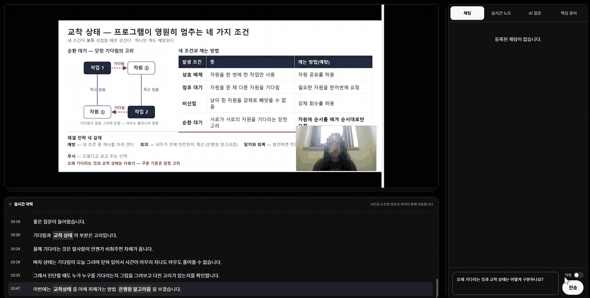
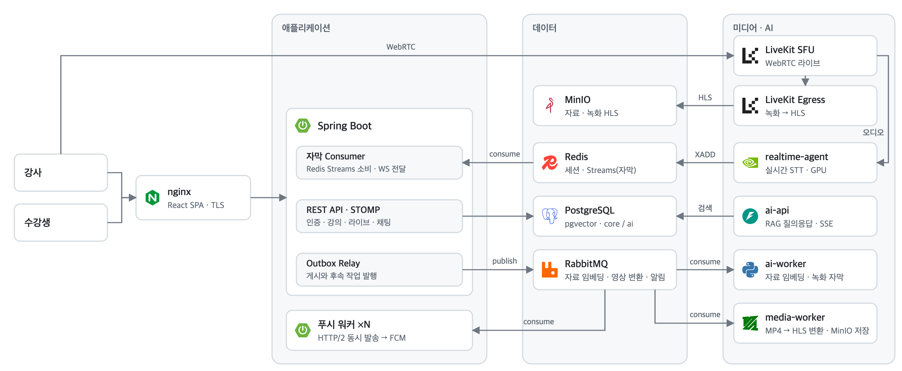

# 집현전

실시간 라이브 강의 플랫폼입니다. 강의를 실시간으로 보면서 지나간 구간을 다시 보고, 실시간 자막과 핵심 용어, 강의 자료를 근거로 한 AI 질의응답을 함께 제공합니다.

<sub>SSAFY 2학기 공통 프로젝트 · 6인(Backend 2, Frontend 2, AI 2) · 2026.07 ~ 2026.08 · 우수상(3등)</sub>



## 주요 기능

- **라이브 강의**: WebRTC 기반 실시간 강의, 강사 판서, 실시간 채팅
- **구간 다시보기**: 라이브 시청 중 지나간 구간을 다시 재생
- **실시간 자막**: 강의 음성을 STT로 자막화해 전달, 자막 시간을 누르면 해당 시점으로 이동
- **핵심 용어**: 강의 자료에서 미리 추출한 용어가 언급되면 설명과 자료를 바로 표시
- **AI 질의응답**: 강의 자료와 자막을 근거로 질문에 답변
- **녹화 다시보기**: 끝난 강의를 HLS로 녹화해 자막, 용어, 질의응답과 함께 재생
- **알림**: 강의 자료 게시, 라이브 일정, 수강 신청 결과를 알림함과 웹 푸시로 발송

## 아키텍처

<picture>
  <source media="(prefers-color-scheme: dark)" srcset="docs/assets/architecture-map-dark.png">
  
</picture>

- **Spring Boot**: 인증, 강의·커리큘럼, 라이브 세션, 채팅(STOMP), 알림, 녹화 제어를 맡는 모듈러 모놀리스
- **AI 서비스(Python)**: realtime-agent(라이브 STT), ai-api(RAG 질의응답, SSE), ai-worker(자료 파싱, 임베딩)
- **미디어**: LiveKit SFU 자체 호스팅, Egress로 녹화해 HLS로 저장
- **메시징**: 실시간 자막은 Redis Streams, 자료 임베딩·녹화 자막 생성·영상 변환·알림 발송은 RabbitMQ

자세한 구조는 [docs/ARCHITECTURE.md](docs/ARCHITECTURE.md), 운영 인프라 전체는 [인프라 다이어그램](docs/architecture/infrastructure-diagram/liveclass-infrastructure.png)에 있습니다.

## 기술 스택

| 구분 | 기술 |
| ---- | ---- |
| Frontend | React 19, TypeScript, Vite, TanStack Query, LiveKit client |
| Backend | Java 21, Spring Boot 4.1, Spring Data JPA, Spring Security, Spring Modulith |
| AI | Python, FastAPI, RabbitMQ worker, NVIDIA Nemotron STT, BGE-M3 임베딩 |
| Database | PostgreSQL, pgvector |
| Cache·Queue | Redis(세션, Streams), RabbitMQ |
| Media | LiveKit(SFU, Egress), MinIO, nginx |
| Infra | Docker Compose, Prometheus, Grafana |

## 디렉터리 구조

```
jiphyeonjeon/
├── backend/        # Spring Boot
├── frontend/       # React + TypeScript
├── ai/             # Python AI 서비스
├── media-worker/   # 녹화강의 MP4 → HLS 변환
├── infra/          # LiveKit, nginx, Postgres, Prometheus 설정
├── bench/          # 알림 팬아웃·발송 부하 측정 환경
├── scripts/        # 개발·배포 보조 스크립트
└── docs/           # 아키텍처, API 계약, ADR, 측정 기록
```

## 실행

```bash
cp .env.example .env
docker compose up -d        # Postgres, Redis, RabbitMQ, MinIO, worker
npm run install:all
npm run dev                 # 프론트 :8083, 백엔드 :8080
```

라이브 강의와 녹화는 LiveKit 서버가 따로 필요합니다. 설정은 [infra/livekit/](infra/livekit/), 실행 방법 전체는 [RUN.md](RUN.md)에 있습니다.

## 문서

| 문서 | 내용 |
| ---- | ---- |
| [docs/ARCHITECTURE.md](docs/ARCHITECTURE.md) | 아키텍처, 데이터 흐름, 도메인 |
| [docs/CONTRACT.md](docs/CONTRACT.md) | 프론트와 백엔드, 백엔드와 AI 사이 API 계약 |
| [docs/api/](docs/api/) | REST API 레퍼런스 |
| [docs/decisions/](docs/decisions/) | 기술 결정 기록(ADR), 작성자별 폴더 |
| [docs/benchmark/](docs/benchmark/README.md) | 알림 100만 건 발송 부하 측정 |

이 저장소는 2026-11-09부로 유지보수를 종료했습니다.
