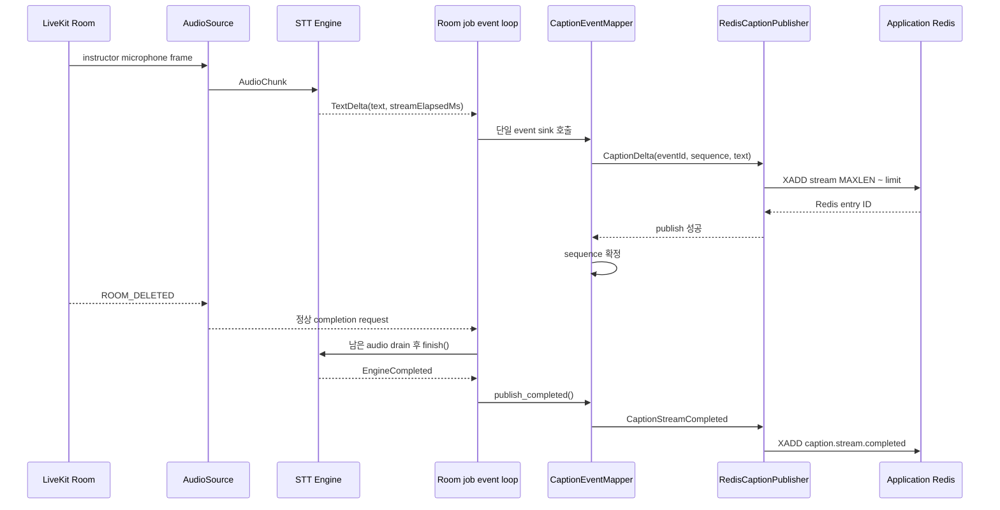

# realtime-agent STT → Redis 구조

이 문서는 `realtime-agent`가 LiveKit 강사 microphone을 받아 실시간 STT 결과를 application Redis에
발행하는 런타임 구조를 설명한다. payload 상세 정본은 [CONTRACT.md](CONTRACT.md), 전체 시스템
아키텍처 정본은 [`docs/ARCHITECTURE.md`](../../docs/ARCHITECTURE.md)다.

## 전체 구조도

```mermaid
flowchart LR
    Dispatch[Spring Backend<br/>또는 운영 dispatch script] -->|named AgentDispatch| LiveKit[LiveKit Server]

    subgraph Agent[realtime-agent]
        AgentServer[LiveKit AgentServer]
        Validate[metadata와 Room binding 검증]
        Lease[RedisSessionLease]

        subgraph Job[Room job child process]
            Source[LiveKitInstructorAudioSource]
            Engine[StreamingSttEngine<br/>Nemotron / vLLM Whisper / OpenAI / stub]
            Events[단일 engine event consumer]
            Mapper[CaptionEventMapper]
            Publisher[RedisCaptionPublisher]
        end

        AgentServer -->|job assignment| Validate
        Validate --> Lease
        Lease --> Source
        Source -->|AudioChunk| Engine
        Engine -->|TextDelta| Events
        Events --> Mapper
        Mapper -->|CaptionDelta| Publisher
    end

    VllmRuntime[vLLM Whisper model owner<br/>GPU0 127.0.0.1:18083]:::external
    Engine -->|provider 선택 시 VAD WAV segment| VllmRuntime

    AgentServer -->|persistent authenticated WebSocket| LiveKit
    LiveKit -->|Room microphone track| Source
    Lease -->|SET NX EX / renew / release| Redis[(Application Redis)]
    Publisher -->|XADD MAXLEN ~| Stream[(Redis Stream<br/>ai:captions:live)]
    Stream --- Redis
    Stream -->|consumer group ai-rag-live-v1| ApiConsumer[ai-api consumer<br/>구현됨]
    Stream -->|consumer group spring-caption-live-v1| SpringConsumer[Spring consumer<br/>구현됨]

    classDef external fill:#fff4dd,stroke:#b26a00
```

`realtime-agent`는 FastAPI 애플리케이션이 아니다. LiveKit job은 HTTP endpoint로 받지 않고 agent가
`LIVEKIT_URL`에 먼저 만든 persistent WebSocket을 통해 받는다. 별도 loopback health server가
`GET /health/live`와 `GET /health/ready`를 제공하며, LiveKit SDK의 HTTP server는 임의 port를
사용한다. 이 health 경로는 STT 결과 전달이나 job dispatch 경로가 아니다.

## 한 job의 데이터 흐름

`EngineWarning`은 자막으로 발행하지 않는다. `CaptionEventMapper`는 `engine.events()`를 새로 읽지 않고
room job이 소유한 단일 event consumer의 sink로만 동작한다. 따라서 한 STT stream을 여러 소비자가
나눠 읽지 않는다.

## Redis 사용 경계

| 용도 | key | 명령/형식 | 비고 |
|---|---|---|---|
| 자막 이벤트 | `CAPTION_STREAM_KEY` (기본 `ai:captions:live`) | `XADD MAXLEN ~ CAPTION_STREAM_MAXLEN` | 기본 최대 길이 10,000, 각 write를 timeout 안에서 직접 await |
| session lease | `agent:session:{sessionId}` | `SET NX EX`, owner 비교 renew/release Lua | 같은 session의 중복 job 차단 |

> 아래 started/final 흐름은 AI producer 구현 기준이며 공유 계약은 변경 중이다. 현재 소비자가 채택한
> delta/completed 계약과 구분한다.

자막 Stream에는 네 이벤트가 들어간다.

- `caption.stream.started`: attempt 첫 audio frame 시작의 UTC 앵커
- `caption.delta`: STT text 조각, `sequence`, `streamElapsedMs` 포함
- `caption.segment.final`: VAD가 확정한 발화 본문·실제 음성 프레임 구간·경계 사유
- `caption.stream.completed`: 정상 종료 attempt의 `lastSequence`, 종료 시각, `ROOM_DELETED` 사유 포함

`sequence`는 전역 번호가 아니라 `(sessionId, sttSessionId)`로 식별되는 한 job attempt 안에서 1부터
증가한다. Redis write가 성공한 뒤에만 mapper의 sequence를 확정한다.

## 종료와 실패 규칙

- `ROOM_DELETED`를 받은 경우에만 남은 audio와 STT event를 drain하고
  `caption.stream.completed` 발행을 시작한다.
- lease loss, provider 오류, Redis 오류, cancellation, 예상하지 못한 disconnect에서는 새로운
  completion을 발행하지 않는다.
- Redis timeout은 서버가 `XADD`를 반영한 뒤 응답만 유실한 상태일 수 있다. downstream consumer는
  `eventId`로 중복을 제거하고 `(sessionId, sttSessionId)` 단위로 이벤트를 처리해야 한다.
- application Redis는 LiveKit 내부 Redis와 별개다. 연결 주소는 `REDIS_URL`로 주입한다.

## 코드 위치

| 책임 | 구현 |
|---|---|
| AgentServer 조립과 job 등록 | [`app/main.py`](app/main.py) |
| dispatch/Room/lease 검증 | [`app/jobs/dispatched_room_job.py`](app/jobs/dispatched_room_job.py) |
| audio와 STT event loop | [`app/jobs/room_job.py`](app/jobs/room_job.py) |
| LiveKit microphone 수집 | [`app/livekit/audio_source.py`](app/livekit/audio_source.py) |
| STT engine 계약과 provider | [`app/stt/`](app/stt/README.md) |
| STT event → caption event 변환 | [`app/captions/pipeline.py`](app/captions/pipeline.py) |
| Redis Stream 발행 | [`app/adapters/redis_caption_publisher.py`](app/adapters/redis_caption_publisher.py) |
| Redis session lease | [`app/adapters/redis_session_lease.py`](app/adapters/redis_session_lease.py) |
