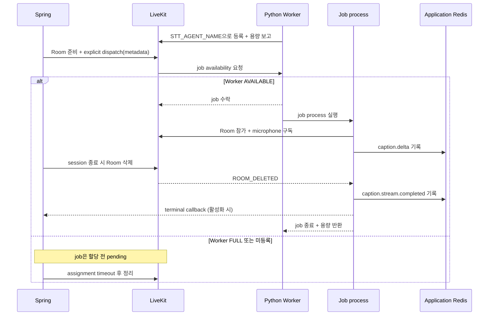

# realtime-agent 상세 계약과 변경 중 후보

이 문서는 realtime-agent의 wire 형식과 AI 런타임 불변식을 Python 테스트로 고정한 상세 계약이다.
Spring이 생산·소비하는 공유 경계의 정본은 [`docs/CONTRACT.md` §3-3~§3-5·§3-8](../../docs/CONTRACT.md#3-내부-계약-확정-인터페이스)이다.

> **변경 상태:** 3절의 `caption.stream.started`·`caption.segment.final`은 AI producer 구현과 Python
> schema/fixture 검증까지 완료된 **후보 계약**이다. 루트 계약과 Spring·ai-api consumer에는 아직 채택되지
> 않았으므로 운영 확정 계약이 아니다. 필드, event type과 `contractVersion`은 양측 합의 과정에서 바뀔 수 있다.

Spring의 named LiveKit AgentDispatch 생성·재사용·삭제와 exact metadata 저장은 구현됐다. 현재 job별
assignment/running readiness는 `live.stt.assume-ready=true`로 우회 중이다. Spring Redis caption consumer는
현재 delta/completed만 처리하고 신규 started/final은 알 수 없는 type으로 폐기한다. live-agent callback
receiver와 realtime-agent health client도 아직 없다.

## 1. Spring → LiveKit → realtime-agent dispatch metadata

LiveKit job metadata는 UTF-8 JSON object이며 최대 4,096 byte다. 필드는 정확히 아래 네 개만
허용하고 duplicate key도 거부한다.

```json
{
  "contractVersion": "1",
  "sessionId": "11111111-1111-4111-8111-111111111111",
  "lessonId": "22222222-2222-4222-8222-222222222222",
  "correlationId": "live-start-01"
}
```

- `sessionId`, `lessonId`: 소문자 canonical UUID 문자열
- `correlationId`: `[A-Za-z0-9][A-Za-z0-9._:-]{0,127}`
- assigned room과 connected room: 모두 정확히 `session-{sessionId}`
- `instructorIdentity`: 포함하지 않는다. 현재 방 권한 불변식상 유일한 remote microphone
  publisher만 선택하고 두 번째 publisher는 fail-closed 처리한다.

metadata와 assigned room 검증은 Redis lease, LiveKit connect, audio source, STT engine보다 먼저
실행한다.

## 2. Agent Worker 흐름

Spring은 dispatch를 만들고, Python은 Worker로 등록해 실제 STT job을 처리한다. 두 서비스는 서로
직접 호출하지 않고 LiveKit을 사이에 둔다.

### 2.1 한눈에 보기



핵심 책임은 다음 네 가지다.

- **Spring:** Room·권한 준비, explicit dispatch, assignment timeout, Room 삭제
- **LiveKit:** 같은 `agentName`의 가용 Worker 선택과 job 단일 배정
- **Python Worker:** 등록·재연결, 용량 보고, job process 실행, Room 참가와 STT
- **공통 계약:** Java의 `agentName`과 Python의 `STT_AGENT_NAME`은 정확히 같아야 한다. dev는 `liveclass-realtime-stt`, prod는 `liveclass-realtime-stt-prod`다.

### 2.2 Worker 등록과 용량

Python `start` command는 설정을 검증한 뒤 `AgentServer`를 LiveKit에 등록하고 persistent WebSocket을
유지한다. 등록은 영구 데이터가 아니며 프로세스가 종료되면 Worker pool에서 사라진다. 재시작은
systemd, container restart policy 또는 orchestrator가 담당한다.

Worker load는 다음 식으로 계산한다.

```text
load = activeJobs / STT_MAX_ACTIVE_JOBS
load >= 1.0 이면 FULL
```

현재 Nemotron은 model sharing 대신 job child마다 독립 model을 소유하며 한 H200 worker의
`STT_MAX_ACTIVE_JOBS`를 최대 12까지 허용한다. `STT_NUM_IDLE_PROCESSES`는 active cap과 별개인 warm
process target이고 provider 기본값은 12다. Nemotron의 active 설정이 없으면 provider 기본값 12를
사용한다. LiveKit Agents 1.6.6은 active job이 아직 0인 동시 availability 요청의 예약 크기를 idle
수로 계산하므로 12-request burst를 받으려면 idle도 12여야 한다. SDK reserved slot도 load에 포함해
12개 한도를 초과해 수락하지 않는다. 13번째 이후 요청은 기존 job을 중단하지 않고 pending으로 둔다.

같은 **환경 안에서** `STT_AGENT_NAME`이 같은 Worker가 여러 개면 LiveKit이 가용 Worker에 분배한다. dev와 prod는 이름을 공유하면 안 된다. 공유하면 prod dispatch가 dev Redis에 연결된 Worker로 배정될 수 있다. 모든 Worker가 FULL
이거나 없으면 job은 pending 상태로 남는다. LiveKit은 GPU EC2를 자동 확장하지 않으며 pending 순서와
대기 SLA도 보장하지 않으므로 Java가 assignment timeout을 정해야 한다.

### 2.3 session별 job 상세 흐름

1. Spring이 `session-{sessionId}` Room과 instructor 한 명의 microphone publish 권한을 준비한다.
2. 같은 `agentName`과 1절 metadata로 explicit dispatch를 생성하고 dispatch ID를 저장한다.
3. LiveKit이 가용 Worker에 job을 배정하면 SDK가 격리된 job process를 실행한다.
4. Python은 metadata·Room 이름을 검증하고 Redis session lease를 얻는다. 실패하면 Room과 STT를
   시작하지 않는다.
5. job은 `JobContext.connect()`로 해당 Room에 한 번 참가하고 유일한 remote microphone만 구독한다.
6. audio → STT → caption 결과를 Redis에 기록하고, callback이 활성화됐다면 상태를 Spring에 보낸다.
7. Spring이 Room을 삭제하면 job은 `ROOM_DELETED`를 정상 EOF로 처리하고 drain·completion·cleanup을
   마친다. Worker는 종료하지 않고 다음 job을 기다린다.

### 2.4 예외 흐름

| 상황 | 결과 | Java 처리 |
| --- | --- | --- |
| 다른 Worker가 가용 | LiveKit이 그 Worker에 배정 | Worker 주소를 직접 선택하지 않는다. |
| 모든 Worker가 FULL/미등록 | job이 pending | timeout 후 capacity failure 처리 및 Room/dispatch 정리 |
| 같은 session의 dispatch 중복 | 서로 다른 job 생성 가능, Python lease는 한 개만 허용 | dispatch ID 저장·재사용으로 중복 생성을 막는다. |
| Worker/job 종료 | job 실패 또는 재배정 가능 | job 상태와 `sttSessionId`별 결과를 조정한다. |
| Room 정상 삭제 | completion 후 Worker 용량 반환 | 이를 정상 stop 신호로 사용한다. |

### 2.5 Java 구현 상태

구현된 Phase 4a 경계:

- Java `agentName`과 Python `STT_AGENT_NAME`을 환경별 같은 설정으로 관리한다(dev `liveclass-realtime-stt`, prod `liveclass-realtime-stt-prod`).
- Python과 같은 네 필드·순서의 metadata를 직렬화한다.
- 같은 room·agent·metadata dispatch를 조회·재사용하고, 없으면 생성한다.
- dispatch ID와 exact metadata를 start attempt에 저장하고 시작 실패 시 dispatch를 삭제한다.

남은 경계:

1. dispatch 생성 뒤 job assignment/running을 bounded polling 또는 상태 event로 확인한다.
2. assignment timeout, capacity failure, 사용자 취소와 Room/dispatch 정리를 실제 job 상태까지 포함해
   멱등하게 처리한다.
3. Redis와 callback을 `(sessionId, sttSessionId)` attempt 단위로 소비하고 event ID 중복을 제거한다.
4. realtime-agent health client와 Worker 수·load, active/pending job, assignment 시간, GPU 메모리 관측을
   연결한다.
5. AVAILABLE, FULL, Worker 미등록, 중복 dispatch, Worker crash, Room 삭제를 E2E로 검증한다.

### 2.6 service health

별도 Python health server는 host로 `127.0.0.1`만 허용하고 port는 `1~65535` 범위로 설정할 수 있다. 배포 기본은 prod `8081`, dev `8082`다.
`GET /health/live`는 server가 응답 가능하면 200이다. `GET /health/ready`는 설정된 모든 child의
provider prewarm, AgentServer 시작과 현재 LiveKit 연결이 확인되면 200 `status=ready`, 아니면
503 `status=notReady`를 반환한다.

readiness body에는 provider, expected/ready process 수, worker 시작과 LiveKit 연결 여부가 포함된다.
expected process 수는 active job 수가 아니라 resolved idle process 수다. Redis, session lease, room
audio, engine queue와 dispatch capacity는 검사하지 않으므로 job별 `STT_READY`를 대체하지 않는다.
`GET /`는 기존 smoke 호환용 plain `OK`이고 `GET /worker`는 prod `:8081`과 dev `:8082`에서 제공하지 않는다.

공유 상태코드와 body는 [`docs/CONTRACT.md` §3-8](../../docs/CONTRACT.md#3-8-gpu-realtime-agent-service-health-http--ai-구현됨-spring-consumer-미구현), JSON 정본은 [health schema](contracts/schemas/realtime-agent-health.schema.json)를 따른다.


## 3. realtime-agent → application Redis caption stream — 후보 계약 변경 중

> AI 런타임은 아래 네 이벤트를 발행하도록 구현됐다. 공유 소비 계약은 아직 delta/completed 2종이며,
> started/final의 채택·버전·롤아웃 순서는 Spring·ai-api 오너와 확정해야 한다. 소비자 반영 전에는 신규
> 이벤트가 ACK 후 폐기되므로 발화별 렌더링과 정확 시간축은 end-to-end로 활성화되지 않는다.

- Redis URL: `REDIS_URL`로 주입한다. dev는 password Redis tunnel `127.0.0.1:4000`, prod는 prod Redis tunnel `127.0.0.1:6390`을 사용한다. LiveKit 내부 Redis나 host `6380`을 전제로 하지 않는다.
- stream key: `CAPTION_STREAM_KEY`, 기본값 `ai:captions:live`
- write: 각 `XADD`를 직접 await하고 제한 시간 안에 응답하지 않거나 실패하면 job을 실패시킨다.
- retention: 모든 `XADD`에 `MAXLEN ~ CAPTION_STREAM_MAXLEN`을 적용하며 기본값은 10,000 엔트리다.
  값은 양의 정수만 허용해 무제한 누적 설정을 막는다. 근사 trimming이므로 실제 길이는 일시적으로
  기준보다 조금 클 수 있고, 이는 바이트 상한이나 Redis 전체 `maxmemory` 설정이 아니다.
- 모든 정수 필드: 부호 없는 최대 18자리 십진 문자열

`caption.stream.started` fields:

```json
{
  "contractVersion": "1",
  "eventId": "22222222-2222-4222-8222-222222222222",
  "type": "caption.stream.started",
  "sessionId": "11111111-1111-4111-8111-111111111111",
  "lessonId": "22222222-2222-4222-8222-222222222222",
  "sttSessionId": "provider-session-01",
  "audioStartedAt": "2026-07-27T00:00:00.000Z",
  "occurredAt": "2026-07-27T00:00:00.001Z"
}
```

`caption.delta` fields:

```json
{
  "contractVersion": "1",
  "eventId": "33333333-3333-4333-8333-333333333333",
  "type": "caption.delta",
  "sessionId": "11111111-1111-4111-8111-111111111111",
  "lessonId": "22222222-2222-4222-8222-222222222222",
  "sttSessionId": "provider-session-01",
  "sequence": "1",
  "streamElapsedMs": "1200",
  "text": "안녕하세요",
  "occurredAt": "2026-07-27T00:00:01.200Z"
}
```

`caption.segment.final` fields:

```json
{
  "contractVersion": "1",
  "eventId": "33333333-3333-4333-8333-333333333334",
  "type": "caption.segment.final",
  "sessionId": "11111111-1111-4111-8111-111111111111",
  "lessonId": "22222222-2222-4222-8222-222222222222",
  "sttSessionId": "provider-session-01",
  "segmentIndex": "0",
  "lastSequence": "1",
  "text": "안녕하세요",
  "startStreamElapsedMs": "200",
  "endStreamElapsedMs": "1200",
  "boundaryReason": "SILENCE",
  "occurredAt": "2026-07-27T00:00:01.210Z"
}
```

`caption.stream.completed` fields:

```json
{
  "contractVersion": "1",
  "eventId": "44444444-4444-4444-8444-444444444444",
  "type": "caption.stream.completed",
  "sessionId": "11111111-1111-4111-8111-111111111111",
  "lessonId": "22222222-2222-4222-8222-222222222222",
  "sttSessionId": "provider-session-01",
  "lastSequence": "1",
  "streamElapsedMs": "1200",
  "reason": "ROOM_DELETED",
  "occurredAt": "2026-07-27T00:00:02.000Z"
}
```

AI producer가 현재 구현한 attempt 순서는 started 1회, delta와 segment.final 반복, completion 1회다. `sequence`와
`lastSequence` 범위는 `(sessionId, sttSessionId)`이고 `segmentIndex`는 0부터 증가한다. 각 retry는 새
`sttSessionId`에서 시작하므로 consumer는 sessionId만으로 합치면 안 된다. sequence는 publish 성공 뒤에만
commit한다. final의 `lastSequence` 이하 delta는 같은 발화의 미리보기이며 final text가 권위 있다.

`audioStartedAt`은 첫 audio frame 시작, 즉 `streamElapsedMs=0`의 UTC다. segment start/end는 VAD가
관측한 실제 speech frame 구간이며 pre-roll/trailing silence를 제외한다. 제안하는 Spring 변환은 raw 값을
보존한 뒤 `audioStartedAt - clockOriginAt + streamElapsedMs`로 세션-ms를 계산하는 방식이다. 이 공식과
fallback 정책은 아직 미확정이며, 채택 시 GPU와 Spring host의 NTP 동기가 전제다.

completion은 LiveKit `ROOM_DELETED`를 명시적으로 받아 남은 audio와 engine event를 정상 drain한
뒤에만 새로 발행을 시도한다. 다른 disconnect, cancellation, lease loss, provider 오류에서는 새
completion 발행을 시작하지 않는다.

Redis write는 at-least-once 전달 경계다. client timeout이나 lease loss가 in-flight `XADD`와
경쟁하면 Redis commit 뒤 응답만 잃었을 수 있으므로 결과는 **unknown**이다. producer cancellation은
"절대 기록되지 않았다"는 보장이 아니다. consumer는 `eventId`로 중복을 제거하고,
`(sessionId, sttSessionId)` attempt 단위로 상태를 접어야 한다. 이 ambiguity를 제거하려면 Java 채택
MR에서 owner fencing과 idempotency record를 같은 Redis 원자 연산으로 합의해야 한다.

completion `XADD`를 시작한 시점부터 remote 결과는 성공 또는 unknown인 terminal 구간이다. 이
구간에서는 `FAILED` callback을 새로 만들지 않는다. 성공 응답을 받으면 해당 attempt의 확정적인
point-of-no-return이며, 그 뒤 `SUCCEEDED` callback 구간에서 cancellation이나 lease loss가 발생하면
callback이 누락될 수는 있어도 이미 닫힌 caption stream을 반대 terminal로 뒤집지 않는다.

## 4. realtime-agent → Spring lifecycle callback

기본값은 `SPRING_STATUS_CALLBACK_ENABLED=false`다. Spring 수신 endpoint를 구현하기 전에는 켜지
않는다. 활성화하려면 HTTP(S) callback URL과 최소 32 byte secret을 모두 주입해야 하며 운영
네트워크에서는 HTTPS를 사용한다.

요청 body는 compact UTF-8 JSON이며 다음 필드를 사용한다.

```json
{
  "contractVersion": "1",
  "eventId": "55555555-5555-4555-8555-555555555555",
  "eventType": "LIVE_AGENT_STATUS",
  "sessionId": "11111111-1111-4111-8111-111111111111",
  "lessonId": "22222222-2222-4222-8222-222222222222",
  "jobId": "livekit-job-01",
  "state": "STT_STARTED",
  "occurredAt": "2026-07-27T00:00:00.500Z"
}
```

상태는 `ROOM_CONNECTED`, `STT_STARTED`, `AUDIO_STARTED`, `STOPPING`, `SUCCEEDED`, `FAILED`다.
`FAILED`만 `{code,message,retryable}` 형태의 `error`를 필수로 가지며 다른 상태에는 error를 넣지
않는다.

요청 headers:

- `Idempotency-Key: {eventId}`
- `X-Correlation-Id: {dispatch correlationId}`
- `X-LiveClass-Timestamp: {Unix seconds}`
- `X-LiveClass-Signature: v1={lowercase hex HMAC-SHA256}`

서명 입력은 `ASCII(timestamp) + "." + rawBody`다. 한 report의 bounded retry는 event ID,
timestamp, raw body와 signature를 전부 동일하게 재사용한다. terminal 상태를 준비한 뒤 반대
terminal 상태를 새 event로 만들지 않는다. nonterminal callback은 작은 시간 budget 안의
best-effort라 STT/audio loop를 장시간 막지 않고, terminal callback 오류는 호출자에게 전파한다.
HTTP timeout도 server가 처리한 뒤 응답만 유실된 상태일 수 있으므로 consumer는 `Idempotency-Key`를
멱등하게 처리해야 한다.

현재 Java의 material callback URL·DTO·base64 `X-Signature`와 호환되지 않는다. 운영 URL은 코드에
고정하지 않고 `SPRING_STATUS_CALLBACK_URL`로만 받는다.

## 5. session lease와 종료

내부 lease key는 `agent:session:{sessionId}`이며 value는 LiveKit job ID다. `SET NX EX`로 획득하고
Lua compare-and-expire/delete로 owner만 갱신·해제한다. lease를 얻지 못하면 audio source와 STT
engine을 시작하지 않는다. **lease를 얻지 못한 중복 job은 lifecycle callback도 발행하지 않는다.**
active owner와 같은 `sessionId`를 가진 거절 job이 `FAILED`를 보내 현재 세션 상태를 덮는 일을 막기
위함이다. acquire·renew·release Redis 연산은 bounded timeout을 사용한다. 실행 중 ownership 상실이나
renewal timeout은 owner job 실패이며 감지 뒤 신규 caption publish를 시작하지 않는다. 이미 in-flight인
Redis write 결과는 위 at-least-once 규칙에 따라 unknown일 수 있다.

LiveKit Agents 1.6.6은 room disconnect 뒤 약 15초가 지나면 user entrypoint를 취소한다. 따라서
`ROOM_DELETED` 수신 순간부터 기본 12초(설정 상한 13초)의 하나의 absolute deadline을 시작하고,
audio/event drain, engine/source cleanup, completion write, terminal callback, lease/report cleanup이 모두
그 남은 budget을 공유한다. 개별 timeout을 단순 합산해 SDK의 15초를 넘기지 않는다.

별도 Python stop HTTP API나 Redis stop command는 두지 않는다. 정상 종료 입력은 Spring이 이미
수행하는 LiveKit room 삭제이며, Python은 `ROOM_DELETED`만 정상 EOF로 분류한다. 다른 disconnect는
실패다.

## 6. Java 연동 완료 전 필수 gate

1. Phase 4a dispatch 이후 job assignment/running readiness gate와 timeout·capacity 처리를 구현한다.
2. metadata schema/fixture의 Java serializer와 양쪽 계약 테스트를 유지한다.
3. Redis key, consumer group, 세션 종료 후 정리, event enum, `contractVersion`, timeout 결과의
   멱등/fencing과 session clock 변환을 확정하고 Spring consumer를 구현한다.
4. callback URL, HMAC 방식, event ID 멱등성과 terminal first-wins를 확정하고 Spring receiver를 구현한다.
5. realtime-agent health client를 연결한다.
6. available/full/unregistered Worker와 LiveKit·Redis·Spring 정상·실패 E2E를 별도 실행하고
   실제 Java 연동 결과를 계약 테스트로 고정한다.
