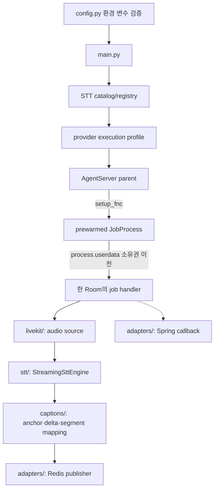

# realtime-agent application

## 역할

LiveKit job을 받아 실시간 오디오를 STT로 변환하고 자막과 상태를 외부로 전달하는 프로세스의 조립 지점이다.

## 구조와 흐름

`main.py`가 설정을 읽어 선택한 STT provider의 실행 profile로 `AgentServer`와 job handler를 등록한다.
provider의 선택적 process resource는 LiveKit child setup에서 준비하고, handler는 `jobs/`의 생명주기를
중심으로 `livekit/` 오디오 입력, `stt/` 엔진, `captions/` 파이프라인, `adapters/` 외부 통신을 연결한다.
`health.py`는 child prewarm marker와 AgentServer 연결 상태를 모아 service-level liveness/readiness를
loopback HTTP로 제공한다.

`AgentServer` parent는 provider catalog와 worker load만 소유하고 CUDA model을 만들지 않는다. Nemotron
resource는 각 child의 `setup_fnc`에서 미리 만들고 `process.userdata`를 통해 정확히 한 engine으로
이전한다. vLLM Whisper child resource는 CUDA model이 아니라 loopback runtime 설정이며 exact model
alias probe가 성공한 뒤 이전한다. OpenAI와 stub은 process resource 없이 같은 job 조립 경로를 사용한다.

## 외부 통신 경계

- `AgentServer` ↔ LiveKit: Worker 등록, load 보고, job 배정용 persistent WebSocket
- `LiveKitInstructorAudioSource` ↔ LiveKit Room: WebRTC 참가, microphone 구독, Room lifecycle
- `RedisSessionLease`·`RedisCaptionPublisher` → application Redis: lease Lua와 자막 started/delta/final/completed `XADD`
- `SpringStatusCallback` → Spring: 선택적인 HTTP(S) HMAC callback
- `OpenAiRealtimeStreamingEngine` → OpenAI: provider가 선택된 경우에만 outbound WebSocket
- `VllmWhisperStreamingEngine` → GPU0 vLLM: provider가 선택된 경우에만 loopback HTTP

`main.py`는 위 통신을 조립하지만 payload를 새로 정의하지 않는다. 세부 wire format은 각 하위 README와
[`../CONTRACT.md`](../CONTRACT.md)가 소유한다.
started/final wire는 루트 계약에 채택됐다(ADR-0052·0053). 소비자별 처리와 상세는
[`../CONTRACT.md` 3절](../CONTRACT.md)을 따른다.

## 파일 구성

- `main.py`: `dev`·`start` 실행 진입점과 LiveKit worker 등록
- `config.py`: 환경 변수 검증과 실행 설정
- `health.py`: loopback health HTTP와 child model readiness 집계
- `jobs/`: dispatch metadata 검증과 room job 생명주기
- `livekit/`, `audio/`, `stt/`, `captions/`: 오디오에서 자막까지의 처리 단계
- `adapters/`, `contracts/`: Redis·HTTP 통신과 payload 모델

## 경계와 불변식

이 디렉터리는 실행을 조립하되 전송 형식을 임의로 만들지 않는다. AI-side 후보 통신 규격은
[`../CONTRACT.md`](../CONTRACT.md)와 [`../contracts/`](../contracts/README.md)를 따른다.

## 검증

`tests/test_main.py`, `tests/test_config.py`, 각 하위 모듈 테스트로 조립과 설정 경계를 검증한다.
