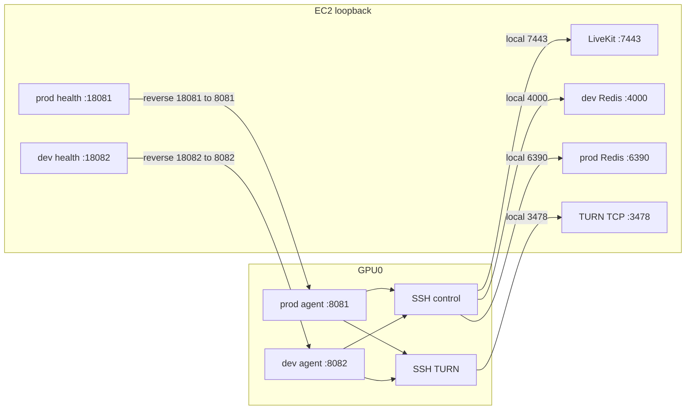

# GPU realtime-agent rootless 배포

GPU 호스트는 sudo 권한이 없고 Jupyter service에 `NoNewPrivileges=yes`가 적용돼 있다. GitLab Runner,
SSH tunnel, realtime-agent는 모두 `liveclass` 사용자 영역에서 실행한다. 한 물리 GPU0에서 prod와 dev
worker를 별도 tmux session으로 동시에 유지하며 LiveKit agent name, Redis, health port를 분리한다.

| 환경 | env file | tmux session | `STT_AGENT_NAME` | Redis | GPU health | EC2 health | 기본 용량 |
|---|---|---|---|---|---|---|---:|
| prod | `~/.config/liveclass/realtime-agent.env` | `liveclass-realtime-agent-prod` | `liveclass-realtime-stt-prod` | `127.0.0.1:6390`, 무인증 | `127.0.0.1:8081` | `127.0.0.1:18081` | 12 |
| dev | `~/.config/liveclass/realtime-agent-dev.env` | `liveclass-realtime-agent-dev` | `liveclass-realtime-stt` | `127.0.0.1:4000`, requirepass | `127.0.0.1:8082` | `127.0.0.1:18082` | 1 |

두 worker가 같은 name을 쓰면 LiveKit이 prod dispatch를 dev Redis worker에 배정할 수 있으므로 이름을
합치지 않는다. prod Spring은 `LIVEKIT_AGENT_NAME=liveclass-realtime-stt-prod`, dev Spring은 기존
기본값 `liveclass-realtime-stt`를 사용한다. GPU host 또는 Jupyter service가 재시작되면 사용자 process도
종료되므로 Runner와 supervisor를 다시 시작해야 한다.

## 1. 사용자 영역 bootstrap

Python 환경은 프로젝트 표준인 Python 3.12와 uv를 사용한다.

~~~sh
cd /home/liveclass/liveclass
ai/realtime-agent/deploy/install.sh /opt/tljh/user/bin/uv
ai/realtime-agent/deploy/install-gitlab-runner-user.sh latest
ai/bge-runtime/deploy/install.sh /opt/tljh/user/bin/uv
~~~

첫 명령은 실행파일을 `~/.local/bin`, release/cache를
`~/.local/share/liveclass/realtime-agent`, 환경파일을 `~/.config/liveclass`에 설치한다. 기존 환경파일은
덮어쓰지 않는다. 다음 세 파일을 실제 값으로 채우고 `0600`을 유지한다.

- `realtime-agent.env`: prod worker
- `realtime-agent-dev.env`: dev worker
- `realtime-agent-tunnels.env`: 공용 LiveKit/TURN, dev/prod Redis·health SSH forward

~~~sh
chmod 600 ~/.config/liveclass/realtime-agent*.env
~~~

두 agent env의 `LIVEKIT_URL`은 인증서 hostname을 유지하고 `LIVEKIT_TUNNEL_HOST`에 같은 hostname을
넣는다. source-controlled resolver가 그 hostname만 GPU loopback으로 해석한다. 두 env 모두
`CUDA_VISIBLE_DEVICES=0`과 같은 외부 model 절대경로를 사용한다. 검증된 prod 12-slot 용량을 유지하면서
추가 dev worker가 GPU 상한을 침범하지 않도록 dev는 active/idle을 `1/1`로 제한한다.

운영 tunnel bootstrap은 전달받은 PEM을 Git 밖의 `~/.config/liveclass/ssh/`로 복사하고 realtime-agent와
BGE tunnel env를 만든다. EC2 host key는 별도 채널로 확인해 `known_hosts`에 먼저 등록한다.

~~~sh
ai/realtime-agent/deploy/configure-gpu-ec2-tunnels.sh \
  /absolute/path/to/gpu-to-ec2.pem \
  <ec2-user>@<ec2-host> \
  --start
~~~

## 2. GPU project Runner 등록

GitLab project Runner는 tag `gpu-realtime`, project lock, protected branch 전용, untagged job 비활성,
동시 실행 수 1로 등록한다. authentication token은 파일·로그·문서에 남기지 않는다.

~~~sh
~/.local/bin/gitlab-runner register \
  --config ~/.gitlab-runner/config.toml \
  --url <gitlab-url> \
  --token <runner-authentication-token> \
  --executor shell
~/.local/bin/liveclass-gitlab-runner-user start
~~~

Runner와 최초 GPU 배포가 정상임을 확인한 뒤 protected CI 변수 `GPU_DEPLOY_ENABLED=1`을 설정한다.
GPU Runner는 GitLab와 EC2로 outbound 연결만 사용하며 GPU inbound port를 열지 않는다.

## 3. 배포와 rollback

~~~sh
~/.local/bin/liveclass-realtime-agent-deploy \
  "$PWD/ai/realtime-agent" "$(git rev-parse HEAD)"
~/.local/bin/liveclass-realtime-agent-supervisor status
curl --fail http://127.0.0.1:8081/health/ready
curl --fail http://127.0.0.1:8082/health/ready
~~~

배포 helper는 commit SHA별 release 생성, frozen Nemotron sync, CUDA smoke, current symlink 교체 후 기존
단일 agent session을 종료하고 prod/dev 두 session을 재시작한다. 두 readiness가 모두 성공해야 배포를
완료하며 하나라도 실패하면 두 신규 session을 정리하고 이전 release로 rollback한다. 시크릿, SSH key,
model checkpoint는 release에 복사하지 않는다.

GitLab `deploy-realtime-agent` job도 같은 helper를 현재 사용자로 호출한다. active 강의의 drain은
지원하지 않으므로 배포 시 두 worker job이 끊길 수 있다.

## 4. 연결 구조와 상태 확인

realtime control과 TURN은 서로 다른 SSH TCP connection이다. BGE도 전용 supervisor와 세 번째
connection에서 `EC2 18020 → GPU 8020`을 유지한다. 모두 GPU에서 EC2 22번으로 시작하므로 GPU inbound와
EC2 application 방화벽 포트를 추가하지 않는다.

`LIVEKIT_URL`은 TLS 인증서 hostname을 유지하되 배포 resolver가 그 hostname만 GPU loopback으로 해석한다.
prod는 `redis://127.0.0.1:6390/0`, dev는 password를 포함한 `redis://...@127.0.0.1:4000/0`을 사용하며
LiveKit 내부 Redis `6379`는 사용하지 않는다. OpenAI provider의 WSS는 tunnel과 별도인 outbound TLS 연결이고
`OPENAI_API_KEY`는 각 agent 환경파일로만 주입한다.

~~~sh
~/.local/bin/liveclass-realtime-agent-supervisor status
~/.local/bin/liveclass-realtime-agent-supervisor logs-agent-prod
~/.local/bin/liveclass-realtime-agent-supervisor logs-agent-dev
~/.local/bin/liveclass-realtime-agent-supervisor logs-tunnel
ss -ltn | grep -E ':(3478|4000|6390|7443|8081|8082)\b'
~~~

EC2 host에서는 prod `18081`, dev `18082`를 확인한다. host-network gpu-proxy를 수동 재배포하면 container
내부에서는 prod `/internal/realtime-agent/`, dev `/internal/realtime-agent-dev/` prefix를 사용할 수 있다.
두 reverse port는 계속 EC2 loopback에만 bind한다.

~~~sh
curl --fail http://127.0.0.1:18081/health/ready
curl --fail http://127.0.0.1:18082/health/ready
~~~

기존 SSH control master에 한 Redis forward만 있더라도 새 tunnel script가 누락된 `4000` 또는 `6390`
forward와 dev health reverse를 `ssh -O forward`로 추가한다. control 장애는 TURN을 종료하지 않고 TURN
장애도 LiveKit·Redis·health를 종료하지 않는다.

수동 tunnel helper의 입력과 검증은 [`../scripts/README.md`](../scripts/README.md), 전체 운영 절차는
[`../../../docs/ai/GPU-REALTIME-AGENT-RUNBOOK.md`](../../../docs/ai/GPU-REALTIME-AGENT-RUNBOOK.md)를 따른다.
