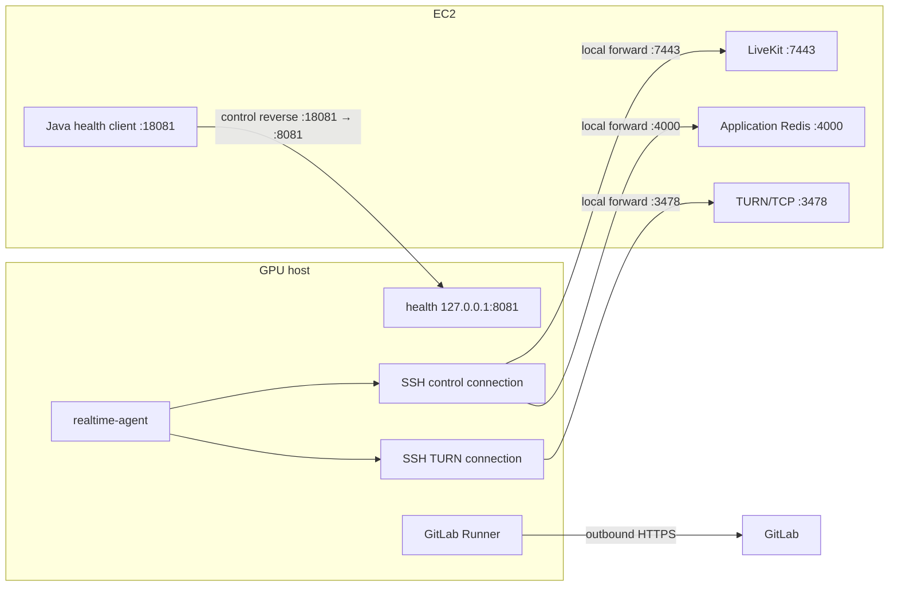

# GPU realtime-agent rootless 배포

GPU 호스트는 sudo 권한이 없고 Jupyter service에 NoNewPrivileges=yes가 적용돼 있다. 따라서
GitLab Runner, SSH tunnel, realtime-agent를 모두 liveclass 계정으로 실행한다. LiveKit Worker
등록은 agent process의 authenticated WebSocket 연결 상태이므로 agent가 시작되면 같은
STT_AGENT_NAME으로 자동 등록된다.

이 방식은 브라우저나 terminal 연결이 끊겨도 tmux session으로 계속 실행된다. 단, GPU host 또는
Jupyter service가 재시작되면 사용자 process도 종료되므로 아래의 Runner 시작 명령을 한 번 다시
실행해야 한다. 현재 권한에서는 boot-time 자동 시작을 설정할 수 없다.

## 1. 사용자 영역 bootstrap

Python 환경은 Conda가 아니라 프로젝트 표준인 Python 3.12와 uv를 사용한다.

~~~sh
cd /home/liveclass/liveclass
ai/realtime-agent/deploy/install.sh /opt/tljh/user/bin/uv
ai/realtime-agent/deploy/install-gitlab-runner-user.sh latest
ai/bge-runtime/deploy/install.sh /opt/tljh/user/bin/uv
~~~

첫 명령은 아래 항목만 사용자 홈에 설치한다.

- 실행 파일: ~/.local/bin
- agent release/cache: ~/.local/share/liveclass/realtime-agent
- 환경파일: ~/.config/liveclass/realtime-agent*.env
- TLS hostname loopback resolver: ~/.local/lib/liveclass/livekit-tunnel-dns.so

설치 스크립트는 기존 환경파일을 덮어쓰지 않는다. 두 환경파일을 실제 값으로 수정하고 권한을
0600으로 유지한다.

~~~sh
chmod 600 ~/.config/liveclass/realtime-agent*.env
~~~

운영 GPU↔EC2 터널은 개발자 로컬 tunnel과 구분해 공용 bootstrap으로 설정한다. 전달받은 PEM은
저장소에 두고 계속 참조하지 않고 `~/.config/liveclass/ssh/`로 복사하며, realtime-agent와 BGE가 같은
EC2 target을 사용하도록 두 tunnel env를 함께 생성한다.

~~~sh
ai/realtime-agent/deploy/configure-gpu-ec2-tunnels.sh \
  /absolute/path/to/gpu-to-ec2.pem \
  <ec2-user>@<ec2-host> \
  --start
~~~

EC2 host key는 실행 전에 별도 채널로 확인해 `~/.ssh/known_hosts`에 등록한다. PEM과 생성된 env는
모두 Git 밖에 있고 권한은 `0600`이다.

realtime-agent.env의 LIVEKIT_URL에는 인증서 hostname을 유지하고 LIVEKIT_TUNNEL_HOST에는 그
hostname만 넣는다. root 권한으로 /etc/hosts를 바꿀 수 없으므로 source-controlled resolver가 해당
hostname만 127.0.0.1로 해석한다.

한 GPU만 쓰는 profile은 CUDA_VISIBLE_DEVICES=0, STT_MAX_ACTIVE_JOBS=12,
STT_NUM_IDLE_PROCESSES=12를 사용한다. 모델은 Git 밖의 기존 절대경로를 ASR_MODEL_ID로 지정한다.

## 2. GPU project Runner 등록

GitLab 프로젝트에서 새 project Runner를 만든다.

- tag: gpu-realtime
- project에 lock
- protected branch만 허용
- untagged job 실행 금지
- 동시 실행 수 1

GitLab 화면에 한 번 표시되는 Runner authentication token은 파일·로그·문서에 남기지 않는다.
사용자 모드로 등록한다.

~~~sh
~/.local/bin/gitlab-runner register \
  --config ~/.gitlab-runner/config.toml \
  --url <gitlab-url> \
  --token <runner-authentication-token> \
  --executor shell
~~~

등록 후 Runner를 tmux에서 시작한다.

~~~sh
~/.local/bin/liveclass-gitlab-runner-user start
~/.local/bin/liveclass-gitlab-runner-user status
~~~

Runner와 최초 GPU 배포가 정상임을 확인한 뒤 protected CI 변수 GPU_DEPLOY_ENABLED=1을 설정한다.
GPU Runner는 GitLab와 EC2로 outbound 연결만 사용하며 GPU inbound port를 열지 않는다.

## 3. 최초 배포와 pipeline

Runner를 활성화하기 전 현재 checkout으로 최초 배포를 검증할 수 있다.

~~~sh
~/.local/bin/liveclass-realtime-agent-deploy \
  "$PWD/ai/realtime-agent" "$(git rev-parse HEAD)"
~/.local/bin/liveclass-realtime-agent-supervisor status
curl --fail http://127.0.0.1:8081/health/live
curl --fail http://127.0.0.1:8081/health/ready
~~~

배포 helper는 commit SHA별 staging 복사, frozen Nemotron sync, CUDA smoke, current symlink 교체,
tunnel·agent 재시작, 120초 model init ceiling을 포함하는 readiness 확인 순서로 동작한다. 실패하면
이전 release로 rollback한다.
GitLab job도 같은 helper를 현재 사용자로 직접 호출하며 sudo, systemctl, Docker executor는 사용하지
않는다. 시크릿, SSH key, model checkpoint는 release에 복사하지 않는다.

## 4. 연결과 상태 확인

GPU 호스트는 외부에서 inbound port를 열지 않는다. 사용자 영역 SSH client가 EC2 22번에 두 개의
realtime-agent 연결을 만든다. control connection은 LiveKit·Redis local forward와 health reverse를,
TURN connection은 미디어 local forward만 담당한다. 별도 BGE supervisor도 같은 PEM/target으로 세 번째
SSH connection을 열어 EC2 `127.0.0.1:18020` reverse forward를 유지한다. 세 연결은 목적지가 같아도
서로 다른 ControlPath와 TCP connection을 사용한다.

| 연결 | 방향 | GPU 측 | EC2 측 | 용도 |
|---|---|---|---|---|
| control | local | 127.0.0.1:7443 | 127.0.0.1:7443 | LiveKit |
| control | local | 127.0.0.1:4000 | 127.0.0.1:4000 | application Redis |
| TURN | local | 127.0.0.1:3478 | 127.0.0.1:3478 | TURN/TCP |
| control | reverse | GPU 127.0.0.1:8081 | EC2 127.0.0.1:18081 | Java health check |

EC2 host smoke는 `http://127.0.0.1:18081/health/live`로 process 생존을,
`http://127.0.0.1:18081/health/ready`로 STT warm pool과 LiveKit 연결 완료를 확인한다. Docker backend는
host loopback에 직접 닿을 수 없으므로 `LIVE_STT_HEALTH_BASE_URL`에 설정된 LiveKit nginx의
`/internal/realtime-agent/` 경로를 사용한다. 이 경로는 Docker private subnet과 host만 허용하며
18081 자체는 계속 EC2 loopback에만 bind된다. readiness는 준비 전 503, 준비 뒤 200이다.

`LIVEKIT_URL`은 TLS 인증서 hostname을 유지하되 배포 resolver가 그 hostname만 GPU loopback으로
해석한다. 따라서 TLS SNI/hostname 검증을 버리지 않고 `127.0.0.1:7443` SSH tunnel을 사용한다.
`REDIS_URL`과 TURN도 GPU loopback listener를 가리킨다. OpenAI provider로 전환하는 경우 OpenAI WSS는
이 SSH tunnel을 거치지 않는 별도 outbound TLS 연결이며 `OPENAI_API_KEY`를 agent 환경파일로 주입해야
한다.

~~~sh
~/.local/bin/liveclass-realtime-agent-supervisor status
~/.local/bin/liveclass-realtime-agent-supervisor logs-agent
~/.local/bin/liveclass-realtime-agent-supervisor logs-tunnel
~/.local/bin/liveclass-gitlab-runner-user logs
curl --fail http://127.0.0.1:8081/health/live
curl --fail http://127.0.0.1:8081/health/ready
~~~

- Runner가 offline이면 GPU job은 pending 상태이며 EC2 Runner가 대신 실행하지 않는다.
- tunnel 또는 agent가 비정상 종료하면 tmux supervisor loop가 다시 시작한다.
- control SSH 장애는 TURN SSH를 종료하지 않고, TURN SSH 장애도 LiveKit·Redis·health를 종료하지 않는다.
- active 강의 중 배포는 기존 process의 drain을 기다리지 않고 tmux session을 교체한다.
- GPU/Jupyter 재시작 후에는 ~/.local/bin/liveclass-gitlab-runner-user start를 다시 실행한다.

수동 tunnel helper의 입력·port 변경과 검증 방법은 [`../scripts/README.md`](../scripts/README.md)를
참고한다.
