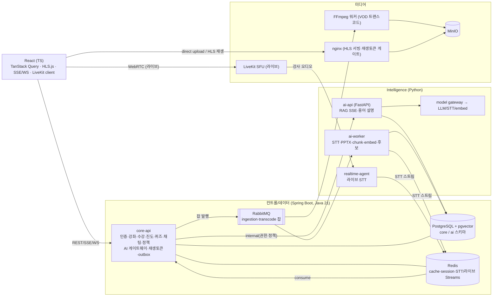
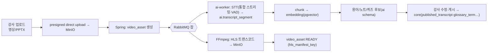
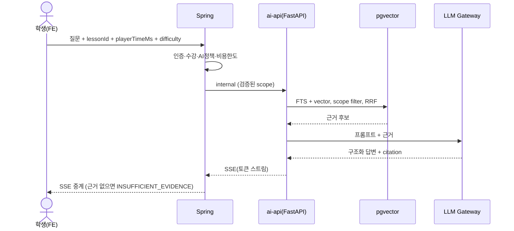
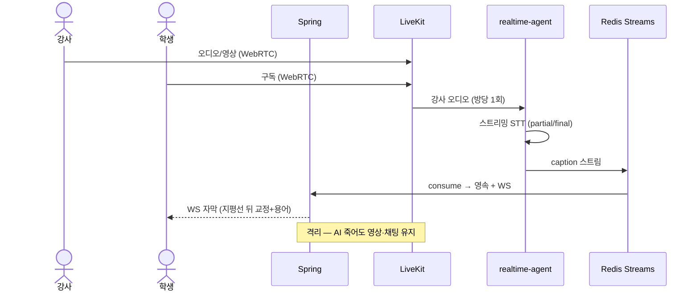

# LiveClass AI — 아키텍처 (확정판)

> 📍 하네스 개요: [harness/README.md](harness/README.md) · 정본 규칙: [../AGENTS.md](../AGENTS.md) · 로드맵: [CP-ROADMAP.md](CP-ROADMAP.md)
>
> LiveClass AI의 **확정 아키텍처 기준선**. 결정 근거는 [decisions/](decisions/) ADR, 세부 계약은 [CONTRACT.md](CONTRACT.md)에 둔다. 팀 기획서(v3.0)를 항목별로 검토해 반영/조정한 결과다. 결정 변경 시 이 문서와 해당 ADR을 함께 갱신한다.

## 제품 한 줄
**VOD 학습 플랫폼**(강좌·커리큘럼·영상·자막·자료 근거 RAG·퀴즈)을 코어로 하고, 동일 도메인 위에 **실시간 WebRTC 강의**를 결합한 온라인 강의 플랫폼.

> 기존 부트캠프 PJT 명세서·스켈레톤은 **참고용**, 본 기획으로 제로베이스 재설계([decisions/0003](decisions/0003-greenfield-redesign.md)). VOD가 코어지만 **실시간 WebRTC는 필수 목표**(P2로 미루지 않음). RAG류는 구조 우선·고도화는 별도.

## 확정 스택

| 컴포넌트 | 스택 | 근거 ADR |
|---|---|---|
| Front-end | **React 19 + TypeScript** (FE/BE 분리, TanStack Query, SSE/WS) | [0002](decisions/0002-react-typescript-frontend.md) |
| 컨트롤/데이터 | **Spring Boot 3.4/3.5 + Java 21**(virtual threads), JPA, JWT | [0006](decisions/0006-backend-spring-plus-python-ai.md)·[0009](decisions/0009-java21-spring-boot-3.md) |
| AI (3서비스) | **ai-api(FastAPI, SSE)** + **ai-worker(RabbitMQ)** + **realtime-agent(LiveKit)** | [0011](decisions/0011-ai-three-services.md) |
| DB | **PostgreSQL + pgvector** (core/ai 스키마 분리) | [0005](decisions/0005-db-postgres-pgvector.md) |
| 캐시·fast path | **Redis** (cache/session/rate-limit + STT·라이브 자막 Streams) | [0008](decisions/0008-ai-bus-redis-streams-session-clock.md)·[0012](decisions/0012-hybrid-queue.md) |
| 잡 큐 | **RabbitMQ** (ingestion·트랜스코드 등 durable 배치) | [0012](decisions/0012-hybrid-queue.md) |
| 미디어 VOD | **MinIO + FFmpeg 워커 + nginx**(self-host HLS) | [0010](decisions/0010-self-host-vod.md) |
| 미디어 라이브 | **LiveKit self-host (SFU)** | [0004](decisions/0004-media-livekit-selfhost.md) |
| LLM | 외부 API → model gateway(추후 로컬) | — |

- 배포: 모듈러 모놀리스(Spring 단일 배포) + 폴리글랏 모노레포. FE dev 8083 / Spring 8080.

## 핵심 원칙 (플레인 분리)
1. **React는 Spring으로만** 업무·AI 요청. Python AI는 외부 비노출(권한·정책·비용을 Spring이 검증).
2. **Spring(core) / Python(ai) 스키마 공동수정 금지** — 한 클러스터, 스키마·계정 분리.
3. **긴 작업은 RabbitMQ 잡**, HTTP 요청에서 처리 안 함. Redis는 durable 큐로 쓰지 않음(cache/session/fast-path만).
4. **영상 바이트는 Spring/Python을 통과하지 않음** — direct upload + nginx/CDN signed 재생.
5. **AI 결과는 후보** — 자막·용어·노트·퀴즈는 원본(ai) 보존 + 강사 수정·게시본(core) 분리.
6. **AI 장애가 코어(검색·재생·수강·채팅)를 막지 않음**(degraded).

## 컴포넌트 다이어그램

## AI 데이터플로우

### 1) VOD ingestion (업로드 → AI Ready)

- 잡은 **idempotency key + outbox**로 유실·중복 방지, 실패는 **DLQ**.
- STT는 VOD·라이브 **공유 스트리밍 로직**(VAD로 자르고 overlap → 전문용어 recall 보호).

### 2) RAG 질문 (현재 재생 맥락)

### 3) 라이브 (실시간 자막)

## 도메인 모델 (core / ai 스키마)
근거: [decisions/0007](decisions/0007-domain-live-session.md)·[0005](decisions/0005-db-postgres-pgvector.md)

**`core` (Spring 쓰기, 공식)**: `user`(role enum) · `course`→`curriculum_section`→`lesson` · `video_asset`(+`video_rendition`)·`material_asset` · `enrollment`·`learning_progress`·`bookmark` · `published_transcript`·`glossary_term` · `quiz`·`quiz_question`·`quiz_attempt` · `chat_message` · `live_session` · `outbox_events`

**`ai` (Python 쓰기, 후보/원본)**: `source_document` · `transcript_segment`(원본 STT) · `document_chunk`·`chunk_embedding` · `glossary_candidate`·`transcript_note`·`quiz_candidate` · `ai_question`·`ai_answer` · `model_run`·`job_run`

- **2계층**: 원본(ai, 보존·RAG·타임스탬프) → 강사 수정 → 게시본(core, 학생 노출).
- **시간축**: 세션 상대 ms — 자막·HLS·되감기 정렬.
- **보류**: org/멀티테넌트·roles테이블·audit_logs·learning_events·question_clusters (스코프 밖, 나중).

## VOD 재생 인증 (defer + seam)
데모는 무인증 nginx 패스스루. 나중 드롭인용 seam 3개 유지: ① 재생 URL은 Spring 발급(`GET /lessons/{id}/playback`) ② nginx를 처음부터 경로에 ③ `PlaybackTokenService` no-op 인터페이스. → 나중에 nginx secure_link/서명만 켜면 됨. [decisions/0010](decisions/0010-self-host-vod.md)

## 신뢰성 / 장애
- **outbox + idempotency + DLQ + correlation_id**(React→Spring→AI→Worker 추적).
- **degraded**: LLM/STT/embedding 장애 시 자막·보강만 중단, 코어(재생·수강·채팅) 유지. AI 전체 장애 시 Spring circuit open.

## 데모 체크포인트 / 로드맵
증분 CP·착수 순서·의존성·역할은 [CP-ROADMAP.md](CP-ROADMAP.md). 안전 데모 지점은 **VOD 용어·근거(제품 핵심)** 와 **라이브 미디어**.

## 열린 항목 (구현 직전 상세)
- Spring↔RabbitMQ 잡 envelope·callback 스키마, Redis Streams STT 메시지 스키마 → [CONTRACT.md](CONTRACT.md)
- 세션시계 변환 기준(LiveKit/미디어 타임스탬프 → 세션 t)
- 한국어 STT 공급자 bake-off, 임베딩 모델, RAG 평가 게이트 (고도화)
- LiveKit/nginx/FFmpeg self-host Docker Compose 구성
