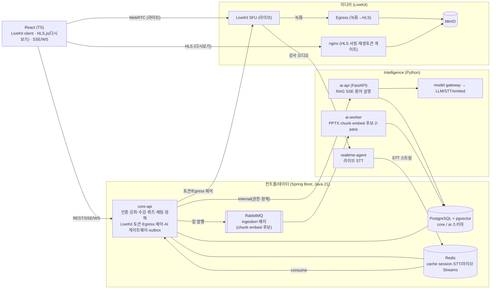
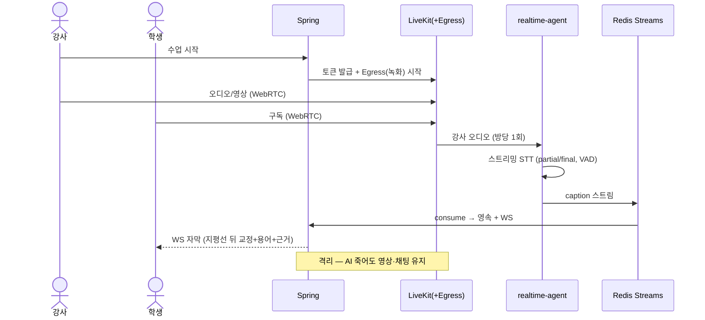
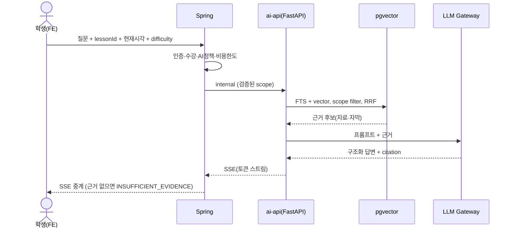
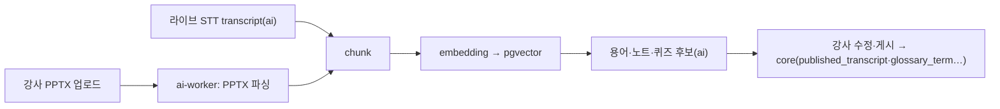
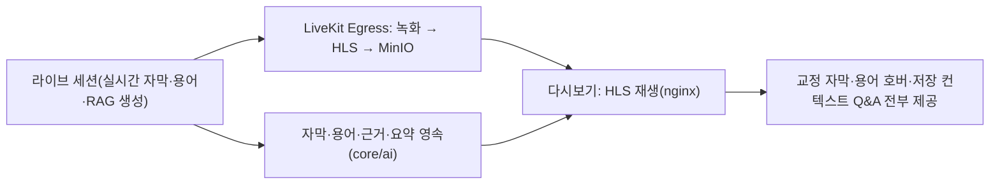

# LiveClass AI — 아키텍처 (확정판)

> 📍 하네스 개요: [harness/README.md](harness/README.md) · 정본 규칙: [../AGENTS.md](../AGENTS.md) · 로드맵: [CP-ROADMAP.md](CP-ROADMAP.md)
>
> LiveClass AI의 **확정 아키텍처 기준선**. 결정 근거는 [decisions/](decisions/) ADR, 세부 계약은 [CONTRACT.md](CONTRACT.md)에 둔다. 결정 변경 시 이 문서와 해당 ADR을 함께 갱신한다.

## 제품 한 줄
**실시간 라이브 강의 플랫폼** — 강사가 WebRTC로 라이브 강의, 실시간 **자막·용어·자료 근거 RAG** 제공. 지난 강의는 **녹화 다시보기**(지평선 넘어 교정된 자막·용어·RAG 전체 제공). **영상 업로드는 없음**(콘텐츠는 전부 라이브+녹화); 자료 PPTX만 업로드.

> 기존 부트캠프 PJT 명세·스켈레톤은 **참고용**, 본 기획으로 제로베이스 재설계([decisions/0003](decisions/0003-greenfield-redesign.md)). **완전 라이브 지향** — 업로드 강의 미지원, VOD는 라이브 녹화(Egress)에서만 나온다([decisions/0010](decisions/0010-self-host-vod.md)). RAG류는 구조 우선·고도화는 별도.

## 확정 스택

| 컴포넌트 | 스택 | 근거 ADR |
|---|---|---|
| Front-end | **React 19 + TypeScript** (FE/BE 분리, TanStack Query, SSE/WS) | [0002](decisions/0002-react-typescript-frontend.md) |
| 컨트롤/데이터 | **Spring Boot 4.1 + Java 21**(virtual threads), JPA, Security | [0006](decisions/0006-backend-spring-plus-python-ai.md)·[0009](decisions/0009-java21-spring-boot-3.md) |
| 인증 | **HttpOnly 쿠키 + Redis 세션**(엣지) · 내부 S2S=단명 JWT · 미디어=LiveKit JWT | [0014](decisions/0014-auth-redis-session-cookie.md) |
| AI (3서비스) | **realtime-agent(LiveKit, 라이브 STT)** + **ai-api(FastAPI, RAG SSE)** + **ai-worker(RabbitMQ, chunk·embed·후보)** | [0011](decisions/0011-ai-three-services.md) |
| DB | **PostgreSQL + pgvector** (core/ai 스키마 분리) | [0005](decisions/0005-db-postgres-pgvector.md) |
| 캐시·fast path | **Redis** (cache/session/rate-limit + STT·라이브 자막 Streams) | [0008](decisions/0008-ai-bus-redis-streams-session-clock.md)·[0012](decisions/0012-hybrid-queue.md) |
| 잡 큐 | **RabbitMQ** (ingestion: PPTX 파싱·chunk·embed·후보·2-pass 교정) | [0012](decisions/0012-hybrid-queue.md) |
| 미디어 | **LiveKit self-host(SFU) + Egress(녹화→HLS) + MinIO + nginx** | [0004](decisions/0004-media-livekit-selfhost.md)·[0010](decisions/0010-self-host-vod.md) |
| LLM | 외부 API → model gateway(추후 로컬) | — |

- 배포: 모듈러 모놀리스(Spring 단일 배포) + 폴리글랏 모노레포. FE dev 8083 / Spring 8080.

## 핵심 원칙 (플레인 분리)
1. **React는 Spring으로만** 업무·AI 요청. Python AI는 외부 비노출(권한·정책·비용을 Spring이 검증).
2. **Spring(core) / Python(ai) 스키마 공동수정 금지** — 한 클러스터, 스키마·계정 분리.
3. **긴 작업은 RabbitMQ 잡**, HTTP 요청에서 처리 안 함. Redis는 durable 큐로 쓰지 않음(cache/session/fast-path만).
4. **미디어 바이트는 Spring/Python을 통과하지 않음** — 라이브는 WebRTC로 LiveKit 직접, 다시보기 HLS는 nginx 직접. (영상 업로드 없음; 자료 PPTX만 업로드)
5. **AI 결과는 후보** — 자막·용어·노트·퀴즈는 원본(ai) 보존 + 강사 수정·게시본(core) 분리.
6. **AI 장애가 코어(라이브 영상·채팅·수강·다시보기)를 막지 않음**(degraded). LiveKit/Egress 미디어 경로는 AI와 격리.

## 컴포넌트 다이어그램

## 데이터플로우

### 1) 라이브 강의 (실시간 자막) — 코어

### 2) RAG 질문 (현재 강의 맥락)

### 3) RAG ingestion (라이브 자막 + 자료 → 후보)

- 잡은 **idempotency + outbox**로 유실·중복 방지, 실패는 **DLQ**. STT는 라이브 스트리밍(VAD, overlap → 전문용어 recall).

### 4) 녹화 → 다시보기 (지평선 넘음 = 전체 기능)

- 다시보기는 **라이브 때 만든 산출물을 그대로 재생** — 지평선 뒤라 교정 완료본. 세션 상대 ms 좌표로 HLS·자막 자동 정렬.

## 도메인 모델 (core / ai 스키마)
근거: [decisions/0007](decisions/0007-domain-live-session.md)·[0005](decisions/0005-db-postgres-pgvector.md)

**`core` (Spring 쓰기, 공식)**: `user`(role enum) · `course`→`curriculum_section`→`lesson` · `live_session`(lesson의 라이브 인스턴스) · `video_asset`(Egress 녹화 HLS)·`material_asset`(PPTX) · `enrollment`·`learning_progress`·`bookmark` · `published_transcript`·`glossary_term` · `quiz`·`quiz_question`·`quiz_attempt` · `chat_message` · `outbox_events`

**`ai` (Python 쓰기, 후보/원본)**: `transcript_segment`(원본 STT) · `document_chunk`·`chunk_embedding` · `glossary_candidate`·`transcript_note`·`quiz_candidate` · `ai_question`·`ai_answer` · `model_run`·`job_run`

- `lesson`은 **라이브로 진행**되고, 끝나면 그 **녹화(video_asset=Egress HLS)** 가 다시보기 소스. 영상 업로드 없음(자료 PPTX만).
- **2계층**: 원본(ai, 보존·RAG·타임스탬프) → 강사 수정 → 게시본(core, 학생 노출).
- **시간축**: 세션 상대 ms — 자막·HLS·다시보기 정렬.
- **보류**: org/멀티테넌트·roles테이블·audit_logs·learning_events·question_clusters.

## 다시보기 재생 인증 (defer + seam)
데모는 무인증 nginx 패스스루. 나중 드롭인용 seam 3개: ① 재생 URL은 Spring 발급(`GET /lessons/{id}/playback`) ② nginx를 처음부터 경로에 ③ `PlaybackTokenService` no-op. → 나중에 nginx secure_link/서명만 켜면 됨. [decisions/0010](decisions/0010-self-host-vod.md)

## 신뢰성 / 장애
- **outbox + idempotency + DLQ + correlation_id**(React→Spring→AI→Worker 추적).
- **degraded**: LLM/STT/embedding 장애 시 자막·보강만 중단, 코어(라이브 영상·채팅·다시보기) 유지. AI 전체 장애 시 Spring circuit open. **미디어 경로(LiveKit/Egress)는 AI와 무관하게 생존.**

## 데모 체크포인트 / 로드맵
증분 CP·착수 순서·의존성·역할은 [CP-ROADMAP.md](CP-ROADMAP.md). 라이브가 토대라 **미니멀 라이브(화상+채팅)** 를 첫 데모로, 그 위에 자막→RAG→다시보기.

## 열린 항목 (구현 직전 상세)
- Spring↔RabbitMQ 잡 envelope·callback, Redis Streams STT 메시지 스키마 → [CONTRACT.md](CONTRACT.md)
- 세션시계 변환 기준(LiveKit 트랙 타임스탬프 → 세션 t)
- 한국어 STT 공급자 bake-off, 임베딩 모델, RAG 평가 게이트(고도화)
- LiveKit·Egress·TURN·nginx self-host Docker Compose 구성
