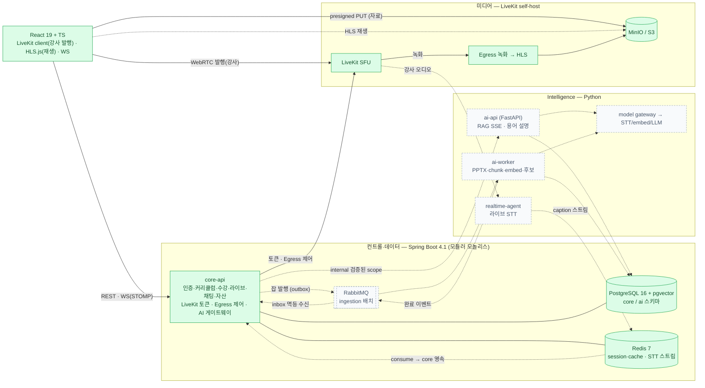
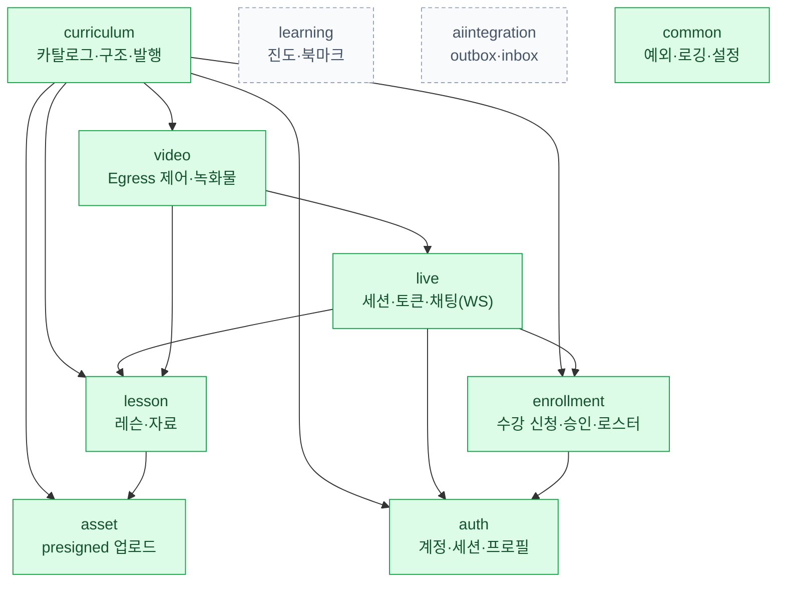
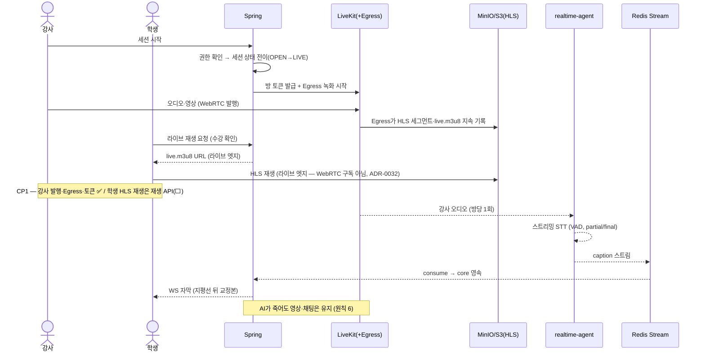
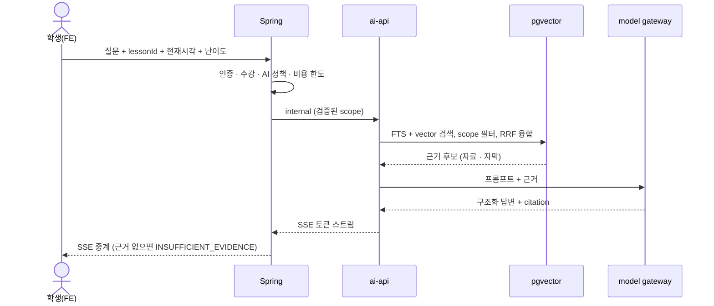
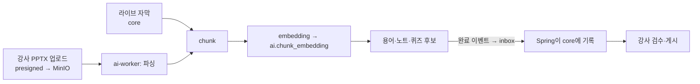
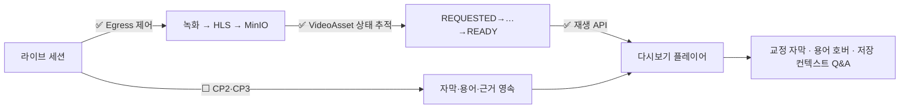
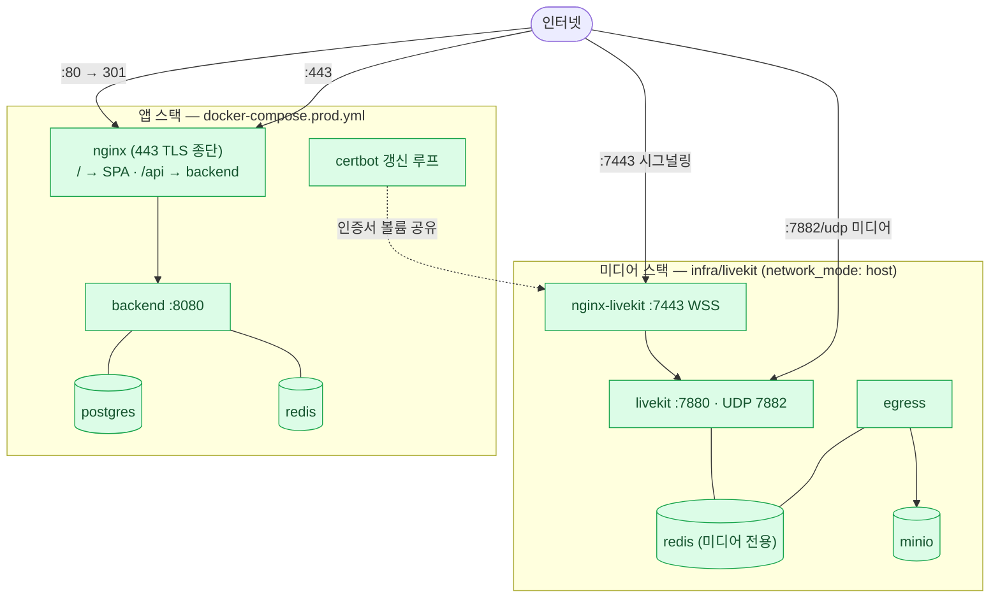

# LiveClass AI — 아키텍처

> 📍 하네스 개요: [harness/README.md](harness/README.md) · 정본 규칙: [../AGENTS.md](../AGENTS.md) · 로드맵: [CP-ROADMAP.md](CP-ROADMAP.md) · 계약: [CONTRACT.md](CONTRACT.md)
>
> LiveClass AI의 **아키텍처 기준선**. 지어진 부분은 **구현 기준**으로 서술하고, 아직 안 지어진 부분은 **설계 의도로 명시**한다.
> 결정 근거는 [decisions/](decisions/) ADR에 있고, 결정이 바뀌면 이 문서와 해당 ADR을 함께 갱신한다.

**범례** — 이 문서 전체에서 사용:

| 표기 | 뜻 |
|---|---|
| ✅ | 구현·동작 확인됨 |
| 🟡 | 일부만 구현 (뒤에 남은 부분 명시) |
| ⬜ | 미착수 — 설계 의도 |

---

## 1. 제품 한 줄

**실시간 라이브 강의 플랫폼** — 강사가 WebRTC로 라이브 강의를 하고, 실시간 **자막·용어·자료 근거 RAG**를 제공한다.
지난 강의는 **녹화 다시보기**로, 교정된 자막·용어·RAG를 전부 제공한다.

**영상 업로드는 없다.** 콘텐츠는 전부 라이브와 그 녹화에서 나오고, 업로드는 강의자료(PPTX)뿐이다.
([ADR-0003](decisions/songjeongki/0003-greenfield-redesign.md) 제로베이스 재설계 · [ADR-0010](decisions/songjeongki/0010-self-host-vod.md) VOD=녹화 산출물)

---

## 2. 확정 스택

| 컴포넌트 | 스택 | 상태 | 근거 ADR |
|---|---|---|---|
| Front-end | React 19 + TypeScript, TanStack Query 5, Vite | ✅ | [0002](decisions/songjeongki/0002-react-typescript-frontend.md) |
| 컨트롤/데이터 | Spring Boot 4.1 + Java 21, JPA, Security, **Spring Modulith 2.1** | ✅ | [0006](decisions/songjeongki/0006-backend-spring-plus-python-ai.md)·[0009](decisions/songjeongki/0009-java21-spring-boot-3.md) |
| 인증 | HttpOnly 쿠키 + Redis 세션(엣지) · 미디어=LiveKit JWT | ✅ | [0014](decisions/songjeongki/0014-auth-redis-session-cookie.md) |
| DB | PostgreSQL 16 + pgvector, `core`/`ai` 스키마 분리 | 🟡 `core`만 존재 | [0005](decisions/songjeongki/0005-db-postgres-pgvector.md)·[0017](decisions/songjeongki/0017-schema-ownership-core-ai.md) |
| 캐시·세션 | Redis 7 | ✅ | [0014](decisions/songjeongki/0014-auth-redis-session-cookie.md) |
| 실시간 채널 | STOMP over WebSocket | ✅ | [0019](decisions/songjeongki/0019-ws-realtime-chat-stomp.md) |
| 오브젝트 스토리지 | MinIO(S3 호환) + presigned direct upload | ✅ | [0023](decisions/songjeongki/0023-asset-presigned-upload.md) |
| 미디어 | LiveKit self-host(SFU) + Egress(녹화→HLS) | 🟡 서버 상시가동·토큰·Egress 제어·VOD 재생 API ✅ / 라이브 엣지 재생 ⬜ | [0004](decisions/songjeongki/0004-media-livekit-selfhost.md)·[0020](decisions/songjeongki/0020-egress-recording-lifecycle.md)·[0039](decisions/songjeongki/0039-replay-playback-api.md) |
| 라이브 STT | realtime-agent (Python, LiveKit Agents) | ⬜ CP2 | [0011](decisions/songjeongki/0011-ai-three-services.md)·[0013](decisions/songjeongki/0013-unified-streaming-stt.md) |
| RAG API | ai-api (FastAPI, SSE) | ⬜ CP3 | [0011](decisions/songjeongki/0011-ai-three-services.md) |
| 배치 파이프라인 | ai-worker + RabbitMQ | ⬜ CP3 | [0011](decisions/songjeongki/0011-ai-three-services.md)·[0012](decisions/songjeongki/0012-hybrid-queue.md) |
| STT/임베딩/LLM | **외부 API** (model gateway 경유) | ⬜ CP2·CP3 | [0011](decisions/songjeongki/0011-ai-three-services.md) |
| 관측성 | Micrometer Tracing(Brave) + Prometheus 레지스트리 | ✅ 배선 / 익스포터 ⬜ | — |

> **배포 형태**: 모듈러 모놀리스(Spring 단일 배포) + 폴리글랏 모노레포.
> dev는 FE 8083(Vite proxy) → Spring 8080, prod는 nginx 단일 오리진(§7).

---

## 3. 핵심 원칙

1. **React는 Spring으로만** 업무·AI 요청을 보낸다. Python AI는 외부에 노출되지 않는다 — 권한·정책·비용을 Spring이 검증한다.
2. **`core`(Spring) / `ai`(Python) 스키마 공동수정 금지.** 한 클러스터, 스키마·계정·마이그레이션 도구 분리. 소유 기준은 **write-owner**([ADR-0017](decisions/songjeongki/0017-schema-ownership-core-ai.md)).
3. **긴 작업은 큐 잡으로**, HTTP 요청 안에서 처리하지 않는다. Redis는 durable 큐로 쓰지 않는다(cache/session/fast-path 전용).
4. **미디어 바이트는 Spring/Python을 통과하지 않는다.** 강사 발행은 WebRTC로 LiveKit 직결, 학생 시청(라이브·다시보기)은 HLS로 스토리지 직결([ADR-0032](decisions/songjeongki/0032-media-playback-hls-only.md)), 자료 업로드는 presigned로 클라이언트→스토리지 직접 PUT.
5. **AI 결과는 후보다.** 원본은 보존하고, 강사 수정·게시본을 학생에게 노출한다.
   - **예외 — 라이브 자막.** 실시간 자막은 검수 없이 즉시 나간다(그게 실시간의 본질). 검수는 사후에 게시본을 교정하는 형태이고, 승인 게이트는 두지 않는다([ADR-0017](decisions/songjeongki/0017-schema-ownership-core-ai.md)).
6. **AI 장애가 코어를 막지 않는다.** 라이브 영상·채팅·수강·다시보기는 AI와 무관하게 살아 있어야 한다(degraded). LiveKit/Egress 미디어 경로는 AI와 격리한다.

---

## 4. 시스템 구성도



**실선 = 구현됨, 점선 = 설계(CP2~CP4).**
초록 박스 7개가 지금 동작하고, 회색 점선 5개가 앞으로 붙는다.
미디어·자료 바이트가 Spring을 통과하지 않는다는 원칙 4가 화살표에 그대로 드러난다 — `FE→OBJ`, `FE→LK`, `EG→OBJ`는 모두 Spring을 우회한다.

---

## 5. 백엔드 모듈 구조 (구현 기준)

Spring Modulith로 **모듈 경계를 코드로 강제**한다. 이게 이 코드베이스에서 가장 강하게 지켜지는 규칙이다.



**규칙**
- 모듈 간 접근은 **`<module>.api` 패키지(`@NamedInterface("api")`)로만.** 남의 `domain`·`repository`를 직접 부를 수 없다.
- 포트는 읽기/쓰기로 나눈다 — `XxxDirectory`(조회) / `XxxManagement`(변경). 경계를 넘는 값은 전부 record DTO.
- **순환 금지.** `ModularityTests`가 CI에서 검증하므로 위반은 리뷰가 아니라 **빌드 실패**로 잡힌다.
- 포트는 **필요한 모듈만** 만든다. 10개 모듈 중 `.api`를 가진 건 6개(`auth`·`lesson`·`enrollment`·`live`·`video`·`asset`)이고, `curriculum`은 유입 참조가 0이라 포트가 없다.

**이 게이트가 실제로 잡은 것**
- `video → live.config` 결합 — 아무도 의도하지 않은 결합이 드러나 `live/api/LiveKitServerAccess` seam으로 정리
- `CatalogService`가 web DTO를 알던 계층 역전 — 서비스 레벨 record + web `from()` 팩토리로 분리
- `live → curriculum` 순환 차단 → `live_session.curriculum_id` 비정규화(V2). 제약이 없었으면 리포지토리를 그냥 주입했을 것이고, 결과적으로 **조인 없이 수강 게이팅되는 더 빠른 구조**가 됐다

**스캐폴딩 상태 2개**(⬜, [ADR-0024](decisions/songjeongki/0024-orphan-module-scaffolding.md)) — 엔티티·DDL만 있고 배선 없음.
`learning`은 학생 진도 기능과, `aiintegration`은 CP3 AI 파이프라인과 함께 배선한다.

---

## 6. 데이터플로우

### 6-1. 라이브 강의 🟡 (강사 발행·Egress·토큰 ✅ / 학생 HLS 시청 ⬜ 재생 API · 자막 ⬜ CP2)



> **학생은 LiveKit 방에 참가하지 않는다**(HLS 단일 시청, [0032](decisions/songjeongki/0032-media-playback-hls-only.md)) — 참가자 목록 유출 자체가 없다. 예전엔 이를 막으려 `(sessionId, userId)` 해시 identity를 썼고, 가명화는 이제 채팅 계층에서 이어진다.

### 6-2. RAG 질문 ⬜ CP3



**핵심 안전장치**: 근거가 없으면 답을 지어내지 않고 `INSUFFICIENT_EVIDENCE`를 반환한다. 모든 답변에 citation을 붙인다.

### 6-3. RAG ingestion ⬜ CP3



잡은 **idempotency key + outbox**로 유실·중복을 막고, 실패는 **DLQ**로 보낸다.
Python은 `core`에 직접 쓰지 않는다 — 결과는 큐 이벤트로 돌아오고 Spring이 기록한다([ADR-0017](decisions/songjeongki/0017-schema-ownership-core-ai.md)).

### 6-4. 녹화 → 다시보기 🟡 (녹화·재생 API ✅ / 플레이어·자막 연동 ⬜ CP4)



**지금 되는 것**: 세션 종료 이벤트로 Egress를 제어하고, `VideoAsset`이 녹화 수명주기를 추적하며, 카탈로그가 "다시보기 있음"을 표시한다. **재생 API**(`GET /lessons/{id}/playback`, [ADR-0039](decisions/songjeongki/0039-replay-playback-api.md))가 권한 검증 + presigned manifest 재작성 + 시간축 오프셋을 반환하고, **게시 전환**(`POST .../replay-review/publish`)으로 강사가 검수 후 공개한다.
**남은 것**: FE HLS.js 플레이어 연동, 자막·용어·RAG 재생(CP2·CP3 산출물 의존), 검수 데이터 저장([0039](decisions/songjeongki/0039-replay-playback-api.md) §5 범위 제외 근거).

다시보기는 라이브 때 만든 산출물을 **그대로 재생**한다. 지평선 뒤라 이미 교정이 끝난 상태이고, 세션 상대 ms 좌표로 HLS와 자막을 자동 정렬한다.

---

## 7. 도메인 모델

소유 기준은 **write-owner** — 런타임에 그 행을 쓰는 서비스가 소유한다([ADR-0017](decisions/songjeongki/0017-schema-ownership-core-ai.md)).

### `core` — Spring 단독 쓰기

| 영역 | 테이블 | 상태 |
|---|---|---|
| 계정 | `app_user` · `instructor_profile` | ✅ |
| 강좌 | `curriculum` → `section` → `lesson` | ✅ |
| 라이브 | `live_session` | ✅ |
| 수강·학습 | `enrollment` · `learning_progress` · `bookmark` | 🟡 `enrollment`만 배선 |
| 자산 | `asset`(범용) ← `material_asset`(레슨 자료) · `video_asset`(녹화 HLS) | 🟡 `material_asset` 미배선 |
| 채팅 | `chat_message` | ✅ |
| 통합 | `outbox_events` · `external_event_inbox` | ⬜ 스키마만 |
| AI 게시본 | 자막 · 용어 · 챕터 · 퀴즈 | ⬜ CP2+ |

### `ai` — Python 단독 쓰기 ⬜ CP2/CP3에 Alembic이 생성

`document_chunk` · `chunk_embedding`(RAG 인덱스) · `job_run` · `model_run`(실행 메타) — **이 4개뿐**이다.

> ⚠️ 이전 판 문서는 `ai`에 자막 원본·후보·질의응답까지 올려놨었는데, [ADR-0017](decisions/songjeongki/0017-schema-ownership-core-ai.md)이 이를 정리했다.
> **원본 자막의 write-owner는 Spring이다** — realtime-agent는 Redis 스트림에 흘리기만 하고, 영속은 Spring이 한다.
> 따라서 자막은 원본·게시본 모두 `core`에 있고, Python은 chunking을 위해 **읽기만** 한다.

### 구조 규칙

- **FK는 스키마 안에서만.** 스키마를 넘는 참조는 물리 FK 없이 논리 `_ref` 컬럼 + 앱 검증.
- **PK는 UUID/BIGINT 하이브리드**([ADR-0018](decisions/songjeongki/0018-pk-strategy-uuid-bigint-hybrid.md)) — 외부 노출은 UUID, 대량 append-only는 BIGINT.
- **시간축은 세션 상대 ms** — 자막·HLS·다시보기 정렬의 공통 좌표.
- **마이그레이션 주체**: `core` = Flyway(Spring, 현재 V1~V4), `ai` = Alembic(Python). 상대 스키마 수정 금지.
- **보류**: org/멀티테넌트 · roles 테이블 · audit_logs · learning_events · question_clusters.

---

## 8. 배포 토폴로지 ✅

단일 EC2(Ubuntu 24.04, 4vCPU/15GB)에 **두 스택이 독립적으로** 돈다.



**설계 포인트**
- **단일 오리진.** nginx가 SPA와 `/api`를 같은 오리진에서 서빙해 쿠키 세션이 CORS 없이 동작한다. FE의 `baseURL`은 `/api` 상대경로다([ADR-0016](decisions/songjeongki/0016-drop-api-path-versioning.md) 경로 버저닝 제거).
- **DB·Redis는 호스트 포트를 열지 않는다.** 도커 내부 네트워크 전용 + Security Group 차단, 2중 방어.
- **도메인이 하나뿐이고 DNS 콘솔 권한이 없어** 미디어 시그널링을 서브도메인이 아니라 **같은 도메인의 별도 TLS 포트(`:7443`)** 로 분리했다([ADR-0022](decisions/songjeongki/0022-local-vs-ec2-infra-profile.md)). 인증서는 앱 스택 certbot이 단독 발급·갱신하고 미디어 nginx는 볼륨으로 읽기만 한다.
- **미디어 스택은 `network_mode: host`** — SFU가 UDP 포트 범위를 직접 잡아야 해서 도커 NAT를 우회한다.
- 배포는 GitLab CI/CD self-hosted runner가 EC2에서 직접 수행한다.

---

## 9. 미해결 설계 이슈 — 착수 전 결정 필요

미구현 영역을 점검하며 나온 것들이다. 대부분 **CP2 착수 전에 답이 있어야** 한다.

### 9-1. 🔴 "지평선(horizon)"이 정의되지 않았다
제품 설명의 핵심 단어인데 정의가 없다. 라이브 시청자가 보는 시점과 확정본 사이의 지연을 뜻하는데, **몇 초인지·누가 확정하는지**가 없으면 FE는 자막 렌더링 정책을, BE는 영속 시점을 정할 수 없다.
→ **제안**: partial은 즉시 렌더(회색), final은 확정 렌더, 교정·용어·근거는 `t - N초` 뒤 재전송. `N`은 CP2 STT bake-off 결과로 확정하고 설정값으로 뺀다. 다시보기는 정의상 항상 지평선 밖이라 전체 기능이 나간다.

### 9-2. ✅ 해소됨 — 자료→레슨 연결
`POST /instructor/lessons/{lessonId}/materials`로 미리 올린 PPTX 에셋(`kind=MATERIAL`)을 레슨에 연결한다. 본문은 presigned 티켓 방식(`{"assetId":"..."}`, multipart 아님), `material_asset`에 status=ACTIVE로 저장되고 레슨/커리큘럼 상세의 `materials`가 이 레코드로 채워진다. 상세는 [ADR-0035](decisions/songjeongki/0035-lesson-material-attach.md).
커리큘럼-레벨 자료·삭제 API·AI(RAG ingestion) 잡 발행은 CP3으로 유보한다 — 이 연결이 그 입력이 된다.

### 9-3. 🟠 Redis Streams가 원칙 3과 긴장 관계다
원칙 3은 "Redis를 durable 큐로 쓰지 않는다"인데, STT 자막이 Redis Streams를 지난다. Redis가 재시작하면 그 구간 자막의 정본이 없다.
→ **제안**: 자막 fast-path는 **의도적으로 유실 허용**(consumer group + PEL로 at-least-once까지만)하고, 유실 구간은 **CP4 녹화본 2-pass 재처리로 복구**한다. 이러면 원칙 3과 모순되지 않는다 — Redis는 여전히 fast-path이고 정본 복구 경로는 녹화다. 이 문장을 계약에 명시해야 한다.

### 9-4. 🟠 RabbitMQ는 서 있지만 배선은 CP3이다
`dev-infra` compose에 브로커가 떠 있고 관리 UI까지 TLS로 종단돼 있다. 다만 **prod compose에는 없고, backend에 `spring-amqp` 의존성도 설정도 없다** — 즉 인프라만 준비된 상태다.
→ **배선 시점은 CP3으로 잡는다.** CP2 자막 경로는 Redis Streams만으로 충분하고, 실제 배치 잡(PPTX 파싱·embed)은 CP3에서 처음 생긴다. prod에 컨테이너를 얹는 것도 그때다(§9-5).

### 9-5. 🔴 EC2 단일 노드 용량이 CP2부터 빠듯하다
두 스택 합쳐 이미 컨테이너 10여 개가 돌고, Egress는 내부적으로 Chrome을 띄워 **단독 권장 사양이 4vCPU/4GB**다. 여기에 CP2~CP3에서 realtime-agent·ai-api·ai-worker·RabbitMQ가 더 붙는다.
→ **완화 전제를 명시해야 한다**: ① STT·임베딩·LLM은 전부 **외부 API**(로컬 모델 미탑재), ② Egress는 데모 세션에만 기동, ③ 동시 라이브 세션은 데모 규모(1~2개)로 전제. 이 전제가 깨지면 노드 분리가 필요하다.

### 9-6. 🟠 채팅 WS가 수평 확장의 첫 장애물이다
STOMP 브로커가 인메모리 SimpleBroker라 **브로드캐스트가 인스턴스 로컬**이다. backend를 2대로 늘리는 순간 채팅이 인스턴스별로 갈린다.
→ 세션이 Redis에 있어 나머지는 이미 stateless이므로, **수평 확장의 유일한 선행조건이 브로커 교체**다. CP3에서 RabbitMQ를 들일 때 STOMP relay로 함께 전환하는 게 자연스럽다.

### 9-7. 🟡 Python → Spring 역방향 경로가 미확정이다
`external_event_inbox`(멱등 수신)가 스키마에 있는데 **어떤 채널로 오는지**가 정해지지 않았다. ADR-0017은 "이벤트(큐)"라고 했으므로 HTTP 콜백이 아니라 **결과 큐**로 확정하는 게 일관적이다.
→ 구성도에는 `WK → MQ → SP` 역방향 화살표로 반영해 뒀다. 계약(잡 envelope·결과 메시지 스키마)은 CONTRACT.md에 정의 필요.

### 9-8. ✅ 다시보기 재생 인증 — presigned 방식으로 구현됨
이전 판은 "seam 3개(재생 URL 발급 · nginx · PlaybackTokenService)"라고 적었지만, 실제로는 **셋 다 존재하지 않고**, 현재 nginx는 SPA·API 프록시 전용이라 HLS 서빙 경로 자체가 없었다.
→ **구현 완료(2026-07-26, [ADR-0039](decisions/songjeongki/0039-replay-playback-api.md))**: nginx secure_link 대신 이미 쓰던 **presigned 방식으로 통일**했다. `GET /api/lessons/{id}/playback`이 권한을 검증하고(`video.api.LessonPlaybackAccess` SPI, curriculum 구현 — 소유 강사는 항상, 학생은 활성 수강 + PUBLISHED만) **manifest를 Spring이 읽어 세그먼트 URL을 presigned로 재작성**해 응답에 인라인으로 싣는다. manifest는 수 KB라 원칙 4(바이트는 Spring을 통과하지 않음)를 유지하면서 세그먼트는 스토리지 직결이다. S3로 옮겨도 그대로 동작한다.

### 9-9. ✅ 다시보기 시간축 변환 — 온디맨드 계산으로 구현됨
자막 싱크는 전송 경로가 아니라 **공통 좌표계** 문제다. 세그먼트는 스토리지에서 직접 받고 자막은 Spring이 내려주므로, 둘을 맞추려면 *재생 위치 → 세션 상대 ms* 변환이 필요하다.

**조사 결과**(Egress v1.13.0 소스 확인)
- Egress는 **모든 세그먼트에 `EXT-X-PROGRAM-DATE-TIME`을 넣는다.** 옵션으로 끌 수 없고 API에도 관련 필드가 없다.
- 다만 **PDT 델타는 `EXTINF` 누적합과 수학적으로 같다.** 즉 PDT가 추가로 주는 정보는 **첫 세그먼트의 절대 시각(앵커) 하나뿐**이다. 프론트가 PDT를 직접 읽어도 얻는 게 없고, hls.js 종속만 생긴다(Safari 네이티브 재생 경로에는 PDT 접근 API가 없다).
- **`EXT-X-DISCONTINUITY`는 생성하지 않는다.**

**결정 — 단일 오프셋, 앵커는 첫 PDT에서 뽑는다**
```
session_offset_ms = index.m3u8 의 첫 PROGRAM-DATE-TIME − live_session.started_at
자막 위치(ms)      = player.currentTime * 1000 + session_offset_ms
```
서버가 앵커를 한 번 읽어 **숫자 하나로 환산해 내려주고**, 프론트는 그 숫자만 쓴다. 플레이어 선택이 묶이지 않는다.

> ⚠️ **`video_asset.recording_started_at`을 앵커로 쓰면 안 된다.** 지금 값은 `StartEgress` 호출 시각(`RecordingService`)이라, Chrome 기동·페이지 로드·방 접속 지연이 통째로 오차가 된다 — `infra/livekit/README.md` 트러블슈팅에 20초까지 걸린 사례가 있다.

**구현 완료(2026-07-26, [ADR-0039](decisions/songjeongki/0039-replay-playback-api.md))** — 앵커를 별도 컬럼에 저장하는 대신, 재생 요청마다 **온디맨드로 계산**한다. `GET /lessons/{id}/playback`이 세그먼트 재작성을 위해 어차피 매니페스트 텍스트를 읽으므로, 같은 텍스트에서 첫 PDT를 파싱해 `live_session.started_at`(`recording_started_at`이 아니다)과의 차이를 `sessionOffsetMs`로 응답에 싣는다. `video_asset.session_offset_ms` 컬럼은 유지하되 쓰지 않는다 — webhook·재생 두 곳에 저장 로직을 나누면 드리프트 위험만 생기고, 매번 계산해도 비용은 정규식 스캔 한 번이다. PDT가 없거나 세션 시작시각을 못 구하면 `null`로 degrade(에러 아님).

**남은 위험 — 파이프라인 stall(미검증).** 미디어 타임라인이 벽시계 대비 멈추면 그만큼 자막이 누적해서 어긋나는데, `DISCONTINUITY` 태그가 없어 **사후 탐지 수단이 없다.** 반면 egress 재시작은 위험하지 않다 — 파일 접두사에 `{retry}` 치환자가 없어 재시도 자체가 거부되므로, 같은 재생목록에 두 번째 타임라인이 몰래 이어붙지 않는다(뒤가 잘릴 뿐 오프셋은 유효).

**실측 과제**: EC2에서 한 세션 돌려 `첫 PDT − recording_started_at` 차이를 재 둔다. 그 값이 곧 "앵커를 바꿔야 하는 이유"의 정량 근거다.

### 9-10. 🟡 `ai` 스키마와 Alembic이 아직 없다
T0에 만들기로 했으나 미이행. `core`만 존재한다. 리스크는 낮지만 CP2 착수 시 **DB 롤(`core_app`/`ai_app`) 분리와 함께** 세워야 원칙 2가 실제로 강제된다.

### 9-11. 🟠 프론트가 아직 없는 백엔드 API를 이미 호출 형태로 굳혀 뒀다
FE는 **오퍼레이션 단위 하이브리드 라우팅**을 쓴다 — 각 호출에 `apiImplemented` 플래그가 붙어 구현된 API는 실 HTTP로, 미구현은 목으로 간다([ADR-0027](decisions/songjeongki/0027-frontend-incremental-api-cutover.md)). 현재 인증·커리큘럼·레슨·라이브 세션에서 **28개 오퍼레이션이 실 연동**됐다(세션 시작/종료·토큰·참가자·채팅 포함).

문제는 **미구현 쪽**이다. `/live-sessions/{id}/captions`, `/lessons/{id}/ai/questions:stream`, `/instructor/live-sessions/{id}/processing`, `/instructor/lessons/{id}/ai-preparation` 같은 CP2·CP3 경로가 이미 FE 코드에 문자열로 박혀 있는데 **CONTRACT.md에는 정의가 없다.** 이대로 CP2에 들어가면 계약 드리프트가 반복된다.
→ **CP2 착수 전에 이 경로들을 계약으로 승격**시키거나, FE가 임시 경로임을 코드에 명시해야 한다.

> ⚠️ 하나는 지금 바로 충돌한다. FE의 자료 업로드 목이 `POST /instructor/lessons/{id}/materials`에 **multipart `FormData`로 파일을 직접 보낸다.** 이는 원칙 4(바이트는 Spring을 통과하지 않음)와 [ADR-0023](decisions/songjeongki/0023-asset-presigned-upload.md) presigned 방식에 어긋난다. 실제 API는 presigned 티켓 발급 + 완료 통보 2단계여야 한다(§9-2와 함께 정리).

`livekit-client`·`hls.js` 의존성은 아직 없다 — **CP1 데모의 실제 잔여 작업은 FE 미디어 연동 하나**다.

---

## 10. 구현 현황 요약

| CP | 범위 | 백엔드 | 프론트 | AI |
|---|---|---|---|---|
| **T0** | 인프라·스캐폴딩 | ✅ compose·CI·Flyway·EC2 배포 | ✅ Vite·라우팅 | ⬜ Alembic·`ai` 스키마 |
| **CP0** | 인증 + 강좌 골격 | ✅ 로그인·커리큘럼·섹션·레슨·수강·카탈로그 | ✅ 화면 + 실 API 연동 | — |
| **CP1** ★ | 라이브 미디어 | ✅ LiveKit 토큰·채팅 WS·세션 수명주기 | 🟡 세션·채팅 API 연동 ✅ / 미디어 클라이언트 ⬜ | — |
| **CP2** | 라이브 자막 | ⬜ | ⬜ | ⬜ realtime-agent |
| **CP3** ★ | 용어·근거 RAG | ⬜ (선행: §9-2) | ⬜ | ⬜ ai-api·ai-worker |
| **CP4** | 녹화·다시보기 | 🟡 Egress 제어·`VideoAsset`·재생 API·게시 전환 ✅ / 검수 데이터 저장 ⬜(선행: CP2·CP3) | ⬜ | — |
| **CP5** | 퀴즈 | ⬜ | ⬜ | ⬜ |

**지금 위치**: CP0 백엔드 완료, CP1 백엔드 완료, **CP1 데모까지 남은 건 FE 미디어 연동**.
자세한 착수 순서·역할 배분은 [CP-ROADMAP.md](CP-ROADMAP.md).

---

## 11. 신뢰성 · 관측성

- **추적**: Micrometer Tracing(Brave)이 요청마다 traceId/spanId를 MDC에 넣어 로그와 에러 응답을 한 요청으로 묶는다 ✅. 익스포터(Zipkin/OTel) 연결은 후속 ⬜.
- **메트릭**: Prometheus 레지스트리로 `/actuator/prometheus` 노출 ✅. 스크레이프·대시보드는 후속 ⬜.
- **동시성**: 낙관적 락(`@Version`) 충돌은 전역 핸들러가 409로 변환한다. 커리큘럼 구조 변경은 `structure_version` CAS로 잃어버린 갱신을 막는다([ADR-0025](decisions/songjeongki/0025-structure-reorder-and-version-cas.md)).
- **degraded**: LLM/STT/임베딩 장애 시 자막·보강만 멈추고 코어(라이브 영상·채팅·다시보기)는 유지한다. AI 전면 장애 시 Spring이 서킷을 연다. **미디어 경로는 AI와 무관하게 생존한다.**
- **잡 신뢰성**(CP3): outbox + idempotency key + DLQ + correlation_id로 React→Spring→AI→Worker를 한 줄로 추적한다.

---

## 12. 열린 항목

- 잡 envelope·결과 메시지·Redis Streams caption 스키마 → [CONTRACT.md](CONTRACT.md)
- 세션 시계 변환 기준(LiveKit 트랙 타임스탬프 → 세션 상대 ms)
- 한국어 STT 공급자 bake-off, 임베딩 모델 선정, RAG 평가 게이트
- 운영 하드닝: 쿠키 `secure` 강제, WS origin 화이트리스트 축소, actuator 노출 범위 제한
