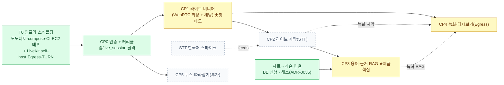

# CP 구현 로드맵 — LiveClass AI

> 📍 하네스 개요: [harness/README.md](harness/README.md) · 아키텍처: [ARCHITECTURE.md](ARCHITECTURE.md) · 계약: [CONTRACT.md](CONTRACT.md)
>
> 아키텍처를 착수 순서·의존성·역할로 변환. **완전 라이브 지향**(업로드 없음, VOD=라이브 녹화)이라 **라이브가 토대**다. (구 [ROADMAP.md](legacy/ROADMAP.md)는 대체됨)

## 원칙
- **증분 vertical slice**: 각 CP는 독립 데모 가능. 폭이 아니라 깊이.
- **라이브가 토대**: VOD/다시보기는 라이브 녹화(Egress)의 산출물 → **라이브 없이 VOD 불가**. VOD-first 불가능.
- **미니멀 라이브부터**: 화상+채팅(AI 없이)을 첫 데모로 → 그 위에 자막→RAG→다시보기 얹기(최난도 리스크를 작게 쪼갬).
- **리스크 front-load**: 한국어 **STT 스파이크** + **LiveKit/Egress 인프라**를 초반 병렬 검증.
- **AI 구조 우선**: RAG/용어 파이프라인은 뼈대+안전장치(citation·scope)까지, 튜닝은 나중.
- **인프라는 쓰는 CP에서 세운다**: 운영 컴포넌트를 미리 세우지 않는다 — 단일 노드 용량이 빠듯하다([ARCHITECTURE §9-5](ARCHITECTURE.md)).

## 의존성 그래프

- **핵심 트랙**: CP1(라이브 미디어) → CP2(자막) → CP3(용어·RAG)
- **다시보기**: CP4 (라이브 산출물 녹화·재생 — CP1 이후, CP2·CP3 결과 재사용)
- **안전 데모 지점**: **CP1(미니멀 라이브)**, **CP3(제품 핵심)**
- ✅ **`자료→레슨 연결`은 해소됐다.** `POST /instructor/lessons/{id}/materials`로 presigned 업로드한 PPTX 에셋을 레슨에 연결하고 삭제·다운로드까지 배선됐다([ADR-0035](decisions/songjeongki/0035-lesson-material-attach.md), [ARCHITECTURE §9-2](ARCHITECTURE.md)). RAG ingestion의 입력이 채워져 CP3 착수를 막던 선행조건이 사라졌다.

## 현재 위치

**CP0 백엔드 완료 · CP1 백엔드 완료 — CP1 데모까지 남은 건 프론트 미디어 연동.**

| CP | 백엔드 | 프론트 | AI |
|---|---|---|---|
| **T0** | ✅ compose·CI·Flyway·EC2 배포·LiveKit/Egress 상시가동 | ✅ Vite·라우팅·목 데이터 계층 | ⬜ Alembic·`ai` 스키마 |
| **CP0** | ✅ 인증·커리큘럼·섹션·레슨·수강·카탈로그·구조 재정렬 | ✅ 화면 + 실 API 연동 | — |
| **CP1** ★ | ✅ LiveKit 토큰·채팅 WS·세션 수명주기·참가자 관리 | 🟡 세션·채팅 API 연동 ✅ / `livekit-client` ⬜ | — |
| **CP2** | ⬜ | ⬜ | ⬜ realtime-agent |
| **CP3** ★ | 🟡 BE 슬라이스 착수(자료 연결·삭제·다운로드, 임베딩 outbox→RabbitMQ→콜백 inbox, 스위치 off) | ⬜ | ⬜ ai-api·ai-worker |
| **CP4** | 🟡 Egress 제어·`VideoAsset` 완료·egress 완료 웹훅 ✅(ADR-0034) / 재생 API 미착수 | ⬜ | — |
| **CP5** | ⬜ | ⬜ | ⬜ |

## 단계별 상세

| CP | 목표 | 주요 작업 | 이 CP에서 새로 도입하는 인프라 |
|---|---|---|---|
| **T0** | 실행 기반 | 모노레포·Docker Compose·CI·EC2 배포·Flyway | Postgres+pgvector · Redis · MinIO · nginx · **LiveKit·Egress·TURN** · RabbitMQ(dev 인프라만) |
| **CP0** | 인증 + 강좌 골격 | 로그인/회원, `curriculum→section→lesson` + `live_session` CRUD, 검색·상세·수강 | — |
| **CP1** ★ | 라이브 미디어 | LiveKit 토큰, **WebRTC 화상 입장**(강사 publish/학생 subscribe), Spring **채팅**(WS) | — |
| **CP2** | 라이브 자막 | **realtime-agent 스트리밍 STT(VAD)** → Redis Streams → Spring 영속+WS, 자막 렌더·검수 | realtime-agent · **`ai` 스키마+Alembic** · 외부 STT API |
| **CP3** ★ | 용어·근거(RAG) | PPTX 업로드·파싱, chunk·embedding(pgvector), 용어 후보·카드, **RAG SSE**(FTS+vector+RRF+scope+citation+insufficient) | ai-api · ai-worker · **RabbitMQ** · model gateway |
| **CP4** | 녹화·다시보기 | Egress 녹화→HLS→MinIO, **egress 웹훅 수신기**(상태 전이 + 시간축 앵커 저장), **재생 API**(권한 검증 + manifest presigned 재작성), HLS 플레이어 + 교정 자막·용어·RAG 재생 | HLS.js |
| **CP5** | 퀴즈·따라잡기 | 퀴즈 후보→검수→응시(**결정론 채점**), 재접속 catch-up | — |

> **RabbitMQ 배선은 CP3에서 이뤄졌다.** backend에 `spring-amqp` 의존성·설정이 들어가 outbox 릴레이가 `ingestion.embed`로 발행하고, prod compose에도 RabbitMQ가 추가됐다([ADR-0036](decisions/songjeongki/0036-material-embedding-pipeline.md), [ARCHITECTURE §9-4](ARCHITECTURE.md)). CP2 자막 경로는 여전히 Redis Streams만으로 충분하다. 자료 임베딩 파이프라인은 스위치(`material.embedding.enabled`) 뒤에서 기본 off다.
>
> **CP3에서 채팅 브로커도 함께 교체한다.** 현재 STOMP 브로커가 인메모리라 백엔드를 2대로 늘리면 채팅이 인스턴스별로 갈린다. RabbitMQ를 들일 때 STOMP relay로 전환하면 수평 확장의 유일한 선행조건이 해소된다([ARCHITECTURE §9-6](ARCHITECTURE.md)).

## 역할·트랙 배분 (백엔드 2 / 프론트 2 / AI 2 + 공유)
그룹은 가로 레이어, CP는 세로 기능 → 한 CP = 여러 그룹 조각을 **계약(CONTRACT) 우선**으로 맞물려 완성.

| CP | BE 2(Spring) | FE 2(React) | AI 2(Python) |
|---|---|---|---|
| T0 | compose·DB·**LiveKit/Egress**·배포 리드 | React 스캐폴드·프록시 | *(STT 스파이크 병렬)* |
| CP0 | auth·curriculum/section/lesson·수강 | 로그인·강좌·내학습 UI | — |
| CP1 | LiveKit 토큰·채팅 WS | LiveKit 클라·화상·채팅 UI | — |
| CP2 | 자막 영속·WS 전달 | 자막 렌더·싱크 | **realtime-agent STT** |
| CP3 | 자료→레슨 연결·AI 게이트웨이·정책·SSE 중계 | 챗봇·용어카드 UI | **chunk·embed·RAG·citation** |
| CP4 | Egress 제어·재생 API | HLS 플레이어·다시보기 UI | *(2-pass 교정 옵션)* |
| CP5 | 퀴즈 채점·API | 퀴즈 UI | *(퀴즈 후보)* |

> **선행 스파이크(Week1 병렬)**: 한국어 STT bake-off + LiveKit/Egress self-host PoC — CP1·CP2 리스크 검증. **미디어·라이브는 3그룹 합동.**

## 착수를 막는 결정
전체 목록·제안은 [ARCHITECTURE.md §9](ARCHITECTURE.md). CP 착수를 실제로 막는 것만 추리면:

| 결정 | 막는 CP | 내용 |
|---|---|---|
| 🔴 **지평선(horizon) 정의** | CP2 | 확정본 지연을 몇 초로 둘지. 없으면 FE 자막 렌더 정책·BE 영속 시점을 못 정한다 |
| 🟠 **자막 유실 정책** | CP2 | Redis fast-path 유실 허용 + 녹화 2-pass 복구로 확정할지 |
| 🟠 **단일 노드 운용 전제** | CP2 | STT·임베딩·LLM 전부 외부 API, Egress는 데모 세션에만, 동시 세션 1~2개 |
| 🟠 **다시보기 시간축 변환** | CP4 | 규칙 확정 — 서버가 `index.m3u8` 첫 PDT를 앵커로 오프셋 하나를 내려준다. 선행: egress 웹훅 수신기 ([ARCHITECTURE §9-9](ARCHITECTURE.md)) |

## 열린 항목 (착수 직전 상세)
- ✅ **인증 방식 확정**: HttpOnly 쿠키 + Redis 세션([decisions/songjeongki/0014](decisions/songjeongki/0014-auth-redis-session-cookie.md)).
- 잡 envelope·결과 메시지·Redis Streams caption 스키마·LiveKit 토큰 계약 → [CONTRACT.md](CONTRACT.md).
- 세션시계 변환 기준 **양방향**: 라이브(LiveKit 트랙 타임스탬프 → 세션 상대 ms)와 다시보기(재생 위치 → 세션 상대 ms). 후자가 없으면 다시보기 자막이 어긋난다([ARCHITECTURE §9-9](ARCHITECTURE.md)). RAG 평가 게이트·reranker(고도화).
- 보류: 분석(클러스터·히트맵)·관리자·멀티테넌트.
