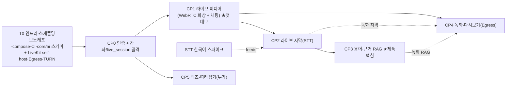

# CP 구현 로드맵 — LiveClass AI

> 📍 하네스 개요: [harness/README.md](harness/README.md) · 확정 아키텍처: [ARCHITECTURE.md](ARCHITECTURE.md) · 계약: [CONTRACT.md](CONTRACT.md)
>
> 확정 아키텍처를 착수 순서·의존성·역할로 변환. **완전 라이브 지향**(업로드 없음, VOD=라이브 녹화)이라 **라이브가 토대**다. (구 [ROADMAP.md](legacy/ROADMAP.md)는 대체됨)

## 원칙
- **증분 vertical slice**: 각 CP는 독립 데모 가능. 폭이 아니라 깊이.
- **라이브가 토대**: VOD/다시보기는 라이브 녹화(Egress)의 산출물 → **라이브 없이 VOD 불가**. VOD-first 불가능.
- **미니멀 라이브부터**: 화상+채팅(AI 없이)을 첫 데모로 → 그 위에 자막→RAG→다시보기 얹기(최난도 리스크를 작게 쪼갬).
- **리스크 front-load**: 한국어 **STT 스파이크** + **LiveKit/Egress 인프라**를 초반 병렬 검증.
- **AI 구조 우선**: RAG/용어 파이프라인은 뼈대+안전장치(citation·scope)까지, 튜닝은 나중.

## 의존성 그래프

- **핵심 트랙**: CP1(라이브 미디어) → CP2(자막) → CP3(용어·RAG)
- **다시보기**: CP4 (라이브 산출물 녹화·재생 — CP1 이후, CP2·CP3 결과 재사용)
- **안전 데모 지점**: **CP1(미니멀 라이브)**, **CP3(제품 핵심)**

## 단계별 상세

| CP | 목표 | 주요 작업 | 스택·인프라 |
|---|---|---|---|
| **T0** | 실행 기반 | 모노레포·Docker Compose(Postgres+pgvector·Redis·RabbitMQ·MinIO·nginx·**LiveKit·Egress·TURN**·Spring·FastAPI·worker)·CI·Flyway/Alembic | 전체 |
| **CP0** | 인증 + 강좌 골격 | 로그인/회원, `course→section→lesson` + `live_session` CRUD, 검색·상세·수강 | React·Spring·Postgres·Redis |
| **CP1** ★ | 라이브 미디어 | LiveKit 토큰, **WebRTC 화상 입장**(강사 publish/학생 subscribe), Spring **채팅**(WS) | +LiveKit·TURN |
| **CP2** | 라이브 자막 | **realtime-agent 스트리밍 STT(VAD)** → Redis Streams → Spring 영속+WS, 자막 렌더·검수(2계층) | +realtime-agent |
| **CP3** ★ | 용어·근거(RAG) | PPTX 업로드·파싱, chunk·embedding(pgvector), 용어 후보·카드, **RAG SSE**(FTS+vector+RRF+scope+citation+insufficient) | +ai-api·ai-worker·model gateway |
| **CP4** | 녹화·다시보기 | **Egress 녹화→HLS→MinIO**, nginx 서빙(재생 seam), HLS 플레이어 + 교정 자막·용어·RAG 재생 | +Egress·nginx·HLS.js |
| **CP5** | 퀴즈·따라잡기 | 퀴즈 후보→검수→응시(**결정론 채점**), 재접속 catch-up | Spring |

## 역할·트랙 배분 (백엔드 2 / 프론트 2 / AI 2 + 공유)
그룹은 가로 레이어, CP는 세로 기능 → 한 CP = 여러 그룹 조각을 **계약(CONTRACT) 우선**으로 맞물려 완성.

| CP | BE 2(Spring) | FE 2(React) | AI 2(Python) |
|---|---|---|---|
| T0 | compose·DB·큐·**LiveKit/Egress** 리드 | React 스캐폴드·프록시 | *(STT 스파이크 병렬)* |
| CP0 | auth·course/section/lesson·수강 | 로그인·강좌·내학습 UI | — |
| CP1 | LiveKit 토큰·채팅 WS | LiveKit 클라·화상·채팅 UI | — |
| CP2 | 자막 영속·WS 전달 | 자막 렌더·싱크 | **realtime-agent STT** |
| CP3 | AI 게이트웨이·정책·SSE 중계 | 챗봇·용어카드 UI | **chunk·embed·RAG·citation** |
| CP4 | Egress 제어·재생토큰 | HLS 플레이어·다시보기 UI | *(2-pass 교정 옵션)* |
| CP5 | 퀴즈 채점·API | 퀴즈 UI | *(퀴즈 후보)* |

> **선행 스파이크(Week1 병렬)**: 한국어 STT bake-off + LiveKit/Egress self-host PoC — CP1·CP2 리스크 검증. **미디어·라이브는 3그룹 합동.**

## 열린 항목 (착수 직전 상세)
- ✅ **인증 방식 확정**: HttpOnly 쿠키 + Redis 세션([decisions/songjeongki/0014](decisions/songjeongki/0014-auth-redis-session-cookie.md)).
- Spring↔RabbitMQ 잡 envelope·Redis Streams STT 메시지·LiveKit 토큰 계약 → [CONTRACT.md](CONTRACT.md).
- 세션시계 변환 기준, RAG 평가 게이트·reranker(고도화).
- 보류: 분석(클러스터·히트맵)·관리자·멀티테넌트.
