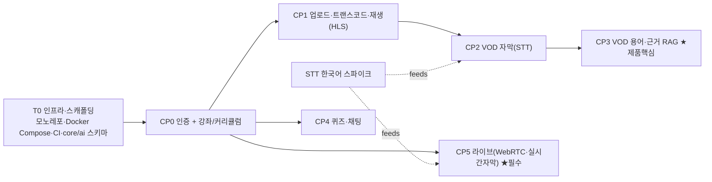

# CP 구현 로드맵 — LiveClass AI

> 📍 하네스 개요: [harness/README.md](harness/README.md) · 확정 아키텍처: [ARCHITECTURE.md](ARCHITECTURE.md) · 계약: [CONTRACT.md](CONTRACT.md)
>
> 확정 아키텍처를 착수 순서·의존성·역할로 변환. 팀 기획서 v3.0의 15-day vertical slice(§11.2)를 우리 결정(self-host·라이브 필수·Spring3.4/Java21)에 맞춰 조정. (구 [ROADMAP.md](legacy/ROADMAP.md)는 대체됨)

## 원칙
- **증분 vertical slice**: 각 CP는 독립 데모 가능. 폭이 아니라 **깊이**(강좌→강의→학습→AI→퀴즈→라이브 한 줄기 관통).
- **리스크 front-load**: 한국어 **STT bake-off**를 초반 스파이크로 병렬 검증.
- **라이브 필수**: 기획서는 P2지만 본 프로젝트는 실시간 WebRTC를 slice에 포함.
- **AI는 구조 우선**: RAG/용어/노트 파이프라인은 뼈대+안전장치(citation·scope)까지, 품질 튜닝은 나중.

## 의존성 그래프

- **VOD 트랙**: CP1 → CP2 → CP3 (제품 핵심, 라이브 인프라 없이 가치 증명)
- **라이브 트랙**: CP5 (CP0 위에서 병렬)
- **부가**: CP4(퀴즈·채팅) CP0 이후 병렬
- **안전 데모 지점**: **CP3(제품핵심)**, **CP5(라이브)**

## 단계별 상세

| CP | 목표 | 주요 작업 | 스택·인프라 |
|---|---|---|---|
| **T0** | 실행 기반 | 폴리글랏 모노레포, Docker Compose(Postgres+pgvector·Redis·RabbitMQ·MinIO·nginx·Spring·FastAPI·worker), CI, Flyway(core)/Alembic(ai) | 전체 |
| **CP0** | 인증 + 강좌 골격 | 로그인/회원, `course→section→lesson` CRUD(강사), 검색·상세·수강(학생), 진도 | React·Spring·Postgres·Redis |
| **CP1** | 업로드·재생 | presigned upload→MinIO, **FFmpeg 트랜스코드(RabbitMQ)**→HLS, nginx 서빙(재생 seam), 플레이어·진도 | +RabbitMQ·FFmpeg·nginx |
| **CP2** | VOD 자막 | **STT(통합 스트리밍·VAD)**→ai.transcript_segment→Redis Streams, 자막 표시·강사 검수(2계층) | +ai-worker·realtime STT lib |
| **CP3** ★ | 용어·근거(RAG) | chunk·embedding(pgvector), 용어 후보·카드, **RAG 질문 SSE**(FTS+vector+RRF+scope+citation+insufficient) | +ai-api·pgvector·model gateway |
| **CP4** | 퀴즈·채팅 | 퀴즈 후보→검수→응시(**결정론 채점**), 채팅(가명·WS·REST 보완) | Spring·WS |
| **CP5** ★ | 라이브 | LiveKit self-host, 토큰, WebRTC 입장, **realtime-agent 스트리밍 STT→Redis→WS 자막** | +LiveKit·realtime-agent |

## 역할·트랙 배분 (예시, [CONTRACT §오너맵](CONTRACT.md)과 동기화)

| 트랙 | 담당 | CP |
|---|---|---|
| 인프라/DevOps | Docker Compose·CI·nginx·큐·스키마 마이그레이션 | T0·CP1 |
| 인증·강좌 (FE+BE) | 로그인·course/section/lesson·수강·진도 | CP0 |
| 미디어 VOD (BE+FE) | 업로드·FFmpeg 트랜스코드·HLS·플레이어 | CP1 |
| AI 파이프라인 (Python) | STT·chunk·embed·후보·RAG SSE | CP2·CP3 |
| 퀴즈·채팅 (BE+FE) | 퀴즈 검수/채점·채팅 | CP4 |
| 라이브 (인프라+BE+FE+Python) | LiveKit·토큰·realtime-agent | CP5 |

> **선행 스파이크(Week1 병렬)**: 한국어 강의 샘플로 STT 공급자 bake-off(전문용어 recall·지연·비용) — CP2·CP5 품질을 좌우.

## 열린 항목 (착수 직전 상세)
- **인증 방식**: JWT(Bearer/localStorage) vs 세션 쿠키(HttpOnly, 기획서 권장) — 보안 기준 확정 필요.
- Spring↔RabbitMQ 잡 envelope·callback, Redis Streams STT 메시지 스키마 → [CONTRACT.md](CONTRACT.md).
- 세션시계 변환 기준, RAG 평가 게이트·reranker·semantic cache(고도화).
- 보류(나중): 분석(클러스터·히트맵)·관리자·멀티테넌트·비용/보존 정책.
