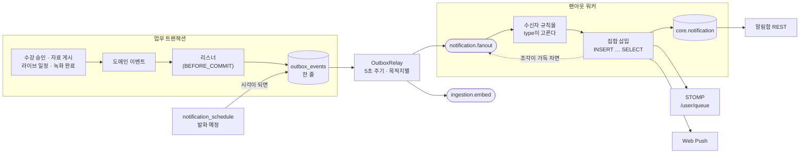

# 알림 센터 — 설계·구현 기록

> 📍 **API 규격의 정본은 [CONTRACT §2-4](CONTRACT.md)이고, 설계 결정의 정본은
> [ADR-0073](decisions/songjeongki/0073-notification-fanout-architecture.md)·
> [ADR-0012](decisions/seominkyeong/0012-notification-center-two-status-axes.md)다.**
> 이 문서는 그 둘을 복제하지 않는다. **고치러 온 사람이 알아야 할 것**만 담는다 — 전체 경로가
> 어떻게 생겼는지, 어디를 건드리면 무엇이 깨지는지, 무엇이 아직 위험한지.
>
> 설계를 **왜** 그렇게 골랐는지(대안과 트레이드오프)는 ADR-0073이 정본이다. 여기서 반복하지 않는다.

---

## 1. 한눈에

알림 12종 가운데 **11종이 실제로 발행**되고, 조회 5경로가 붙어 있고, 탭이 열려 있으면 STOMP로
즉시·닫혀 있으면 Web Push로 간다. 리드타임은 커리큘럼 단위로 정하고 강의별로 덮어쓴다.

| 축 | 결정 |
|---|---|
| 저장 | **수신자별 한 행**(fan-out on write) |
| 트리거 | **사건**이 트리거. 시각형은 `LIVE_STARTING_SOON` 하나뿐 |
| 발행 경로 | 도메인 이벤트 → 아웃박스(업무와 같은 트랜잭션) → RabbitMQ → 워커 |
| 명단 | **앱을 통과하지 않는다.** 조건은 SQL이 걸고 커서로 자른다 |
| 전달 | 알림함(REST) + STOMP(탭 열림) + Web Push(탭 닫힘) |

**규모 목표**: 커리큘럼 하나에 수강생 100만 명이어도 메시지 크기·예약 행 수가 그대로여야 한다.
이 문서의 설계 선택 대부분이 이 한 줄에서 나온다.

---

## 2. 아키텍처

### 2-1. 전체 경로



**요점 셋.**

- **업무 트랜잭션이 하는 일은 아웃박스에 한 줄 넣는 것뿐**이다. 문구 생성·이름 조회·대량 삽입은
  전부 큐 건너편이다.
- **워커가 자기 다음 조각을 큐에 넣는다.** 몇 조각인지 미리 세지 않으므로 `COUNT(*)`가 없고,
  큐 길이가 워커 속도에 맞춰 저절로 조절된다.
- **예약 표는 "언제"만 안다.** 누구에게 갈지는 발화 시점의 수강 상태가 정한다.

### 2-2. 메시지가 담는 것

```json
{ "type": "MATERIAL_PUBLISHED", "curriculumId": "…", "materialId": "…",
  "afterUserId": "3f2a…", "sliceLimit": 1000 }
```

**명단이 아니라 "무슨 사건인가 + 어디까지 왔나"**다. 크기가 수신자 수와 무관하게 일정하다.

누구에게 갈지는 워커가 `type`으로 고르는 **미리 정의된 규칙**이 정한다. 메시지가 조건문을 실어
나르지 않는 이유는 둘이다 — 주입 표면이 생기고, 조건을 고쳤을 때 **큐에 떠 있는 옛 메시지가 옛
조건으로 돈다.**

### 2-3. 조각을 자르는 SQL

```sql
WITH slice AS (
    SELECT e.user_id FROM core.enrollment e
    WHERE e.curriculum_id = ? AND e.status = 'ACTIVE'
      AND (? IS NULL OR e.user_id > ?)          -- 커서
    ORDER BY e.user_id LIMIT ?
), inserted AS (
    INSERT INTO core.notification (…)
    SELECT gen_random_uuid(), s.user_id, … , :dedupePrefix || s.user_id
    FROM slice s
    ON CONFLICT (dedupe_key) DO NOTHING
    RETURNING recipient_id
)
SELECT (SELECT count(*) FROM slice)    AS scanned,
       (SELECT count(*) FROM inserted) AS inserted,
       (SELECT array_agg(recipient_id) FROM inserted) AS inserted_recipients,
       (SELECT s.user_id FROM slice s ORDER BY s.user_id DESC LIMIT 1) AS last_user_id
```

**`slice`를 CTE로 먼저 고정하는 것이 핵심**이다. `INSERT … RETURNING`만으로는 커서를 얻을 수
없다 — `ON CONFLICT DO NOTHING`이 중복을 건너뛰므로, 조각의 마지막 몇 명이 이미 받은 사람이면
RETURNING에 그들이 없고 **커서가 뒤로 밀려 그 자리부터 영영 다시 훑는다.**

`inserted_recipients`가 따로 있는 이유는 실시간 전달 때문이다. **새로 받은 사람만** 나오므로
재배달로 같은 조각을 다시 처리해도 화면에 알림이 두 번 뜨지 않는다.

---

## 3. 고치기 전에 알아야 할 규칙

대안과 근거는 [ADR-0073](decisions/songjeongki/0073-notification-fanout-architecture.md)에 있다.
여기서는 **어기면 깨지는 것**만 적는다.

| 규칙 | 어기면 |
|---|---|
| 리스너는 `BEFORE_COMMIT`이고 하는 일은 아웃박스 INSERT 한 줄뿐 | `AFTER_COMMIT`으로 바꾸면 커밋 직후 죽었을 때 알림이 유실된다. 여기서 무거운 일을 하면 알림 버그가 **업무를 롤백**시킨다 |
| 중복은 `ON CONFLICT DO NOTHING`으로 막는다 | try/catch로 바꾸면 실패한 statement가 트랜잭션을 **롤백 전용**으로 만들어 커밋에서 다시 터진다 |
| 중복 키 구성이 사건마다 다르다(아래 표) | 시각을 빼면 재신청·재변경 알림이 **조용히 사라진다** |
| 읽음 처리는 처리 축을 건드리지 않는다 | 강사의 "처리 대기" 목록이 성립하지 않는다 |
| 수신자 조건은 **SQL**에 있다. 메시지에 싣지 않는다 | 조건을 고쳤을 때 큐에 떠 있는 옛 메시지가 **옛 조건으로** 돈다 |
| 리드타임은 선택지로 제한한다 | 예약 표가 그 값을 몰라 **그 사람에게만 알림이 영영 안 간다** |
| 팬아웃 조각은 `slice`를 CTE로 먼저 고정한다 | `INSERT … RETURNING`만으로는 커서가 뒤로 밀려 **같은 자리를 영영 다시 훑는다** |

### 중복 키 구성

| 사건 | 키 |
|---|---|
| 수강 신청·판정 | `type:수신자:enrollmentId:사건시각` |
| 일정 변경 | `type:sessionId:새시각:수신자` |
| 자료·녹화 | `type:리소스id:수신자` |
| 곧 시작 | `type:sessionId:시작시각:수신자` (리드타임은 넣지 않는다 — §6-3) |

---

## 4. 실측

| 측정 | 결과 |
|---|---|
| 알림 100만 행 삽입 | **32.7초 · 423MB** |
| 10만 행 **집합 삽입**(`INSERT … SELECT`) | **828ms** |
| 같은 결과를 DB 안 루프(plpgsql)로 | **1,521ms** |

집합 삽입과 루프의 차이가 1.8배인데, 이건 **네트워크 왕복이 아예 없는 최선의 조건**이다. 실제
앱에서 행마다 왕복하면 10만 건에 66,667회(조각 1,000 기준)가 붙어 20~60초가 된다.

RabbitMQ는 운영 3.13.7, 메모리 워터마크 6.7GB에 사용 0.164GB. 지연 메시지 플러그인은 없다.

---

## 5. 과거에 깨졌던 자리

**고치다가 같은 곳을 다시 밟지 않기 위한 목록**이다. 전부 테스트가 잡았고, 그 테스트들이 지금도
지키고 있다 — 되돌리면 해당 테스트가 빨개진다.

### 5-1. `now()`는 트랜잭션 시작 시각이다

```sql
created_at timestamptz NOT NULL DEFAULT now()   -- ❌
```

한 트랜잭션에서 만든 알림이 **전부 같은 시각**을 갖는다. `ORDER BY created_at DESC`가
비결정적이 되어 목록 순서가 흔들렸다. `clock_timestamp()`로 바꾸고, 정렬에 `id DESC`
보조 기준을 더했다.

> **증상이 조용하다.** 대부분의 경우 순서가 맞아 보이고, 같은 트랜잭션에 두 건이 들어갈 때만 틀린다.

### 5-2. Postgres에 `max(uuid)` 집계가 없다

커서를 `max(user_id)`로 뽑으려다 `function max(uuid) does not exist`로 터졌다. 조각이 이미
`user_id` 오름차순이므로 **내림차순 첫 행**으로 바꿨다.

### 5-3. `OffsetDateTime.equals`가 오프셋까지 본다

```
넘긴 값: 2026-08-07T01:52:55.296994723+09:00
읽은 값: 2026-08-06T16:52:55.296995Z          ← 같은 순간인데 equals는 false
```

두 가지가 겹쳤다 — `equals`는 오프셋을 비교하고, Postgres `timestamptz`는 **마이크로초까지만**
저장해 나노초가 잘린다. 그대로 뒀으면 **강사가 같은 시각을 다시 저장했을 뿐인데 수강생 전원에게
"일정이 변경되었습니다"가 나갔다.** 일정의 실제 단위는 분이므로 밀리초로 끊어 instant를 비교한다.

### 5-4. 세션이 사라진 경우 — "0행"이 아니라 NPE

녹화 사건은 커리큘럼도 강사도 모르고 세션만 안다. 세션이 지워졌을 때 "커리큘럼 없는 팬아웃이라
0행으로 끝난다"고 봤는데 실제로는 **NPE**였다. 그대로였으면 그 메시지가 재시도를 거쳐 DLQ에
쌓였을 것이다. 보낼 곳이 없으면 **로그만 남기고 끝낸다** — 예외를 던져 봐야 재시도해도 같다.

### 5-5. `@Order`가 없으면 404가 500이 된다

`UnhandledExceptionHandler`가 `Exception` 전부를 `LOWEST_PRECEDENCE`로 잡는다. 모듈 핸들러에
순서를 주지 않으면 같은 값이라 **어느 쪽이 이길지 보장이 없다.** 다른 모듈 핸들러가 전부 쓰는
`@Order(Ordered.LOWEST_PRECEDENCE - 100)`을 붙였다.

### 5-6. 커밋하는 테스트가 다른 테스트를 깨뜨렸다

`BEFORE_COMMIT` 발행을 검증하려면 **롤백할 수 없다.** 그래서 알림 계약 테스트들이 아웃박스 행을
커밋한 채 남겼고, 그 행이 `OutboxRelayTest`의 **발행 횟수·배치 상한 단언에 섞여** 2건이 깨졌다.

- 릴레이 테스트는 실제 큐 이름 대신 **전용 목적지**를 쓴다 — 그 테스트가 보려는 것은 "목적지가
  데이터인가"이지 특정 큐가 아니다.
- 커밋하는 테스트는 `@AfterEach`로 자기 행을 치운다.

### 5-7. JPA 더티 상태와 네이티브 SQL

두 번 걸렸다. 테스트와 요청이 같은 트랜잭션일 때 엔티티는 더티 상태로만 남는데 `JdbcTemplate`은
영속성 컨텍스트를 우회한다. `flush()` 없이는 **"UPDATE가 나갔는지"가 아니라 "아직 안 나갔다"를
보게 된다.** 운영에서는 서로 다른 트랜잭션이라 생기지 않는 문제다.

### 5-8. 모듈 경계

`@EnableConfigurationProperties`를 애플리케이션 클래스에 달았더니 **루트가 알림 모듈 내부 타입을
참조**하게 되어 `ModularityTests`가 막았다. 설정은 그 설정을 쓰는 모듈이 등록한다.

### 5-9. 머리 막힘(head-of-line)

이건 버그를 만든 게 아니라 **이미 있던 것을 찾은** 경우다. 릴레이가 전체에서 오래된 순 100건을
뽑았기 때문에, 알림이 쌓이면 방금 올린 자료의 임베딩 잡이 그 뒤에 줄을 섰다.

```
[아웃박스]  알림1 … 알림120  임베딩잡
           └─── 오래된 순 100건 ───┘  ← 임베딩잡은 다음 주기로
```

목적지별로 100건씩 뽑도록 고쳤다. 회귀 테스트가 이걸 고정하고, **고치기 전 코드로 실패하는 것을
확인**했다.

---

## 6. 한계와 알려진 위험

### 6-1. 구조적 한계

| 한계 | 내용 |
|---|---|
| **단일 인스턴스 전제** | 발화 폴링과 SimpleBroker 둘 다. 늘리면 같은 예약 행을 두 인스턴스가 집을 수 있고(알림은 `dedupe_key`가 막지만 헛일이 는다), STOMP 브로드캐스트가 인스턴스 경계를 못 넘는다. 외부 브로커 릴레이로 교체할 때 함께 풀린다 |
| 릴레이 주기 지연 | 아웃박스 경유라 최대 5초. 필요하면 커밋 뒤 릴레이를 깨워 줄일 수 있다 |
| 팬아웃 중 명단 변화 | 커서가 지나간 자리는 반영되지 않는다. 사건 뒤 수강자가 빠지는 것은 옳고, 방금 취소한 사람이 하나 더 받는 것은 해롭지 않다 |
| 기기별 푸시 | PC에서 읽어도 폰 알림은 사라지지 않는다 |
| 발화 시각을 놓치면 건너뛴다 | 배포·장애로 폴링이 멈춘 사이 시작 시각이 지났으면 **보내지 않는다** — "곧 시작합니다"가 거짓이 되기 때문이다. 행은 끝난 것으로 표시해 매 주기 다시 집지 않는다 |

### 6-2. `LESSON_PUBLISHED`는 발행 지점이 생길 수 없다

레슨에는 초안이 없고 공개 여부는 커리큘럼이 결정한다([ADR-0005](decisions/seominkyeong/0005-lesson-has-no-draft-state.md)).
"강의가 게시됐다"는 사건 자체가 없다. FE 타입·목·문구는 있지만 서버는 이 종류를 만들지 않는다.

**지우지 않은 이유**는 레슨에 공개 상태가 생기면 그때 쓸 자리이기 때문이다. 계약에서 아예 빼는
편이 나은지는 **아직 판단이 필요하다.**

### 6-3. 리드타임 중복 키 — 테스트가 지키지 않는 불변식

`StartingSoonLeadTimeFanoutTest`는 조각끼리 서로를 중복으로 지우지 않게 하려고 **운영과 다른
접두사**를 쓴다(`:lead30:`). 운영 워커는 리드타임을 키에 넣지 않는다.

지금은 안전하다 — 한 사람의 적용 리드타임은 `COALESCE`로 나오는 **단일 값**이라 조각 하나에만
걸리고, 키에 수신자 id가 들어가므로 충돌이 없다.

**위험한 것은 나중이다.** 누군가 필터를 범위 비교로 바꾸면(예: `<=`) 한 사람이 여러 조각에 걸리고,
그때 중복 키가 두 번째를 조용히 삼킨다 — **알림이 안 오는 게 아니라 하나만 오는** 형태라 알아채기
어렵다. 실제 접두사로 조각 전체를 돌려 한 사람이 한 건만 받는지 보는 테스트가 필요하다.

### 6-4. 운영에 남은 것

**VAPID 키가 없으면 Web Push는 꺼진 채로 동작한다**(알림함·STOMP는 그대로). 실제로 푸시가 오게
하려면 키를 만들어 `/etc/liveclass/.env.prod`에 넣어야 한다.

```
NOTIFICATION_WEB_PUSH_PUBLIC_KEY / NOTIFICATION_WEB_PUSH_PRIVATE_KEY / NOTIFICATION_WEB_PUSH_SUBJECT
```

공개키가 `null`이면 화면이 푸시 스위치를 **숨긴다**(404가 아니다 — 404로 주면 서버 장애와
구별되지 않는다). iOS는 16.4+이고 **홈 화면에 추가해야** 온다.

---

### 6-5. 푸시는 다른 층과 확장 방식이 다르다

**Web Push에는 배치가 없다.** 표준에 기기 여러 대를 한 요청으로 보내는 방법이 없어 구독 수만큼
HTTPS를 쳐야 한다 — 알림 행 삽입이 조각당 SQL 한 방인 것과 대비된다.

처음 구현은 이 층만 100만 기준이 아니었다. **요청을 순차로**, 그것도 트랜잭션 안에서 쳤다.

더 나쁜 것은 라이브러리였다. `PushService.sendAsync`는 **호출 한 번마다** HTTP 클라이언트를
새로 만들고 시작한 뒤 응답 콜백에서 닫는다(바이트코드 확인). 요청마다 연결 풀·I/O 리액터를
새로 세우고 TLS 핸드셰이크를 다시 하므로 **연결 재사용이 없고**, 순진하게 병렬화하면
클라이언트 수만큼 셀렉터 스레드가 뜬다.

그래서 라이브러리는 **암호화기로만** 쓴다. `preparePost`가 RFC 8291 암호화와 RFC 8292 VAPID
서명을 끝낸 요청을 돌려주므로, 그것을 **공유 JDK `HttpClient`** 로 실행한다.

**병목이 어디인지는 재 봐야 안다.** 처음에 "공유 클라이언트로 100만이 3분"이라고 적었는데
**틀렸다** — HTTP 왕복만 보고 CPU와 연결 상한을 세지 않았다. 실측하면 이렇다.

**운영 장비에서 재야 한다.** 개발 장비(22코어)와 운영(4코어 Xeon E5-2686 v4)이 **2.6배** 차이가
난다. 아래는 전부 운영 장비 값이다.

| 구간 | 건당 | 비고 |
|---|---|---|
| 본문 암호화 | 4.07ms | 기기마다 키가 달라 피할 수 없다 |
| `verifyKeyPair` | 1.93ms | 키쌍은 안 바뀌는데 라이브러리가 매번 한다 |
| 조립·서명 등 | 1.79ms | |
| **`preparePost` 전체** | **7.79ms** | |

한 스레드에서 순서대로 하면 이게 곧 발송 속도의 상한이 된다. 그래서 전용 풀에 흩는다.

| 암호화 스레드 | 처리량 | 100만 |
|---|---|---|
| 1 | 172건/s | **97분** |
| 2 | 278건/s | |
| **4**(코어 수) | **444건/s** | **37분** |
| 8 | 475건/s | 4코어라 여기서 포화 |

**라이브러리를 걷어냈다.** `preparePost`가 기기 하나에 7.79ms를 쓰는데 실제 암호 연산은 0.9ms면
된다 — `verifyKeyPair`가 매 호출 1.83ms, 그리고 **키를 만드는 방식 하나로 5~7배**가 갈렸다
(`ECNamedCurveTable` 스펙 직접 vs `ECGenParameterSpec("secp256r1")`). §6-7에 자세히 적었다.

**측정은 통제해야 한다.** 아래는 <b>같은 규모(2만 건)·같은 실패 주입(없음)·목 초기화 후·설정마다
3회</b> 재서 중앙값을 취한 값이다. 라이브러리 버전과 우리 구현을 <b>번갈아</b> 돌려 배경 부하가 한쪽에만
실리지 않게 했다.

| 설정 | 라이브러리 | 우리 구현 | 배수 |
|---|---|---|---|
| 상한 200 · 워커 1 (옛 기본값) | 439건/s | 726건/s | 1.65배 |
| **상한 800 · 워커 2 (기본값)** | 470건/s | **1,609건/s** | **3.42배** |
| 상한 1600 · 워커 2 | 474건/s | 1,605건/s | 3.39배 |

편차는 라이브러리 ±0.7%, 우리 구현 ±1.5~3.7%.

**라이브러리는 설정을 올려도 안 오른다** — 439 → 470 → 474. `preparePost`가 건당 7.79ms라
`4코어 ÷ 7.79ms = 초당 513건`이 이론 상한이고 이미 거기 붙어 있다. **동시 상한도 워커도 듣지
않는다.** 우리 구현으로 CPU가 싸진 뒤에야 비로소 설정이 듣는다(726 → 1,609).

**상한 1600은 800보다 나을 것이 없다.** 그래서 기본값은 800이다.

| | 초당 | 100만 |
|---|---|---|
| 라이브러리 · 옛 기본값 | 439건 | 38.0분 |
| 우리 구현 · 옛 기본값 | 726건 | 23.0분 |
| **우리 구현 · 새 기본값** | **1,609건** | **10.4분** |

> **이 숫자는 푸시 층만이다.** 아웃박스·릴레이·큐·알림 행 삽입·`last_success_at` 쓰기는 들어 있지
> 않다. 하니스가 저장소를 스텁으로 바꿔 그 구간을 건너뛴다. 전 구간 측정은 별도다.

**HTTP 230ms는 네트워크가 아니다.** EC2에서 FCM까지 TLS 핸드셰이크가 65ms(왕복 ≈20ms)인데
첫 바이트가 290ms다. 나머지 225ms는 **FCM 자신의 처리 시간**이라 우리가 줄일 수 없다.

줄일 수 있는 것은 **겹치는 정도**뿐이다. 그런데 여기에 상한이 있다.

**연결 하나에 동시 100.** 서버가 연결 직후 SETTINGS 프레임으로 광고한다 — 실측으로 FCM·Mozilla
모두 `MAX_CONCURRENT_STREAMS=100`이다(2026-08-04). 문서에는 없는 값인데, **프로토콜이 실어 나르는
값**이라 요청 한 번이면 보인다.

**넘으면 줄을 서는 것이 아니라 터진다.** JDK는 스트림을 예약하지 못하면 그 자리에서
`IOException("too many concurrent streams")`를 던진다(`Http2Connection.reserveStream`). 그래서
연결 수 계산은 **여유를 남겨야 한다** — 광고값의 80%만 쓴다. 서버가 SETTINGS를 다시 보내 상한을
도중에 낮출 수도 있다.

**배정이 아니라 점유를 고르게 해야 한다.** 순번으로 돌리면 *나눠 준 횟수*만 고르고, 완료 시점이
제각각이라 물고 있는 수는 한쪽에 쌓인다. 그 연결이 상한을 넘으면 그 요청들이 통째로 실패하고,
실패는 재시도를 불러 부하를 더 만든다. 매번 **가장 한가한 연결**을 고른다.

> 10만 건 부하에서 실제로 **1,794건이 이 이유로 실패**했다. 2천 건 실행 여섯 번으로는 못 잡는다 —
> 동시 피크가 122~140이라 상한에 닿지 않는다. 고친 뒤 같은 부하에서 **0건**이다.

**진짜 상한은 우리 바깥에 있다.** Chrome은 "알림을 많이 보내는데 참여도가 낮은" 사이트를
**분당 1,000건**으로 조인다(초과 시 429, 1일 → 7일 → 14일로 벌칙이 늘고 42일 무사고면 초기화).
우리는 실측으로 **초당 526건**이니 **그 31배**다. 이 정책에 걸리면 연결을 늘리는 것은 429를 더 빨리
맞는 일일 뿐이고, 엔지니어링으로 넘을 수 없다.

그래서 **"100만"이라는 말이 두 층에서 뜻이 다르다.**

| | 누가 정하나 | 100만이 되나 |
|---|---|---|
| 알림함 삽입 | 우리 (DB·큐·설계) | 된다 |
| 푸시 발송 | **FCM/Chrome** | 우리 소관이 아니다 |

이 설계는 처음부터 그걸 전제로 했다 — **푸시는 알림함 위에 얹은 층이고 알림함이 진실의 원천이다.**
푸시가 늦거나 막히거나 실패해도 알림은 DB에 남아 있다. 재시도를 기기 단위로만 하고, 제한 시간을
넘기면 버리는 것도 그래서 할 수 있는 선택이다.

**HTTP/2는 선호일 뿐 전제가 아니다.** RFC 8030은 애플리케이션 서버 → 푸시 서비스 구간에
HTTP/1.1을 허용한다("Many of the exchanges can be completed using HTTP/1.1: … Requesting Push
Message Delivery"). 실측으로는 FCM·Mozilla·Apple 셋 다 ALPN에서 `h2`를 협상하지만 브라우저가 주는
엔드포인트는 우리가 고를 수 없다 — JDK 클라이언트는 협상 실패 시 **알아서 1.1로 떨어진다.**

**재시도는 기기 단위다.** Web Push에는 멱등 키가 없어서 같은 endpoint로 두 번 POST하면 기기가
두 번 운다. 그래서 **조각 단위로는 재시도할 수 없다** — 1,000명 중 900명 성공 후 조각을 다시 돌리면
그 900명이 또 받는다.

큐도 이 일을 대신하지 못한다. 푸시는 커밋 뒤에 돌아서, 여기서 예외를 올려 메시지가 재배달되면
알림 행이 이미 있어 `ON CONFLICT DO NOTHING`이 수신자 명단을 **비워서** 돌려준다 — 결과가
"두 번 울림"이 아니라 **"아무도 못 받음"**이다.

그런데 어느 기기가 왜 실패했는지는 결과에 정확히 남아 있다. 그래서 **실패한 기기만** 골라
다음 회차를 돈다:

| 응답 | 판정 | 다음 회차 |
|---|---|---|
| 2xx | 전달됨 | **절대 안 보냄** ← 이 층의 불변식 |
| 404·410 | 구독 끝남 | 안 보냄, 행 삭제 |
| 429 | 지금 말고 이따가 | `Retry-After`만큼 기다렸다 다시 |
| 5xx·응답 없음 | 도달 못 함 | 지수 백오프 후 다시 |
| 그 외 4xx | 요청이 틀림 | 안 보냄 (다시 해도 같다) |

`Retry-After`는 RFC 9110이 **초와 HTTP 날짜** 두 형식을 허용하고 푸시 서비스마다 다른 쪽을 쓴다.
하나만 읽으면 그 서비스에서 재시도가 조용히 죽는다.

전체는 `batch-timeout-ms` 안에서 끝난다. 상대가 부른 시간이 남은 예산보다 길면 **기다리지 않고
접는다** — 기다려 봐야 제한 시간에 걸리고, 그동안 큐에 선 다른 알림이 늦는다. 못 보낸 푸시는
버린다. 푸시는 못 받아도 알림함에 남아 있다.

**아직 한 프로세스 안이다.** 조각마다 발송이 끝날 때까지 워커 스레드가 기다리므로, 소비자를 늘려
분산하려면 푸시를 별도 큐로 빼야 한다. 지금 규모에서는 필요하지 않다.

무엇을 언제 해야 하는지는 `푸시 배치 … Nms` 로그가 말해 준다.

| 보이는 것 | 문제 | 손댈 곳 |
|---|---|---|
| 배치가 반복적으로 수 초 | 조각 하나의 총 소요 | 동시 상한↑ (연결이 따라 는다) |
| 그 사이 다른 알림이 늦음 | 큐가 막힘 | 푸시 전용 큐 + 소비자 |
| 배치 시간이 기기 수에 비례 | 암호화가 한 스레드에 직렬 | `preparePost`를 CPU 풀로 |
| 429가 보임 | 정책 상한 | 위 전부 무의미 — 발송량 자체를 줄여야 한다 |

**둘을 헷갈리면 안 된다** — 연결을 늘리면 조각의 소요가 줄고, 큐를 나누면 그동안 다른 알림이
안 막힌다. 서로 다른 문제다.

### 6-5-1. 재는 사람이 빠지기 쉬운 함정

이 문서의 숫자를 다시 잴 일이 있으면 아래를 먼저 보라. **전부 실제로 겪은 것**이고, 각각이 한 번씩
결론을 뒤집었다.

| 함정 | 무슨 일이 생기나 |
|---|---|
| **목을 안 비운다** | 구독 키쌍이 쌓여 목이 GC에 질식한다. 우리 속도가 아니라 **목의 GC**를 재게 되고, 같은 설정이 46% 낮게 나온다 |
| **작은 표본** | 동시성이 상한에 붙기 전에 끝나 과소평가한다(2천 건 292건/s 대 2만 건 1,609건/s) |
| **규모가 다른 실행을 비교** | 하니스는 매번 새 JVM이라 **JIT 워밍업**이 섞인다. 4만 건이 2만 건보다 빨라 보인다 — "상한 1600이 1,991건/s"라고 적었던 것이 이 착시였다 |
| **목의 복호화를 켜고 처리량을 잰다** | 목이 8코어 중 6.8을 쓰고 우리는 1.9만 쓴다. **실제 FCM은 복호화를 안 한다**(키가 없다) — 처리량은 꺼서 재고 정확성은 켜서 본다 |
| **측정 중에 다른 실행을 끼워 넣는다** | 둘이 CPU를 나눠 쓴다 |
| **한 번만 잰다** | 분산을 모른다. 설정마다 3회 재서 중앙값을 쓴다 |
| **비교군을 다른 조건에서 잰다** | 라이브러리와 우리 구현을 **번갈아** 돌려야 배경 부하가 한쪽에만 실리지 않는다 |

### 6-6. 서버가 성공했다고 알림이 뜬 것은 아니다

**FCM의 2xx는 "구글이 접수했다"까지다.** 그 뒤로 단계가 셋 더 있고 **전부 서버에서 안 보인다.**

```
우리 서버 ──2xx──▶ FCM ──▶ ① 브라우저 복호화 ──▶ ② 서비스워커 ──▶ ③ OS 알림
            ↑ 로그가 여기서 끝난다
```

운영에서 "알림이 안 온다"를 몇 시간 쫓았는데 **서버 쪽은 전부 결백했다** — 구독 엔드포인트 일치,
VAPID 키 일치, 알림 권한 `granted`, 페이로드 유효, 구독 키 구조 정상, FCM 2xx. 원인은 둘 다
서비스워커에 있었다.

**원인 ① `tag`만 있고 `renotify`가 없었다.** 같은 태그의 알림은 기존 것을 교체하는데, `renotify`
기본값이 `false`라 **교체할 때는 사용자에게 다시 알리지 않는다.** 소리도 팝업도 없이 내용만 조용히
바뀐다. 그래서 앞 알림이 알림 센터에 남아 있는 동안 오는 것은 전부 묻혔다 — **첫 알림만 뜨고 그
뒤로는 아무것도 안 오는 것처럼 보인다.**

> 결정적 단서는 "콘솔로 직접 푸시하면 한 번은 되는데 여러 번 하면 안 된다"였다. 그게 정확히
> `tag` + `renotify:false`의 동작이다.

**원인 ② 억제 조건이 너무 넓었다.** `visibilityState === 'visible'`은 창이 다른 앱 뒤에 떠 있기만
해도 참이라, **딴 일 하는 중에는 알림이 하나도 안 왔다** — 푸시를 쓰는 이유가 정확히 그 상황인데도.
지금은 `client.focused`로 본다.

**남은 구멍**: 이 억제는 여전히 **계정을 보지 않는다.** A의 창이 활성이면 B에게 갈 알림도 건너뛴다.
실제로 그 상황이 있었다(수강신청은 학생, 알림 수신자는 강사). 막으려면 푸시 페이로드에 수신자
식별자를 실어 워커가 대조해야 하는데 계약 변경이라 미뤘다.

**교훈**: 이 구간에 로그가 한 줄도 없다. 그게 이 디버깅이 길어진 진짜 이유다.

### 6-7. 암호화를 직접 구현한 이유

라이브러리로 기기 하나에 **7.79ms**가 드는데 실제 암호 연산은 **0.9ms**면 된다.

| 구간 | 건당 | |
|---|---|---|
| `verifyKeyPair` | 1.83ms | 키쌍은 안 바뀌는데 **호출마다** 검사 |
| 임시 키쌍 생성 | 1.44ms | 0.27ms면 될 일 |
| ECDH | 2.24ms | 0.34ms면 될 일 |

**키를 어떻게 만드느냐가 5~7배를 가른다.**

```
키쌍 생성   ECGenParameterSpec("secp256r1")   0.273 ms
키쌍 생성   ECNamedCurveTable 스펙 직접        1.437 ms   ← 5.3배
ECDH        named 방식 키                     0.335 ms
ECDH        스펙 직접 방식 키                  2.240 ms   ← 6.7배
```

같은 곡선, 같은 수학이다. 라이브러리는 후자를 쓴다. BouncyCastle이 JDK 내장 SunEC보다 **2.6배
빠르므로**(0.92ms 대 2.39ms) 제공자를 바꿀 문제도 아니다.

**고칠 방법이 없다.** `verifyKeyPair`도 키 생성도 `preparePost` 안에 있고 `prepareRequest`는
`protected final`이라 상속으로도 못 바꾼다. 그래서 RFC 8291·8292를 직접 구현한다.

구현에서 조심한 것:

| | 왜 |
|---|---|
| 도구는 **스레드마다 하나** | `Cipher`·`KeyAgreement`·`Mac`·`Signature`는 스레드 안전하지 않다 |
| VAPID 토큰은 **오리진당 하나** | `aud`가 오리진이고 만료가 몇 시간이라 기기마다 서명할 이유가 없다 |
| 임시 키쌍·salt는 **메시지마다** | RFC 8291 요구. 재사용하면 AES-GCM nonce가 재사용되어 암호가 깨진다 |
| ECDSA 서명 **DER → raw `R‖S`** | 안 바꾸면 서명이 거부되는데 **401/403으로 와서** 암호문 쪽을 봐도 원인이 안 보인다 |
| `aud`는 **오리진만** | 경로가 붙으면 거부된다 |

**이 층의 실패는 조용하다.** 푸시 서비스는 암호문을 안 보므로 틀려도 2xx를 준다. 그래서 테스트가
**구독 개인키로 직접 복호화**해 평문을 견준다. 되돌리면 그 테스트가 깨진다.

검증은 세 겹이다 — 단위 테스트(복호화 왕복), 목 FCM(3만 건 실패 0), **실제 FCM + 실제 브라우저**
(발송 성공, 알림 표시 확인). 마지막이 결정적이다. 목은 우리가 만든 복호화기라 **우리 실수를 똑같이
반복할 수 있지만**, 브라우저는 독립 구현이다.

## 7. 확장 시나리오

| 상황 | 무엇을 해야 하나 |
|---|---|
| 인스턴스를 늘린다 | 발화 폴링에 잠금(또는 리더 선출), SimpleBroker → 외부 브로커 릴레이 |
| 알림 종류를 더한다 | `NotificationTypes`에 상수와 severity, `NotificationCopy`에 문구, 발행 지점에 이벤트. 수신자 규칙은 워커의 `WIDE_TYPES`/`INSTRUCTOR_TYPES` 집합 |
| 수신자 규칙이 복잡해진다 | 조건은 SQL에 둔다. 메시지에 실으면 큐에 뜬 옛 메시지가 옛 조건으로 돈다 |
| INFO 알림이 너무 많아진다 | read fan-out 하이브리드를 검토한다. **임계치는 측정해서 정한다** — 그 측정 자체가 남은 과제다 |
| 다국어를 시작한다 | `params` 컬럼을 더한다. 그 이전 알림은 한국어로 남는 것을 감수한다 |
| 오래된 알림을 정리한다 | 지금은 지우지 않는다. 파티셔닝이나 보관 정책이 필요해지는 시점이 온다 |

---

## 8. 코드 지도

### 백엔드 (`backend/src/main/java/com/liveclass/notification/`)

| 경로 | 역할 |
|---|---|
| `api/` | 다른 모듈에 공개하는 타입 — `NotificationTypes`(12종+severity), `NotificationLeadTimes`(선택지), `NewNotification` |
| `domain/` | `Notification`, `NotificationSchedule`(발화 예정), `NotificationPreference`(리드타임) |
| `repository/NotificationFanoutRepository` | **집합 삽입과 커서.** 이 설계의 심장 |
| `repository/NotificationInsertRepository` | 좁은 팬아웃용 단건·배치 삽입 |
| `service/*NotificationListener` | 사건 → 아웃박스 한 줄. 수강·자료·라이브·녹화 넷 |
| `service/NotificationFanoutWorker` | 큐 소비. `type`으로 수신자 규칙을 고르고 조각을 이어 간다 |
| `service/LiveStartingSoonScheduler` | 발화 예정을 시각에 맞춰 아웃박스로 |
| `service/NotificationTargetService` | 클릭 시점 재판정. 다른 모듈 넷을 읽는 유일한 자리 |
| `web/ws/WsNotificationBroadcaster` | STOMP 신호 + Web Push 발송 |
| `push/` | VAPID·구독 관리·죽은 구독 정리 |

### 프론트엔드 (`frontend/src/features/notification/`)

`httpNotificationService`(어댑터) · `useNotificationRealtime`(STOMP) · `usePushSubscription`(Web Push) ·
`LiveReminderSetting`(리드타임) · `notificationRouting`(목적지 계산) · `useNotificationActivation`(클릭 흐름).
서비스워커는 `frontend/public/push-worker.js`.

### 마이그레이션

| 버전 | 내용 |
|---|---|
| `V23` | `core.notification` — dedupe UNIQUE, 최신순·부분 인덱스 |
| `V24` | `outbox_events.destination` — 목적지를 데이터로 |
| `V25` | `enrollment(curriculum_id, status, user_id)` — 커서 범위 스캔 |
| `V26` | `core.notification_schedule` — 발화 예정 |
| `V27` | `core.push_subscription` — 기기당 한 행 |
| `V28` | `core.notification_preference` — 리드타임 |

### 테스트

BE 계약 테스트 **73건**(11개 파일). 검증 대상은 [ADR-0073 §검증](decisions/songjeongki/0073-notification-fanout-architecture.md)에
정리돼 있다. 설계 판단마다 **변이 검증**(그 줄을 되돌리면 의도한 테스트만 실패하는지)을 돌렸다.

---

## 9. 작업 이력

| MR | 내용 |
|---|---|
| !334 | 표 + 조회 4경로 |
| !336 | 아웃박스 목적지 일반화 + 머리 막힘 제거 |
| !337 | 수강 판정 발행 — 파이프라인이 선다 |
| !338 | 자료 게시 넓은 팬아웃(커서 슬라이싱) |
| !339 | 대상 재판정 — FE 501 전부 제거 |
| !340 | 라이브 일정 3종 |
| !341 | 녹화·다시보기 3종 — 사건형 11종 완성 |
| !342 | 발화 예정 표 + 곧 시작 알림 |
| !343 | STOMP 실시간 |
| !344 | Web Push |
| !345 · !346 | 리드타임 설정(BE · FE) |
