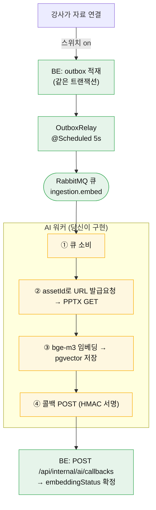
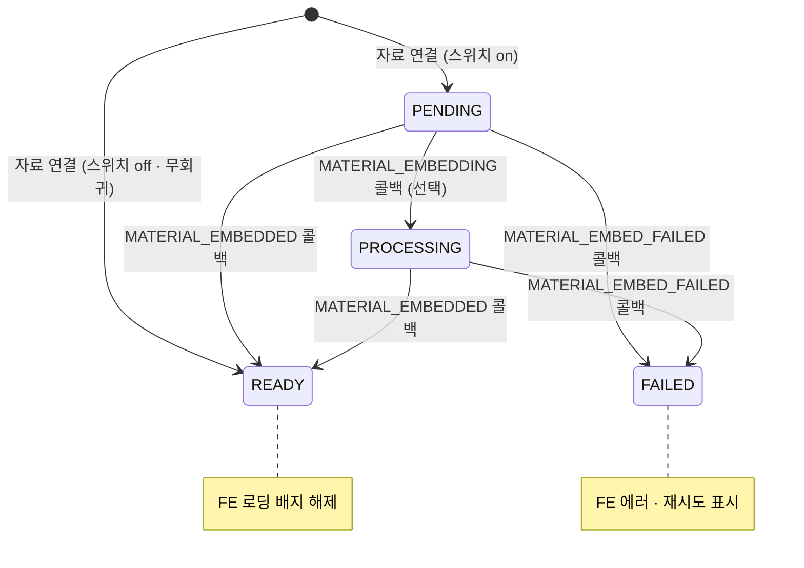

# AI 워커 통합 가이드 — 자료 임베딩 파이프라인

> 대상: AI 파트(유채은). 소스: BE(송정기), 계약 정본은 [ADR-0036](decisions/songjeongki/0036-material-embedding-pipeline.md).
> 이 문서는 **소비자(AI 워커) 관점**만 정리한다 — 뭘 받고 / 어떻게 파일을 읽고 / 어디로 결과를 보내는지.

BE·인프라(발행측 + RabbitMQ + 콜백 수신)는 실서버에 이미 배포돼 있다. 스위치(`MATERIAL_EMBEDDING_ENABLED`)만 꺼져 있어서 아직 잡이 안 실릴 뿐, AI 워커가 준비되면 켜면 바로 흐른다.


> 🟢 초록 = BE·인프라(실서버 배포 완료) · 🟡 노랑 = AI 워커가 구현할 부분

---

## 1. 큐에서 뭘 소비하나

| 항목 | 값 |
|---|---|
| 브로커 | RabbitMQ (prod 전용, 컨테이너 `rabbitmq`, `docker-compose.prod.yml`) |
| 큐 이름 | **`ingestion.embed`** (durable) |
| 익스체인지 | 기본(default) 익스체인지, 라우팅키 = 큐 이름 |
| 접속 | 현재 **prod 내부 네트워크 전용**(호스트 포트 미노출). 아래 §5 참고 |
| 메시지 본문 | UTF-8 JSON 문자열 하나 (아래 envelope) |

큐는 durable이라 소비자가 없어도 메시지가 쌓인다. `taskType`으로 임베딩/삭제를 구분한다.

### 1-1. 임베딩 잡 envelope (`taskType=PPTX_EMBED`)

```json
{
  "taskType": "PPTX_EMBED",
  "materialId": "uuid",         // 콜백에 그대로 되돌려줘야 함(상태 확정 키)
  "assetId": "uuid",            // ★ 파일 URL을 요청할 때 쓰는 키(§2)
  "lessonId": "uuid",
  "curriculumId": "uuid",
  "fileName": "강의자료.pptx",   // 원본 파일명(빈 문자열일 수 있음)
  "policy": { "embedModel": "bge-m3" },
  "contractVersion": 1
}
```
> 파일 위치·URL은 envelope에 **없다**(§2 B안). 워커는 처리 직전에 `assetId`로 다운로드 URL을 주문형 발급받는다 — 그래서 TTL 만료 걱정이 없다.

### 1-2. 삭제 잡 envelope (`taskType=EMBED_DELETE`)

자료가 연결 해제(소프트 삭제)되면 발행된다. **pgvector에서 해당 `materialId`의 chunk를 전부 지워라.**

```json
{
  "taskType": "EMBED_DELETE",
  "materialId": "uuid",
  "lessonId": "uuid",
  "contractVersion": 1
}
```
> 삭제 잡은 콜백이 필수는 아니다(BE는 이미 자료를 DELETED 처리함). 성공/실패 통지를 원하면 §3의 콜백을 써도 되지만 상태 전이 대상이 아니다.

---

## 2. PPTX 바이트를 어떻게 읽나 (확정: B — 주문형 presigned URL)

**워커가 잡을 처리하기 직전에 BE에 URL을 요청하고, 갓 서명된 presigned GET URL로 파일을 읽는다.**
URL을 큐에 싣지 않으므로(발급 즉시 사용) **TTL 만료 문제가 아예 없고**, 워커는 **스토리지 자격증명을 갖지 않는다**(최소권한).

| 항목 | 값 |
|---|---|
| 메서드·경로 | `POST https://jiphyeonjeon.thdwjdrl.com/api/internal/ai/materials/download-url` |
| 인증 | HMAC-SHA256 서명(콜백과 동일 방식·시크릿, §3-2) — `X-Signature` 헤더 |
| 본문 | `{"assetId": "<잡의 assetId>"}` |
| 성공 | `200` + `{"url": "https://.../liveclass-assets/material/...?X-Amz-..."}` |
| 서명 실패 | `401` |
| 없는/미완료/비-MATERIAL 에셋 | `404` |

Python 예시:
```python
import json, hmac, hashlib, base64, requests

body = json.dumps({"assetId": job["assetId"]}).encode("utf-8")
sig  = base64.b64encode(hmac.new(SECRET.encode(), body, hashlib.sha256).digest()).decode()
r = requests.post("https://jiphyeonjeon.thdwjdrl.com/api/internal/ai/materials/download-url",
                  data=body, headers={"Content-Type": "application/json", "X-Signature": sig})
url = r.json()["url"]
pptx_bytes = requests.get(url).content     # 갓 발급된 URL로 즉시 다운로드
```

> 서명 규칙은 콜백(§3-2)과 똑같다 — 서명한 바이트를 `data=`로 그대로 보낸다(`json=` 금지).
> 반려한 대안(A′: 워커가 MinIO 직접 접근)은 워커에 상시 자격증명이 필요해 최소권한에 어긋난다. 상세 비교는 ADR-0036.

---

## 3. 결과를 어디로 어떻게 보내나 (콜백)

임베딩이 끝나면(성공/실패) BE 콜백을 호출해 자료 상태를 확정한다.

| 항목 | 값 |
|---|---|
| 메서드·경로 | `POST https://jiphyeonjeon.thdwjdrl.com/api/internal/ai/callbacks` |
| 인증 | HMAC-SHA256 서명 (아래 §3-2). 세션·토큰 불필요 |
| Content-Type | 임의(`application/json` 권장). 서버는 **원시 바이트**로 검증하므로 보낸 그대로여야 함 |
| 성공 응답 | `204 No Content` |
| 서명 실패 | `401` |

### 3-1. 콜백 본문

```json
{
  "eventId": "uuid",                    // 이벤트 고유 id — 멱등 키. 재시도해도 같은 값 유지
  "eventType": "MATERIAL_EMBEDDED",     // 아래 표 참고
  "jobId": "worker-side-job-id",        // 선택(로그/추적용)
  "materialId": "uuid",                 // 큐에서 받은 값 그대로
  "lessonId": "uuid",                   // 선택
  "status": "..."                       // 선택(자유 텍스트, BE는 eventType만 봄)
}
```

| `eventType` | 결과 자료 상태(`embeddingStatus`) | 언제 |
|---|---|---|
| `MATERIAL_EMBEDDING` | `PROCESSING` | (선택) 임베딩 시작 알림 |
| `MATERIAL_EMBEDDED` | `READY` | 임베딩 완료 |
| `MATERIAL_EMBED_FAILED` | `FAILED` | 임베딩 실패 |

- **멱등**: BE는 `(source="ai-worker", eventId)` 복합키로 중복을 무시한다. 네트워크 재시도 시 **같은 `eventId`로 다시 보내면 안전**하다(중복 반영 없음). 새 사건이면 새 `eventId`.
- 모르는 `eventType`은 inbox에 기록만 하고 상태는 안 바꾼다(무해). 형식 미달(`eventId`/`eventType` 없음)은 조용히 `204`.

### 3-2. HMAC 서명 만드는 법

공유 시크릿 `ai.callback-secret`(prod env `AI_CALLBACK_SECRET`, 나와 같은 값)으로 **보낼 본문 바이트 그대로** 서명한다.

```
X-Signature: base64( HMAC-SHA256(secret, rawBody) )
```

Python 예시:
```python
import hmac, hashlib, base64, requests

body = json.dumps(payload).encode("utf-8")          # 이 바이트를 그대로 서명하고 그대로 전송
sig  = base64.b64encode(hmac.new(secret.encode(), body, hashlib.sha256).digest()).decode()

requests.post(
    "https://jiphyeonjeon.thdwjdrl.com/api/internal/ai/callbacks",
    data=body,                                       # ← json= 쓰지 말 것(재직렬화되면 서명 어긋남)
    headers={"Content-Type": "application/json", "X-Signature": sig},
)
```

> **핵심**: 서명한 바이트와 전송한 바이트가 **비트 단위로 동일**해야 한다. `requests`의 `json=`처럼 라이브러리가 본문을 다시 직렬화하면 401난다. 반드시 `data=body`로 이미 서명한 바이트를 보낸다.
>
> 무서명/오서명 검증(현재 실서버): `curl -X POST .../api/internal/ai/callbacks` → `401`.

---

## 4. 상태 모델 요약

자료 임베딩 상태(`embeddingStatus`) 전이 — 4값(PENDING/PROCESSING/READY/FAILED):


`embeddingStatus`는 자료 존재 여부(`MaterialStatus` ACTIVE/DELETED)와 **직교**한다. 스위치가 꺼져 있으면 연결 시 바로 `READY`(파이프라인 미가동, 무회귀). FE(윤광혁)가 이 값으로 로딩 UI를 그린다.

---

## 5. 남은 배선(스위치 켜기 전 체크리스트)

- [x] **§2 파일 접근 방식** — B 확정, BE가 주문형 발급 엔드포인트(`POST /api/internal/ai/materials/download-url`) 배선 완료. 워커는 MinIO 자격증명 불필요
- [ ] **워커의 RabbitMQ 접근 경로**: 큐는 prod 내부 네트워크 전용. 워커를 (a) 같은 compose 네트워크 컨테이너로 붙이거나 (b) 호스트 포트/방화벽 열어 접속. 같은 호스트 컨테이너 권장(`rabbitmq:5672` 내부 직결). ※ 콜백·URL 발급 HTTP 엔드포인트는 public HTTPS라 별도 개방 불필요
- [ ] **공유 시크릿 전달**: `AI_CALLBACK_SECRET` 하나(콜백 + URL 발급 공용) — 안전한 채널로 공유, 커밋 금지
- [ ] 워커: 큐 소비 → PPTX 파싱 → bge-m3 임베딩 → pgvector upsert → 콜백. 삭제 잡은 pgvector delete
- [ ] 위 완료 후 BE가 `MATERIAL_EMBEDDING_ENABLED=true`로 스위치 on → E2E("업로드→로딩→완료") 검증

---

## 부록 — 빠른 참조

| 무엇 | 값 |
|---|---|
| 소비 큐 | `ingestion.embed` (durable, default exchange, routing key=큐명) |
| 임베딩 잡 | `taskType=PPTX_EMBED`, 모델 `bge-m3`, `contractVersion=1` |
| 삭제 잡 | `taskType=EMBED_DELETE` |
| 콜백 | `POST /api/internal/ai/callbacks`, `X-Signature: base64(HMAC-SHA256(secret, body))`, `204`/`401` |
| 완료 이벤트 | `MATERIAL_EMBEDDED`→READY, `MATERIAL_EMBED_FAILED`→FAILED, `MATERIAL_EMBEDDING`→PROCESSING |
| 멱등 키 | 콜백 `eventId`(재시도 시 동일 유지) |
| 파일 URL | `POST /api/internal/ai/materials/download-url` `{assetId}`(HMAC) → `{url}`, 그 URL로 즉시 GET |
