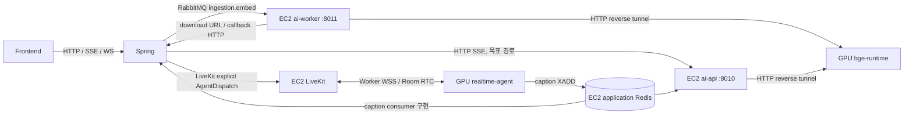

# AI 통신 계약 지도

이 문서는 LiveClass의 **Java↔AI** 및 **EC2 AI↔GPU AI** 통신 경계를 한곳에서 찾기 위한 인덱스다.
HTTP endpoint뿐 아니라 RabbitMQ queue, Redis Stream, LiveKit AgentDispatch와 SSH port forwarding을
함께 다룬다.

## 1. 문서 권한과 범위

- Java와 공유하는 payload, 상태코드, 인증과 멱등 규칙의 정본은 [`docs/CONTRACT.md`](../CONTRACT.md)다.
- Python 서비스의 상세 검증 규칙은 각 서비스 `CONTRACT.md`가 소유한다.
- 이 문서는 프로세스별 주소, 호출 방향, transport, 현재 배선 상태와 상세 정본으로 가는 경로를 소유한다.
- 이 문서와 루트 공유 계약이 충돌하면 Java 공유 경계에서는 루트 `docs/CONTRACT.md`가 우선한다.

| 프로세스 | 실행 위치 | 역할 |
|---|---|---|
| [`ai-api`](../../ai/ai-api/README.md) | EC2 | Spring 전용 RAG SSE 서비스 |
| [`ai-worker`](../../ai/ai-worker/README.md) | EC2 | RabbitMQ 자료 작업 consumer |
| [`realtime-agent`](../../ai/realtime-agent/README.md) | GPU | LiveKit audio→STT→Redis caption agent |
| [`bge-runtime`](../../ai/bge-runtime/README.md) | GPU | BGE-M3 embedding HTTP runtime |

Frontend는 위 프로세스를 직접 호출하지 않는다. 사용자 인증·권한·공개 API와 브라우저용 SSE/WS는
Spring이 소유한다.

## 2. 전체 통신 구조



## 3. AI 프로세스 제공 HTTP endpoint

| 제공자 | 기본 bind | 운영 접근 주소 | method/path | 호출자 | 인증 | 용도 |
|---|---|---|---|---|---|---|
| ai-api | `127.0.0.1:8010` | 배포 설정 주입 | `GET /healthz` | 운영 probe | 없음, loopback 전제 | 프로세스 생존 |
| ai-api | `127.0.0.1:8010` | 배포 설정 주입 | `GET /readyz` | 운영 probe | 없음, loopback 전제 | lifespan 준비 |
| ai-api | `127.0.0.1:8010` | 배포 설정 주입 | `POST /internal/v1/rag/answers:stream` | Spring | `X-Internal-Signature` HMAC | RAG SSE |
| ai-worker | `127.0.0.1:8011` | 배포 설정 주입 | `GET /healthz` | 운영 probe | 없음, loopback 전제 | worker 생존 |
| ai-worker | `127.0.0.1:8011` | 배포 설정 주입 | `GET /readyz` | 운영 probe | 없음, loopback 전제 | runtime 준비 |
| bge-runtime | GPU `127.0.0.1:8020` | host `:18020`; container `:18080/internal/bge` | `GET /healthz` | EC2 AI/운영 | 없음, 내부망 전제 | FastAPI 생존 |
| bge-runtime | GPU `127.0.0.1:8020` | host `:18020`; container `:18080/internal/bge` | `GET /readyz` | ai-api, ai-worker | 없음, 내부망 전제 | model warmup 완료 |
| bge-runtime | GPU `127.0.0.1:8020` | host `:18020`; container `:18080/internal/bge` | `POST /internal/v1/embeddings` | ai-api, ai-worker | Bearer token | embedding |
| realtime-agent | GPU `127.0.0.1:8081` | EC2 `127.0.0.1:18081` | `GET /health/live` | 운영/Spring 목표 경로 | 없음, loopback 전제 | Python health server 생존 |
| realtime-agent | GPU `127.0.0.1:8081` | EC2 `127.0.0.1:18081` | `GET /health/ready` | 운영/Spring 목표 경로 | 없음, loopback 전제 | STT prewarm·AgentServer·LiveKit 준비 |
| realtime-agent | GPU `127.0.0.1:8081` | EC2 `127.0.0.1:18081` | `GET /` | 기존 운영 smoke | 없음, loopback 전제 | 호환용 plain `OK` |

realtime-agent는 FastAPI가 아니다. Python `ThreadingHTTPServer`가 loopback `:8081`의 service health를
제공하고 LiveKit Agents SDK의 자체 HTTP server는 loopback 임의 port를 사용한다. `:8081/worker`는
존재하지 않으며 알 수 없는 path는 404다.

### 3.1 management endpoint 의미

- ai-api `/readyz`는 lifespan 준비 상태이며 Redis, PostgreSQL, BGE와 GMS의 매 요청 성공을 증명하지 않는다.
- ai-worker는 material consumer가 꺼져 있으면 event loop 준비를, 켜져 있으면 RabbitMQ·PostgreSQL·BGE
  readiness를 포함해 `/readyz`를 결정한다.
- bge-runtime `/readyz`는 model warmup 완료 뒤에만 200을 반환한다.
- realtime-agent `/health/live`는 HTTP server 생존만 확인한다.
- `/health/ready`는 설정된 모든 child prewarm, AgentServer 시작과 현재 LiveKit 연결을 요구한다.
  Redis, session lease, room audio, engine queue와 dispatch capacity는 검사하지 않으므로 job-level
  `STT_READY` gate를 대체하지 않는다.

### 3.2 secret 소유권

| 배포 env | 실제 소비자 | 용도 | GPU 사용 |
|---|---|---|---|
| `AI_INTERNAL_SECRET` | ai-api; 향후 Spring signer | Spring→ai-api RAG HMAC | 사용하지 않음 |
| `AI_CALLBACK_SECRET` | Spring; ai-worker mapping | 자료 download-url·callback HMAC | realtime callback 활성 시에만 선택 사용 |
| `BGE_RUNTIME_INTERNAL_TOKEN` | GPU bge-runtime; EC2 compose mapping | EC2 AI→GPU BGE Bearer | 사용 |

운영 compose는 `BGE_RUNTIME_INTERNAL_TOKEN`을 ai-api의 `AI_API_BGE_TOKEN`과 ai-worker의
`AI_WORKER_BGE_INTERNAL_TOKEN`으로, `AI_CALLBACK_SECRET`을 worker의
`AI_WORKER_SPRING_HMAC_SECRET`으로 매핑한다. `AI_INTERNAL_SECRET`은 이름이 바뀌지 않았지만 현재
Spring signer가 아직 없어 ai-api만 소비한다.

## 4. Java↔AI 통신

### 4.1 Spring→ai-api RAG SSE

```http
POST /internal/v1/rag/answers:stream
Accept: text/event-stream
X-Internal-Signature: base64(HMAC-SHA256(AI_INTERNAL_SECRET, rawBody))
Content-Type: application/json
```

요청은 `requestId`, `lessonId`, `sessionId`, `question`, `contextTimeMs`, `issuedAtMs`를 포함한다.
응답은 `answer.delta` 0개 이상과 `answer.done|answer.insufficient|answer.error` terminal 하나로 끝난다.

현재 ai-api route와 HMAC verifier는 구현됐지만 Spring signer와 browser-facing SSE proxy는 구현되지
않았다. `AI_INTERNAL_SECRET`이 없으면 503으로 fail-closed한다. 상세 계약은
[`ai-api/CONTRACT.md`](../../ai/ai-api/CONTRACT.md)를 따른다.

### 4.2 Spring→ai-worker 자료 작업

자료 작업에는 HTTP submit endpoint가 없다.

| 항목 | 값 |
|---|---|
| exchange | RabbitMQ default exchange |
| routing key / durable queue | `ingestion.embed` |
| task | `PPTX_EMBED`, `EMBED_DELETE` |
| 실패 보존 queue | `ingestion.embed.dlq` |
| worker prefetch | 1 |

consumer는 `AI_WORKER_MATERIAL_INGESTION_ENABLED=true`일 때만 시작한다. wire 정본은
[`docs/CONTRACT.md` §3-1](../CONTRACT.md#3-1-spring--ai-배치-잡-rabbitmq), Python 적용 규칙은
[`ai-worker/CONTRACT.md` §9.1](../../ai/ai-worker/CONTRACT.md#91-rabbitmq-wire-envelope)에 있다.

### 4.3 ai-worker→Spring 자료 source

```http
POST /api/internal/ai/materials/download-url
X-Signature: base64(HMAC-SHA256(AI_CALLBACK_SECRET, rawBody))
Content-Type: application/json

{"assetId":"<job assetId>"}
```

성공은 `200 {"url":"https://..."}`다. worker는 URL을 저장하지 않고 즉시 GET하며 MinIO credential을
소유하지 않는다. Spring endpoint와 worker adapter가 모두 구현돼 있다.

### 4.4 ai-worker→Spring 결과 callback

```http
POST /api/internal/ai/callbacks
X-Signature: base64(HMAC-SHA256(AI_CALLBACK_SECRET, rawBody))
Content-Type: application/json
```

성공은 204다. Spring은 `(source=ai-worker, eventId)`로 중복을 제거한다. 자료가 ACTIVE로 commit된 뒤
`MATERIAL_EMBEDDED/READY`를 보내며 영구 실패는 `MATERIAL_EMBED_FAILED/FAILED`를 보낸다.
정본은 [`docs/CONTRACT.md` §3-2](../CONTRACT.md#3-2-ai--spring-callback-http-서명--구현됨)다.

### 4.5 Spring→realtime-agent 작업 시작

Spring이 GPU HTTP 주소를 호출하지 않는다.

```text
Spring
  → LiveKit explicit named AgentDispatch
  → persistent Worker WebSocket
  → GPU realtime-agent job
```

- Java `agentName`과 Python `STT_AGENT_NAME`은 같아야 한다.
- Room은 `session-{sessionId}`다.
- metadata는 `contractVersion`, `sessionId`, `lessonId`, `correlationId` 네 필드만 가진다.
- 실제 값은 [`dispatch fixture`](../../ai/realtime-agent/contracts/fixtures/dispatch-metadata.valid.json)를
  사용한다.

양쪽 dispatch 구현은 존재하지만 현재 `live.stt.assume-ready=true` 기본값으로 job별 STT readiness gate를
우회한다. 상세는 [`docs/CONTRACT.md` §3-3](../CONTRACT.md#3-3-spring--realtime-agent-livekit-explicit-agentdispatch--ai-구현됨-spring-phase-4a-구현)다.

### 4.6 realtime-agent→application Redis 자막

| 항목 | 값 |
|---|---|
| Redis | LiveKit 내부 Redis가 아닌 application Redis |
| Stream key | `CAPTION_STREAM_KEY`, 기본 `ai:captions:live` |
| write | `XADD MAXLEN ~ CAPTION_STREAM_MAXLEN` |
| event | `caption.delta`, `caption.stream.completed` |
| idempotency | `eventId` |
| attempt scope | `(sessionId, sttSessionId)` |
| ai-api consumer group | `ai-rag-live-v1` |

payload는 [`delta fixture`](../../ai/realtime-agent/contracts/fixtures/caption-delta.valid.json)와
[`completion fixture`](../../ai/realtime-agent/contracts/fixtures/caption-completed.valid.json)를 따른다.
ai-api consumer는 구현됐고 Spring caption consumer도 구현됐다(별도 group `spring-caption-live-v1`,
`eventId` 멱등, `core.live_caption` append-only 영속, `/topic/.../captions` WS 전달, raw `streamElapsedMs`
그대로 — [ADR-0043](../../docs/decisions/songjeongki/0043-caption-consumer-persistence.md)). Spring consumer는
`spring.data.redis`가 가리키는 프로필 구동 Redis를 소비한다. prod 캡션-Redis 토폴로지(현재 prod redis ≠
캡션 redis)는 AI/인프라 오너 작업으로 남아 있다.

### 4.7 realtime-agent→Spring lifecycle

Python callback client는 구현돼 있지만 `SPRING_STATUS_CALLBACK_ENABLED=false`가 기본값이다.
Spring receiver URL은 아직 확정·구현되지 않았고 기존 material callback `/api/internal/ai/callbacks`와
서명·body가 호환되지 않는다. 두 callback을 같은 endpoint로 보내지 않는다.

정상 종료는 HTTP/Redis stop endpoint가 아니라 Spring의 LiveKit Room 삭제다. agent는 `ROOM_DELETED`만
정상 EOF로 보고 drain 뒤 `caption.stream.completed`를 발행한다.

## 5. EC2 AI↔GPU AI 통신

### 5.1 SSH forward 지도

GPU host는 application inbound port를 public ingress로 열지 않는다. GPU가 EC2로 SSH 연결을 시작하고
다음 forwarding을 유지한다.

| 방향 | GPU 주소 | EC2 주소 | protocol/용도 |
|---|---|---|---|
| local `-L` | `127.0.0.1:7443` | `localhost:7443` | LiveKit Worker WSS/API |
| local `-L` | `127.0.0.1:4000` | `localhost:4000` | application Redis lease/caption |
| local `-L` | `127.0.0.1:3478` | `localhost:3478` | TURN/TCP Room media |
| reverse `-R` | realtime-agent `127.0.0.1:8081` | `127.0.0.1:18081` | service liveness/readiness |
| reverse `-R` | bge-runtime `127.0.0.1:8020` | `127.0.0.1:18020` | BGE readiness/embedding |

실제 SSH TCP connection은 realtime control(LiveKit·Redis·health), TURN media, BGE supervisor 세 개로
분리한다. 같은 EC2 SSH endpoint와 key를 사용해도 ControlPath와 장애 범위를 공유하지 않는다.

세부 실행은 [`realtime-agent tunnel 문서`](../../ai/realtime-agent/scripts/README.md)와
[`BGE tunnel 문서`](../../ai/bge-runtime/scripts/README.md)를 따른다.

### 5.2 EC2 AI→GPU BGE

EC2 host process의 운영 origin은 `http://127.0.0.1:18020`이다. 운영 container의 base URL은
`http://host.docker.internal:18080/internal/bge`이며 5.4의 nginx를 거쳐 같은 reverse tunnel에 도달한다.

```http
GET http://127.0.0.1:18020/readyz
```

```http
POST http://127.0.0.1:18020/internal/v1/embeddings
Authorization: Bearer <BGE_INTERNAL_TOKEN>
Content-Type: application/json

{
  "model": "BAAI/bge-m3",
  "revision": "5617a9f61b028005a4858fdac845db406aefb181",
  "texts": ["첫 번째 chunk", "두 번째 chunk"]
}
```

성공은 같은 model/revision, `dimensions=1024`, `normalized=true`와 입력 개수·순서를 보존한
`embeddings`를 반환한다. Java는 BGE를 직접 호출하지 않는다. 정본은
[`docs/CONTRACT.md` §3-7](../CONTRACT.md#3-7-ec2-ai-worker--gpu-bge-runtime-http--ai-구현됨)다.

### 5.3 EC2→GPU realtime-agent management

```http
GET http://127.0.0.1:18081/health/live
```

성공은 200이다.

```json
{"contractVersion":"1","status":"alive","service":"realtime-agent"}
```

```http
GET http://127.0.0.1:18081/health/ready
```

준비되면 200과 `status:"ready"`, 준비 전에는 503과 `status:"notReady"`를 반환한다.

```json
{"contractVersion":"1","status":"notReady","service":"realtime-agent","sttProvider":"nemotron","workerStarted":true,"liveKitConnected":false,"modelsReady":true,"readyProcessCount":12,"expectedProcessCount":12}
```

`GET /`는 호환용 plain `OK`이고 `:18081/worker`는 존재하지 않는다. 두 health 경로는 dispatch 생성,
slot 예약 또는 job stop에 사용하지 않는다. 상세 body와 의미는
[공유 계약 §3-8](../CONTRACT.md#3-8-gpu-realtime-agent-service-health-http--ai-구현됨-spring-consumer-미구현)을 따른다.

### 5.4 EC2 container용 내부 nginx proxy

[`gpu-proxy.conf`](../../infra/nginx/gpu-proxy.conf)는 host network `:18080`에서 다음 prefix를 제공한다.

| 요청 prefix | upstream |
|---|---|
| `/internal/realtime-agent/` | EC2 `127.0.0.1:18081/` |
| `/internal/bge/` | EC2 `127.0.0.1:18020/` |

```text
GET  /internal/realtime-agent/health/live
GET  /internal/realtime-agent/health/ready
GET  /internal/realtime-agent/              # 호환용 smoke
GET  /internal/bge/readyz
POST /internal/bge/internal/v1/embeddings
```

`docker-compose.ai-prod.yml`은 ai-api와 ai-worker의 BGE base URL을
`http://host.docker.internal:18080/internal/bge`로 주입한다. 두 client 설정은 안전한 path prefix를
허용하므로 embedding 요청이 `/internal/bge/internal/v1/embeddings`로 전달된다.

Spring realtime-agent health proxy client는 아직 없다. 따라서 `/internal/realtime-agent/*`는 proxy만
준비됐고, `/internal/bge/*`는 운영 AI container caller까지 배선된 상태다.

## 6. 지원하지 않는 직접 호출

- Frontend→ai-api/ai-worker/realtime-agent/bge-runtime 직접 호출
- Spring→bge-runtime 직접 호출
- Spring→realtime-agent 업무 HTTP 호출
- ai-worker HTTP job submit
- realtime-agent HTTP stop
- GPU `8020`·`8081` public ingress
- material callback body를 realtime lifecycle callback으로 재사용

## 7. 현재 구현 상태

| 경계 | 상태 |
|---|---|
| Spring→ai-api RAG SSE | AI route/auth 구현, Spring signer/proxy 미구현 |
| Spring→RabbitMQ→ai-worker | 양쪽 구현, Spring producer·worker 앱 기본 비활성, AI 운영 compose는 worker만 활성 |
| ai-worker→Spring download URL/callback | 양쪽 구현 |
| ai-worker/ai-api→BGE | runtime/client/reverse tunnel/운영 container proxy 배선 구현 |
| Spring→LiveKit→realtime-agent dispatch | 양쪽 Phase 4a 구현, STT readiness gate 우회 중 |
| realtime-agent→Redis caption | producer·ai-api consumer·Spring consumer 구현(Spring: 별도 group·eventId 멱등·core.live_caption 영속·WS 전달, ADR-0043). prod 캡션-Redis 토폴로지는 인프라 오너 후속 |
| realtime-agent→Spring lifecycle callback | AI v1 구현·기본 off, Spring receiver 미구현 |
| realtime-agent service health `:18081` | endpoint·schema·tunnel 구현, Spring client 미구현 |
| nginx `:18080/internal/bge/*` | ai-api·ai-worker 운영 container caller 배선 구현 |
| nginx `:18080/internal/realtime-agent/*` | proxy 구현, Spring health client 미구현 |

## 8. 변경 규칙

- Java 공유 field, 상태코드, queue/stream payload, 인증 또는 멱등 규칙 변경은 루트
  [`docs/CONTRACT.md`](../CONTRACT.md), Java/Python 구현과 양쪽 계약 테스트를 같은 변경에서 갱신한다.
- AI process port, management path, SSH forward 또는 nginx prefix 변경은 이 문서와 해당 `.env.example`,
  tunnel script, deploy 문서와 proxy 설정을 함께 갱신한다.
- 서비스 README에는 전체 계약을 복제하지 않고 통신 요약과 이 문서 링크만 둔다.
- 구현 상태가 바뀌면 구현 MR에서 7절을 함께 갱신한다.
