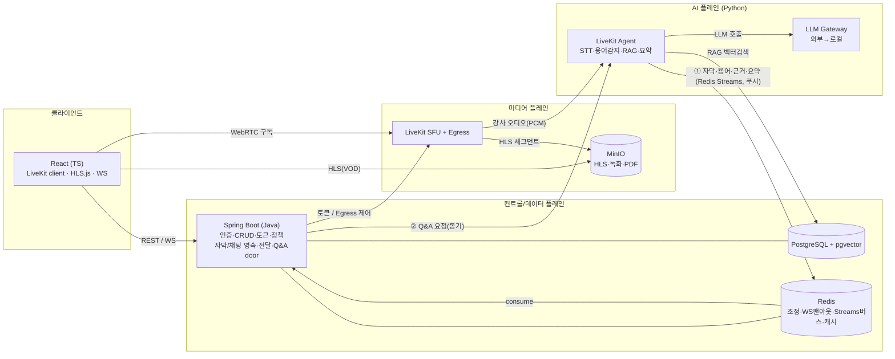
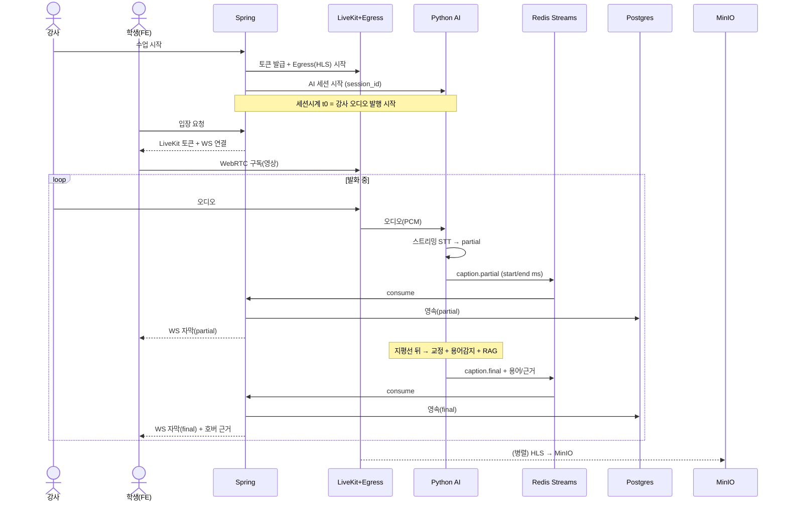
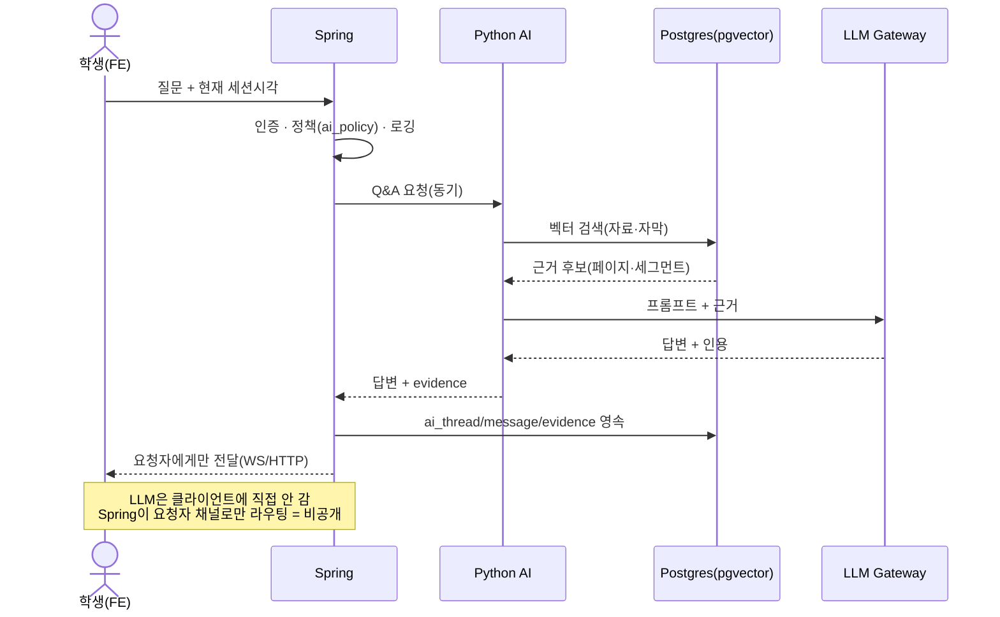
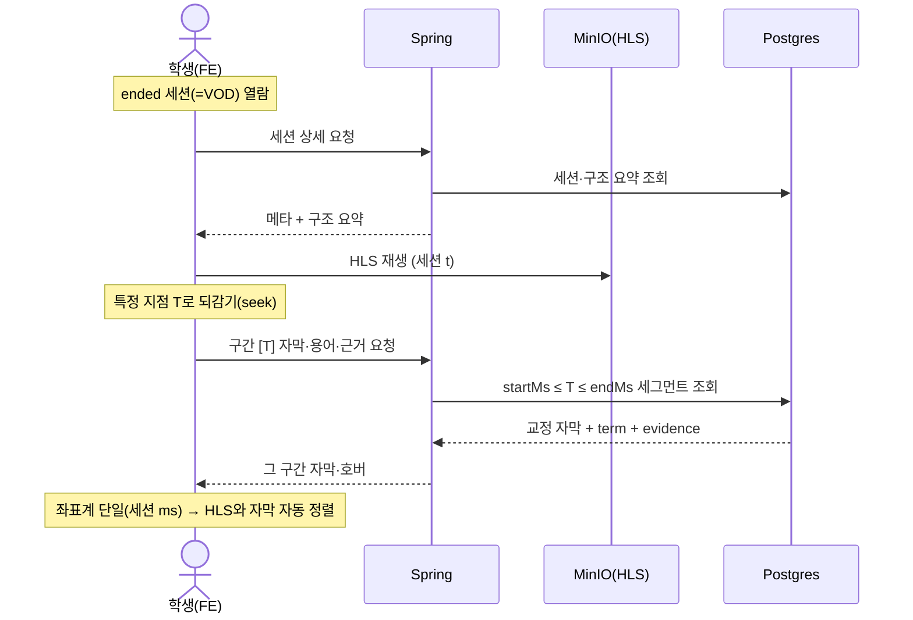
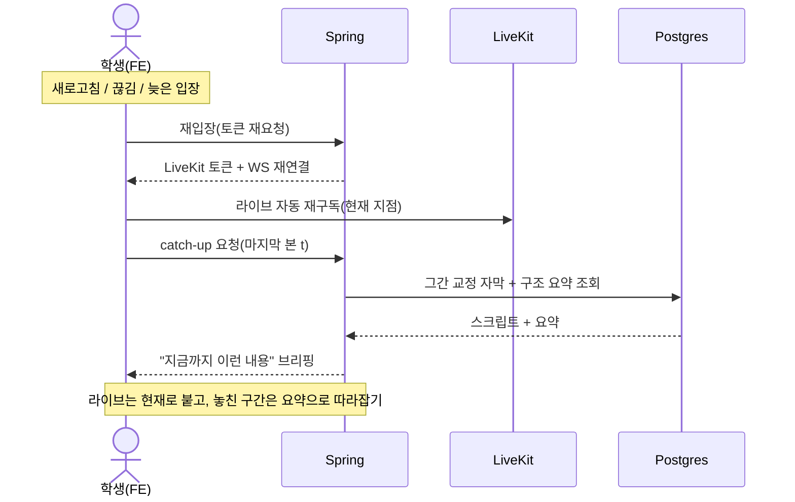
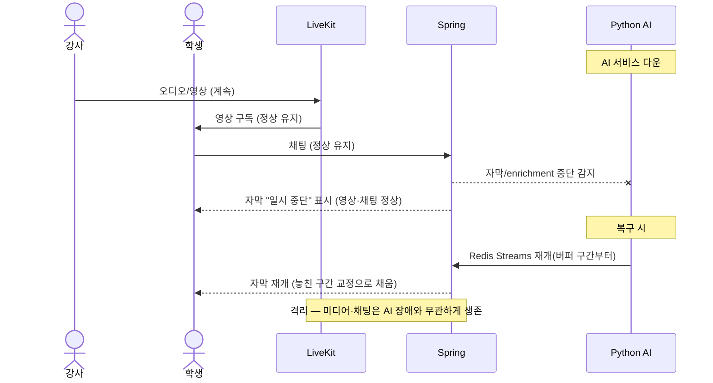

# LiveClass AI — 아키텍처 (확정판)

> 📍 하네스 개요: [harness/README.md](harness/README.md) · 정본 규칙: [../AGENTS.md](../AGENTS.md)
>
> 이 문서는 LiveClass AI의 **확정 아키텍처 기준선**이다. 결정 근거는 [decisions/](decisions/)의 ADR에, 세부 계약은 [CONTRACT.md](CONTRACT.md)에 둔다. 결정이 바뀌면 이 문서와 해당 ADR을 함께 갱신한다.

## 제품 한 줄
WebRTC 그룹 화상수업에 **실시간 자막 · 자료 근거 AI 설명 · 따라잡기 · 강사 피드백**을 결합한 실시간 온라인 강의 플랫폼.

> 기존 부트캠프 PJT 명세서·스켈레톤 코드는 **참고용**이며, 본 기획에 맞춰 제로베이스로 재설계한다. 근거: [decisions/0003-greenfield-redesign.md](decisions/0003-greenfield-redesign.md)

## 확정 스택

| 컴포넌트 | 스택 | 근거 ADR |
|---|---|---|
| Front-end | **React + TypeScript** (FE/BE 분리 배포) | [0002](decisions/0002-react-typescript-frontend.md) |
| 컨트롤/데이터 | **Spring Boot (Java)** + JWT + JPA | [0006](decisions/0006-backend-spring-plus-python-ai.md) |
| AI | **Python** (LiveKit Agent · STT · RAG) | [0006](decisions/0006-backend-spring-plus-python-ai.md) |
| 미디어 | **LiveKit self-host (SFU) + Egress** | [0004](decisions/0004-media-livekit-selfhost.md) |
| DB | **PostgreSQL + pgvector** | [0005](decisions/0005-db-postgres-pgvector.md) |
| 캐시·버스 | **Redis** (LiveKit 조정 · WS 팬아웃 · Streams 버스 · 캐시) | [0008](decisions/0008-ai-bus-redis-streams-session-clock.md) |
| 스토리지 | **MinIO** (S3 호환: HLS · 녹화 · PDF) | — |
| LLM | 외부 API → 게이트웨이 뒤(추후 로컬 전환) | — |

- API: REST, `/api/v1` prefix, Swagger/OpenAPI. 실시간: WebRTC(미디어) + WebSocket(자막·채팅).
- FE dev 8083, Spring 8080. **FE/BE 분리 배포**(통합 빌드 아님).

## 핵심 아키텍처 원칙 — 플레인 분리

- **미디어 플레인** = LiveKit 전용. WebRTC 오디오/영상 + Egress(HLS·녹화)만. 텍스트(자막·채팅)는 다루지 않는다.
- **컨트롤·데이터 플레인** = Spring. 인증·CRUD·LiveKit 토큰·Egress 제어·정책·채팅/자막 소유·영속·전달·Q&A 프론트도어.
- **AI 플레인** = Python. LiveKit Agent로 오디오 구독 → STT·용어 감지·RAG·요약·AI Gateway.
- **격리**: AI 플레인이 죽어도 영상(LiveKit)·채팅(Spring)은 유지되고 자막·보강만 중단된다.

### 컴포넌트 다이어그램

## Python ↔ Spring 인터페이스 (2경로)

확정 인터페이스이므로 계약을 명시한다([CONTRACT.md](CONTRACT.md)).

- **경로 ① 라이브 enrichment (Redis Streams, 비동기 푸시)**: 자막(partial/final/revised) + 용어감지 + RAG 근거 + 구조 요약을 Python이 스트림에 밀고 Spring이 소비 → 영속 + WS 브로드캐스트. 스트림이라 내구성·재처리·리플레이 가능.
- **경로 ② Q&A (동기 요청/응답)**: `Spring → Python(RAG) → LLM Gateway → Python → Spring`. 스트림 아님. **LLM은 클라이언트에 직접 가지 않는다** — Spring이 인증·정책·로깅 후 **요청자 채널로만** 라우팅(비공개).

## 자막 싱크 — 단일 좌표계

모든 시간을 **세션 상대 ms**(t0 = 강사 오디오 발행 시작)로 통일한다. 자막·채팅·HLS·되감기가 한 축에 정렬되어 되감기·리플레이 정렬이 공짜로 맞는다. 라이브에선 STT 지연(~1–2s)만큼 자막이 영상(~0.3s)보다 뒤지며(허용), **보강 지평선**으로 흡수: 라이브 엣지는 partial(부정확) 그대로, 지평선 뒤는 교정 final + 용어·근거. 근거: [decisions/0008-ai-bus-redis-streams-session-clock.md](decisions/0008-ai-bus-redis-streams-session-clock.md)

### 시퀀스 — 라이브 강의 + 자막

### 시퀀스 — 학생 Q&A (비공개)

## 도메인 모델 (live_session 중심)

근거: [decisions/0007-domain-live-session.md](decisions/0007-domain-live-session.md)

**코어 (CP0~3)**
- `user` — 계정. 역할은 세션별.
- `session` — 강의 세션. `host_user_id`, `title`, `status`(scheduled/live/ended), `media_start_at`(세션시계 t0), `livekit_room`. **ended면 그대로 VOD.**
- `session_participant` — `session_id`, `user_id`, `role`(host/student), joined/left.
- `material` / `material_version` — 강의 PDF. 버전 불변 + 페이지 앵커.
- `transcript_segment` — `session_id`, `start_ms`/`end_ms`(세션 상대), `text`, `revision`(streaming/batch), 안정 `segment_id`.
- `chat_message` — `session_id`, `user_id`, `session_ms`, `text`. 영속·리플레이.

**AI 레이어 (CP2·CP6)**: `transcript_summary`, `ai_thread`/`ai_message`/`evidence`, `ai_policy`. (후순위: understanding_signal 등)

**권한**: 역할(host/student)은 세션별. 전역 RBAC와 별개.

## 런타임 플로우

**라이브**: 강사 세션 생성·PDF 업로드 → 수업 시작(LiveKit 토큰 + Egress + AI 세션, t0 기록) → 학생 입장(토큰 → WebRTC 구독 + WS) → 강사 오디오 → Python STT 세그먼트 → Redis Streams → Spring 영속 + WS → 교정 구간 용어·RAG → Egress HLS → MinIO → 학생 질문은 Spring 경유 비공개 응답.

**VOD/되감기**: `session` ended → HLS(MinIO) + 저장된 세그먼트·요약 → FE가 세션 ms로 seek → 그 구간 교정자막·용어호버·저장 컨텍스트 Q&A. 좌표계가 하나라 정렬은 공짜.

**재접속·늦은 입장**: 라이브 자동 재구독 + Spring에서 교정 스크립트·구조 요약 로드로 따라잡기.

## 추가 시퀀스 (VOD · 재접속 · 장애)

### VOD / 되감기

### 재접속 / 늦은 입장 catch-up

### 장애 / 격리 (AI 서비스 다운)

## 데모 체크포인트 (증분, 각 지점 독립 데모 가능)

- **CP0** 기반: 로그인·회원 + 세션 CRUD·입장.
- **CP1** VOD 자막: 업로드 강의 + PDF → 배치 STT → 타임라인 재생.
- **CP2** VOD 용어·근거(제품 핵심): 용어 강조 + 클릭 시 자료·발화 근거 설명.
- **CP3** 라이브 미디어: LiveKit 그룹 화상 + Spring 채팅.
- **CP4** 라이브 자막: 스트리밍 STT → 실시간 partial 자막.
- **CP5** 되감기 + 보강: HLS 되감기 + 교정 자막·호버.
- **CP6** 전체: 2-pass 교정 + 구조 요약 + 개인 Q&A + 따라잡기.

> 설계 제1원칙: **각 CP가 독립적으로 완성·데모 가능**해야 한다(중간에 멈춰도 그 지점까지 온전한 제품). 안전 데모 지점: CP2(제품 핵심)·CP3(라이브 필수).

## 열린 결정 / TODO
- Python↔Spring 메시지 스키마 상세, 세션시계 변환 기준점(LiveKit 트랙 타임스탬프 → 세션 t).
- STT 공급자 bake-off(한국어 강의: 전문용어 recall·latency·비용), 스트리밍/배치.
- RAG 근거 검증 메커니즘(인용 강제, 근거 없으면 "모름"), 임베딩 모델(한국어).
- LiveKit self-host 구성(Docker Compose: LiveKit·Redis·Egress·Spring·Python·Postgres·MinIO).
- 요약·압축 정책(요약 단위·갱신 주기·RAG 컨텍스트 계층), LLM 로컬 전환 시점, 보존 기간.
