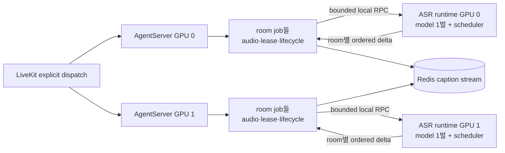

# ADR-0026: realtime STT 동시성은 GPU별 격리 pool로 열고 shared batch runtime으로 이행

- **상태**: 채택
- **일자**: 2026-07-28
- **관련**: [ADR-0010](0010-realtime-agent-room-job-boundary.md),
  [ADR-0012](0012-realtime-stt-provider-and-overload-boundary.md),
  [ADR-0024](0024-realtime-agent-gpu-turn-runtime.md),
  [ADR-0027](0027-realtime-stt-shared-gpu-runtime.md),
  [realtime-agent CONTRACT](../../../ai/realtime-agent/CONTRACT.md)

## 맥락

현재 `realtime-agent`는 LiveKit `AgentServer` 하나가 named worker로 등록되고, dispatch마다 격리된
job process를 실행한다. `NemotronStreamingEngine`은 job마다 `NemotronStreamingASR`을 만들고 모델을
lazy-load하며, `STT_MAX_ACTIVE_JOBS=1`만 허용한다. 따라서 첫 room이 실행 중이면 같은 worker로 온
두 번째 dispatch는 LiveKit에서 pending이 된다.

동시 room을 늘리는 방법은 크게 다음 세 가지다.

1. room/job process마다 모델 가중치를 하나씩 적재한다.
2. 모델 하나를 여러 room thread가 동시에 호출한다.
3. GPU별 모델 하나를 가진 별도 inference runtime이 여러 room의 오디오를 모아 batch 처리한다.

또한 평균 강의에는 silence가 많으므로 room마다 가변 가중치를 부여해 overbooking할 수도 있다. 그러나
여러 강사가 동시에 발화하는 순간에는 모든 room이 한꺼번에 GPU를 요구하므로, 평균 사용률만으로
admission을 열면 bounded audio queue와 실시간 자막 지연을 보장할 수 없다.

이 ADR은 현재 GPU 서버에서 어느 정도까지 안전하게 병렬 처리할 수 있는지 측정하고, 즉시 적용할
구조와 장기 목표 구조를 분리한다.

## 전제와 공식 구현 특성

- 서버는 NVIDIA H200 NVL 2장이다. PyTorch가 인식한 device memory는 장당 139.81 GiB이고 두 GPU는
  서로 다른 NUMA node에 연결돼 있다.
- 측정 환경은 Python 3.12, `torch==2.11.0+cu128`, Transformers 5.14.1, FP32 local checkpoint,
  `num_lookahead_tokens=6`(streaming latency 560 ms)이다.
- Nemotron 3.5 ASR은 cache-aware FastConformer-RNNT이며 80/160/320/560/1120 ms streaming
  지점을 제공한다. Transformers streaming `generate()`는 experimental API다.
  [공식 Transformers 문서](https://huggingface.co/docs/transformers/v5.13.1/en/model_doc/nemotron3_5_asr#streaming-transcription)
- NVIDIA의 단일 H100 기준 자료는 최적화된 cache-aware streaming 경로에서 80 ms 설정 240 stream,
  1120 ms 설정 2,400 stream을 제시한다. 이는 현재의 Transformers job별 모델 경로와 다른 runtime
  결과이므로 우리 서버 용량으로 환산하지 않는다.
  [공식 model card](https://huggingface.co/nvidia/nemotron-3.5-asr-streaming-0.6b#throughput--efficiency)
- LiveKit Agents는 job을 별도 process에서 실행하며 `setup_fnc`로 모델을 prewarm하고,
  `num_idle_processes`로 warm process 수를 정할 수 있다. custom `load_fnc`로 active job 기반 admission을
  제어할 수 있다.
  [LiveKit server options](https://docs.livekit.io/agents/server/options/)

## 2026-07-28 GPU 용량 실험

### 방법

- Hugging Face 공식 문서가 사용하는 공개 비민감
  [`obama.mp3`](https://huggingface.co/datasets/hf-internal-testing/dummy-audio-samples/resolve/main/obama.mp3)에서
  서로 다른 구간을 잘라 사용했다.
- decoder 부하가 빠진 silence 벤치마크가 되지 않도록 실제 영문 출력이 발생하는 `en-US` 음성을 썼다.
- 현행 구조를 재현하기 위해 동시 room마다 독립 OS process와 독립 FP32 model instance를 사용했다.
- 모든 process가 모델 적재를 마친 뒤 같은 시점에 8초 또는 2초 발화를 시작하는 burst를 만들었다.
- 8초는 현재 VAD의 강제 분할 상한이다. 2초 발화는 silence close 500 ms를 더해 약 2.5초마다 다음
  segment가 만들어지는 짧은 발화 반복을 대표한다.
- 두 GPU 동시 실험은 GPU 0/process를 NUMA 0, GPU 1/process를 NUMA 1에 고정했다.
- 운영 후보는 `p95 처리시간 <= 다음 segment 생산 주기의 70%`로 잡아 최소 30% headroom을 요구한다.

이 결과는 단일 burst 위주의 engineering benchmark다. Korean CER, LiveKit 수신, Redis publish,
장시간 열·전력 상태를 함께 측정한 production SLO 인증은 아니다.

### 단일 모델 기준

| 항목 | 측정값 |
|---|---:|
| cold load | 2.4481초 |
| model allocated VRAM | 2,433.77 MiB |
| 8초 실제 음성 처리 | 0.8267초 |
| 8초 처리 peak VRAM | 2,522.86 MiB |
| 출력 | 120자, 실제 decoder 경로 확인 |

메모리만 보면 장당 수십 모델을 올릴 수 있지만 실제 한계는 compute와 process scheduling에서 먼저
나타났다.

### GPU 한 장, room별 독립 process/model, 8초 동시 burst

| 동시 room | 전체 완료시간 | 합산 처리율(audio sec/wall sec) | peak allocated VRAM 합 | 판정 |
|---:|---:|---:|---:|---|
| 2 | 1.0523초 | 15.205 | 5,045.70 MiB | 통과 |
| 4 | 1.6662초 | 19.206 | 10,091.37 MiB | 통과 |
| 8 | 3.0366초 | 21.076 | 20,182.79 MiB | 통과 |
| 16 | 5.7124초 | 22.407 | 40,365.64 MiB | 실시간 통과, headroom 경계 |
| 20 | 7.2523초 | 22.062 | 50,457.07 MiB | 실시간은 통과, 운영 여유 부족 |
| 24 | 8.8211초 | 21.766 | 60,548.48 MiB | 입력보다 느려 backlog 누적 |

16개 이후 처리율이 약 22 audio sec/wall sec에서 포화된다. VRAM은 절반 이상 남아 있으므로 이
구조에서는 VRAM 증설로 동시성이 늘지 않는다.

### 두 GPU 동시 사용과 NUMA

| 조건 | GPU 0 p95 | GPU 1 p95 | 기준 | 판정 |
|---|---:|---:|---:|---|
| 16 room/GPU, 8초, NUMA 미고정 | 8.8950초 | 8.9096초 | 8초 이내 | 실패 |
| 16 room/GPU, 8초, NUMA 고정 | 5.4817초 | 5.4719초 | headroom 기준 5.6초 | 통과 |
| 20 room/GPU, 8초, NUMA 고정 | 8.3388초 | 6.7917초 | headroom 기준 5.6초 | 실패 |
| 12 room/GPU, 2초, NUMA 고정 | 1.4792초 | 1.5370초 | 2.5초 주기의 70%=1.75초 | 통과 |
| 16 room/GPU, 2초, NUMA 고정 | 2.1885초 | 3.1075초 | 2.5초 주기의 70%=1.75초 | 실패 |

NUMA 미고정 시 16개/GPU도 실시간을 넘었다. 고정 후 긴 발화는 16개/GPU가 가능했지만, 짧은 발화
반복에서는 한쪽 GPU의 처리시간이 생산 주기를 넘었다. admission 시 앞으로 생길 segment 길이를 알
수 없으므로 긴 발화 결과만으로 32 room을 열 수 없다.

따라서 현행 job별 독립 model 구조의 **임시 release cap은 GPU당 12 room, 서버 전체 24 room**이다.
이는 “H200의 이론 최대”가 아니라 현재 코드·dtype·chunk 정책에 대한 보수적 동시 dispatch cap이다.

### 모델 한 벌 공유와 batch 가능성

현재 Transformers model 객체의 `generate()`를 두 thread가 동시에 호출하자 동시성 2에서
`_symbols_at_frame`, `get_audio_features` 같은 내부 가변 상태가 충돌했다. 따라서 lock 없이 model
객체 하나를 room thread 여러 개가 공유하는 방식은 사용할 수 없다. 전역 lock을 두면 안전하더라도
추론이 직렬화돼 동시 처리 이득이 없다.

반면 같은 모델의 offline `generate()`에 batch dimension을 사용한 실험은 성공했다.

| batch size | model generate | peak allocated VRAM | 출력 합계 |
|---:|---:|---:|---:|
| 1 | 0.5292초 | 2,513.62 MiB | 132자 |
| 2 | 0.1340초 | 2,627.42 MiB | 240자 |
| 4 | 0.1743초 | 2,785.81 MiB | 454자 |
| 8 | 0.1853초 | 3,103.49 MiB | 1,081자 |
| 16 | 0.2140초 | 3,738.06 MiB | 2,047자 |
| 32 | 0.2718초 | 5,005.43 MiB | 3,923자 |

batch 32의 CPU feature preprocessing은 별도 측정에서 0.0825초였다. 첫 호출 warm-up과 model-only
측정이 섞여 있으므로 위 수치를 streaming SLO나 최대 room 수로 사용하지 않는다. 다만 model 32벌을
복제하는 대신 model 한 벌과 batch dimension을 쓰는 방향에 큰 효율 여지가 있다는 증거다.

offline segment batch는 room별 streaming cache를 유지하는 stateful chunk batch와 같지 않다. 현재
VAD segment를 다 모은 뒤 offline batch하면 구현은 쉽지만 발화 종료 또는 8초 강제 분할까지 자막이
나오지 않는 현재 지연을 고착한다. 최종 구조는 room별 RNNT/encoder cache를 유지하는 streaming
batch여야 한다.

## 결정

### 1. 즉시 구조: GPU별 AgentServer와 격리된 warm job pool

1. 물리 GPU마다 `AgentServer` process를 하나씩 실행한다. 두 server는 같은 `STT_AGENT_NAME`으로
   LiveKit에 등록하고 각자 한 GPU만 보게 한다.
2. GPU 0 worker는 NUMA 0, GPU 1 worker는 NUMA 1에 CPU와 memory를 고정한다. 두 GPU를 모두 보이는
   process 하나에 `device_map=auto`를 맡기지 않는다.
3. Nemotron의 `STT_MAX_ACTIVE_JOBS`는 worker당 12로 연다. load는
   `activeJobs / 12`, threshold는 1.0으로 두고 reserved slot까지 포함해 12를 넘겨 수락하지 않는다.
4. LiveKit `setup_fnc`에서 각 idle job process에 Nemotron을 prewarm하고 `proc.userdata`로 job에 넘긴다.
   [ADR-0028](0028-stt-provider-execution-profile-and-warm-pool.md)에 따라 active cap과 기본 idle
   process를 모두 12로 둔다. idle 2 실측에서 초기 dispatch가 10/12만 배정됐기 때문이다. process
   하나는 동시에 job 하나만 실행하므로 Transformers 내부 가변 상태를 공유하지 않는다.
5. room은 admission 단계에서 항상 weight 1을 예약한다. silence 비율로 cap을 늘리지 않는다. silence나
   segment deadline은 inference queue의 스케줄링 힌트로만 쓰고 admission 용량으로 환산하지 않는다.
6. 24개를 넘는 dispatch는 LiveKit pending으로 두고 Spring assignment timeout으로 정리한다.
   pending 순서나 무제한 대기를 정상 동작으로 간주하지 않는다.

이 단계는 가중치를 room마다 복제해 VRAM을 더 쓰는 대신 구현 위험을 낮춘다. 기존 표의 29.47 GiB는
PyTorch allocator 기준 12 active process의 2초 burst peak 합이다. 구현 후 `nvidia-smi`로 측정한
12개 warm process의 CUDA context 포함 resident memory는 35,503 MiB였다. active 12 상태에서 SDK가
replacement idle 12개를 채운 최대 24 model과 동시 추론 peak는 81,468 MiB였다. H200 memory에는
여유가 있으며 이 구조의 주 병목은 memory보다 compute와 scheduling이다.

### 2. 목표 구조: GPU별 shared ASR runtime과 stateful micro-batch

중기에는 Nemotron을 LiveKit job 안에서 직접 소유하지 않고 GPU별 local inference service로 분리한다.

- runtime은 GPU, model, room별 streaming cache, bounded queue와 batch scheduler만 소유한다.
- room job은 LiveKit audio, metadata 검증, Redis lease, sequence/audio clock, caption publish와 Spring
  lifecycle callback의 owner로 남는다. runtime이 Redis나 LiveKit을 직접 알지 않는다.
- scheduler는 560 ms streaming chunk를 기본으로 room별 cache를 유지하고, ready chunk를 최대 20 ms
  micro-batch window 안에서 모은다. deadline이 먼저 오거나 max batch에 도달하면 즉시 실행한다.
- 같은 room의 chunk 순서는 직렬화하고, room 간에는 oldest-deadline-first와 round-robin을 결합해 한
  room이 GPU를 독점하지 못하게 한다.
- 현행 Transformers `generate()` 객체를 여러 thread가 직접 공유하지 않는다. NeMo의 cache-aware
  streaming batch 경로 또는 per-stream cache를 명시적으로 입출력하는 adapter로 구현한다.
- completed VAD segment를 offline batch하는 방식은 shared runtime의 검증용 중간 단계로만 허용한다.
  이를 최종 실시간 자막 경계로 채택하지 않는다.
- shared runtime을 도입해도 최초 admission cap은 12 room/GPU로 유지한다. Korean live workload에서
  새 SLO를 통과한 뒤에만 cap을 올린다.

## 대안

| 대안 | 장점 | 단점 | 결론 |
|---|---|---|---|
| room마다 AgentServer main process 하나 | 현재 guard를 거의 유지 | worker WebSocket·운영 단위가 room 수만큼 증가, GPU별 load coordination 어려움 | 기각 |
| GPU별 AgentServer + 격리 warm job process | 현재 LiveKit process model과 맞음, failure 격리, 24 room 실측 | model 12벌/GPU, 효율 한계 | 즉시 채택 |
| 두 GPU를 한 process에서 `device_map=auto` | 실행 명령이 단순 | child별 GPU placement와 NUMA가 불명확, GPU 0 쏠림 위험 | 기각 |
| model 하나 + thread 동시 `generate()` | 가중치 메모리 절약 | 현재 Transformers에서 동시성 2부터 가변 상태 충돌 | 기각 |
| model 하나 + 전역 lock | 구현이 쉬움 | 모든 room 추론 직렬화, backlog 확대 | 기각 |
| completed VAD segment offline batch | batch 32 실험이 빠르고 구현이 비교적 단순 | 자막이 발화 종료까지 지연, streaming cache 미사용 | 임시 spike만 허용 |
| GPU별 stateful streaming batch runtime | model 한 벌, 높은 GPU 효율, 낮은 chunk latency 가능 | cache lifecycle·batch compaction·failure fan-out 구현 필요 | 목표 구조로 채택 |
| silence 기반 room weight overbooking | 평균 utilization 증가 | 동시 발화 burst에서 무제한 backlog, admission 안정성 없음 | 기각 |

## 영향과 후속

### 구현 순서

1. Nemotron의 무조건적인 `STT_MAX_ACTIVE_JOBS=1` 검증을 GPU worker당 측정 cap으로 교체한다.
2. prewarm한 recognizer를 `ctx.proc.userdata`에서 engine에 주입해 job 시작 때 모델을 다시 읽지 않게 한다.
3. GPU/NUMA가 짝지어진 worker 2개를 supervisor가 실행하고 각각 health·Prometheus endpoint를 노출한다.
4. Spring에 dispatch assignment polling, timeout, pending dispatch 삭제와 room 정리를 구현한다.
5. 재현 가능한 capacity benchmark를 `scripts/`에 승격하고 model revision, dtype, chunk 설정, GPU/NUMA,
   segment 분포와 결과 JSON을 저장한다.
6. 이후 별도 ADR에서 local ASR runtime protocol, session cache lifecycle과 overload 응답을 확정한다.

### cap 승격 gate

24 concurrent room을 production cap으로 선언하거나 그 이상으로 올리기 전 다음을 모두 확인한다.

- 비민감 Korean 음성의 0.3/1/2/8초 혼합 workload와 실제 LiveKit microphone 30분 soak
- p95 provider 처리시간이 다음 segment 생산 주기의 70% 이하
- audio capture backlog 5초 미만, frame/segment/caption drop 0, CUDA/decoder 예외 0
- caption sequence와 `audioEndMs` 단조 증가, Redis completion과 lease release 확인
- Korean CER 회귀 기준, GPU별 VRAM/utilization/power, process RSS와 cold-start 기록
- 한 GPU runtime 또는 worker kill 시 해당 job의 terminal callback과 pending 재할당/정리 확인

model revision, dtype, Transformers/NeMo runtime, lookahead/chunk, VAD segment 정책, GPU 또는 NUMA 배치가
바뀌면 12 room/GPU cap의 근거가 무효가 되므로 다시 측정한다.

### 계약·테스트 판단

이번 변경은 결정 문서만 추가하고 실제 payload, 상태코드, Redis entry와 Java/Python runtime을 바꾸지
않는다. 따라서 공유 계약 테스트와 `docs/CONTRACT.md` 변경은 필요하지 않고 문서 링크 검사로 충분하다.
후속 구현에서는 Python config/load/prewarm 단위 테스트와 다중 dispatch GPU E2E를 추가한다. shared
runtime protocol이 새 process 경계를 만들면 그때 별도 schema와 계약 테스트를 함께 추가한다.
