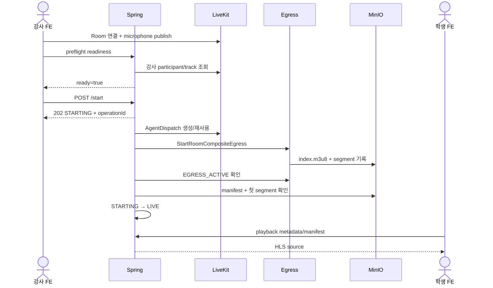

# ADR-0002: 라이브 시작은 강사 송출과 HLS 재생 준비를 확인한다

> 관련 결정: [ADR-0001 라이브·다시보기 재생 API](0001-live-replay-playback-api.md) ·
> [ADR-0020 Egress 녹화 생명주기](../songjeongki/0020-egress-recording-lifecycle.md) ·
> [ADR-0032 학생 HLS 단일 재생](../songjeongki/0032-media-playback-hls-only.md) ·
> [ADR-0025 realtime-agent–Spring 핸드오프](../canola/0025-realtime-agent-spring-handoff-contract.md) ·
> [공유 계약 §3-3~§3-6](../../CONTRACT.md#3-내부-계약-확정-인터페이스)

- **상태**: 채택 — MVP 범위 재정리 (2026-07-31)
- **일자**: 2026-07-28
- **적용 범위**: 강사 FE preflight, Spring 라이브 시작, LiveKit Room·Egress·AgentDispatch,
  학생 HLS 공개

## 한 줄 결정

강사는 preflight에서 실제 LiveKit Room에 연결해 microphone을 publish한다. `/start`는 세션을
`STARTING`으로 전환하고 비동기로 AgentDispatch와 Egress를 시작한다. Spring은 Egress가
`EGRESS_ACTIVE`이고 HLS manifest와 첫 segment가 만들어져 학생이 재생할 수 있을 때 `LIVE`로
전환한다.

MVP에서는 AgentDispatch 생성까지 수행하되 STT 모델·Redis·audio queue의 준비를 별도
`STT_READY` callback으로 증명하지 않는다. 자동 재시도·reconciler·lease·응답 유실 복구는
운영 안전장치이며 MVP 기능 완료 조건에서 제외한다.

## 왜 이 확인이 필요한가

학생은 LiveKit WebRTC를 직접 구독하지 않고 Egress가 만든 HLS로 라이브를 본다. 따라서 Egress API가
요청을 받았다는 사실만으로 `LIVE`를 공개하면 학생 화면에 재생할 영상이 없을 수 있다.

MVP에서 구분할 상태는 다음이면 충분하다.

```text
OPEN
  → STARTING: 강사 송출은 준비됐고 Egress를 만드는 중
  → LIVE: HLS manifest와 첫 segment가 있어 학생이 재생 가능
  → OPEN: 시작에 실패해 강사가 다시 시도 가능
```

`VideoAssetStatus.READY`는 종료된 녹화물 후처리 상태다. 여기서 말하는 “HLS 준비”와는 다르며
라이브 중 자산은 `RECORDING`일 수 있다.

## MVP 결정

### 1. preflight에서 실제 microphone publish를 확인한다

1. Spring이 `session-{sessionId}` Room을 생성하거나 재사용한다.
2. 강사 FE가 publisher token으로 연결해 camera·microphone을 publish한다.
3. Spring이 LiveKit participant와 track을 조회한다.
4. ~~소유 강사의 unmuted microphone 하나가 확인돼야 시작 버튼을 활성화한다.~~
   → **개정([ADR-0099](../songjeongki/0099-microphone-is-shown-not-required.md))**: 소유 강사가 방에
   있고 마이크가 겹치지 않으면 활성화한다. **마이크 유무·음소거는 막지 않고 화면에 표시한다.**
   이 조항이 재려던 것은 "강사가 실제로 방에 있는가"였고 그건 `instructorPresent`가 만족한다.

FE의 로컬 토글 값만으로 준비 완료를 판단하지 않는다. preflight와 classroom 전환 중에는 같은
LiveKit 연결과 local track을 유지한다.

### 2. `/start`는 `202 STARTING`을 반환한다

```http
POST /api/live-sessions/{sessionId}/start
```

응답:

```json
{
  "operationId": "op_...",
  "sessionId": "33333333-3333-4333-8333-333333333333",
  "status": "STARTING"
}
```

FE는 `GET /api/live-sessions/{sessionId}/start-status`로 진행 상태를 조회한다. 동일 세션이 이미
`STARTING`이면 현재 active operation을, `LIVE`면 현재 성공 상태를 반환한다.

`STARTING`과 상태 조회용 attempt는 외부 Egress 준비가 HTTP 요청보다 오래 걸릴 수 있기 때문에
필요한 제품 흐름이다. attempt를 자동 복구 작업으로 사용하는 것은 별도 운영 범위다.

### 3. 자막이 켜진 세션은 explicit AgentDispatch를 생성한다

- Spring과 realtime-agent의 `agentName`은 같아야 한다.
- dispatch metadata는 공유 계약 §3-3을 따른다.
- 동일 시작 시도에서는 저장된 dispatch를 재사용한다.
- dispatch 생성 자체가 실패하면 시작을 실패 처리한다.

현재 `live.stt.assume-ready=true`에서는 dispatch 생성 뒤 STT 준비 확인을 생략하고 Egress로
넘어간다. 자막이 실제로 출력되는지까지 라이브 시작의 선행 조건으로 삼지 않는다.

### 4. HLS가 실제로 재생 가능할 때 LIVE로 전환한다

Spring은 다음 세 단계를 확인한다.

1. `StartRoomCompositeEgress`가 `egressId`를 반환한다.
2. Egress 상태가 `EGRESS_ACTIVE`다.
3. `sessions/{sessionId}/index.m3u8`과 그 manifest가 가리키는 첫 media segment가 존재한다.

세 조건을 통과한 뒤 짧은 DB 트랜잭션에서 `STARTING → LIVE`를 커밋한다. 그 전에는 playback
metadata의 `source`를 공개하지 않는다.

manifest나 첫 segment가 준비되지 않거나 Egress가 명시적으로 실패하면 attempt를 실패 처리하고
세션을 다시 시작 가능한 상태로 돌린다. 세부 polling 간격과 timeout 값은 설정값이지 공유 API
계약이 아니다.

### 5. 라이브 종료는 ADR-0003을 따른다

이 문서는 시작 절차만 소유한다. Room 삭제 재시도, Egress stop 보완, 자막 completion 대기 등
종료 복구 설계는 MVP 시작 조건에 포함하지 않는다. 종료 상태와 학생 UI 마감은
[ADR-0003](0003-simple-live-end-sequential-process.md)을 따른다.

## 목표 MVP 시퀀스



## 현재 구현됐지만 MVP 완료 조건은 아닌 안전장치

다음 항목은 현재 Spring 코드에 들어가 있다. 문서에서 이를 “필수 설계”로 확대하지 않지만,
문서만 바꿨다고 런타임에서 사라지는 것은 아니다.

| 항목 | 현재 의미 | MVP 판단 |
|---|---|---|
| start attempt 영속 단계·시도 횟수 | 상태 조회와 재실행 자료 | 상태 조회에 필요한 최소 필드만 필수 |
| scheduled reconciler | Spring 재시작·일시 장애 뒤 STARTING 재개 | 완료 조건 아님 |
| DB lease·owner fencing | 다중 인스턴스 중복 실행 방지 | 단일 MVP 배포의 완료 조건 아님 |
| Egress 응답 유실 뒤 room 기준 조회 | 원격 성공 여부가 불명확할 때 중복 생성 방지 | 완료 조건 아님 |
| LIVE 직전 강사 publisher 재검증 | STARTING 중 강사 이탈 감지 | 완료 조건 아님 |
| 실패 시 Egress·Dispatch 정리 재시도 | 외부 자원 누수 완화 | 완료 조건 아님 |

향후 코드를 단순화할 때는 `202 STARTING` 상태 조회 계약과 중복 Egress 생성 가능성을 먼저 확인하고,
관련 테스트·`CONTRACT.md`를 같은 변경에서 수정한다.

## 추후 고려사항

다음은 현재 MVP에서 구현하지 않으며, 실제 장애 빈도·동시 접속 규모·자막 품질 요구가 확인될 때
별도 ADR로 결정한다.

- Agent job의 `JS_RUNNING`, worker/participant 일치 확인
- 모델 warm inference, Redis probe, session lease, 첫 audio frame, queue 상태를 묶은 `STT_READY`
- lifecycle callback v2의 HMAC·멱등 inbox·필수 ACK와 LIVE 직전 STT 재검증
- Worker 용량 예약·FULL 구분·전역 readiness 지표
- Spring 재시작 후 STARTING 자동 복구와 단계별 backoff
- Egress/Dispatch 응답 유실·중복·정리 실패에 대한 장애 주입
- LIVE 이후 Egress 장애의 자동 종료와 STT 장애의 `DEGRADED` 상태
- 자막 owner fencing, 정밀 session/HLS time-origin, final segment 복구
- 30분 이상 지속성·다중 인스턴스·최대 Worker 용량 E2E

`CONTRACT.md` §3-3과 §3-5에 적힌 “목표 상태”의 `STT_READY`는 이 목록의 추후 계약이다.
현재 MVP 계약으로 해석하지 않는다.

## 현재 구현 상태

| 영역 | 상태 |
|---|---|
| FE 실제 preflight 연결·publish·readiness | 구현 |
| `202 STARTING`, operation 상태 조회 | 구현 |
| AgentDispatch create/reuse/delete | 구현 |
| Egress ACTIVE + manifest + 첫 segment 확인 | 구현 |
| HLS 준비 후 원자적 LIVE 공개 | 구현 |
| `live.stt.assume-ready=true` 경로 | 구현 |
| reconciler·lease·응답 유실 복구·publisher 재검증 | 구현됐으나 MVP 완료 조건 아님 |
| `STT_READY` v2와 실제 STT readiness gate | 추후 고려, 미구현 |
| 실제 LiveKit·MinIO 장시간/장애 E2E | 추후 검증 |

## 실패와 API 계약

시작 실패는 start-status의 안정된 `failureCode`로 전달한다.

| code | 의미 |
|---|---|
| `STT_DISPATCH_FAILED` | AgentDispatch 생성 실패 |
| `STT_READINESS_GATE_UNAVAILABLE` | 추후 readiness gate를 잘못 활성화한 설정 오류 |
| `EGRESS_START_FAILED` | Egress 시작 요청 실패 |
| `EGRESS_NOT_READY` | 제한 시간 안에 HLS가 준비되지 않음 |
| `EGRESS_FAILED`·`EGRESS_ABORTED`·`EGRESS_LIMIT_REACHED` | Egress terminal 실패 |
| `INSTRUCTOR_NOT_PUBLISHING` | preflight 또는 현재 구현된 publisher 재검증 실패 |
| `START_FAILED` | 분류되지 않은 시작 실패 |

공유 응답 필드와 상태코드는 [CONTRACT.md](../../CONTRACT.md)를 정본으로 한다.

## 검증

공유 상태코드·응답과 학생 HLS 공개는 계약 테스트 대상이다. MVP 완료 판정은 다음에 집중한다.

- 실제 microphone publish 전에는 시작할 수 없다.
- `/start`가 202와 `STARTING` operation을 반환한다.
- AgentDispatch 생성 실패가 시작 실패로 보인다.
- manifest와 첫 segment 전에는 `source=null`이며 `LIVE`가 아니다.
- HLS 준비 뒤 `LIVE`와 재생 source가 공개된다.
- Egress 명시 실패·timeout 뒤 강사가 다시 시작할 수 있다.

reconciler, lease/fencing, 응답 유실 복구, `STT_READY`, 장기 장애 주입은 이 ADR의 MVP 완료
조건이 아니다.
