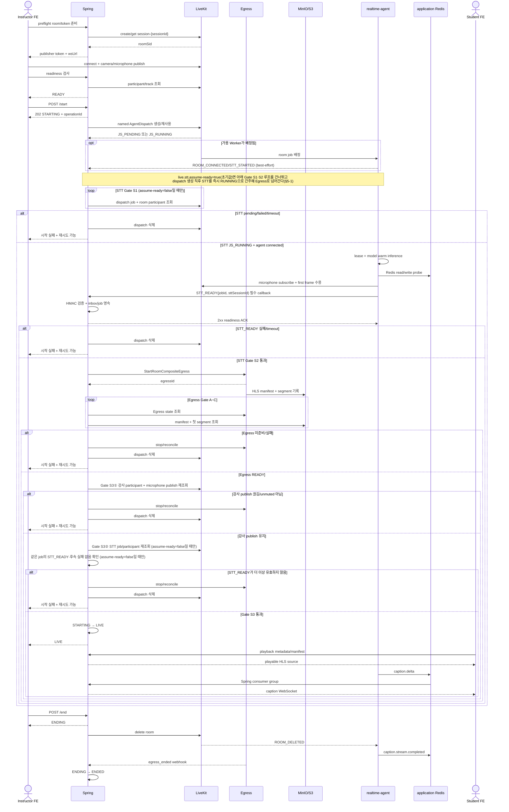

# ADR-0002: 라이브 시작은 publisher·STT 서비스·Egress 재생 준비를 게이트로 한다

> 관련 결정: [ADR-0001 라이브·다시보기 재생 API](0001-live-replay-playback-api.md) ·
> [ADR-0020 Egress 녹화 생명주기](../songjeongki/0020-egress-recording-lifecycle.md) ·
> [ADR-0032 학생 HLS 단일 재생](../songjeongki/0032-media-playback-hls-only.md) ·
> [ADR-0025 realtime-agent–Spring 핸드오프](../canola/0025-realtime-agent-spring-handoff-contract.md) ·
> [ADR-0026 realtime STT 동시성·prewarm](../canola/0026-realtime-stt-concurrency-and-batching.md) ·
> [ADR-0027 shared GPU runtime 제안](../canola/0027-realtime-stt-shared-gpu-runtime.md) ·
> [공유 계약 §3-3~§3-6](../../CONTRACT.md#3-내부-계약-확정-인터페이스)

- **상태**: 채택 — Phase 4a 구현·자동 검증 중, Phase 4b·실환경 E2E 전
- **일자**: 2026-07-28
- **적용 범위**: 강사 FE preflight, Spring 라이브 시작·종료 오케스트레이션,
  LiveKit room·Egress, realtime-agent AgentDispatch, application Redis 자막, 학생 HLS·WebSocket

## 한 줄 결정

강사가 preflight에서 **실제 LiveKit room에 연결해 microphone을 publish**한 뒤 `/start`를 요청한다.
Spring은 세션을 `STARTING`으로 두고 이번 세션의 named STT job `JS_RUNNING`뿐 아니라, 배정된
agent가 **모델 warm inference·Redis·session lease·실제 microphone frame 수용**을 모두 확인한 뒤
보내는 필수 `STT_READY`를 영속해야 한다. 그 뒤 Egress의 **`EGRESS_ACTIVE` + HLS manifest + 첫
media segment**까지 확인하고 LIVE 직전에 같은 STT job을 재검증한 후에만 `LIVE`로 전환한다.
시작 전 STT 또는 Egress 실패는 라이브를 막고, 이미 LIVE가 된 뒤의 STT 장애만 영상과 분리해
`DEGRADED`로 처리한다.

이 중 STT readiness 확인(Gate S1·S2)은 realtime-agent 쪽 readiness API·callback을 AI 담당자가
별도로 배포하기 전까지는 설정 플래그(`live.stt.assume-ready`, 기본 **true**)로 우회한다. 플래그가
꺼지기 전까지 `captionEnabled=true` 세션도 STT 준비를 실제로 확인하지 않고 Egress로 넘어간다 —
상세 근거와 전환 조건은 §5-1. 반대로 **강사 publisher 재검증(Gate S3)은 이 플래그와 무관하게
항상 수행한다** — STT를 신뢰할지와 "학생이 볼 영상이 실제로 있는지"는 서로 다른 조건이기 때문이다.

## 맥락

### 1. Egress의 역할이 “선택 녹화”에서 “학생 라이브 원천”으로 바뀌었다

[ADR-0020](../songjeongki/0020-egress-recording-lifecycle.md)은 Egress 실패가 세션 시작을 롤백하지 않는
best-effort 녹화를 선택했다. 당시에는 녹화 장애와 현재 WebRTC 라이브를 분리할 수 있었다.

그러나 이후 [ADR-0032](../songjeongki/0032-media-playback-hls-only.md)가 학생 재생을 HLS 하나로
확정했다. 학생은 LiveKit WebRTC를 직접 구독하지 않고 Egress가 만드는 HLS를 라이브 엣지와
되감기, 종료 후 VOD에 모두 사용한다. 따라서 지금의 제품 경계에서는 다음이 성립한다.

- **시작 전 Egress 실패**: 학생이 볼 영상 자체가 없으므로 `LIVE`가 될 수 없다.
- **LIVE 이후 Egress 영구 장애**: 학생 미디어 경로가 사라진 것이므로 자막만의 degraded 장애와
  같게 취급할 수 없다.
- **시작 전 STT 장애**: 자막 제공을 전제로 시작하는 세션이면 준비되지 않은 강의를 공개하지 않는다.
- **LIVE 이후 STT 장애**: 이미 공개된 영상·채팅은 계속 제공하고 자막만 degraded 처리한다.

이 ADR은 ADR-0020의 “Egress 시작 실패도 라이브를 막지 않는다”는 부분을 HLS 단일 재생 범위에서
대체한다. 트랜잭션 커밋 후 외부 I/O를 수행하고 녹화 자산을 별도 상태로 관리한다는 나머지 결정은
유지한다.

### 2. 현재 정상 UI 경로에서도 Egress가 publisher보다 먼저 실행된다

현재 Spring의
[`LiveSessionService.start`](../../../backend/src/main/java/com/liveclass/live/service/LiveSessionService.java)는
`DRAFT/SCHEDULED/OPEN`을 즉시 `LIVE`로 바꾸고 같은 요청 시각을 `startedAt`과 `clockOriginAt`에
기록한 뒤 `LiveSessionStartedEvent`를 발행한다.

이 결정 당시의 `RecordingEventListener`는 `AFTER_COMMIT`이지만 비동기·지속 작업이 아니므로
시작 요청 스레드에서 Egress를 호출했다. 시작 제어는 이 ADR 구현에서
[`RecordingOrchestrationService`](../../../backend/src/main/java/com/liveclass/video/service/RecordingOrchestrationService.java)의
동기 포트 호출로 교체됐고, 종료 리스너도 후속 [ADR-0003](0003-simple-live-end-sequential-process.md)의
순차 종료 façade로 교체됐다.
반면 [`InstructorPreflightPage`](../../../frontend/src/pages/InstructorPreflightPage.tsx)는 `/start`
성공 후 classroom으로 이동하고,
[`useInstructorLiveKit`](../../../frontend/src/features/live-session/useInstructorLiveKit.ts)은 classroom에
들어온 뒤에야 token을 받아 room에 연결하고 카메라·마이크를 publish한다.

따라서 새 세션의 실제 순서는 다음과 같다.

```text
POST /start
→ DB LIVE 커밋
→ 빈 room에 Egress 시작 또는 실패
→ HTTP 응답
→ classroom 이동
→ 강사 LiveKit 연결·microphone publish
```

LiveKit Egress는 publish 중인 track이 없는 빈 room에서 정상 녹화를 시작할 수 없다. 실제 인프라
문서도 publisher를 먼저 띄운 뒤 Egress를 시작하도록 요구한다
([infra/livekit/README](../../../infra/livekit/README.md#4-테스트)).

### 3. Spring에는 room 생성·AgentDispatch·자막 역방향 경로가 없다

- `LiveRoomControl`은 참가자 조회·강퇴·room 삭제만 지원하고 `createRoom`과 track readiness 조회가 없다.
- `live_session.room_sid`는 존재하지만 채우는 코드가 없다.
- `captionEnabled`는 세션에 있지만 시작 이벤트와 오케스트레이션에서 사용하지 않는다.
- 공유 계약 §3-3의 named AgentDispatch 생성, dispatch/job ID 저장, assignment timeout과 재사용이 없다.
- realtime-agent에는 Spring이 호출할 별도 readiness endpoint가 없고, LiveKit dispatch 조회만으로
  현재 가용 Worker 수를 미리 나열할 수도 없다.
- 현재 Nemotron은 첫 speech segment에서 모델을 lazy-load한다. 따라서 LiveKit의 `JS_RUNNING`만으로는
  프로세스와 job 실행은 증명하지만 모델 warm-up 완료까지 증명하지 못한다.
- 공유 계약 §3-5의 live-agent lifecycle callback endpoint가 없다.
- realtime-agent는 `ai:captions:live`에 자막을 발행하지만 Spring consumer·영속·WebSocket 전달이 없다.
- 기존 STOMP 구독 interceptor는 정확한 `/chat` 외 모든 `/topic`을 거부해 자막 topic도 막는다.

Python realtime-agent 쪽에는 metadata 검증, room binding, microphone 구독, STT, Redis publisher,
lease, `ROOM_DELETED` completion, 선택적 lifecycle callback이 구현돼 있다. 현재 주된 공백은 Spring
제어면과 FE/BE 시작 순서, 그리고 job 수락 전에 모델·Redis 준비를 보장하는 AI admission readiness다.

## 용어와 상태 의미

### Preflight

preflight는 화면 토글 확인이 아니라 **방송 시작 전 실제 미디어 연결 점검**이다.

- Spring이 `session-{sessionId}` room을 생성하거나 기존 room을 재사용하고 `roomSid`를 저장한다.
- 강사는 publisher token으로 그 room에 실제 연결한다.
- 브라우저는 실제 camera·microphone track을 publish한다.
- FE의 `LocalTrackPublished` 뒤 Spring이 LiveKit 서버에서 participant와 track을 다시 조회한다.
- 필수 조건은 소유 강사 participant, unmuted microphone 하나, 예상 밖 microphone publisher 없음이다.
- FE의 로컬 boolean만으로 준비 완료를 판정하지 않는다.

### STARTING

`STARTING`은 “시작 버튼을 눌렀지만 학생이 아직 재생할 수 없는 상태”다. 이 구간에서 Spring은
다음을 수행한다.

1. preflight readiness 재검증
2. 자막이 켜졌다면 explicit named AgentDispatch 생성 또는 재사용
3. 해당 dispatch의 job `JS_RUNNING`과 agent room 연결 확인
4. 같은 job의 필수 `STT_READY` callback 수신·영속 확인
5. Egress 생성 또는 기존 작업 재조정
6. Egress가 `EGRESS_ACTIVE`인지 확인
7. HLS EVENT manifest와 첫 segment가 저장소에 생성됐는지 확인
8. 같은 STT job의 RUNNING·READY 유효성을 재검증

### LIVE

`LIVE`는 단순히 StartEgress가 `egressId`를 반환한 상태가 아니다. 학생이 인증된 playback API를
통해 실제 HLS를 재생할 수 있는 상태다.

```text
room 존재
+ 강사 microphone publish 유지 (Gate S3에서 LIVE 직전 재검증, §7)
+ 자막 필수 세션이면 STT job RUNNING + agent participant 연결 + STT_READY
+ Egress ACTIVE
+ 유효한 HLS manifest 존재
+ manifest가 참조하는 첫 segment 존재
= LIVE
```

`captionEnabled=true`인 세션에서는 STT의 세션별 readiness가 `LIVE`의 필수 조건이다.
제품이 모든 라이브에서 자막을 강제한다면 `captionEnabled=false`를 허용하지 않거나 플래그를 제거한다.
자막을 명시적으로 끈 세션을 계속 지원한다면 그 세션만 STT gate를 건너뛰며 상태는 `DISABLED`다.

이 문서의 `Egress READY`는 **라이브 시작 오케스트레이션의 준비 판정**이다.
종료 녹화물 검증을 뜻하는 `VideoAssetStatus.READY`와 다르며, 라이브 중 `video_asset.status`는
`RECORDING`을 유지한다.

## 결정

### 1. 강사 FE는 preflight와 classroom에서 하나의 LiveKit 연결을 유지한다

1. preflight 진입 시 Spring에 room 준비와 강사용 publisher token을 요청한다.
2. FE가 LiveKit room에 연결하고 camera·microphone을 실제 publish한다.
3. FE는 `LocalTrackPublished` 후 서버 readiness 검사를 요청한다.
4. 서버 검사를 통과해야 시작 버튼을 활성화한다.
5. `/start` 후 `STARTING` 동안 같은 room과 local track을 유지한다.
6. `LIVE`가 되면 classroom 화면으로 전환하되 기존 `Room` 인스턴스와 track을 재사용한다.

라우트 전환으로 preflight 컴포넌트가 unmount되면서 `room.disconnect()`가 실행되면 Egress 준비 중
publisher가 사라진다. 따라서 `Room` 수명주기는 두 페이지보다 위의
`InstructorLiveMediaProvider` 같은 session-scoped provider가 소유해야 한다. 새 페이지에서 token을
다시 받아 재접속하는 방식은 시작 구간의 미디어 공백과 중복 participant를 만들 수 있어 채택하지 않는다.

카메라는 제품 UI 정책에 따라 필수 여부를 정할 수 있지만 microphone은 STT와 최소 오디오 방송을 위해
필수다. 화면공유는 LIVE 이후 추가 publish할 수 있다.

### 2. `/start`는 지속 가능한 작업을 만들고 `202 STARTING`을 반환한다

`POST /api/live-sessions/{sessionId}/start`는 긴 STT·Egress 준비를 HTTP 요청이나 DB 트랜잭션 안에서
기다리지 않는다.

1. 소유권, 세션 상태, 최신 preflight readiness를 검증한다.
2. 한 DB 트랜잭션에서 세션을 `STARTING`으로 바꾸고 start attempt를 생성한다.
3. 서버가 만든 `operationId`와 §3-3 규칙을 만족하는 `correlationId`를 저장한다.
4. `202 Accepted`와 `{operationId, sessionId, status:"STARTING"}`를 반환한다.
5. FE는 중복 클릭을 막고 세션 또는 operation 상태를 polling/WS로 관찰한다.

동일 세션이 이미 `STARTING`이면 기존 active attempt를 반환하고, 이미 `LIVE`면 현재 성공 상태를
반환한다. 같은 start retry가 Egress와 Dispatch를 새로 만들지 않도록 active attempt는 세션당 하나만
허용한다. FE `Idempotency-Key`를 채택할지는 공유 REST 계약에서 확정하되, 헤더 유실 여부와 관계없이
서버의 세션·active attempt 유일성이 최종 중복 방어선이다.

`STARTING`이 필요한 이유는 STT job assignment·서비스 readiness ACK와 Egress가 외부
프로세스·스토리지를 거쳐 실제 준비되기까지 수 초가 걸리고, timeout이나 응답 유실이 곧 외부 작업
실패를 뜻하지 않기 때문이다. 요청을 오래 붙잡으면 프록시 timeout과 사용자 재클릭이 동일
Dispatch·Egress를 중복 생성할 수 있다.

### 3. 시작 오케스트레이션은 DB 상태를 정본으로 하고 재조정할 수 있어야 한다

인메모리 `ApplicationEvent`만으로 Egress와 STT 시작을 소유하지 않는다.

- 시작 트랜잭션은 `live_start_attempt` 같은 지속 레코드를 남긴다.
- 커밋 후 즉시 실행하는 비동기 trigger는 지연을 줄이는 가속 수단일 뿐이다.
- scheduled reconciler가 오래된 `STARTING`과 비종료 attempt를 다시 집어 복구한다.
- 외부 LiveKit·MinIO I/O 동안 DB 트랜잭션을 열어 두지 않는다.
- 다중 Spring 인스턴스에서는 row lock 또는 lease로 한 reconciler만 attempt를 진행한다.

최소 start attempt에는 `operationId`, `liveSessionId`, `correlationId`, 단계, 시도 횟수,
`nextAttemptAt`, 마지막 오류, 생성·갱신·완료 시각이 필요하다. 기존 `video_asset`은 Egress ID와
녹화 상태를 계속 소유하고, 별도 `live_agent_job`은 dispatch/job/worker ID, `sttSessionId`,
STT 상태와 `readyAt`을 소유한다.

새 테이블과 컬럼은 이미 적용된 `V1__init_core.sql`을 수정하지 않고 다음 Flyway migration으로 추가한다.

### 4. Egress는 API 수락, 프로세스, 저장소 세 단계로 준비를 확인한다

#### Gate A — API 수락

- `video_asset`을 `REQUESTED → STARTING`으로 만든 뒤 `StartRoomCompositeEgress`를 호출한다.
- 응답의 `egressId`를 즉시 저장한다.
- 네트워크 timeout은 “실패 확정”이 아니라 원격 commit 결과가 unknown인 상태다.
- 재시도 전에 room과 저장된 자산 기준으로 기존 Egress를 조회해 중복 생성하지 않는다.

#### Gate B — 프로세스 활성

- `EgressControl`에 get/list 상태 조회를 추가한다.
- `EGRESS_ACTIVE`가 될 때까지 bounded polling한다.
- `EGRESS_FAILED/ABORTED`는 즉시 실패로 접고, `STARTING`은 timeout까지 기다린다.

#### Gate C — 학생 재생 가능

- `sessions/{sessionId}/index.m3u8`이 존재하고 `#EXTM3U`로 파싱돼야 한다.
- media URI를 하나 이상 포함해야 한다.
- 첫 media URI가 가리키는 segment가 같은 bucket에 실제 존재해야 한다.
- live 준비 단계의 manifest에는 아직 `#EXT-X-ENDLIST`가 없어야 한다.
- 기존 manifest 파서와 객체 키 정규화 규약을 재사용하고, 별도 느슨한 parser를 만들지 않는다.

초기 Egress readiness timeout은 설정값으로 두고, 과거 Chrome page load가 약 20초까지 걸린
인프라 기록을 고려해 **45초**를 시작값으로 제안한다. 고정 상수가 아니라 운영 지표로 조정한다.
단일 poll 실패로 자산을 `FAILED`로 만들지 않고 timeout과 명시적 terminal 상태만 실패를 확정한다.

`recordingEnabled=false`인 세션은 HLS 단일 학생 재생 정책과 양립하지 않는다. 다른 학생 미디어 경로를
추가하지 않는 한 시작을 거부하거나 플래그를 제거해 항상 true로 고정한다.

### 5. STT는 Egress보다 먼저 job 실행과 실제 서비스 readiness를 모두 확인한다

`captionEnabled=true`이면 단순한 프로세스 health URL 대신 공유 계약 §3-3의 explicit named
AgentDispatch를 **세션별 용량 예약**으로 사용한다. 다만 LiveKit의 `JS_RUNNING`은 transport/job
상태일 뿐 STT 애플리케이션 readiness가 아니다. Spring은 이어지는 필수 `STT_READY`까지 받아야 한다.

이 작업은 FE preflight 화면 진입 시점이 아니라 **`/start`가 start attempt를 만든 직후,
Egress Gate A 이전**에 둔다. 장치 설정 중이거나 시작 버튼을 누르지 않은 강사를 위해 GPU slot을
미리 점유하면 새로고침·이탈 때 자원이 새고 다른 강의의 시작을 막을 수 있다. preflight UI는 최근
운영 readiness를 안내용으로 보여줄 수 있지만, 최종 시작 판정은 반드시 start attempt에 귀속된
dispatch로 한다.

#### Gate S1 — Worker admission과 job 실행 확인

1. `session-{sessionId}`에 동일 metadata의 기존 dispatch가 있는지 조회하고 없을 때만 생성한다.
2. dispatch ID를 먼저 저장한 뒤 bounded polling으로 현재 job을 조회한다.
3. 다음 조건을 모두 만족해야 transport 상태를 `RUNNING`으로 판정한다.
   - 현재 active job의 상태가 `JS_RUNNING`이다.
   - job ID와 `workerId`, `participantIdentity`가 비어 있지 않다.
   - 그 `participantIdentity`가 같은 room의 participant로 실제 조회된다.
   - dispatch의 room, `agentName`, metadata가 저장한 start attempt와 정확히 같다.
4. `JS_PENDING`은 Worker 미등록 또는 전체 FULL일 수 있으므로 성공으로 간주하지 않는다.
5. `JS_FAILED`, metadata 충돌, active job 중복은 즉시 실패로 접고, pending은 설정 가능한 assignment
   timeout까지만 기다린다.

초기 assignment timeout은 warm Worker 기준 **15초**를 시작값으로 제안하고 운영 지표로 조정한다.
cold model load 시간을 이 timeout 안에 숨기지 않는다. timeout 뒤에는 dispatch를 삭제하고
`STT_UNAVAILABLE` 또는 `STT_CAPACITY_FULL`처럼 안정된 시작 실패 code를 반환한다. LiveKit API가
Worker 목록 조회를 제공하지 않으므로 pending 원인을 완벽히 구분할 수 없다면 외부 응답은
`STT_UNAVAILABLE`로 합치고 내부 지표에서만 세분화한다.

Gate S1만으로는 LIVE를 시작하지 않는다. 이는 Worker 프로세스와 job 배정만 증명하고 모델,
provider session, Redis, microphone 입력과 내부 처리 task를 증명하지 않기 때문이다.

#### Gate S2 — 세션별 `STT_READY` 확인 응답

배정된 **그 job**이 아래 조건을 순서대로 모두 만족한 뒤에만 `STT_READY`를 만든다.

1. dispatch metadata와 room binding을 검증하고 session lease를 획득했으며 첫 renewal까지 성공한다.
2. 활성 STT provider의 설정·자격증명을 검증한다.
3. 배정될 slot에서 실제 model load와 provider별 warm-up inference를 완료한다.
   - Nemotron은 해당 job이 재사용할 동일 recognizer로 짧은 비민감 fixture를 추론해 예외 없이
     decode가 끝나는지 확인한다.
   - 원격 provider라면 인증만 확인하지 않고 실제 provider session open까지 완료한다.
4. application Redis에 연결하고 caption publisher가 사용하는 권한으로 bounded read/write probe를
   성공시킨다.
5. 같은 room에서 유일한 강사 microphone을 subscribe하고 첫 audio frame을 받는다.
6. 그 frame을 STT engine의 bounded input queue가 성공적으로 수락하며 engine event consumer와
   caption publisher task가 살아 있는지 확인한다.
7. 위 조건과 같은 `jobId`·새 `sttSessionId`를 담은 `STT_READY` callback을 Spring에 보낸다.

첫 audio frame은 실제 발화를 요구하지 않는다. publish된 microphone의 silence frame도 연결 검증에
사용할 수 있으므로 강사가 말을 시작할 때까지 LIVE가 무기한 대기하지 않는다. 반대로 첫
`caption.delta`는 실제 발화가 있어야 하므로 readiness gate로 사용하지 않는다.

`STT_READY`는 기존 best-effort nonterminal callback과 다르게 **필수 확인 응답**이다.

- lifecycle callback v2에 `state="STT_READY"`와 `sttSessionId`를 추가한다.
- agent는 한 readiness event의 event ID·timestamp·raw body·signature를 고정한 채 bounded retry한다.
- Spring은 HMAC, timestamp, idempotency key, correlation ID, session·lesson·dispatch·job 일치를
  검증하고 `live_agent_job`과 inbox를 같은 트랜잭션에 영속한 뒤에만 2xx를 반환한다.
- agent는 Spring 2xx를 받기 전까지 자신을 start-ready로 간주하지 않는다.
- callback 전달 또는 Spring 영속이 readiness timeout 안에 끝나지 않으면 job을 `FAILED`로 종료한다.
- Spring도 DB에 같은 job의 `STT_READY`가 영속될 때까지 bounded polling/notification으로 기다린다.
- 이미 실패·취소·종료된 start attempt에 늦게 도착한 `STT_READY`는 inbox 멱등 기록만 하고 상태를
  되살리지 않으며 2xx로 재시도를 끝낸다.

초기 `sttReadyTimeout`은 warm slot 기준 **15초**를 시작값으로 제안한다. 모델 cold load가 매 세션
여기에 포함된다면 admission/prewarm 구현이 잘못된 것으로 보고 timeout을 무작정 늘리지 않는다.

#### Worker가 job을 받기 전에 보장할 전역 readiness

세션별 Gate S2와 별개로 realtime-agent는 준비되지 않은 slot을 LiveKit에 광고하지 않아야 한다.

- 활성 provider 설정과 필수 자격증명을 검증한다.
- application Redis 연결과 쓰기 가능성을 bounded probe로 확인한다.
- Nemotron은 model load와 최소 warm-up을 완료한 idle job process만 가용 slot으로 광고한다.
- 장기 shared runtime 구조에서는 runtime의 model ready, queue pressure, available slot을 Worker load에
  반영해 비정상 runtime의 load를 1.0으로 만든다.
- readiness를 잃은 Worker는 기존 job을 명시적으로 실패시키고 새 job은 받지 않는다.

현재 구현은 모델을 첫 speech segment에서 lazy-load한다. `STT_STARTED`는
`engine.start_stream()` 직후 모델 load 전에 발생하고, `AUDIO_STARTED`는 첫 frame을
`engine.push_audio()`가 수락하기 전에 발생한다. 둘 다 nonterminal best-effort callback이라 유실될
수도 있다. 따라서 현재의 `JS_RUNNING`, `STT_STARTED`, `AUDIO_STARTED` 조합으로는 Gate S2를
충족하지 못하며 **`STT_READY`와 준비 barrier 전체가 미구현**이다.

별도 `/healthz`나 `/readyz`는 배포 오케스트레이터와 운영 모니터링에는 유용하지만 Spring의 LIVE
게이트로 단독 사용하지 않는다. 응답 직후 Worker가 FULL/종료될 수 있고, 여러 Worker 중 실제 배정될
인스턴스와 다른 인스턴스를 확인할 수 있으며, 이번 세션의 용량을 예약하지도 못하기 때문이다.

`ROOM_CONNECTED`, `STT_STARTED`, `AUDIO_STARTED`는 단계별 진단과 지연 측정에 계속 사용하되
LIVE gate의 정본은 Gate S1의 LiveKit 상태와 Gate S2의 영속된 `STT_READY` 조합이다.

### 5-1. 초기 구현은 STT readiness 검증을 설정 플래그로 임시 우회한다

Gate S1(job 배정 확인)과 Gate S2(`STT_READY` 필수 callback)는 realtime-agent 쪽 readiness 확인
API·callback이 실제로 배포돼 있어야 검증할 수 있다. 이 API는 AI(STT) 담당자가 별도로 열어주기로
했고, 이 ADR을 구현하는 시점에는 아직 없다. 그 사이 라이브 시작 오케스트레이션 자체를 막지 않기
위해 Spring은 설정 플래그로 Gate S1/S2/S3의 STT 부분 실행 여부를 전환한다.

- `live.stt.assume-ready=true`(초기 기본값)면 `captionEnabled=true` 세션에서도 AgentDispatch는
  그대로 생성·재사용해 실제 STT 작업이 돌아가게 하되, job의 `JS_RUNNING` polling과 `STT_READY`
  callback 수신·영속을 기다리지 않는다. dispatch 생성(또는 기존 dispatch 재사용) 직후 STT 상태를
  즉시 `RUNNING`으로 간주하고 Egress Gate A로 넘어간다. LIVE 직전 Gate S3의 STT job 재검증도
  건너뛴다.
- `live.stt.assume-ready=false`(AI 담당자의 readiness API·callback이 배포된 뒤로 전환)면 이 문서에
  적힌 Gate S1·S2·S3의 STT 부분을 그대로 수행한다.
- 이 플래그는 **일시적 우회이지 대체 설계가 아니다**. `true`인 동안에는 이 ADR이 원래 막으려던
  "STT가 실제로는 불가능한데도 세션이 시작되는" 상황을 다시 허용한다 — `captionEnabled=true` 세션이
  자막 없이 LIVE가 될 수 있다. 이는 명시적으로 받아들이는 임시 리스크이며 운영 설정에 현재 값을
  남긴다.
- 전환 조건: AI 담당자가 §3-5 v2 schema·fixture, Gate S1 조회에 필요한 job 상태 조회, 계약 테스트를
  배포하면 플래그 기본값을 `false`로 바꾸고 Gate S1/S2/S3의 STT 부분을 활성화한다.
- **Gate S3의 강사 publisher 재검증(§7)은 이 플래그와 무관하게 항상 수행한다.** STT를 신뢰할지와
  강사의 실제 영상·음성이 지금 room에 있는지는 서로 다른 조건이며, 후자를 건너뛰면 빈 방이 LIVE로
  노출될 수 있다.

### 6. Egress는 STT_READY 뒤 시작하고, 준비되지 않으면 LIVE로 전환하지 않는다

Gate S1과 Gate S2를 모두 통과한 뒤에만 Egress Gate A~C를 실행한다. 제한된 GPU slot과 실제 STT
서비스 readiness를 먼저 확인하면 STT가 불가능한 방송을 위해 Egress와 저장소 객체를 만들었다가
버리는 일을 줄일 수 있다. 강사는 `STARTING` 동안 수업을 진행하지 않으며, Spring caption consumer는
LIVE 이전 caption을 학생에게 노출하지 않는다.

시작 전 STT 또는 Egress 명시 실패와 readiness timeout이면 다음을 수행한다.

1. 세션은 `LIVE`가 되지 않는다.
2. start attempt를 실패로 기록하고 강사에게 안정적인 오류 code를 제공한다.
3. 원격 Egress가 존재하면 멱등 중지한다.
4. 불완전 `video_asset`과 객체는 재조정 가능한 상태로 남긴다.
5. 생성된 pending/running Dispatch를 멱등 삭제한다.
6. 강사 publisher 연결을 유지할 수 있으면 재시도 UI를 제공한다.

일시적인 STT/Egress 시작 실패는 세션 자체를 terminal `FAILED`로 만들지 않고 `OPEN`으로 복귀시키며,
실패한 attempt를 이력으로 남긴다. 세션 데이터 손상처럼 재시도할 수 없는 경우에만 `FAILED`를 사용한다.
정확한 오류 code와 상태코드는 `CONTRACT.md`에 승격할 때 확정한다.

LIVE 전환 뒤 Egress가 영구 실패하면 HLS-only 학생 미디어가 사라진 것이므로 영상이 계속된다고
표시하지 않는다. 짧은 grace와 상태 재확인 후 `ENDING`으로 전환해 room·STT·Egress를 정리하고
운영자와 강사에게 미디어 장애를 알린다. 새로운 Egress로 이어 붙이는 복구는 HLS discontinuity와
객체 충돌 계약이 필요하므로 이 ADR의 자동 복구 범위에 넣지 않는다.

### 7. Egress READY 뒤 STT_READY 유효성을 재검증하고 LIVE를 원자적으로 공개한다

Egress Gate C가 통과하면 LIVE 전환 직전에 **Gate S3**를 수행한다. Gate S3는 두 부분으로 나뉜다.

**① 강사 publisher 재검증 — 모든 세션에서, `captionEnabled`·`live.stt.assume-ready`와 무관하게 항상 수행**

- 소유 강사 participant가 room에 여전히 존재한다.
- 그 강사의 microphone track이 여전히 publish·unmuted 상태다. preflight(§1)에서 쓰는 것과 같은
  LiveKit participant/track 조회를 재사용한다.
- 위 조건이 깨졌으면 Egress·Dispatch를 정리하고 LIVE로 전환하지 않는다.

이 재검증이 필요한 이유는 Gate S2의 "첫 audio frame 수신"이 STARTING 진입 초반에 단 한 번만
확인되기 때문이다. STARTING 구간은 STT·Egress 대기로 수십 초까지 걸릴 수 있는데, 그 사이 강사의
네트워크가 끊기거나 기기가 슬립돼도 기존 게이트만으로는 이를 감지하지 못하고 빈 방·무음 녹화가
LIVE로 노출될 수 있었다.

**② STT job 재검증 — `captionEnabled=true`이고 `live.stt.assume-ready=false`일 때만(§5-1)**

- Gate S1에서 저장한 같은 job이 여전히 `JS_RUNNING`이다.
- 같은 agent participant가 room에 남아 있다.
- 같은 job·`sttSessionId`의 `STT_READY`가 영속돼 있다.
- `STT_READY` 이후 `FAILED/STOPPING/SUCCEEDED`, session lease 상실 또는 participant 이탈이 없다.

`live.stt.assume-ready=true`인 동안에는 ②를 건너뛰고 ①만 통과하면 LIVE로 전환한다.

Egress 준비 중 Worker나 provider가 죽었다면 세션을 공개하지 않고 Egress·Dispatch를 정리한 뒤
`OPEN`으로 복귀한다. 새 dispatch로 자동 교체하면 어떤 STT attempt가 첫 자막 owner인지 모호해지므로
첫 버전은 같은 start attempt 안에서 자동 재배정하지 않고 강사의 명시적 재시도로 새 attempt를 만든다.
AI는 model/runtime, Redis, lease, audio source 또는 내부 task readiness를 잃으면 job을 즉시
`FAILED`로 전환해 Gate S3가 이를 발견할 수 있게 한다.

Gate S3와 Egress 필수 gate가 모두 통과한 뒤 짧은 트랜잭션에서 다음을 함께 반영한다.

- `live_session.status = LIVE`
- `startedAt`과 `startedBy`
- start attempt 성공
- `video_asset`의 현재 Egress 상태
- 현재 STT 상태(`RUNNING` 또는 명시적으로 자막을 끈 세션의 `DISABLED`)

현재 Nemotron runtime은 process-wide model sharing이 없어 Worker당 active job 1개다. 두 번째
dispatch의 pending은 정상 capacity backpressure지만, 자막 필수 세션의 시작 성공은 아니다.
assignment timeout까지 slot이 나지 않으면 해당 start attempt를 실패시키고 재시도를 안내한다.

학생 playback metadata는 `STARTING`을 실제 라이브로 오해하지 않아야 한다. 준비 화면을 위해
`STARTING` metadata 조회를 허용할 수는 있지만 HLS `source`는 `LIVE` 전환 전 노출하지 않는다.
이는 [ADR-0001](0001-live-replay-playback-api.md)의 `STARTING` 라이브 접근을 “준비 상태 조회”로
좁히는 보완이다.

Egress가 LIVE 전환 전에 만든 짧은 pre-roll과 `startedAt`, HLS 첫 PDT의 관계는 명시적으로 처리해야
한다. FE에 음수 session time을 노출하지 않도록 playback 범위를 0 이상으로 자르거나 media origin을
별도 저장하는 후속 공통 시간축 계약이 필요하다. `streamElapsedMs`는 STT 첫 audio frame 기준의
attempt-local 값이므로 이 보정값으로 직접 사용할 수 없다.

### 8. lifecycle callback과 Redis 자막은 서로 다른 목적의 역방향 경로다

#### Lifecycle callback

공유 계약 §3-5의 별도 endpoint와 v2를 구현·계약 테스트한 뒤 Python callback을 필수 설정으로 켠다.
자막 필수 세션을 허용하는 배포에서 callback이 꺼져 있으면 realtime-agent startup을 실패시킨다.

- material callback과 URL·DTO·서명 verifier를 공유하지 않는다.
- `timestamp + "." + rawBody`의 v1 hex HMAC을 검증한다.
- timestamp skew, `Idempotency-Key`, correlation ID, session·lesson·job 일치를 확인한다.
- v1의 `ROOM_CONNECTED/STT_STARTED/AUDIO_STARTED/STOPPING/SUCCEEDED/FAILED`와 v2의
  `STT_READY`를 저장한다.
- terminal은 first-wins로 접는다.

callback은 job 관측용이고 자막 본문 전달 경로가 아니다. nonterminal callback은 best-effort라
assignment polling과 Redis Stream을 대체하지 않는다. 단, 라이브 시작 barrier인 v2 `STT_READY`만
필수 전달·영속 확인 응답이며 유실을 정상으로 허용하지 않는다.

#### Caption Redis consumer

- application Redis의 `ai:captions:live`를 Spring 전용 consumer group으로 읽는다.
- ai-api의 `ai-rag-live-v1` group과 분리한다.
- wire의 모든 값을 문자열 규칙대로 엄격 검증한다.
- `(sessionId, sttSessionId)` attempt 단위로 sequence를 접고 `eventId`로 중복 제거한다.
- durable 처리 또는 정해진 relay 완료 뒤에만 ACK한다.
- gap, duplicate, stale attempt, PEL, lag, parse failure를 계측한다.

consumer group 이름, abandoned PEL claim, 전역 stream 정리, owner fencing, final segment,
session/HLS time-origin은 공유 계약의 후속 항목이다. 이를 확정하기 전 raw `streamElapsedMs`를
세션 상대 시간으로 DB에 쓰거나 FE에 전달하지 않는다.

### 9. FE 자막은 시간축 후속 계약 뒤 Spring WebSocket만 소비한다

시간축과 final segment 계약을 확정한 뒤 다음을 구현한다.

1. Spring의 live caption attempt·event/segment 영속
2. REST snapshot 또는 재접속 보완 조회
3. `/topic/live-sessions/{sessionId}/captions` STOMP broadcast
4. chat과 같은 소유 강사·활성 수강생 subscription 인가
5. FE의 snapshot + WebSocket merge, `eventId` 중복 제거
6. HLS player의 session-relative position에 맞춘 caption 표시

현재 `ChatTopicSubscriptionInterceptor`는 `/chat` 외 topic을 모두 거부하므로 caption topic을 명시적으로
허용하고 같은 `LiveAccessGuard`를 적용해야 한다. FE는 realtime-agent나 Redis에 직접 연결하지 않는다.

### 10. 정상 종료 제어면은 room 삭제이고, ENDED는 정리 완료 뒤 확정한다

1. 강사 종료 요청에서 `LIVE → ENDING`으로 전환하고 신규 token·시작 요청을 차단한다.
2. LiveKit room 삭제를 요청한다.
3. room 삭제 실패 시 `ENDING`을 유지하고 reconciler가 재시도한다.
4. realtime-agent는 `ROOM_DELETED`만 정상 EOF로 보고 drain 후
   `caption.stream.completed(reason=ROOM_DELETED)`를 발행한다.
5. Egress가 room 종료로 끝나지 않으면 저장된 `egressId`로 stop을 보완 호출한다.
6. Egress webhook과 HLS `#EXT-X-ENDLIST`·manifest 존재를 확인해 녹화 자산을 확정한다.
7. bounded 정리 결과를 기록한 뒤 세션을 `ENDED`로 전환한다.

현재처럼 DB를 먼저 `ENDED`로 바꾸고 room 삭제 실패를 무시하면 agent completion과 lease release가
영구 누락될 수 있다. 종료 API도 `ENDING`을 반환하고 비동기 정리 상태를 관찰하게 한다.

## 목표 런타임 시퀀스



## 구현 작업 순서

### Phase 0 — 공유 계약과 상태 확정

| 작업 | 영역 | 이유 |
|---|---|---|
| preflight prepare/readiness URL·DTO·오류 확정 | FE+BE+common | 현재 FE 호출은 `notImplemented`이고 서버 검증 계약이 없다 |
| `/start`의 202·operation DTO·재시도 의미 확정 | FE+BE+common | 현재 200 즉시 LIVE 계약과 달라 양쪽 동시 변경이 필요하다 |
| Egress READY 조건·timeout·실패 code 확정 | BE+common | API 수락과 학생 재생 가능을 구분해야 한다 |
| 자막 필수 여부와 `captionEnabled=false` 정책 확정 | FE+BE+common | 어떤 세션이 STT gate를 통과해야 하는지 모호하면 상태기계가 달라진다 |
| STT RUNNING·READY 조건과 두 timeout·오류 code 확정 | BE+AI+common | job 실행과 실제 서비스 준비를 구분하고 시작 실패 UX를 맞춰야 한다 |
| lifecycle callback v2 `STT_READY`·`sttSessionId` 확정 | BE+AI+common | v1 신호는 모델·Redis·audio 수용을 보장하지 않고 유실도 허용한다 |
| lifecycle callback 실제 URL 확정 | BE+AI+common | Python은 callback을 기본 off로 두고 있다 |
| caption consumer·owner fencing·시간축·final 계약 확정 | FE+BE+AI+common | raw attempt 시간을 학생 시간으로 오용하지 않기 위해 필요하다 |
| ADR-0020/0001의 대체 범위를 공유 문서에 반영 | common | 두 기존 결정의 Egress/STARTING 의미가 현재 정책과 충돌한다 |

공유 JSON·상태코드가 바뀌므로 같은 common MR에서 `CONTRACT.md`, FE, BE와 계약 테스트를 함께 바꾼다.

### Phase 1 — 인프라와 설정

- prod backend에 `LIVEKIT_URL/API_KEY/API_SECRET`을 명시적으로 주입한다.
- `live.stt.assume-ready`(기본 **true**) 설정을 추가하고, AI 담당자의 readiness API·callback 배포
  뒤 `false`로 전환하는 절차를 운영 문서에 남긴다(§5-1).
- Spring `agentName`과 Python `STT_AGENT_NAME`을 같은 배포 변수로 관리한다.
- GPU realtime-agent에 application Redis URL·인증, callback URL·secret, 재시작 정책을 제공한다.
- realtime-agent가 Redis probe와 활성 STT provider model load·warm-up을 마친 slot만 가용하다고
  LiveKit에 보고하도록 prewarm/admission을 구현한다.
- warm-up은 별도 health process가 아니라 실제 job에 넘겨질 동일 recognizer/runtime slot에서
  provider별 실제 inference 또는 session open을 수행한다.
- 배포 오케스트레이터용 worker `/readyz`와 Prometheus 지표에는 model ready, Redis ready,
  active/reserved job, available slot을 포함한다. 이는 운영 신호이며 Spring의 dispatch gate를 대체하지 않는다.
- LiveKit 내부 Redis와 application Redis를 혼동하지 않는다.
- Egress upload endpoint, backend read endpoint, browser public endpoint를 각각 smoke test한다.

### Phase 2 — Spring room 준비와 실제 FE preflight

- `LiveRoomControl`에 create/get room과 track source·muted 조회를 추가한다.
- room 생성·재사용과 `roomSid` 저장을 멱등 구현한다.
- instructor 전용 preflight prepare/readiness endpoint와 계약 테스트를 만든다.
- FE preflight에서 실제 getUserMedia, token, room connect, publish를 수행한다.
- preflight/classroom 공유 media provider와 disconnect 정책을 구현한다.
- mute·disconnect·track unpublish 시 readiness와 시작 버튼을 즉시 무효화한다.

### Phase 3 — 지속 가능한 STARTING 오케스트레이터

- 다음 Flyway migration으로 start attempt와 agent job 상태를 추가한다.
- `/start`를 `202 STARTING`으로 바꾸고 세션당 active attempt를 유일하게 한다.
- 외부 I/O를 트랜잭션 밖에서 수행하는 `LiveStartOrchestrator`를 만든다.
- 즉시 실행 trigger와 scheduled reconciler를 함께 둔다.
- FE가 operation/session 상태를 관찰하고 실패·재시도 UX를 제공한다.

### Phase 4 — §3-3 STT readiness gate와 §3-5 callback

`live.stt.assume-ready` 플래그(§5-1)로 두 단계로 나눠 구현한다. 4a는 flag 기본값 `true`에서도
동작해야 하는 최소 경로이고, 4b는 AI 담당자의 readiness API·callback이 배포된 뒤 `false`로 전환하며
구현한다.

**Phase 4a — assume-ready 경로(선행)**

- `live.stt.assume-ready` 설정과 분기를 오케스트레이터에 추가한다.
- dispatch create/list/delete, ID 저장, `captionEnabled=true`일 때 생성·재사용을 구현한다(assignment
  polling·timeout은 4b로 미룬다).
- flag=true일 때 dispatch 생성 직후 STT 상태를 `RUNNING`으로 간주하고 Gate S1/S2/Gate S3②를
  건너뛰는 경로를 구현한다.
- Gate S3①(강사 publisher 재검증)은 flag와 무관하게 이 단계에서 구현한다 — assume-ready 경로에서도
  빈 방이 LIVE가 되지 않게 하는 유일한 방어선이다.

**Phase 4b — 실제 readiness gate(AI 담당자 API 배포 후)**

- Java metadata serializer를 Python fixture와 같은 bytes/필드 규칙으로 계약 테스트한다.
- dispatch assignment polling과 timeout을 구현한다.
- `JS_RUNNING`의 job/worker/participant ID와 실제 room participant를 확인하는 Gate S1을 구현한다.
- AI에 model/Redis/lease/microphone/audio-queue readiness barrier와 필수 `STT_READY` 전송을 구현한다.
- Spring에 lifecycle callback v2 schema·HMAC·멱등 inbox와 `STT_READY` 영속 Gate S2를 구현한다.
- Egress READY 직후 같은 job과 READY 유효성을 재조회하는 Gate S3②를 구현한다.
- pending/full/duplicate/metadata conflict와 S1/S2/S3 실패를 attempt 상태에 반영하고 Egress를 시작하지
  않았거나 이미 시작한 경우를 나눠 멱등 정리한다.
- v1/v2 schema·fixture와 Java/Python 양쪽 계약 테스트를 함께 갱신한다.
- Spring endpoint 배포 뒤 Python callback을 필수 설정으로 켠다. 자막 필수 세션에서 callback off는
  startup configuration error다.
- 검증 뒤 `live.stt.assume-ready` 기본값을 `false`로 바꾼다.

### Phase 5 — 필수 Egress readiness

- `video_asset.STARTING`을 실제로 사용하고 실패 자산 재시도를 막는 현재 exists-only 분기를 고친다.
- Egress get/list와 unknown-outcome reconciliation을 구현한다.
- manifest + 첫 segment readiness probe를 기존 storage·manifest parser 위에 구현한다.
- Egress READY 전 학생에게 HLS source를 노출하지 않는다.
- timeout, 명시 실패, Spring 재시작, 중복 `/start`를 통합 테스트한다.

### Phase 6 — §3-4 caption consumer와 FE 전달

- Spring 전용 Redis consumer group, strict parser, event inbox/dedupe, ACK/recovery를 구현한다.
- 후속 공통 계약으로 time origin, owner fencing, final segment와 retention을 확정한다.
- caption persistence, REST snapshot, STOMP broadcaster와 subscription 인가를 구현한다.
- FE가 snapshot과 WebSocket을 합치고 HLS session time에 자막을 정렬한다.

### Phase 7 — ENDING·정리·복구

- `/end`를 즉시 `ENDED`가 아니라 `ENDING`으로 바꾼다.
- room 삭제 재시도, pending dispatch 삭제, Egress stop fallback을 reconciler에 넣는다.
- `caption.stream.completed`, lifecycle terminal, Egress webhook의 중복·순서 역전을 견딘다.
- bounded timeout 뒤 누락된 부가 신호를 장애로 기록하되 room·Egress 실제 상태를 재조회한다.

### Phase 8 — 실제 E2E와 운영 게이트

단위·목 테스트 통과는 아래 실환경 게이트를 대체하지 않는다.

| Gate | 시나리오 | 완료 증거 |
|---|---|---|
| A | 강사 preflight | 실제 roomSid 저장, 강사 unmuted microphone track 서버 조회 |
| B | 시작 요청 | 202 STARTING, 동일 retry가 같은 operation/Dispatch/Egress를 재사용 |
| C | STT Gate S1 | (`live.stt.assume-ready=false`일 때만 검증) Worker 배정, `JS_RUNNING`, job/worker/participant ID, agent room 연결 |
| D | STT Gate S2 | (`live.stt.assume-ready=false`일 때만 검증) 같은 slot의 model warm inference, Redis·lease·mic frame·queue 확인, `STT_READY` 영속 |
| E | Egress 준비 | Gate S1/S2(또는 assume-ready 통과) 뒤 EGRESS_ACTIVE, `index.m3u8`, 첫 segment 존재·인증 manifest 재생 |
| F | LIVE 공개 | Egress Gate C·Gate S3①(강사 publisher 재검증)·Gate S3②(assume-ready=false일 때 STT 재검증) 전 source 미노출, 모두 통과한 뒤 LIVE와 학생 HLS 재생 |
| F2 | assume-ready 하의 강사 이탈 | `live.stt.assume-ready=true`에서 STARTING 도중 강사 연결이 끊겨도 Gate S3①이 이를 잡아 LIVE로 전환되지 않음 |
| G | STT 실제 처리 | 실제 발화의 `caption.delta` 수신 |
| H | 자막 전달 | Spring dedupe·시간 변환 후 인가된 학생 WebSocket 렌더 |
| I | 정상 종료 | room 삭제, completion 정확히 1개, lease release, Egress ENDLIST/webhook, ENDED |
| J | 장애 복구 | Spring 재시작·응답 유실·중복 start에도 Egress/Dispatch 중복 없음 |
| K | 용량 | 모든 slot 사용 시 새 세션은 LIVE/Egress 없이 시작 실패하고 기존 LIVE는 유지 |
| L | 지속성 | 실제 강사 media로 30분 이상 HLS·STT·Redis·WS 연속 동작 |

추가 실패 시나리오는 최소한 다음을 포함한다.

- room 없음, 강사 없음, microphone muted/unpublished
- STARTING 도중(Egress·STT 대기 중) 강사 연결 끊김·트랙 unpublish로 Gate S3① 재검증 실패
- `live.stt.assume-ready=true`인데 실제 STT가 동작하지 않는 경우(자막 없이 LIVE로 전환되는 허용된
  임시 상태인지 관측으로 확인)
- Egress API 거절, API timeout 뒤 원격 성공, ACTIVE지만 manifest 없음, manifest에 segment 없음
- MinIO 일시 장애와 복구, 잘못된 public playback endpoint
- Worker 미등록/FULL, dispatch assignment timeout, 잘못된 metadata
- model warm inference·Redis probe·lease renewal·mic subscribe·first frame·engine queue 실패
- `STT_READY` callback 위조·유실·timeout·중복과 Spring 영속 후 2xx 응답 유실
- Gate S2 뒤 Egress 준비 중 Worker crash와 Gate S3 실패·정리
- Redis write/read 장애, duplicate event, sequence gap, 새 `sttSessionId` retry
- callback 위조·timestamp 초과·중복·서로 반대인 terminal
- room 삭제 실패, Spring 종료 중 재시작, Egress webhook 지연·중복

## 구현 현황

> 2026-07-28 현재 작업 트리 기준이다. 아래의 **자동 검증 완료**는 인프라를 mock한 계약·통합 테스트와
> 정적 검증이 통과했다는 뜻이며, 실제 LiveKit·Egress·MinIO·realtime-agent E2E 통과를 뜻하지 않는다.
> Phase 4a는 `CONTRACT.md` §3-3의 단계적 rollout 예외일 뿐 Gate S1·S2를 통과한 실제 STT
> readiness 완료가 아니다.

| 영역 | 현재 | 이 ADR 완료에 필요한 것 |
|---|---|---|
| FE preflight UI | session-scoped media provider가 prepare→token→room 연결→실제 microphone publish를 수행하고, 서버 readiness·STARTING 상태를 polling해 `SUCCEEDED + LIVE` 뒤에만 같은 연결로 classroom 전환; 자동 검증 완료 | 실제 브라우저 장치·LiveKit 연결 재사용 E2E |
| Spring preflight·room | room 생성·재사용, SID 저장, prepare/readiness endpoint, 정확히 1개인 강사 unmuted microphone 판정; 계약 테스트 완료 | 실제 LiveKit participant·track 검증 |
| 세션 상태 | `202 STARTING`, 지속 attempt·step, DB lease·owner fencing·reconciler와 FE polling·실패 재시도 UI; 자동 검증 완료. `/end` 정리 재조정은 미구현 | ENDING 비동기 정리 상태기계 |
| Egress 요청 | 외부 I/O 밖의 짧은 DB 트랜잭션, Gate A~C, 시작 응답 유실 시 room list로 ID 복구·중복 생성 차단; 자동 검증 완료 | 실제 Egress·MinIO timeout·장애·Spring 재시작 E2E |
| 재생 API | STARTING metadata만 허용하고 source·manifest를 LIVE 전까지 차단; 계약 테스트 완료 | 실제 HLS 인증 재생과 LIVE 원자 공개 E2E |
| realtime-agent | named Worker·STT·Redis·lease·callback 구현, model은 첫 발화에 lazy-load | 동일 slot warm inference와 per-job readiness barrier·필수 `STT_READY` |
| Spring AgentDispatch | Phase 4a create/reuse/delete, exact metadata, 생성 실패 차단, dispatch ID 영속·실패 정리; 자동 검증 완료 | 실제 LiveKit 계약 검증과 Phase 4b Gate S1 |
| STT readiness 플래그 | 기본 true에서는 Dispatch 뒤 readiness만 우회하고, Phase 4b 전 false는 fail-closed; 자동 검증 완료 | Gate S1/S2/S3② 구현 후 기본 false 전환 |
| Gate S3① 강사 publisher 재검증 | preflight와 같은 판정으로 LIVE 직전 재검증하며 stale 실행의 성공·실패 상태 변경도 owner fencing으로 차단; 자동 검증 완료 | 실제 disconnect·mute·unpublish E2E |
| Spring callback | v1은 AI만 구현·기본 off, v2 양쪽 미구현 | §3-5 v2 endpoint·서명·멱등·Gate S2 영속 ACK |
| Spring caption consumer | 미구현 | §3-4 parser·group·dedupe·recovery |
| caption REST/WS/FE | 미구현 | 시간축/final 계약 뒤 end-to-end 구현 |
| 운영 검증 | FE·backend 전체 자동 테스트와 FE lint/typecheck/build 통과, AI 수동 GPU gate 일부 성공 | Spring 포함 실제 인프라 Gate A~L과 30분 검증 |

따라서 이번 구현의 자동 검증 범위는 **Phase 2·3의 FE/BE 시작 연결, Phase 4a, Phase 5의 시작
readiness 경로**까지다. Phase 4b의
`STT_READY` v2 schema·AI readiness barrier·Spring callback/inbox·Gate S1/S2/S3②와 실제 인프라
Gate A~L은 후속이며, 이들이 끝나기 전에는 “STT가 실제 서비스 준비를 확인한 뒤 LIVE가 된다”고
완료 보고하지 않는다.

## 대안과 기각 이유

| 대안 | 기각 이유 |
|---|---|
| 빈 room에 Egress부터 시작 | publisher가 없어 `Start signal not received`; 현재 정상 UI 순서가 이미 이 문제를 만든다 |
| `egressId` 반환 즉시 LIVE | Egress 프로세스·manifest·segment가 아직 없어 학생 재생 가능성을 증명하지 못한다 |
| `/start` HTTP를 Egress 준비까지 유지 | 긴 응답·프록시 timeout·재클릭·원격 결과 unknown과 DB 트랜잭션 경계가 모호해진다 |
| Egress 실패를 계속 best-effort 처리 | HLS-only 학생 재생에서는 영상 원천이 없어 “라이브 유지”가 성립하지 않는다 |
| `/healthz` 응답만 보고 STT READY 판정 | 실제 배정 Worker·잔여 slot을 보장하거나 이번 세션 용량을 예약하지 못해 TOCTOU가 남는다 |
| model lazy-load 상태에서 `JS_RUNNING`만 확인 | job process 실행만 증명하고 첫 발화 때 model load가 실패할 수 있다 |
| `STT_STARTED`와 `AUDIO_STARTED`를 READY로 재사용 | 현재 발생 시점이 model load·audio queue 수용보다 빠르고 best-effort라 의미가 부족하다 |
| 첫 `caption.delta`까지 기다린 뒤 LIVE | 실제 인식은 증명하지만 강사가 말하지 않으면 시작이 영원히 대기한다 |
| STT 미준비여도 영상 LIVE로 fallback | 시작 전 STT 필수라는 이번 제품 정책과 충돌한다. LIVE 이후 장애만 degraded로 허용한다 |
| STT readiness 검증을 영구히 생략 | `captionEnabled` 세션에서 자막 없는 LIVE를 정상 상태로 굳혀 이 ADR의 전제(§1)를 무너뜨린다. `live.stt.assume-ready`로 AI 담당자 API 배포 전까지만 임시 허용하고 전환 조건을 명시한다(§5-1) |
| Gate S3에서 강사 publisher를 재검증하지 않음(최초 설계) | STARTING이 수십 초 걸리는 동안 강사 연결이 끊겨도 감지하지 못해 빈 방이 LIVE로 노출될 수 있다. flag와 무관하게 Gate S3①로 항상 재검증한다 |
| RabbitMQ 또는 Python HTTP로 STT 시작 | LiveKit AgentDispatch와 room lifecycle이라는 기존 제어면을 중복시킨다 |
| FE가 Redis/realtime-agent를 직접 소비 | 인증·권한·attempt/time 변환이 우회되고 Spring front door 원칙을 깨뜨린다 |
| raw `streamElapsedMs`를 session time으로 사용 | 첫 audio frame 기준 attempt-local 값이라 HLS·세션 시간과 일치하지 않는다 |
| room 삭제 실패를 무시하고 ENDED | agent가 정상 `ROOM_DELETED`를 못 받아 completion·lease 정리가 누락된다 |

## 영향·후속

- 이 개정은 현재 lifecycle v1로 표현할 수 없는 `STT_READY`와 `sttSessionId`가 필요하다고 결정했다.
  `CONTRACT.md`에는 목표 v2와 미구현 상태를 명시했으며, 실제 schema·fixture·AI·Spring은 같은 common
  MR에서 함께 갱신해야 한다. 공유 REST 오류 code·operation DTO와 시간축 계약도 그 MR에서 확정한다.
- ADR-0020의 Egress best-effort 시작 정책은 HLS-only 학생 재생 범위에서 대체된다.
- ADR-0001의 `STARTING` 학생 접근은 준비 상태 조회만 허용하고 실제 HLS source는 `LIVE`부터 노출하는
  것으로 좁힌다.
- Spring의 `STARTING/ENDING` enum과 `video_asset.STARTING`은 선언만 된 상태에서 실제 상태기계로
  활성화된다.
- STT 시작 준비와 실제 처리, 제품 자막 완료를 구분한다.
  - **LIVE 전 STT 준비 완료**: dispatch `JS_RUNNING` → 실제 readiness barrier → 영속된 `STT_READY`
  - **STT 실제 처리 확인**: audio → Redis delta → room 삭제 completion
  - **제품 자막 완료**: Spring consumer → 시간 변환·영속 → 인가 WS → HLS 위치 렌더
- 계약 테스트가 필수다. FE↔BE start/preflight 상태코드·DTO, Spring↔AI fixture, Redis entry,
  callback 서명은 모두 공유 경계를 넘고 세션 시작·자막 전달은 CP 핵심 경로다.
- 이 문서 작성만으로 기능이 구현된 것은 아니다. 위 구현 현황의 미구현 항목과 Gate A~L이 남아
  있으므로 완료 보고에서 ADR 작성과 E2E 완료를 혼동하지 않는다.
