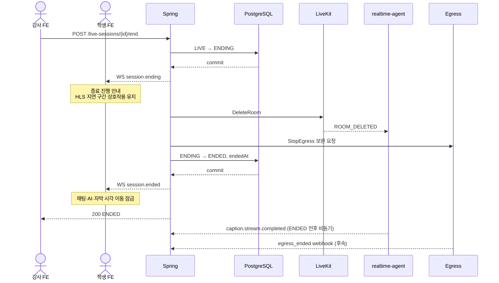

# ADR-0003: 라이브 종료는 ENDING 선커밋 후 Room·Egress를 순차 제어한다

> 관련 결정: [ADR-0001 라이브·다시보기 재생 API](0001-live-replay-playback-api.md) ·
> [ADR-0002 라이브 시작 publisher·STT 서비스·Egress 게이트](0002-live-start-egress-stt-orchestration.md) ·
> [ADR-0020 Egress 녹화 생명주기](../songjeongki/0020-egress-recording-lifecycle.md) ·
> [ADR-0019 채팅 STOMP·커밋 후 브로드캐스트](../songjeongki/0019-ws-realtime-chat-stomp.md) ·
> [공유 계약](../../CONTRACT.md) ·
> [프론트 라이브 API](../../frontend/api/LIVE.md)

- **상태**: 채택 — 구현됨
- **일자**: 2026-07-31
- **적용 범위**: 강사 라이브 종료 요청, Spring 세션 상태 전이, LiveKit Room·Egress 종료 제어,
  학생 종료 상태 전파와 채팅·AI·자막 시각 이동 잠금
- **부분 대체**: [ADR-0002](0002-live-start-egress-stt-orchestration.md)의 §10과 Phase 7 종료 설계 중
  종료 operation·비동기 reconciler·자막/Egress 완료 신호 대기 부분을 이 ADR의 단순 MVP 흐름으로 대체한다.

## 한 줄 결정

강사의 `POST /api/live-sessions/{sessionId}/end` 한 요청이 종료 과정을 순차 수행한다.
Spring은 먼저 별도 트랜잭션으로 `LIVE → ENDING`을 커밋해 종료 진행 상태를 알리고,
트랜잭션 밖에서 LiveKit Room 삭제와 Egress 종료 요청을 차례대로 수행한 다음,
두 번째 트랜잭션으로 `ENDING → ENDED`를 커밋한다. 학생의 채팅·AI 질문·자막 시각 이동은
HLS 지연 구간을 고려해 `ENDING` 동안 유지하고, `ENDED` 커밋 뒤에 잠근다.

이번 범위에서는 종료 operation 테이블, 작업 큐, 자동 재시도, reconciler를 만들지 않는다.
`caption.stream.completed`, Egress webhook, HLS `#EXT-X-ENDLIST`는 세션 `ENDED`의 선행 조건이 아니라
각 자막·녹화 수명주기가 나중에 반영하는 후속 신호로 둔다.

## 맥락

### 1. 학생 화면은 HLS 지연을 고려해 ENDED에서 잠가야 한다

현재 종료 구현은 한 서비스 호출 안에서 `LIVE → ENDING → ENDED`를 모두 처리한다.
WebSocket 연결 자체는 이미 있다. 공통 STOMP endpoint `/api/ws`와 세션별
`/topic/live-sessions/{sessionId}/chat`·`/topic/live-sessions/{sessionId}/captions` 토픽으로
채팅과 실시간 자막을 전달한다. 다만 같은 연결에서 세션의 `ENDING`·`ENDED` 상태를 전달할
`/topic/live-sessions/{sessionId}/state` 토픽은 아직 없어서 중간 `ENDING`을 학생이 즉시 관찰할 수 없다.

자막 토픽의 `caption.stream.completed`는 한 STT attempt가 끝났다는 후속 신호이지,
라이브 세션 상태 전이의 권위 있는 알림이 아니다. Room 삭제와 agent drain 뒤에 도착하므로
종료 진행과 완료를 알리는 `session.ending`·`session.ended`를 대신할 수 없다.

학생은 실시간 원본보다 수 초 늦은 HLS 영상을 보고 있다. 강사가 종료 버튼을 누른 시점에
학생 화면을 바로 잠그면, 학생에게는 아직 라이브의 마지막 구간이 재생 중인데도 다음 기능을
먼저 사용할 수 없게 된다.

- 새 채팅 또는 질문 채팅 전송
- 새 개인 AI 질문 요청
- 실시간 자막 시각을 눌러 HLS 위치 이동

따라서 `ENDING`은 서버가 송출 종료를 진행하는 동안 학생이 HLS 지연 구간을 이어서 보는
유예 상태로 사용한다. 학생 기능의 마감 시점은 종료 제어를 마치고 DB에 커밋한 `ENDED`다.

### 2. 완전한 자동 복구는 현재 MVP 범위에 비해 크다

ADR-0002의 목표 종료 상태기계는 Room 삭제 재시도, pending dispatch 정리, Egress stop 보완,
자막 completion·Egress webhook 순서 역전 처리, bounded timeout과 reconciler를 포함한다.

이 설계는 운영 내구성에는 유리하지만 다음 구조를 한 번에 요구한다.

- 영속 종료 operation과 단계별 상태
- 비동기 실행기와 lease
- 주기적 reconciler
- 자막·Egress 완료 신호의 상관관계와 timeout 정책
- Spring 재시작 후 이어서 실행할 복구 규칙

현재 요구사항은 정상 종료 경로와 HLS 지연을 반영한 학생 화면 잠금이다.
따라서 우선 정상 경로를 짧고 관찰 가능한 순차 흐름으로 완성하고,
자동 복구는 실제 장애 빈도와 운영 필요가 확인된 뒤 별도 결정으로 도입한다.

### 3. 라이브 세션과 녹화 자산은 독립된 상태축이다

라이브가 끝났더라도 녹화 파일은 다음처럼 아직 마무리 중일 수 있다.

```text
liveSessionStatus = ENDED
videoAssetStatus  = FINALIZING
replayStatus      = DRAFT
```

이는 모순이 아니다. `ENDED`는 더 이상 라이브 상호작용과 송출을 받지 않는다는 뜻이고,
Egress webhook·manifest 검증·다시보기 게시는 `VideoAsset`과 `ReplayStatus`가 따로 표현한다.
그러므로 녹화가 `READY`가 될 때까지 라이브 세션을 `ENDING`에 묶어둘 필요가 없다.

## 결정

### 1. 종료 API는 동기 순차 오케스트레이션으로 유지한다

```http
POST /api/live-sessions/{sessionId}/end
```

성공 응답은 기존과 같이 `200 OK`와 최종 세션 표현을 사용한다. 아래는 핵심 필드만 표시한 예시다.

```json
{
  "sessionId": "33333333-3333-4333-8333-333333333333",
  "liveSessionStatus": "ENDED",
  "endedAt": "2026-07-31T15:00:03+09:00"
}
```

별도 `operationId`와 `202 Accepted`를 도입하지 않는다. 요청은 Room·Egress 제어가 끝날 때까지
수 초간 열려 있을 수 있으므로 Room·Egress 서버 제어 호출에는
`LIVEKIT_CONTROL_TIMEOUT`(기본 10초)의 명시적인 전체 timeout을 둔다.

상태별 동작은 다음과 같다.

| 요청 시 상태 | 동작 |
|---|---|
| `LIVE` | `ENDING` 커밋 후 종료 제어를 시작한다 |
| `ENDING` | 자동 복구 대신 같은 종료 제어를 다시 순차 실행한다 |
| `ENDED` | 외부 제어를 반복하지 않고 현재 종료 세션을 반환한다 |
| 그 외 | `409 LIVE_SESSION_STATE_CONFLICT` |

`ENDING` 재요청은 강사가 명시적으로 누르는 수동 재시도 경로다. Room 삭제와 Egress stop은
같은 요청이 반복돼도 안전한 멱등 호출로 취급한다.

### 2. 하나의 긴 트랜잭션을 사용하지 않는다

종료 façade는 다음 세 구간을 순서대로 호출한다.

```text
[트랜잭션 A] LIVE → ENDING 커밋
        ↓
[트랜잭션 없음] LiveKit Room 삭제
        ↓
[트랜잭션 없음] Egress 종료 요청
        ↓
[트랜잭션 B] ENDING → ENDED, endedAt 기록 후 커밋
```

전체 façade에 `@Transactional`을 붙이지 않는다. 외부 네트워크 호출 동안 DB 트랜잭션과 락을
유지하면 안 되고, `ENDING` 커밋이 늦어져 학생에게 종료 진행 상태가 전달되는 것도 늦어지기 때문이다.

구현은 별도 transition bean 또는 `TransactionTemplate`로 두 트랜잭션 경계를 분리한다.

### 3. ENDING은 종료 진행을 알리고, ENDED에서 학생 기능을 잠근다

상태 전이는 커밋된 뒤에만 WebSocket으로 전달한다. 롤백된 상태가 학생 화면에 먼저 노출되지 않도록
`@TransactionalEventListener(AFTER_COMMIT)` 패턴을 사용한다.

채널:

```text
/topic/live-sessions/{sessionId}/state
```

`ENDING` 이벤트:

```json
{
  "eventId": "evt_...",
  "type": "session.ending",
  "sessionId": "33333333-3333-4333-8333-333333333333",
  "occurredAt": "2026-07-31T15:00:00+09:00",
  "payload": {
    "liveSessionStatus": "ENDING",
    "endedAt": null
  }
}
```

`ENDED` 이벤트:

```json
{
  "eventId": "evt_...",
  "type": "session.ended",
  "sessionId": "33333333-3333-4333-8333-333333333333",
  "occurredAt": "2026-07-31T15:00:03+09:00",
  "payload": {
    "liveSessionStatus": "ENDED",
    "endedAt": "2026-07-31T15:00:03+09:00"
  }
}
```

`/state` 구독은 기존 `/chat`·`/captions`와 같은 소유 강사·활성 수강생 게이트를 적용한다.
구체적인 세션 토픽만 정확 매칭으로 허용하고 `/topic/**` 같은 와일드카드 구독은 계속 차단한다.

두 이벤트의 학생 화면 의미는 명확히 구분한다.

- `session.ending`: 종료 진행 안내를 표시하되 채팅·AI 질문·자막 시각 이동은 유지한다.
- `session.ended`: 종료 완료 문구를 표시하고 채팅·AI 질문·자막 시각 이동을 잠근다.

프론트는 WebSocket 재연결 직후 `GET /api/live-sessions/{sessionId}`를 다시 조회한다.
이벤트를 놓쳤더라도 서버 상태로 UI를 복구한다.

### 4. 학생 UI는 LIVE·ENDING에서 상호작용을 허용한다

프론트의 공통 판정은 다음과 같다.

```ts
const canInteract =
  session.status === 'LIVE' || session.status === 'ENDING'
const canCaptionSeek =
  session.status === 'LIVE' || session.status === 'ENDING'
```

`session.ending`을 받거나 최초 조회에서 `ENDING`을 확인하면
**“강사가 수업을 종료하고 있습니다. 남은 영상을 재생 중입니다.”**와 같은 종료 진행 안내를 표시한다.
이 상태에서는 HLS 지연 구간을 시청하는 학생을 위해 채팅·AI 질문·자막 시각 이동을 계속 허용한다.

`session.ended`를 받거나 최초 조회에서 `ENDED`를 확인한 시점에 다음 상태로 전환한다.

- 화면에 **“라이브가 종료된 강의입니다.”** 표시
- 채팅 내역은 유지하되 작성 폼을 제거하거나 비활성화
- AI 대화 내역은 유지하되 새 질문과 재시도를 비활성화
- 진행 중 AI SSE는 `AbortController`로 중단
- 자막 내용과 마지막 drain 결과는 계속 표시
- 자막 시각은 클릭 가능한 버튼 대신 비활성 시각(`<time>`)으로 표시
- 아직 적용하지 않은 자막 `seekRequest`는 폐기
- HLS 플레이어 자체의 재생·탐색은 유지하고, 이 결정에서는 **자막 시각 클릭 이동만** 막는다

`ENDED`는 학생 기능을 처음 잠그는 최종 신호다. 다시보기 페이지로 자동 이동시키지는 않는다.

### 5. ENDED에서는 서버도 채팅·AI 쓰기를 차단한다

프론트 비활성화는 보안·정합성 경계가 아니다. 다음 쓰기 경로는 세션이 `LIVE` 또는
`ENDING`일 때 허용한다.

- `POST /api/live-sessions/{sessionId}/messages`
- STOMP `/app/live-sessions/{sessionId}/chat`
- `POST /api/live-sessions/{sessionId}/ai/answers/stream`

`ENDED`에서는 업스트림 AI 호출이나 채팅 저장 전에 다음 오류를 반환한다.

```json
HTTP 409

{
  "code": "LIVE_SESSION_INTERACTION_CLOSED",
  "message": "종료된 라이브에서는 채팅이나 AI 질문을 보낼 수 없습니다."
}
```

종료 후에도 다음 읽기는 허용한다.

- 기존 채팅 이력 조회
- 저장 자막 리로드
- 세션 상태 조회
- 권한과 게시 상태를 만족하는 재생 조회

종료와 채팅 저장이 동시에 들어온 경우의 기준은 DB에 커밋된 세션 상태다.
종료의 `ENDED` 커밋 뒤 시작한 쓰기는 반드시 거절한다. 이를 보장하기 위한 행 잠금 또는
조건부 저장 방식은 구현 단계에서 선택하되 외부 계약은 바꾸지 않는다.

### 6. Room 삭제는 필수, 자막 completion은 비동기 후속이다

순서는 다음과 같다.

1. `ENDING` 커밋
2. LiveKit Room 삭제 요청
3. realtime-agent가 `ROOM_DELETED`를 받아 남은 audio·STT event를 drain
4. agent가 `caption.stream.completed(reason=ROOM_DELETED)` 발행

3~4번은 2번의 결과로 비동기 진행되며 `/end` 응답과 `ENDED` 전이를 막지 않는다.
학생이 종료 화면에 남아 있으면 기존 caption 구독으로 마지막 자막을 받을 수 있고,
재접속한 경우 저장 자막 REST 조회로 복구한다.

Room 삭제 호출 자체가 실패하면 실제 송출 종료를 보장할 수 없으므로 `ENDED`로 전환하지 않는다.

- 세션은 `ENDING` 유지
- 종료 API는 `502 LIVE_ROOM_CONTROL_FAILED`
- 학생 화면은 종료 진행 안내를 표시하고 상호작용은 계속 허용
- 강사가 같은 `/end`를 다시 호출해 수동 재시도

### 7. Egress 종료 실패는 라이브 종료를 롤백하지 않는다

Room 삭제 요청 뒤 Egress stop을 보완 호출한다. Egress 종료 요청이 실패해도 라이브 세션은
`ENDED`로 전환한다.

- Room 삭제로 라이브 송출 종료는 이미 요청됐다.
- 녹화 실패는 `VideoAsset` 상태와 로그에서 별도로 드러낸다.
- Egress webhook, HLS `#EXT-X-ENDLIST`, manifest 존재, `READY` 전이는 후속 녹화 수명주기다.
- 녹화 실패 때문에 학생 채팅·AI를 다시 열거나 세션을 `LIVE`로 되돌리지 않는다.

## 목표 런타임 시퀀스



## 최소 실패 정책

| 실패 | 세션 상태 | API 결과 | 복구 |
|---|---|---|---|
| `ENDING` DB 전이 실패 | 기존 상태 | 요청 실패 | 강사 재요청 |
| Room 삭제 실패 | `ENDING` | 502 | 강사 `/end` 수동 재요청 |
| Egress stop 실패 | `ENDED` | 200 | 녹화 자산에서 별도 실패 표시 |
| `ENDED` DB 전이 실패 | `ENDING` | 요청 실패 | 강사 `/end` 수동 재요청 |
| caption completion 지연·누락 | `ENDED` | 영향 없음 | 이번 범위에서 자동 복구 없음 |
| Egress webhook·ENDLIST 지연 | `ENDED` | 영향 없음 | `VideoAsset` 상태로 계속 관찰 |

Spring 프로세스가 `ENDING` 커밋 뒤 종료되면 세션이 `ENDING`에 남을 수 있다.
이번 범위에서는 자동 복구하지 않으며 강사의 같은 종료 요청이 순차 제어를 다시 실행한다.

## 채택하지 않은 대안

### 1. 종료 operation + 비동기 reconciler

프로세스 재시작과 외부 장애를 자동 복구할 수 있지만, 영속 단계·lease·timeout·재시도 정책이 필요해
현재 정상 종료 요구보다 구현 범위가 크다. 운영에서 `ENDING` 고착이 반복되면 별도 ADR로 도입한다.

### 2. 하나의 DB 트랜잭션 안에서 Room·Egress 호출

구현은 짧지만 외부 호출 동안 DB 트랜잭션을 점유하고, `ENDING` 이벤트가 늦게 전달되며,
외부 장애가 DB 롤백과 결합된다. 채택하지 않는다.

### 3. caption completion·Egress READY 뒤에만 ENDED

종료 확정의 의미는 강하지만 자막·녹화 완료 신호의 지연과 누락이 라이브 세션을 오래 `ENDING`에
묶는다. 라이브 세션과 녹화 자산을 독립 상태축으로 유지하기 위해 채택하지 않는다.

### 4. 프론트에서만 입력 비활성화

직접 REST·STOMP·SSE 호출을 막지 못하고 종료 이벤트와 요청의 경합에서 종료 후 데이터가 저장될 수 있다.
서버의 `LIVE`·`ENDING` 허용, `ENDED` 차단 상태 게이트를 함께 적용한다.

## 결과와 한계

### 장점

- 학생이 HLS 지연 구간을 보는 `ENDING` 동안 상호작용을 유지하고, `ENDED` 커밋 시점에 일관되게 잠근다.
- 정상 경로가 한 HTTP 요청의 순차 호출이라 추적과 디버깅이 쉽다.
- 외부 I/O를 DB 트랜잭션 밖에 둔다.
- 라이브 종료와 녹화 후처리 상태를 분리한다.
- operation 테이블·작업 큐·reconciler 없이 구현할 수 있다.

### 한계

- Spring 재시작이나 Room API 장애 뒤 자동 복구하지 않는다.
- `ENDING` 고착은 강사의 수동 재요청이 필요하다.
- caption completion·Egress webhook이 `ENDED` 뒤 늦게 도착할 수 있다.
- 여러 backend 인스턴스에서 상태 WS를 일관되게 전달하려면 현재 SimpleBroker를 외부 relay로
  바꾸는 기존 확장 과제가 남는다.

## 구현 범위

### Backend

1. `LiveSessionService.end`를 `transitionToEnding`·`transitionToEnded` 트랜잭션으로 분리한다.
2. 트랜잭션 밖 순차 제어를 담당하는 종료 façade를 둔다.
3. `ENDING`·`ENDED` 커밋 이벤트와 `/state` broadcaster를 구현한다.
4. 구독 인터셉터에 구체적인 `/state` 토픽을 추가한다.
5. 채팅 REST·STOMP와 AI SSE에 `LIVE`·`ENDING` 허용, `ENDED` 차단 상태 게이트를 추가한다.
6. `LiveSessionEndedEvent`에 묶인 Egress stop 시점을 순차 종료 façade로 옮긴다.
7. Room·Egress 외부 호출 timeout을 명시한다.

### Frontend

1. 세션 `state` 토픽을 구독하고 TanStack Query의 세션 캐시를 갱신한다.
2. 최초 조회와 WebSocket 재연결 직후 서버 상태를 다시 조회한다.
3. `ENDING`에는 종료 진행 안내를 표시하되 채팅·AI 입력과 자막 시각 이동을 유지한다.
4. `ENDED`부터 종료 문구와 채팅·AI 입력 잠금을 적용하고 진행 중 AI SSE를 중단한다.
5. `CaptionDock`에 seek 허용 여부를 전달하고 `ENDED`에서는 시각을 `<time>`으로 렌더한다.
6. 종료 후에도 기존 채팅·AI 대화·자막·HLS 플레이어를 유지한다.

### 공유 계약·문서

구현 변경과 같은 커밋에서 다음을 갱신한다.

- `docs/CONTRACT.md`: 종료 응답, `/state` 이벤트, `ENDED` 이후 채팅·AI 409
- `docs/frontend/api/LIVE.md`: `202 + operationId` 제안을 `200 + 동기 순차 종료`로 교체
- `docs/frontend/components/LIVE_LESSON.md`: 종료 배너와 자막 시각 잠금
- OpenAPI와 FE 서비스 interface·HTTP adapter

## 검증

공유 상태코드·응답·WebSocket 필드와 라이브 핵심 경로이므로 계약 테스트가 필수다.

### Backend 계약·통합 테스트

- `LIVE` 종료 시 `ENDING`이 먼저 커밋되고 `session.ending`이 발행된다.
- Room 삭제 다음 Egress stop이 호출되고, 그 뒤 `ENDED`가 커밋된다.
- 성공 응답은 200과 `liveSessionStatus=ENDED`다.
- 이미 `ENDED`인 종료 요청은 외부 호출 없이 멱등 성공한다.
- `ENDING` 재요청은 순차 종료 제어를 다시 실행한다.
- Room 삭제 실패는 502이며 세션은 `ENDING`에 남는다.
- Egress stop 실패는 세션 `ENDED`를 막지 않는다.
- `ENDING`의 채팅 REST·STOMP와 AI SSE는 허용된다.
- `ENDED`의 채팅 REST·STOMP와 AI SSE는 409이고 저장·업스트림 호출이 없다.
- `/state` 구독은 참가자만 가능하고 와일드카드는 거부된다.

### Frontend 테스트

- `session.ending` 수신 시 종료 진행 안내가 나타나고 채팅·AI·자막 시각 이동은 유지된다.
- `session.ended` 수신 시 종료 문구와 채팅·AI 잠금이 나타나고 진행 중 AI 요청이 abort된다.
- `ENDED`의 자막 시각은 클릭할 수 없고 `onSeek`가 호출되지 않는다.
- 기존 채팅·AI 대화·자막은 사라지지 않는다.
- `ENDING` 상태로 새로고침하면 상호작용이 유지되고, `ENDED` 상태면 처음부터 잠긴 화면이 나온다.
- WebSocket 재연결 뒤 REST 상태가 이벤트 유실을 보완한다.

### 완료 판정

실제 LiveKit 환경에서 강사 종료 요청 후 `ENDING` 동안 학생 상호작용 유지, Room 삭제,
Egress 종료 요청, `ENDED` 전환 뒤 학생 잠금, `caption.stream.completed` 후속 수신을
한 번 연속 확인한다.
reconciler·프로세스 재시작 자동 복구·장기 장애 주입은 이 ADR의 완료 조건이 아니다.
