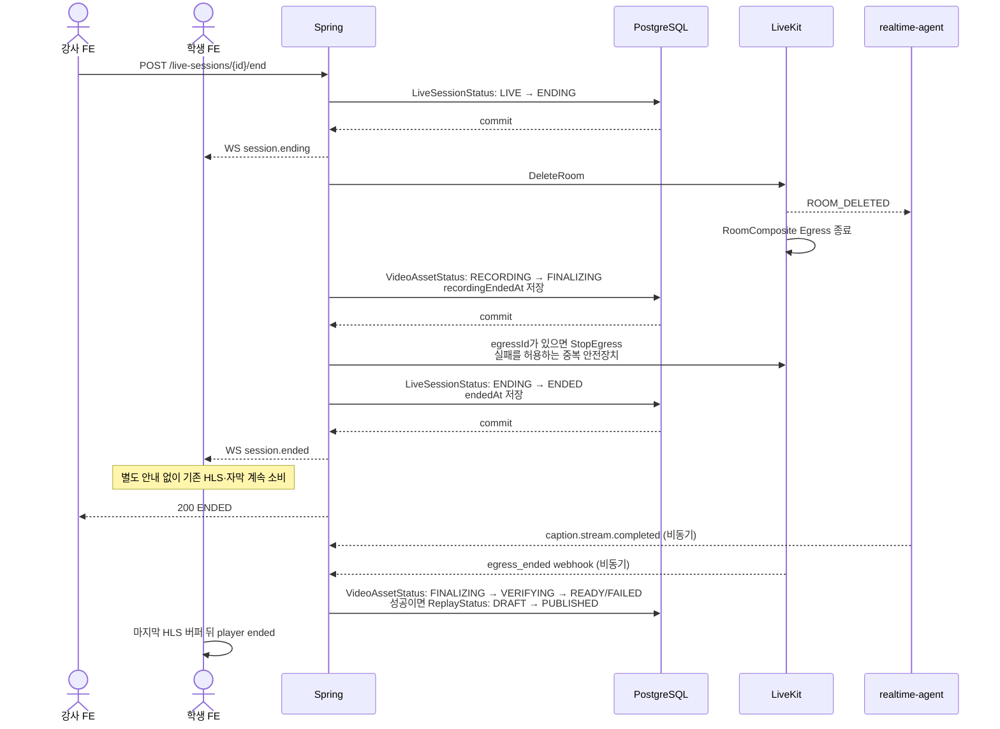

# ADR-0003: 라이브 종료는 ENDING 선커밋 후 Room을 삭제하고 ENDED로 확정한다

> 관련 결정: [ADR-0001 라이브·다시보기 재생 API](0001-live-replay-playback-api.md) ·
> [ADR-0002 라이브 시작과 HLS 준비](0002-live-start-egress-stt-orchestration.md) ·
> [ADR-0020 Egress 녹화 생명주기](../songjeongki/0020-egress-recording-lifecycle.md) ·
> [ADR-0019 채팅 STOMP·커밋 후 브로드캐스트](../songjeongki/0019-ws-realtime-chat-stomp.md) ·
> [ADR-0034 Egress 완료 webhook](../songjeongki/0034-egress-completion-webhook.md) ·
> [공유 계약](../../CONTRACT.md) ·
> [프론트 라이브 API](../../frontend/api/LIVE.md) ·
> [ADR-0004 종료 세션 대화 지속](0004-ended-session-conversation.md) ·
> [ADR-0005 학생 HLS·자막 drain](0005-ended-hls-caption-drain.md) ·
> [ADR-0007 녹화 READY 자동 게시·processing 폴링](0007-recording-ready-auto-publish-and-processing-polling.md)

- **상태**: 채택 — 상호작용은 ADR-0004, 학생 HLS·자막 종료 판단은 ADR-0005,
  녹화 확정·자동 게시·처리 화면까지의 최종 통합 흐름은 ADR-0007로 개정
- **일자**: 2026-07-31
- **적용 범위**: 강사 라이브 종료, Spring 상태 전이, LiveKit Room 종료, 학생 상태 전파와
  미디어·자막 종료 처리
- **부분 대체**: ADR-0002에 있던 종료 operation·reconciler·완료 신호 대기 설계를 단순 MVP
  흐름으로 대체한다.

## 한 줄 결정

강사의 `POST /api/live-sessions/{sessionId}/end` 한 요청에서 Spring은 먼저
`LiveSessionStatus: LIVE → ENDING`을 커밋하고, 트랜잭션 밖에서 LiveKit Room 삭제를 요청한다.
그 뒤 `VideoAssetStatus: RECORDING → FINALIZING`을 커밋하고, `egressId`가 있으면 실패를 허용하는
`StopEgress` 중복 안전장치를 호출한 다음 `LiveSessionStatus: ENDING → ENDED`를 커밋한다.
`ENDED`는 강사 송출과 Room 종료만 뜻하며 학생의 HLS·자막 소비를
종료하지 않는다. 학생은 별도 송출 종료 안내 없이 남아 있는 HLS와 확정 자막을 계속 소비한다.
새 자막 생성은 `caption.stream.completed`, HLS 파일 확정은 `VideoAsset READY/FAILED`, 학생별 실제
재생 완료는 player `ended`가 판단한다. 채팅·AI 질문은 ADR-0004에 따라 같은 세션에서 계속 허용한다.

RoomComposite Egress는 Room 종료에 따라 종료되고, 이후 LiveKit webhook이 녹화 자산을 확정한다.
정상 manifest면 같은 트랜잭션에서 `VideoAssetStatus=READY + ReplayStatus=PUBLISHED`, 실패면
`VideoAssetStatus=FAILED + ReplayStatus=DRAFT`가 된다. `StopEgress`는 확정 종료 순서에 포함된
안전장치지만 그 **성공**은 완료 조건이 아니다. 종료 operation, 자동 재시도, reconciler도 MVP 완료
조건이 아니다.

## `StopEgress` 안전장치

Spring 종료 façade는 Room 삭제 뒤 `egressId`가 있으면 `StopEgress`를 한 번 더 호출한다. Room 삭제가
RoomComposite Egress 종료를 시작하므로 중복일 수 있지만, 예외 상황에서 Egress가 남는 것을 줄이는
안전장치다. 호출 실패는 로그만 남기고 `VideoAssetStatus=FINALIZING`과 세션 `ENDED` 확정을 유지한다.

## 상태 의미

```text
liveSessionStatus = ENDED
videoAssetStatus  = FINALIZING
replayStatus      = DRAFT
```

위 조합은 정상이다.

- `ENDED`: 강사 송출과 LiveKit Room이 끝남. 학생 HLS·자막 drain과 세션 채팅·AI 질문은 계속 가능
- `FINALIZING`: LiveKit이 Egress 파일을 마무리하고 webhook을 보내기 전
- `DRAFT`: 녹화 확정 전의 미게시 상태. 새 정상 녹화는 webhook에서 `READY + PUBLISHED`로 함께 전환

따라서 Egress webhook, HLS `#EXT-X-ENDLIST`, manifest 검증, 자막 completion을 기다리느라
라이브 세션을 `ENDING`에 묶어 두지 않는다.

## MVP 결정

### 1. 종료 API는 동기 순차 흐름을 사용한다

```http
POST /api/live-sessions/{sessionId}/end
```

성공 응답은 `200 OK`와 최종 세션 표현이다. 별도 종료 `operationId`나 `202 Accepted`를 만들지 않는다.

| 요청 시 상태 | 동작 |
|---|---|
| `LIVE` | `ENDING` 커밋 후 Room 삭제를 시작 |
| `ENDING` | Room 삭제를 다시 요청하는 수동 재시도 |
| `ENDED` | 외부 제어 없이 현재 세션 반환 |
| 그 외 | `409 LIVE_SESSION_STATE_CONFLICT` |

### 2. 외부 호출 동안 DB 트랜잭션을 열지 않는다

```text
[트랜잭션 A] LIVE → ENDING 커밋
        ↓
[트랜잭션 없음] LiveKit Room 삭제
        ↓
[트랜잭션 B] VideoAsset RECORDING → FINALIZING, recordingEndedAt 커밋
        ↓
[트랜잭션 없음] egressId가 있으면 StopEgress 안전장치 호출(실패 허용)
        ↓
[트랜잭션 C] ENDING → ENDED, endedAt 커밋
```

Room 삭제 실패 시 실제 송출 종료를 보장할 수 없으므로 `ENDED`로 전환하지 않는다.

- 세션은 `ENDING` 유지
- API는 `502 LIVE_ROOM_CONTROL_FAILED`
- 강사가 같은 `/end`를 다시 호출해 수동 재시도

### 3. 커밋된 ENDING·ENDED를 WebSocket으로 전달한다

채널:

```text
/topic/live-sessions/{sessionId}/state
```

`session.ending` payload:

```json
{
  "liveSessionStatus": "ENDING",
  "endedAt": null
}
```

`session.ended` payload:

```json
{
  "liveSessionStatus": "ENDED",
  "endedAt": "2026-07-31T15:00:03+09:00"
}
```

이벤트는 `AFTER_COMMIT`에 발행한다. `/state` 구독은 기존 채팅·자막과 같은 소유 강사·활성
수강생 게이트를 사용하고 와일드카드 구독은 차단한다. FE는 재연결 뒤 REST로 세션 상태를 다시
조회해 놓친 이벤트를 보완한다.

### 4. ENDED에서는 강사 송출만 종료한다

- `ENDING`: 종료 진행 안내를 표시하고 채팅·AI 질문·자막 시각 이동을 유지
- `ENDED`: 학생에게 별도 송출 종료 안내를 표시하지 않고 재생 중인 HLS와 자막 시각 이동을 유지
- `ENDED`에서도 새 채팅·AI 질문·AI 재시도와 진행 중 AI SSE를 유지
- `caption.stream.completed` 뒤 새 자막 생성을 종료하되 기존 자막은 HLS 위치에 맞춰 유지
- `VideoAsset READY` 뒤에도 마지막 HLS 버퍼를 소비하고 player `ended`에서 학생 재생을 마친다

서버도 채팅 REST·STOMP와 AI SSE 쓰기를 `LIVE`·`ENDING`·`ENDED`에서 허용한다. 시작 전·취소·실패
상태는 저장이나 업스트림 호출 전에 `409 LIVE_SESSION_STATE_CONFLICT`를 반환한다. 상세 근거와
다시보기 AI와의 범위 구분은 ADR-0004, 학생 HLS·자막 drain은 ADR-0005가 정본이다.

### 5. 자막과 녹화 완료는 비동기 후속 처리다

Room 삭제 뒤 realtime-agent는 `ROOM_DELETED`를 받아 남은 자막을 drain하고
마지막 자막 이벤트 다음에 `caption.stream.completed`를 발행한다. 동일 attempt에는 그 뒤 새 자막을
생성하지 않는다. 이 신호는 `/end` 응답이나 `ENDED` 전이의 선행 조건이 아니다.

RoomComposite Egress도 Room 생명주기에 따라 종료된다. LiveKit의 서명된 `egress_ended` webhook은
별도 녹화 수명주기에서 `VideoAsset`을 `FINALIZING → VERIFYING → READY/FAILED`로 확정한다. 정상
경로는 `ReplayStatus: DRAFT → PUBLISHED`도 같은 DB 트랜잭션에서 확정한다.
학생 classroom은 확정 전에도 기존 HLS 접근을 유지하고, `READY` 뒤 마지막 버퍼까지 재생한다.
webhook 유실 복구는 라이브 종료 기능과 분리한 추후 운영 과제다.

## 종료 핵심 시퀀스

처리 현황 폴링과 강사 replay 자동 이동까지 포함한 최종 목표 시퀀스의 정본은
[ADR-0007](0007-recording-ready-auto-publish-and-processing-polling.md)이다.



## 최소 실패 정책

| 실패 | 세션 상태 | API 결과 | MVP 복구 |
|---|---|---|---|
| `ENDING` DB 전이 실패 | 기존 상태 | 요청 실패 | 강사 재요청 |
| Room 삭제 실패 | `ENDING` | 502 | 강사 `/end` 수동 재요청 |
| `ENDED` DB 전이 실패 | `ENDING` | 요청 실패 | 강사 `/end` 수동 재요청 |
| caption completion 지연·누락 | `ENDED` | 영향 없음 | 자동 복구 없음 |
| Egress webhook·ENDLIST 지연 | `ENDED` | 영향 없음 | `VideoAsset` 상태로 표시 |
| `StopEgress` 안전장치 실패 | `ENDED` | 영향 없음 | `FINALIZING` 유지, 로그만 남김 |

Spring이 `ENDING` 커밋 뒤 종료되면 세션이 `ENDING`에 남을 수 있다. MVP에서는 자동 복구하지 않고
강사의 같은 종료 요청으로 다시 진행한다.

## 추후 고려사항

다음은 실제 운영 지표에서 필요성이 확인될 때 별도 ADR로 결정한다.

- `ENDING` 고착을 자동 복구하는 종료 operation·작업 큐·reconciler
- 다중 backend 인스턴스의 lease·owner fencing
- Egress webhook 유실 시 `FINALIZING` 자산을 재조회하는 reconciler
- 자막 completion·webhook·ENDLIST의 순서 역전과 장기 지연 처리
- SimpleBroker를 외부 STOMP relay로 바꾸는 다중 인스턴스 상태 전파

## 현재 구현 상태

| 항목 | 상태 |
|---|---|
| ENDING 선커밋과 Room 삭제 뒤 ENDED 커밋 | 구현 |
| `session.ending`·`session.ended` WebSocket | 구현 |
| ENDED 이후 별도 안내 없이 HLS·자막 시각 이동 유지 | ADR-0005로 설계 확정, 코드 미반영 |
| ENDED 이후 서버 채팅·AI 쓰기 허용 | 구현 |
| completion 뒤 새 자막 생성 금지 | producer drain·completion 구현, 늦은 이벤트 차단 보강 필요 |
| Egress webhook의 `VideoAsset READY/FAILED` 확정 | 구현 |
| ENDED classroom의 FINALIZING HLS 연속 접근 | ADR-0005로 설계 확정, 코드 미반영 |
| 실패 허용 `StopEgress` 중복 안전장치 | 구현, 호출 성공은 MVP 완료 조건 아님 |
| webhook의 `READY + PUBLISHED` 원자적 확정 | ADR-0007에 따라 구현 |
| 강사 processing 폴링·replay 자동 이동 | ADR-0007에 따라 FE/BE 구현 |
| 종료 operation·자동 재시도·reconciler | 추후 고려, 미구현 |
| webhook 유실 시 `FINALIZING` 복구 | 추후 고려, 미구현 |

## 검증

공유 상태코드·응답·WebSocket 필드는 계약 테스트 대상이다. MVP 완료 판정은 다음에 집중한다.

- `LIVE` 종료 시 `ENDING`이 먼저 커밋되고 `session.ending`이 발행된다.
- Room 삭제 성공 뒤 `ENDED`가 커밋되고 `session.ended`와 200 응답이 전달된다.
- Room 삭제 실패는 502이며 세션은 `ENDING`에 남는다.
- 이미 `ENDED`인 요청은 멱등 성공한다.
- `session.ended` 뒤 별도 종료 안내 없이 학생 HLS·자막 시각 이동이 유지된다.
- `caption.stream.completed`가 마지막 자막 이벤트이며 이후 같은 attempt의 새 자막이 없다.
- `VideoAsset FINALIZING/VERIFYING` 동안 기존 classroom HLS 접근이 유지된다.
- `READY` 뒤 player가 마지막 세그먼트를 소비해 자연스럽게 `ended`에 도달한다.
- `ENDED`에서도 FE와 서버의 채팅·AI 질문이 허용된다.
- 시작 전·취소·실패 상태의 채팅·AI 쓰기는 409 `LIVE_SESSION_STATE_CONFLICT`로 차단된다.
- Egress webhook이 늦게 와도 라이브 세션은 `ENDED`를 유지하고 자산 상태만 갱신된다.

`StopEgress` 호출의 성공, 자동 reconciler, 프로세스 재시작 복구, webhook 유실 복구, 장기 장애
주입은 이 ADR의 MVP 완료 조건이 아니다. 자동 게시·processing 흐름의 완료 조건은 ADR-0007의 검증
절을 따른다.
