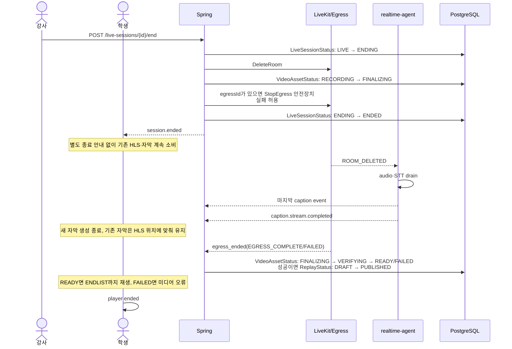

# ADR-0005: 세션 종료와 학생 HLS·자막 drain 완료를 분리한다

> 관련 결정: [ADR-0001 라이브·다시보기 재생 API](0001-live-replay-playback-api.md) ·
> [ADR-0003 라이브 종료 순차 처리](0003-simple-live-end-sequential-process.md) ·
> [ADR-0004 종료 세션 대화 지속](0004-ended-session-conversation.md) ·
> [ADR-0006 REQUESTED 상태 제거](0006-remove-video-asset-requested-status.md) ·
> [ADR-0007 녹화 READY 자동 게시·processing 폴링](0007-recording-ready-auto-publish-and-processing-polling.md) ·
> [ADR-0034 Egress 완료 webhook](../songjeongki/0034-egress-completion-webhook.md) ·
> [공유 계약](../../CONTRACT.md) ·
> [프론트 라이브 설계](../../frontend/components/LIVE_LESSON.md)

- **상태**: 채택 — 설계 확정, 코드 반영 필요
- **일자**: 2026-07-31
- **적용 범위**: 강사 송출 종료 뒤 학생 classroom의 HLS·자막 잔여 구간, `VideoAsset` 종료 수명주기
- **부분 대체**: ADR-0001의 `ENDED` 즉시 replay 게이트, ADR-0003·0004의 `ENDED` 즉시 학생 미디어·자막 잠금

## 맥락

학생은 LiveKit Room을 직접 구독하지 않고 Egress가 만드는 HLS를 시청한다. HLS에는 인코딩·업로드·
플레이어 버퍼만큼 지연이 있으므로 강사 송출이 끝난 시각과 학생이 마지막 프레임을 보는 시각이 다르다.

현재 종료 순서는 다음처럼 서로 독립적인 세 신호를 만든다.

1. Room 삭제 뒤 `LiveSession`이 `ENDED`로 커밋되고 `session.ended`가 전달된다.
2. realtime-agent가 남은 오디오와 STT 결과를 drain한 뒤 `caption.stream.completed`를 전달한다.
3. Egress가 마지막 HLS 세그먼트와 `#EXT-X-ENDLIST`를 확정한 뒤 `egress_ended` webhook을 보낸다.

`session.ended`만으로 학생의 자막 seek와 HLS 접근을 닫으면 2·3번보다 먼저 화면이 종료되고,
남아 있는 HLS 구간의 영상·자막을 소비할 수 없다.

## 결정

### 1. `session.ended`는 강사 송출 종료만 뜻한다

학생 classroom은 `session.ended`를 받아도 다음 동작을 유지한다.

- 재생 중인 HLS player와 manifest 갱신
- 현재 HLS 위치에 맞춘 자막 노출과 자막 시각 이동
- 채팅·AI 질문과 진행 중 AI SSE

학생에게 **“송출이 종료되어 남은 영상을 재생 중입니다”** 같은 별도 배너·토스트·오버레이를
표시하지 않는다. 재생 화면을 끊거나 다른 페이지로 이동시키지도 않는다.

`LiveSession.ENDED`는 Room과 강사의 실시간 발행이 끝났다는 코어 상태다. 자막 생성 완료,
Egress 파일 확정, 학생 player의 실제 재생 완료를 의미하지 않는다.

### 2. `caption.stream.completed`가 새 자막 생성의 terminal 신호다

realtime-agent는 `ROOM_DELETED`를 받은 뒤 남은 오디오와 STT event를 먼저 drain하고 마지막
델타·확정 세그먼트를 발행한 다음 `caption.stream.completed`를 발행한다.

동일한 `(sessionId, sttSessionId)`에 대해서는 completion의 `lastSequence` 뒤에 새
`caption.delta`나 `caption.segment.final`을 생성하지 않는다. 지연·중복 전달로 completion 뒤에
도착한 동일 attempt의 이벤트도 새 자막으로 반영하지 않는다.

completion을 받아도 기존 자막을 숨기거나 즉시 사용할 수 없게 만들지는 않는다. 학생이 남은 HLS를
재생하는 동안 이미 확정된 자막은 player 위치에 맞춰 계속 노출하고 시각 이동에 사용할 수 있다.

### 3. HLS 확정은 `VideoAsset`, 실제 시청 완료는 player가 판단한다

`egress_ended` webhook은 원시 입력 신호다. Spring은 성공 webhook을 받은 뒤 manifest 존재를
검증하고 `VideoAsset`을 `READY` 또는 `FAILED`로 확정한다.

- `FINALIZING`·`VERIFYING`: 기존 classroom의 HLS 접근과 manifest 갱신을 유지한다.
- `READY`: 더 이상 새 세그먼트가 생기지 않는 최종 HLS가 준비됐다. player는 남은 버퍼를 계속 재생한다.
- `FAILED`: 더 이상 정상적인 꼬리 재생을 보장할 수 없으므로 미디어 오류로 종료한다.

`READY`가 됐다고 player를 즉시 pause/unmount하지 않는다. 마지막 세그먼트까지 소비한 브라우저
player의 `ended` 이벤트가 해당 학생의 실제 재생 완료 신호다.

새로 다시보기 화면에 진입할 때 적용하는 `ReplayStatus.PUBLISHED` 게이트와, 이미 라이브 classroom에서
시청 중인 학생이 꼬리 HLS를 마저 보는 권한은 분리한다. 현재 lesson 기반 playback endpoint는 이
연속 시청 권한을 구분하지 못하므로 구현 시 별도 grant 또는 session-scoped 접근 계약이 필요하다.

## `VideoAssetStatus` 상태 정리

코드에 정의된 상태는 다음 6개다.

| 상태 | 의미 | 진입·처리 |
|---|---|---|
| `STARTING` | Egress 시작 요청 준비·응답 재조정 중 | 새 자산 또는 재시도할 `FAILED` 자산을 초기화한다. Egress ID가 아직 없을 수 있다 |
| `RECORDING` | Egress ID가 저장됐고 HLS를 생성 중 | 시작 응답을 연결하면서 `recordingStartedAt`을 기록한다 |
| `FINALIZING` | 중지 요청 뒤 마지막 세그먼트·manifest 완료 대기 | 종료 흐름이 `recordingEndedAt`을 기록한 뒤 진입한다. 중지 API 실패와 무관하게 webhook을 기다린다 |
| `VERIFYING` | 성공 webhook 뒤 manifest 존재 확인 중 | 현재 코드는 `READY/FAILED` 확정과 같은 트랜잭션에서 처리하므로 외부 조회에서 거의 관찰되지 않는다 |
| `READY` | 최종 manifest가 확인됐거나 검증 장애에서 webhook 성공을 신뢰해 확정 | `readyAt`, 가능하면 `durationMs`·`sizeBytes`·`segmentCount`를 기록한다 |
| `FAILED` | Egress 시작 실패·시작 abort·Egress 종료 실패·manifest 부재 | `failureCode`를 기록한다. 시작 재시도 시 같은 자산을 `STARTING`으로 초기화할 수 있다 |

정상 전이는 다음과 같다.

```text
(신규 또는 재시도할 FAILED)
  → STARTING
  → RECORDING
  → FINALIZING
  → VERIFYING
  → READY
```

실패 전이는 다음과 같다.

```text
STARTING ─┐
RECORDING ├→ FAILED
FINALIZING┤
VERIFYING ┘
```

Egress가 정상 종료 요청보다 먼저 끝나면 webhook handler는 `READY/FAILED`가 아닌 현재 자산을 받아
`STARTING` 또는 `RECORDING`에서도 바로 `VERIFYING → READY/FAILED`로 확정할 수 있다.

`VideoAssetStatus`는 파일 생성·검증 상태이고 `ReplayStatus`
(`DRAFT`·`READY_FOR_REVIEW`·`PUBLISHED`·`WITHDRAWN`)는 공개·검수 상태다. 두 상태축의 의미는
독립이지만 새 정상 녹화는 ADR-0007에 따라 성공 webhook 트랜잭션에서 `READY + PUBLISHED`를 함께
확정한다. `READY + DRAFT`는 기존 미게시 자산에서만 정상 조합으로 남고 일괄 자동 게시하지 않는다.

## 종료 시퀀스



`caption.stream.completed`와 `VideoAsset READY/FAILED`의 도착 순서는 고정하지 않는다. 어느 하나가
늦어도 다른 상태축을 되돌리지 않으며, `LiveSession`을 다시 `ENDING`으로 바꾸지 않는다.

## 현재 구현과의 차이

이 ADR은 목표 설계이며 다음 코드는 아직 맞춰야 한다.

- FE가 `session.ended`에서 종료 배너를 표시하고 자막 시각 이동을 잠그는 동작
- backend playback이 `ENDED`를 즉시 replay로 분류해 `READY + PUBLISHED`를 요구하는 동작
- playback 응답·WS에 `VideoAssetStatus` 확정 상태를 학생에게 전달하는 계약
- completion 뒤 동일 attempt의 늦은 자막을 무시하는 terminal 순서 보장

코드와 계약 테스트를 바꾸기 전까지 위 항목을 구현 완료로 보고하지 않는다.
