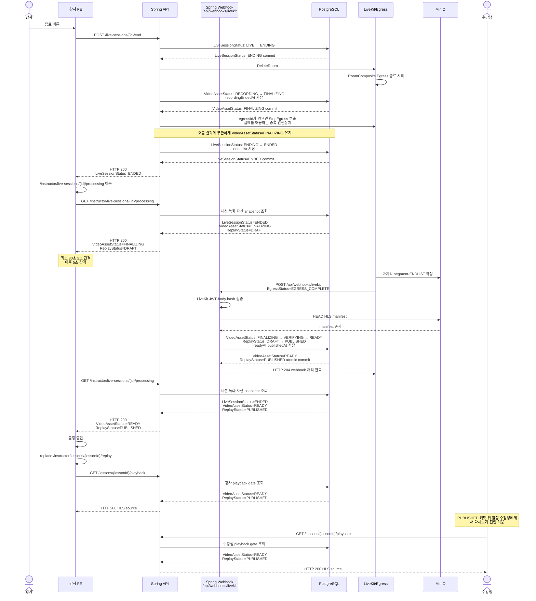
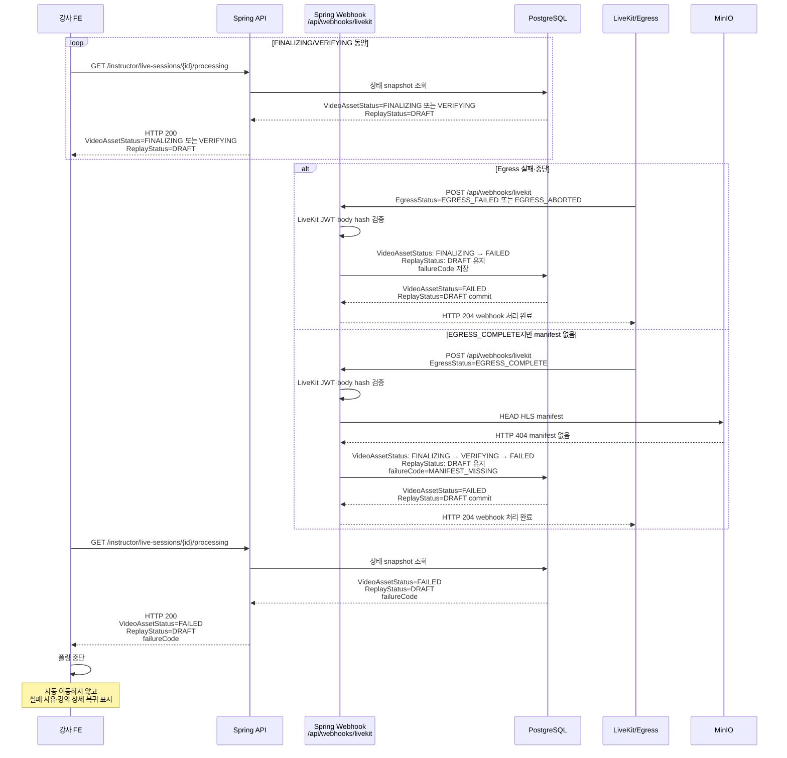

# ADR-0007: 녹화 READY와 다시보기 자동 게시를 원자적으로 확정하고 처리 화면은 폴링한다

> 관련 결정: [ADR-0001 라이브·다시보기 재생 API](0001-live-replay-playback-api.md) ·
> [ADR-0003 라이브 종료 순차 처리](0003-simple-live-end-sequential-process.md) ·
> [ADR-0005 학생 HLS·자막 drain](0005-ended-hls-caption-drain.md) ·
> [ADR-0034 Egress 완료 webhook](../songjeongki/0034-egress-completion-webhook.md) ·
> [ADR-0039 다시보기 재생 API](../songjeongki/0039-replay-playback-api.md) ·
> [ADR-0006 VOD 공개·AI 게시본 분리](../yoongwanghyeok/0006-vod-publication-review-and-learning.md) ·
> [공유 계약](../../CONTRACT.md) ·
> [프론트 라이브 API](../../frontend/api/LIVE.md)

- **상태**: 채택 — FE/BE 구현 및 계약 테스트 반영
- **일자**: 2026-08-02
- **적용 범위**: 라이브 종료 뒤 녹화 자산 확정, 영상 다시보기 자동 공개, 강사용 처리 현황 조회,
  처리 화면 폴링과 강사 다시보기 화면 자동 이동
- **부분 대체**:
  - ADR-0001·0003·0005의 `VideoAsset READY + ReplayStatus DRAFT` 수동 게시 기본 흐름
  - ADR-0039의 최초 게시가 반드시 강사 `POST .../publish` 요청으로만 일어난다는 결정
  - ADR-0006의 `videoAssetStatus=READY`가 학생 자동 공개를 뜻하지 않는다는 영상 공개 정책
- **유지**:
  - 영상 공개 상태와 자막·용어·챕터·퀴즈 등 AI 게시 상태는 독립이다.
  - 철회와 철회 후 수동 재게시 API는 유지한다.
  - 기존 classroom 학생의 HLS drain은 새 다시보기 진입의 게시 게이트와 분리한다.

## 한 줄 결정

강사가 라이브 종료에 성공하면 처리 현황 화면으로 이동한다. 화면은 강사 전용
`GET /api/instructor/live-sessions/{sessionId}/processing`을 짧게 폴링한다. LiveKit의
`egress_ended(EGRESS_COMPLETE)` webhook을 받은 Spring은 HLS manifest를 검증한 뒤 같은 DB
트랜잭션에서 `VideoAssetStatus.READY`와 `ReplayStatus.PUBLISHED`를 함께 확정한다. 다음 폴링에서
`READY + PUBLISHED`를 확인한 강사 FE는 폴링을 중단하고
`/instructor/lessons/{lessonId}/replay`로 이동한다.

`ReplayStatus.PUBLISHED`는 강사 미리보기 상태가 아니라 **활성 수강생에게 영상 다시보기를 즉시
공개하는 상태**다. 이번 결정은 이 제품 동작을 의도적으로 채택한다.

## 맥락

현재 종료·녹화 수명주기는 다음까지 구현되어 있다.

1. `POST /live-sessions/{sessionId}/end`가 세션을 `ENDED`로 확정한다.
2. 녹화 자산은 `FINALIZING`에서 LiveKit Egress의 마무리를 기다린다.
3. 서명된 `egress_ended` webhook이 오면 Spring이 manifest를 확인한다.
4. 성공이면 `VideoAssetStatus.READY`, 실패면 `FAILED`로 확정한다.

그러나 종료 성공 뒤 이동하는 녹화 처리 화면의 HTTP 구현은 아직 `501 API_NOT_IMPLEMENTED`이고,
백엔드 처리 현황 endpoint도 없다. 또한 현재 webhook 성공 경로는 영상 자산만 `READY`로 바꾸고
`ReplayStatus.DRAFT`를 유지하므로 학생 공개를 위해 강사가 다시 게시 버튼을 눌러야 한다.

이번 MVP에서는 녹화 파일이 정상 확정되면 영상은 별도 승인 없이 바로 학생에게 공개한다. AI 산출물은
준비 시간과 검수 정책이 다르므로 영상 자동 게시 트랜잭션에 포함하지 않는다.

## 상태 의미와 불변식

### 1. 정상 종료 직후

```text
LiveSessionStatus = ENDED
VideoAssetStatus  = FINALIZING
ReplayStatus      = DRAFT
```

위 조합은 Egress가 마지막 세그먼트와 `#EXT-X-ENDLIST`를 만드는 동안의 정상 상태다.

### 2. 정상 녹화 확정 뒤

```text
LiveSessionStatus = ENDED
VideoAssetStatus  = READY
ReplayStatus      = PUBLISHED
```

새 자동 게시 경로에서는 `READY`와 `PUBLISHED`를 같은 트랜잭션에서 저장한다. 신규 녹화가
`READY + DRAFT`로 관찰되는 중간 상태를 만들지 않는다.

### 3. 녹화 실패

```text
LiveSessionStatus = ENDED
VideoAssetStatus  = FAILED
ReplayStatus      = DRAFT
failureCode       = <stable code>
```

녹화 실패는 라이브 세션을 `ENDING`으로 되돌리지 않는다. 실패 자산은 자동 게시하지 않는다.

### 4. 자동 게시와 AI 게시 상태는 분리한다

`ReplayStatus.PUBLISHED`는 **영상 HLS의 학생 공개 여부**만 뜻한다. 다음 상태는 영상 게시를 막지
않으며, 준비되지 않은 영역은 학생 화면에서 숨기거나 준비 중으로 표시한다.

- 교정 자막
- 용어
- 챕터·요약
- 퀴즈
- 다시보기 시점 기반 AI 질문

AI 후보나 고정 fixture를 영상과 함께 게시된 실제 데이터처럼 노출하지 않는다.

### 5. 기존 자산은 일괄 자동 게시하지 않는다

배포 전에 이미 `READY + DRAFT`인 녹화 자산을 migration으로 일괄 `PUBLISHED`로 바꾸지 않는다.
기존 강사가 의도적으로 공개하지 않은 영상을 갑자기 학생에게 노출할 수 있기 때문이다.

- 새 정책 적용 뒤 정상 webhook으로 확정되는 녹화: `READY + PUBLISHED`
- 기존 `READY + DRAFT`: 기존 수동 게시 API로 게시
- `WITHDRAWN`: 중복 webhook이나 조회가 다시 `PUBLISHED`로 되살리지 않음

`READY_FOR_REVIEW` enum은 호환성과 향후 수동 검수 정책을 위해 유지하지만, 새 자동 게시 정상 경로는
이 상태를 거치지 않는다.

## 백엔드 처리

### 1. 라이브 종료 API는 녹화 확정을 기다리지 않는다

```http
POST /api/live-sessions/{sessionId}/end
```

ADR-0003의 ENDING 선커밋·Room 삭제·ENDED 확정 흐름을 유지하되, 처리 현황의 시작점을 명확히
관찰할 수 있도록 녹화 자산의 `FINALIZING` 전이를 별도 짧은 트랜잭션으로 둔다.

```text
LIVE → ENDING 커밋
  → LiveKit Room 삭제
  → VideoAsset RECORDING → FINALIZING 커밋
  → ENDING → ENDED 커밋
  → 200 OK
```

`FINALIZING` 커밋은 Egress 완료를 기다린다는 뜻이 아니다. `recordingEndedAt`과 “이제 파일을 마무리
중”이라는 DB 상태만 먼저 고정하고, manifest 확정은 뒤따르는 webhook이 담당한다. LiveKit 외부 중지
호출 실패가 세션 `ENDED`를 막지 않는 ADR-0003의 정책도 유지한다.

`egress_ended` webhook과 영상 게시까지 기다려 `/end` 응답을 늦추지 않는다. 강사는 200 응답을 받은
즉시 처리 현황 화면으로 이동한다.

### 2. webhook 성공에서 READY와 PUBLISHED를 원자적으로 저장한다

LiveKit webhook은 브라우저가 아니라 Spring에 도착한다. webhook의 `EGRESS_COMPLETE`는 원시 완료
신호이고, Spring이 녹화 자산과 manifest를 검증한 결과가 `READY`다.

성공 트랜잭션은 최소한 다음 필드를 함께 저장한다.

```text
video_asset.status          = READY
video_asset.replay_status   = PUBLISHED
video_asset.ready_at        = now
video_asset.published_at    = now
video_asset.published_by    = null
video_asset.failure_code    = null
```

`publishedBy=null`은 사용자가 게시 버튼을 누른 것이 아닌 **시스템 자동 게시**를 뜻한다.
수동 게시 API는 계속 실제 강사 ID를 기록한다. 자동·수동 게시 감사를 더 세분화할 필요가 생기면
`publicationSource=AUTO|MANUAL`을 별도 후속 migration으로 추가한다.

성공 webhook이 중복 도착해도 최초 `readyAt`·`publishedAt`을 바꾸지 않는다. 이미 `READY` 또는
`FAILED`인 자산은 기존 terminal first-wins 정책을 유지한다.

### 3. manifest 검증 정책

기존 녹화 완료 정책을 유지한다.

| 검증 결과 | VideoAsset | ReplayStatus | 처리 |
|---|---|---|---|
| manifest 존재 | `READY` | `PUBLISHED` | 자동 공개 |
| manifest 부재가 확정됨 | `FAILED` | 기존 미게시 상태 유지 | `MANIFEST_MISSING` |
| Egress 실패·중단 | `FAILED` | 기존 미게시 상태 유지 | Egress `failureCode` |
| 스토리지 확인 불가 | `READY` | `PUBLISHED` | 기존 fail-open 정책대로 `EGRESS_COMPLETE` 신뢰 |

스토리지 확인 불가에서 fail-open하면 잠시 게시 링크가 보이지만 실제 재생 API가 503을 반환할 수 있다.
MVP에서는 미디어 경로의 가용성을 우선해 이를 허용하고, 재생 화면은 기존
`PLAYBACK_STORAGE_UNAVAILABLE` 복구 동작을 사용한다. 자동 게시 이후 이 사례가 실제로 발생하면
`VERIFYING` durable retry와 strict publish gate를 후속 ADR로 분리한다.

### 4. 처리 현황 조회는 DB snapshot만 반환한다

```http
GET /api/instructor/live-sessions/{sessionId}/processing
```

이 endpoint는 매 요청마다 LiveKit이나 MinIO를 다시 조회하지 않는다. `live_session`과
`video_asset`에 이미 커밋된 상태만 읽어 작은 JSON snapshot을 반환한다.

응답 예시:

```json
{
  "sessionId": "20000000-0000-4000-8000-000000000001",
  "lessonId": "30000000-0000-4000-8000-000000000001",
  "liveSessionStatus": "ENDED",
  "videoAsset": {
    "videoAssetId": "40000000-0000-4000-8000-000000000001",
    "status": "FINALIZING",
    "failureCode": null,
    "durationMs": null,
    "recordingEndedAt": "2026-07-31T15:00:03+09:00",
    "readyAt": null
  },
  "replayStatus": "DRAFT"
}
```

완료 응답:

```json
{
  "sessionId": "20000000-0000-4000-8000-000000000001",
  "lessonId": "30000000-0000-4000-8000-000000000001",
  "liveSessionStatus": "ENDED",
  "videoAsset": {
    "videoAssetId": "40000000-0000-4000-8000-000000000001",
    "status": "READY",
    "failureCode": null,
    "durationMs": 5423000,
    "recordingEndedAt": "2026-07-31T15:00:03+09:00",
    "readyAt": "2026-07-31T15:00:11+09:00"
  },
  "replayStatus": "PUBLISHED"
}
```

API 규칙:

| 조건 | 결과 |
|---|---|
| 소유 강사 | 200 |
| 비소유 사용자·수강생 | 403 `LIVE_SESSION_FORBIDDEN` |
| 세션 없음 | 404 |
| 자산 없음 | 200, `videoAsset:null`, `replayStatus:null` |
| `FINALIZING`·`VERIFYING` | 오류가 아니라 200 진행 상태 |
| `FAILED` | 200과 `failureCode`; terminal 상태를 정상 조회한 것 |

`ready`나 화면용 단계 배열은 원본 상태에서 파생할 수 있으므로 서버 응답에 중복 저장하지 않는다.
FE는 `VideoAssetStatus`를 화면 단계로 매핑한다.

## 프론트엔드 폴링과 이동

### 1. WebSocket을 추가하지 않는다

녹화 완료는 세션당 한 번 발생하고 처리 화면을 연 소유 강사만 기다린다. 이를 위해 장기 WebSocket
연결과 새 이벤트 계약을 추가하지 않는다. TanStack Query의 제한된 폴링으로 처리한다.

### 2. 폴링 주기와 종료 조건

처리 화면 진입 직후 한 번 조회하고 다음 정책을 적용한다.

| 경과 시간·상태 | 동작 |
|---|---|
| 최초 30초, `STARTING/RECORDING/FINALIZING/VERIFYING` | 2초 간격 |
| 30초 이후 같은 진행 상태 | 5초 간격 |
| 브라우저 탭 비활성 | 백그라운드 폴링 중단 |
| `READY + PUBLISHED` | 폴링 중단 후 강사 replay 이동 |
| `FAILED` | 폴링 중단 후 실패 안내 |
| 컴포넌트 unmount | Query observer와 폴링 정리 |

긴 처리 시간을 FE timeout으로 `FAILED`로 바꾸지 않는다. 2분 이상 terminal 상태가 오지 않으면
“녹화 처리가 지연되고 있습니다”와 수동 새로고침·강의 상세 복귀를 제공하되 서버 상태를 그대로 유지한다.

### 3. 자동 이동 조건

다음 두 조건을 모두 만족할 때만 이동한다.

```text
videoAsset.status == READY
replayStatus       == PUBLISHED
```

목적지:

```text
/instructor/lessons/{lessonId}/replay
```

브라우저 history에는 처리 화면을 남기지 않도록 `replace` 이동을 사용한다. effect 중복 실행이나
Query 재렌더로 같은 이동을 반복하지 않도록 한 번만 수행한다.

`READY + DRAFT`는 기존 자산 또는 정책 적용 전 데이터일 수 있으므로 자동 이동 조건으로 사용하지 않는다.
화면에는 “녹화는 준비됐지만 게시되지 않았습니다”와 기존 수동 게시 동선을 제공한다.

### 4. 다시보기 화면은 실제 서버 상태를 사용한다

강사 replay 화면의 게시 배지를 로컬 `useState(false)`나 고정 `READY_FOR_REVIEW` 문자열로 만들지 않는다.
서버의 실제 `replayStatus`를 읽는다.

- `PUBLISHED`: 자동 게시 완료 안내와 영상 미리보기
- `WITHDRAWN`: 비공개 안내와 수동 재게시
- `DRAFT/READY_FOR_REVIEW`: 기존 자산의 수동 게시 동선
- 재생 API 실패: `REPLAY_NOT_READY`·`PLAYBACK_STORAGE_UNAVAILABLE`에 맞는 재시도

자동 게시가 정상 경로가 되므로 최초 공개를 위한 “게시본 공개” 버튼은 제거한다. 철회 후 재게시나 기존
`READY + DRAFT` 자산에는 기존 수동 게시 API를 사용할 수 있다.

## 목표 MVP 시퀀스



## 실패 시퀀스



## 폴링 비용

처리 현황 조회는 DB의 세션 1건과 녹화 자산 0..1건만 읽는다. 정상적으로 30초 안에 완료되면 강사
한 명당 최대 약 15회 요청이며, 30초 이후에는 분당 12회로 줄어든다.

- LiveKit 상태 API를 호출하지 않는다.
- MinIO manifest를 다시 검사하지 않는다.
- 응답에 자막·manifest 본문·세그먼트 목록을 넣지 않는다.
- terminal 상태에서 즉시 멈춘다.
- 비활성 탭에서는 폴링하지 않는다.

따라서 녹화 완료 한 번을 알리기 위해 별도 WebSocket 구독·브로드캐스트 계약을 추가하는 것보다
MVP 운영 복잡도와 장기 연결 자원을 줄일 수 있다.

## 최소 실패 정책

| 실패 | 저장 상태 | FE 동작 |
|---|---|---|
| `/end` 실패 | `ENDING` 또는 기존 상태 | 처리 화면으로 이동하지 않고 종료 재시도 |
| 처리 조회 일시 실패 | 서버 상태 불변 | 제한된 자동 재시도, 이후 수동 새로고침 |
| Egress 실패 | `FAILED`, 미게시 | 폴링 중단, `failureCode` 표시 |
| manifest 404 | `FAILED`, 미게시 | `MANIFEST_MISSING` 표시 |
| webhook 지연·유실 | `FINALIZING` 유지 | 폴링 완화, 지연 안내; 임의 실패 처리 금지 |
| 자동 게시 트랜잭션 실패 | 기존 상태 rollback | 다음 webhook 재전송 또는 운영 복구 |
| `READY + DRAFT` 기존 자산 | 상태 유지 | 자동 이동 금지, 수동 게시 동선 |
| replay 진입 뒤 스토리지 장애 | `READY + PUBLISHED` 유지 | 재생 API 503 안내·재시도 |

webhook 유실로 장기 `FINALIZING`에 남는 자산을 재조회하는 reconciler는 ADR-0003의 후속 운영
과제로 유지한다. 처리 상태 GET 요청이 외부 시스템을 건드리거나 상태를 몰래 전이하는 복구 endpoint가
되어서는 안 된다.

## 보안

- 처리 현황 조회는 세션 소유 강사만 허용한다.
- 수강생은 `PUBLISHED` 뒤 기존 lesson playback API로만 접근한다.
- webhook은 기존 LiveKit JWT 서명과 원시 body hash 검증을 유지한다.
- 클라이언트가 `READY`·`PUBLISHED`를 요청 body로 지정하거나 상태를 확정할 수 없다.
- 자동 이동 URL은 응답의 권위 있는 `lessonId`로 FE가 조립하며 서버가 임의 외부 URL을 반환하지 않는다.

## 구현 변경 범위

### Backend

- `RecordingService` 성공 확정에서 `READY + PUBLISHED` 원자적 전이
- 자동 게시의 `publishedAt`·`publishedBy=null` 규칙
- 강사 소유권을 검사하는 processing 조회 service·controller·DTO
- `VideoAssetRepository.findByLiveSessionId` 기반 read model
- 기존 수동 publish는 기존 자산·철회 후 재게시 용도로 유지
- OpenAPI와 `CONTRACT.md` 갱신

### Frontend

- `ProcessingStatus`를 실제 backend DTO에 맞게 확장
- `httpLiveSessionService.getProcessingStatus`의 501 stub을 실제 GET으로 교체
- 처리 화면의 2초→5초 폴링과 terminal 중단
- `READY + PUBLISHED`에서 강사 replay 경로로 `replace` 이동
- 고정 진행 시간·종료 시각·AI 상태 제거
- replay 화면의 로컬 `published` 상태를 서버 상태로 교체
- 미구현 AI·자막·요약 fixture를 게시된 실제 데이터처럼 노출하지 않음

## 검증

공유 상태·필드·권한과 자동 이동은 계약 테스트 대상이다.

### Backend 계약·수명주기 테스트

- `/end` 성공 직후 `ENDED + FINALIZING + DRAFT`를 조회한다.
- `EGRESS_COMPLETE`와 manifest 존재 뒤 한 트랜잭션에서 `READY + PUBLISHED`가 된다.
- 자동 게시에서 `readyAt`·`publishedAt`이 함께 채워지고 `publishedBy`는 null이다.
- 중복 webhook이 terminal 상태와 최초 시각을 바꾸지 않는다.
- Egress 실패와 manifest 404는 `FAILED`이며 게시하지 않는다.
- processing은 진행·성공·실패 모두 200 snapshot으로 반환한다.
- processing은 소유 강사만 200이고 비소유자·수강생은 403이다.
- 자동 게시 뒤 활성 수강생이 playback source를 조회할 수 있다.
- 기존 `READY + DRAFT`와 `WITHDRAWN` 자산은 배포·중복 webhook으로 자동 공개되지 않는다.

### Frontend 테스트

- 처리 화면 진입 즉시 첫 조회를 수행한다.
- 진행 상태에서만 폴링하고 terminal 상태에서 멈춘다.
- 30초 뒤 폴링 간격을 5초로 낮춘다.
- 비활성 탭에서 백그라운드 폴링을 하지 않는다.
- `READY + PUBLISHED`에서 정확히 한 번 강사 replay로 이동한다.
- `READY + DRAFT`와 `FAILED`에서는 자동 이동하지 않는다.
- 네트워크 오류와 `failureCode`를 구분해 표시한다.
- replay 화면이 로컬 fixture가 아니라 서버의 게시 상태와 playback source를 사용한다.

## 현재 구현 상태

| 항목 | 상태 |
|---|---|
| `/end`의 `ENDED` 확정과 처리 화면 이동 | 구현 |
| `VideoAsset FINALIZING → VERIFYING → READY/FAILED` webhook 처리 | 구현 |
| 성공 webhook의 `ReplayStatus.PUBLISHED` 자동 전이 | 구현 |
| 강사 processing 조회 API | 구현 |
| FE processing HTTP adapter | 구현 |
| processing 폴링과 terminal 자동 중단 | 구현 |
| `READY + PUBLISHED` 강사 replay 자동 이동 | 구현 (`replace`) |
| 강사·학생 replay playback API | 구현 |
| replay 화면의 실제 게시 상태 연결 | 구현 (`playback.replayStatus`) |
| AI 후처리별 상태·게시 | 이 ADR 범위 밖 |

자동 게시·processing 응답·권한·폴링·자동 이동은 backend와 frontend 계약 테스트로 고정한다.
