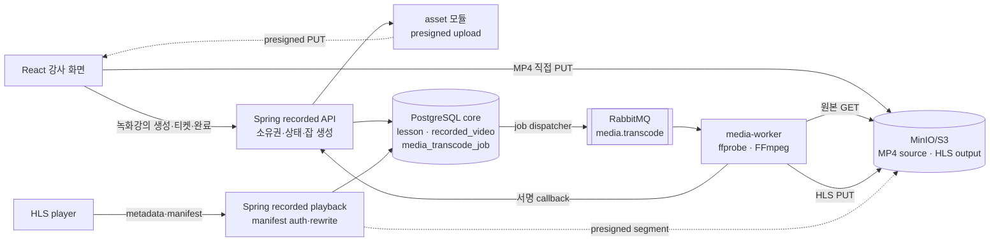

# ADR-0008: 녹화강의는 전용 API·상태로 격리하고 HLS 저장·배포 계층만 재사용한다

> 관련 결정: [ADR-0001 라이브·다시보기 재생 API](0001-live-replay-playback-api.md) ·
> [ADR-0007 녹화 READY 자동 게시·processing 폴링](0007-recording-ready-auto-publish-and-processing-polling.md) ·
> [ADR-0010 VOD=LiveKit Egress](../songjeongki/0010-self-host-vod.md) ·
> [ADR-0012 RabbitMQ durable 배치](../songjeongki/0012-hybrid-queue.md) ·
> [ADR-0023 presigned 직접 업로드와 범용 asset](../songjeongki/0023-asset-presigned-upload.md) ·
> [ADR-0032 학생 HLS 단일 재생](../songjeongki/0032-media-playback-hls-only.md) ·
> [ADR-0034 Egress 완료 webhook](../songjeongki/0034-egress-completion-webhook.md) ·
> [공유 계약](../../CONTRACT.md) · [확정 아키텍처](../../ARCHITECTURE.md)

- **상태**: 채택 — 1차 구현 완료(실스토리지·FFmpeg 운영 E2E 검증 전)
- **일자**: 2026-08-03
- **적용 범위**: 강사용 녹화강의 생성·MP4 직접 업로드, 비동기 MP4→HLS 처리, 처리 상태 조회,
  녹화강의 재생, 관련 DB와 오브젝트 수명주기
- **부분 대체**: ADR-0010의 “영상 업로드·FFmpeg 트랜스코드 없음” 결정. 라이브 다시보기는 계속
  LiveKit Egress만 사용하며, 새 FFmpeg 경로는 강사가 명시적으로 업로드한 녹화강의에만 적용한다.
- **유지**:
  - 기존 라이브 강의 생성·세션·Egress·LiveKit webhook API와 상태기계
  - 기존 `core.video_asset` 스키마와 라이브 `GET /api/lessons/{lessonId}/playback` 계약
  - 학생 미디어는 HLS로만 재생하고, 미디어 바이트는 Spring을 통과하지 않는 원칙
  - 레슨은 생성 즉시 `PUBLISHED`이며 외부 공개는 커리큘럼 `lifecycleStatus`가 결정하는 정책

## 한 줄 결정

녹화강의의 외부 API·DB·처리 잡은 라이브 녹화와 분리한다. 기존 `video_asset`, `EgressControl`,
`RecordingService`, LiveKit webhook, 라이브 playback 응답을 녹화강의 때문에 일반화하지 않는다.
대신 범용 asset의 presigned 저장 기능, MinIO/S3 저장소 포트, HLS manifest 안전 재작성,
세그먼트 presign, 프론트 HLS 플레이어만 하위 계층에서 재사용한다.

업로드 MP4의 HLS 변환은 LiveKit Egress가 아니라 별도 `media-worker`의 FFmpeg 작업으로 수행한다.
Spring은 원본·처리 상태와 권한을 소유하고, RabbitMQ에는 멱등 `jobId`를 가진 durable 작업만 발행한다.

## 맥락과 현재 충돌 지점

현재 구현은 “라이브가 원본이고 VOD는 Egress 산출물”이라는 전제에 맞게 잘 좁혀져 있다. 이 전제를
업로드 영상까지 늘리면 다음 기존 불변식과 충돌한다.

1. `EgressControl.startHlsRecording(roomName, objectPrefix)`는 MP4 입력이 아니라 LiveKit 방을 받는다.
2. `LiveKitEgressControl`은 `startRoomCompositeEgress`로 방 화면을 실시간 합성해 HLS를 만든다.
3. `core.video_asset.live_session_id`는 `NOT NULL UNIQUE`이며 `egress_id`와 세션 시간축을 중심으로 한다.
4. `ReplayPlaybackService`는 자산 조회 뒤 반드시 `LiveSessionDirectory`에서 세션과 상태를 찾는다.
5. 기존 processing API는 `/instructor/live-sessions/{sessionId}/processing`이고, 상태도
   `RECORDING/FINALIZING`처럼 Egress 의미를 가진다.
6. 기존 `OutboxRelay`는 모든 이벤트를 AI 자료 임베딩 큐 `ingestion.embed`로 보내도록 고정돼 있다.

업로드 MP4를 브라우저나 임시 LiveKit 방에서 재생한 뒤 Egress로 다시 녹화하면 영상 길이만큼 시간이
걸리고, 방·참가자·Egress 슬롯·LiveKit webhook을 가짜로 만들어야 한다. 이는 코드 재사용이 아니라
라이브 생명주기를 녹화강의가 침범하는 구조다.

반대로 `video_asset`과 기존 playback DTO를 즉시 범용화하면 안정화된 라이브 시작·종료·되감기·drain
경로의 회귀 범위가 커진다. 이번 설계는 **추가(additive) 테이블과 API**를 우선해 이 충돌을 피한다.

## 목표와 비목표

### 목표

- 라이브 강의와 이름·URL·상태코드가 겹치지 않는 녹화강의 API를 제공한다.
- MP4 원본을 Spring 힙에 올리지 않고 브라우저에서 MinIO/S3로 직접 전송한다.
- HTTP 요청과 무관한 durable 비동기 작업으로 HLS VOD를 만든다.
- 중복 완료 요청·큐 중복 배달·worker callback 재전송에 안전하다.
- 변환 실패를 기존 라이브 세션 상태에 전파하지 않는다.
- 현재 HLS 권한·manifest URI 검증·presigned segment 제공 코드를 재사용한다.
- 기존 레슨 수정·삭제·재정렬·커리큘럼 공개 규칙은 가능한 한 그대로 사용한다.

### 비목표

- 기존 라이브 녹화물을 업로드 영상 파이프라인으로 이전하지 않는다.
- LiveKit Egress를 범용 트랜스코더로 바꾸지 않는다.
- 적응형 멀티 비트레이트(ABR) ladder, 썸네일 추출, DRM은 1차 범위가 아니다.
- 업로드 MP4의 배치 STT·자막·RAG·퀴즈 생성은 별도 AI ADR로 남긴다.
- 이미 `READY`인 녹화강의의 영상 교체·버전 관리는 1차 범위가 아니다.

## 전체 구조



외부에서 보는 recorded API는 새로 만들지만, 내부에서는 asset 저장 포트와 HLS 읽기 포트를 사용한다.
“API 분리”와 “코드 중복”을 같은 문제로 보지 않는다.

## 녹화강의 업로드 정상 처리 흐름

```mermaid
flowchart TD
  A["1. 강사 · React<br/>MP4와 강의 정보 입력"]
  B["2. Spring recorded API<br/>녹화강의 생성 요청"]
  C["3. PostgreSQL<br/>lesson와 recorded_video 생성<br/>AWAITING_UPLOAD"]
  D["4. Spring asset 포트<br/>MP4 업로드 URL 발급"]
  E["5. React → MinIO/S3<br/>presigned URL로 MP4 직접 업로드"]
  F["6. Spring recorded API<br/>업로드 완료 요청 및 객체 검증"]
  G["7. PostgreSQL<br/>source UPLOADED · video QUEUED<br/>transcode job PENDING"]
  H["8. Dispatcher → RabbitMQ<br/>media.transcode 작업 발행"]
  I["9. media-worker<br/>작업 시작 통지 · MP4 다운로드<br/>video TRANSCODING"]
  J["10. media-worker<br/>ffprobe 검증 · FFmpeg HLS 변환"]
  K["11. media-worker → MinIO/S3<br/>segment 업로드 후 index.m3u8 업로드"]
  L["12. media-worker → Spring<br/>SUCCEEDED callback"]
  M["13. Spring recorded API<br/>HLS 산출물 검증<br/>video VERIFYING"]
  N["14. PostgreSQL<br/>job SUCCEEDED · video READY<br/>재생 메타데이터 저장"]
  O["15. React<br/>처리 상태 READY 확인"]
  P["16. recorded playback API<br/>수강 권한 확인 · manifest URL 발급"]
  Q["17. React → MinIO/S3<br/>HLS segment 직접 재생"]

  A --> B --> C --> D --> E --> F --> G --> H --> I --> J --> K --> L --> M --> N --> O --> P --> Q
```



- `201 Created`는 녹화강의 리소스가 생성된 시점이고, `202 Accepted`는 변환 작업이 DB에 커밋된 시점이다.
- 정상 상태는 `AWAITING_UPLOAD → QUEUED → TRANSCODING → VERIFYING → READY` 순서로 전이한다.
- 대용량 MP4 업로드와 HLS segment 재생은 Spring 서버를 거치지 않고 오브젝트 스토리지와 직접 통신한다.

## API 결정

모든 경로는 기존 규칙대로 `/api` prefix, camelCase JSON, HttpOnly 세션 쿠키와 CSRF 보호를 사용한다.
강사용 경로는 강사 역할뿐 아니라 `lesson → section → curriculum.instructorId` 소유권까지 확인한다.

### 1. 녹화강의 생성

```http
POST /api/instructor/sections/{sectionId}/recorded-lessons
Content-Type: application/json
```

```json
{
  "clientRequestId": "5bc957e0-afcf-47f0-b574-f890a4c11842",
  "title": "Spring Security 녹화 강의",
  "description": "필터 체인과 인증 흐름을 설명합니다."
}
```

성공은 **201 Created**다.

```json
{
  "lessonId": "10000000-0000-4000-8000-000000000001",
  "recordedVideoId": "50000000-0000-4000-8000-000000000001",
  "deliveryType": "RECORDED",
  "processingStatus": "AWAITING_UPLOAD"
}
```

- 기존 `POST /api/instructor/sections/{sectionId}/lessons`는 `deliveryType=LIVE` 레슨만 만든다.
- 새 API는 레슨과 `recorded_video`를 같은 트랜잭션에서 만든다.
- `clientRequestId`는 전역 UUID 멱등키다. 같은 키 재요청은 새 레슨을 만들지 않고 최초 결과를 돌려준다.
- 같은 키로 다른 section/title을 보내면 409 `RECORDED_LESSON_IDEMPOTENCY_CONFLICT`다.
- 새 레슨은 기존 정책대로 `lesson.status=PUBLISHED`다. `recorded_video.status`는 미디어 준비 상태이며
  레슨 게시 상태를 대신하지 않는다.

### 2. MP4 업로드 티켓 발급

```http
POST /api/instructor/recorded-lessons/{lessonId}/video/upload-requests
Content-Type: application/json
```

```json
{
  "fileName": "spring-security.mp4",
  "contentType": "video/mp4",
  "fileSize": 734003200
}
```

성공은 새 source asset을 만들므로 **201 Created**다.

```json
{
  "assetId": "60000000-0000-4000-8000-000000000001",
  "uploadUrl": "https://object-storage/...",
  "method": "PUT",
  "headers": {
    "Content-Type": "video/mp4"
  },
  "expiresAt": "2026-08-03T12:10:00Z"
}
```

- 외부 generic `POST /api/assets/upload-requests`에 영상 kind를 직접 보내지 않는다.
- recorded controller가 asset 모듈의 새 `AssetUploadManagement` 포트를 호출해
  `RECORDED_VIDEO_SOURCE` 에셋과 presigned PUT을 만든다.
- 기존 generic asset controller는 `RECORDED_VIDEO_SOURCE`를 외부 요청으로 받으면
  400 `ASSET_KIND_NOT_PUBLIC`로 막는다. 녹화강의 소유권을 우회해 고아 MP4를 만드는 경로를 열지 않는다.
- 업로드 URL 만료·전송 실패 시 `AWAITING_UPLOAD` 상태에서 새 티켓을 받을 수 있다. 새 티켓을 연결하면
  이전 PENDING source는 폐기 대상으로 표시하고, 늦게 도착한 이전 asset 완료 요청은 409로 막는다.
- 신고값 검증 기본값은 `video/mp4`, 5 GiB 이하이며 운영 설정으로 더 낮출 수 있다. 실제 객체는
  완료 단계 HEAD와 worker의 `ffprobe`에서 다시 검증한다.

### 3. 업로드 완료와 변환 접수

브라우저가 `uploadUrl`에 MP4를 PUT한 뒤 호출한다.

```http
POST /api/instructor/recorded-lessons/{lessonId}/video/complete
Content-Type: application/json
```

```json
{
  "assetId": "60000000-0000-4000-8000-000000000001"
}
```

Spring은 source asset의 업로더·kind·현재 연결·실제 객체 크기·content-type을 확인한다. 같은 DB
트랜잭션에서 `recorded_video`를 `QUEUED`로 바꾸고 `media_transcode_job`을 만든 뒤 **202 Accepted**를
반환한다.

```json
{
  "lessonId": "10000000-0000-4000-8000-000000000001",
  "recordedVideoId": "50000000-0000-4000-8000-000000000001",
  "jobId": "70000000-0000-4000-8000-000000000001",
  "processingStatus": "QUEUED"
}
```

- 같은 `assetId` 완료 재요청은 같은 active job을 반환하는 멱등 성공이다.
- 현재 연결이 아닌 과거 asset은 409 `RECORDED_VIDEO_SOURCE_STALE`다.
- 객체가 아직 없거나 크기·형식이 다르면 각각 409 `RECORDED_VIDEO_UPLOAD_NOT_FOUND`,
  400 `RECORDED_VIDEO_INVALID`다.
- RabbitMQ 발행은 HTTP 요청 안에서 하지 않는다. job 행 커밋이 접수 성공 기준이다.

### 4. 처리 현황 조회와 재시도

```http
GET /api/instructor/recorded-lessons/{lessonId}/processing
```

```json
{
  "lessonId": "10000000-0000-4000-8000-000000000001",
  "recordedVideoId": "50000000-0000-4000-8000-000000000001",
  "status": "TRANSCODING",
  "failureCode": null,
  "durationMs": null,
  "sizeBytes": null,
  "readyAt": null
}
```

이 API는 DB snapshot만 읽고 RabbitMQ·worker·MinIO를 매번 조회하지 않는다. 프론트는 기존 라이브
processing 화면과 같은 제한 폴링 정책을 재사용할 수 있지만 URL과 DTO는 공유하지 않는다.

```http
POST /api/instructor/recorded-lessons/{lessonId}/processing/retry
```

- `FAILED`이면서 source asset이 `UPLOADED`일 때 새 attempt의 job을 만들고 202를 반환한다.
- 진행 중 또는 `READY`면 409 `RECORDED_VIDEO_RETRY_CONFLICT`다.
- source가 손실·삭제됐으면 409 `RECORDED_VIDEO_SOURCE_NOT_READY`로 새 업로드를 요구한다.

### 5. 수정·삭제·순서 변경

아래 동작은 라이브/녹화 구분과 무관하게 최종적으로 같은 레슨 자원을 수정하므로 기존 API를
재사용한다.

- `PATCH /api/instructor/lessons/{lessonId}`: 제목·설명 수정
- `DELETE /api/instructor/lessons/{lessonId}`: 레슨과 연결 미디어 정리
- 기존 curriculum structure API: 섹션 간 이동·순서 변경

삭제 시 기존 `LessonRecordingCleanup` 포트 구현이 live `video_asset` 또는 `recorded_video`를
`deliveryType`에 따라 정리한다. 다만 recorded video가 `QUEUED/TRANSCODING/VERIFYING`이면 worker와
HLS 업로드 경합을 피하기 위해 409 `RECORDED_VIDEO_DELETE_WHILE_PROCESSING`으로 삭제를 막는다.
stuck job은 timeout reconciler가 `FAILED`로 확정한 뒤 삭제할 수 있다. 1차 구현에서는 실행 중 작업의
분산 취소 프로토콜을 추가하지 않는다.

### 6. 녹화강의 재생

1차 구현에서는 현재 라이브 playback 응답을 범용화하지 않고 새 API를 둔다.

```http
GET /api/lessons/{lessonId}/recorded-playback
GET /api/lessons/{lessonId}/recorded-playback/manifest
```

metadata 성공 응답:

```json
{
  "lessonId": "10000000-0000-4000-8000-000000000001",
  "recordedVideoId": "50000000-0000-4000-8000-000000000001",
  "durationMs": 3612000,
  "source": {
    "url": "/api/lessons/10000000-0000-4000-8000-000000000001/recorded-playback/manifest",
    "availableFromMs": 0,
    "availableToMs": 3612000
  }
}
```

- 소유 강사 또는 활성 수강생만 접근한다. 학생은 상위 커리큘럼이 공개 상태여야 한다.
- `deliveryType!=RECORDED`는 404 `RECORDED_VIDEO_NOT_FOUND`다.
- `READY` 전에는 409 `RECORDED_VIDEO_NOT_READY`, 실패 상태는 같은 code와 안정적인
  `failureCode`를 반환한다.
- manifest 응답은 기존과 같은 MIME, `Cache-Control: no-store`, 세그먼트 presigned URL 재작성,
  상대경로 이탈 차단을 사용한다.
- recorded manifest는 `#EXT-X-ENDLIST`가 있는 VOD이므로 라이브 delta playlist 로직과
  `sessionOffsetMs`·PDT 보정은 적용하지 않는다.
- 프론트는 `deliveryType`에 따라 playback metadata URL만 선택하고 실제 HLS player는 그대로 쓴다.

기능이 안정된 뒤 두 playback 응답을 `sourceType=LIVE_EGRESS|RECORDED_UPLOAD` 기반으로 통합할 수 있지만,
그 작업은 기존 DTO의 `sessionId`·`startedAt`·`liveSessionStatus` nullable화와 FE/BE 계약 변경을 수반하므로
이번 구현에 포함하지 않는다.

## 상태기계

`recorded_video.status`는 라이브 `VideoAssetStatus`와 별도 enum을 쓴다.

```text
AWAITING_UPLOAD
    │ upload complete + job commit
    ▼
QUEUED ── dispatcher ──▶ TRANSCODING ── worker success ──▶ VERIFYING ──▶ READY
   │                           │                                  │
   └──────── publish fail ─────┴──── transcode/validation fail ───┴──▶ FAILED

FAILED ── instructor retry + valid source ──▶ QUEUED
```

불변식:

- `READY`만 학생 playback을 연다.
- `READY`에는 `outputBucket`, `hlsManifestKey`, `durationMs`, `sizeBytes`, `segmentCount`, `readyAt`가
  모두 있어야 한다.
- `READY`는 1차 범위에서 terminal이다. 새 업로드로 덮어쓰지 않는다.
- `failureCode`는 안정적인 기계 code이고 worker의 임의 오류 문자열을 API에 그대로 노출하지 않는다.
- AI 후처리 상태는 이 상태에 합치지 않는다. 영상이 READY면 AI 장애와 무관하게 재생할 수 있다.

## DB 설계

모든 변경은 새 Flyway migration 한 개에서 **기존 행에 안전한 additive 순서**로 적용한다.

### 1. `lesson.delivery_type`

```sql
ALTER TABLE core.lesson
  ADD COLUMN delivery_type varchar(20) NOT NULL DEFAULT 'LIVE';

ALTER TABLE core.lesson
  ADD CONSTRAINT lesson_delivery_type_check
  CHECK (delivery_type IN ('LIVE', 'RECORDED'));
```

- 기존 레슨은 전부 `LIVE`로 backfill된다.
- 기존 레슨 생성 API는 `LIVE`, 새 recorded API는 `RECORDED`를 명시한다.
- delivery type은 생성 후 변경하지 않는다. 변경은 영상·세션·학습 기록의 의미를 바꾸므로 API를
  제공하지 않고 DB trigger로 값 변경을 거부한다.
- `createLiveSession`은 `deliveryType=LIVE`를 검사해 녹화강의에 세션을 붙이지 못하게 한다.
- live_session INSERT/UPDATE와 recorded_video INSERT에는 lesson type을 확인하는 DB trigger도 둔다.
  서비스 검증만으로는 동시 요청에서 두 종류가 함께 생길 수 있기 때문이다.

### 2. `asset.kind` 확장

기존 `core.asset`과 presigned storage seam을 원본 MP4에도 사용한다.

```sql
ALTER TABLE core.asset DROP CONSTRAINT asset_kind_check;
ALTER TABLE core.asset
  ADD CONSTRAINT asset_kind_check
  CHECK (kind IN ('PROFILE_IMAGE', 'THUMBNAIL', 'MATERIAL', 'RECORDED_VIDEO_SOURCE'));
```

실제 constraint 이름은 migration 작성 전에 PostgreSQL catalog에서 확인한다. 이름을 추측해 DROP하지
않는다. Java `AssetKind`에도 `RECORDED_VIDEO_SOURCE`를 추가하되 기존 kind의 크기·MIME·인가 정책은
계약 테스트로 고정한다.

source 객체 키는 서버가 `recorded_video_source/{assetId}`로 만든다. 원본 파일명은 표시용일 뿐
object key에 넣지 않는다.

### 3. `core.recorded_video`

```sql
CREATE TABLE core.recorded_video (
  id uuid PRIMARY KEY DEFAULT gen_random_uuid(),
  lesson_id uuid NOT NULL UNIQUE REFERENCES core.lesson(id) ON DELETE CASCADE,
  client_request_id uuid NOT NULL UNIQUE,
  source_asset_id uuid NULL UNIQUE REFERENCES core.asset(id),
  status varchar(30) NOT NULL DEFAULT 'AWAITING_UPLOAD'
    CHECK (status IN (
      'AWAITING_UPLOAD', 'QUEUED', 'TRANSCODING', 'VERIFYING', 'READY', 'FAILED'
    )),
  output_bucket varchar(255) NULL,
  hls_manifest_key text NULL,
  duration_ms bigint NULL CHECK (duration_ms IS NULL OR duration_ms > 0),
  size_bytes bigint NULL CHECK (size_bytes IS NULL OR size_bytes >= 0),
  segment_count integer NULL CHECK (segment_count IS NULL OR segment_count > 0),
  failure_code varchar(100) NULL,
  ready_at timestamptz NULL,
  version bigint NOT NULL DEFAULT 0,
  created_at timestamptz NOT NULL DEFAULT now(),
  updated_at timestamptz NOT NULL DEFAULT now(),
  CONSTRAINT recorded_video_ready_fields CHECK (
    status <> 'READY' OR (
      output_bucket IS NOT NULL AND hls_manifest_key IS NOT NULL
      AND duration_ms IS NOT NULL AND size_bytes IS NOT NULL
      AND segment_count IS NOT NULL AND ready_at IS NOT NULL
      AND failure_code IS NULL
    )
  ),
  UNIQUE (output_bucket, hls_manifest_key)
);
```

- `source_asset_id`가 처음에는 null인 이유는 레슨 생성과 대용량 업로드 티켓 발급을 분리해
  만료·재시도를 허용하기 위해서다.
- `version`은 완료·재시도·callback이 동시에 상태를 바꾸는 것을 막는 낙관적 잠금이다.
- `replay_status`, `live_session_id`, `egress_id`, `session_offset_ms`는 두지 않는다. 이 값들은
  라이브 다시보기 의미이며 녹화강의에는 상위 커리큘럼 공개와 READY gate만 필요하다.
- HLS 출력 키는 `recorded/{recordedVideoId}/index.m3u8`, 세그먼트는 같은 prefix 아래에 둔다.
  기존 `sessions/{sessionId}/...`와 키 공간이 겹치지 않는다.

### 4. `core.media_transcode_job`

기존 AI outbox 릴레이가 큐를 고정해서 보내므로 이를 수정하지 않고 media 전용 job table을 둔다.
이 테이블은 처리 이력인 동시에 durable dispatch source다.

```sql
CREATE TABLE core.media_transcode_job (
  id uuid PRIMARY KEY DEFAULT gen_random_uuid(),
  recorded_video_id uuid NOT NULL REFERENCES core.recorded_video(id) ON DELETE CASCADE,
  attempt_no integer NOT NULL CHECK (attempt_no > 0),
  status varchar(20) NOT NULL DEFAULT 'PENDING'
    CHECK (status IN ('PENDING', 'DISPATCHED', 'RUNNING', 'SUCCEEDED', 'FAILED')),
  idempotency_key varchar(255) NOT NULL UNIQUE,
  publish_attempt_count integer NOT NULL DEFAULT 0,
  next_publish_at timestamptz NOT NULL DEFAULT now(),
  published_at timestamptz NULL,
  started_at timestamptz NULL,
  finished_at timestamptz NULL,
  last_error text NULL,
  created_at timestamptz NOT NULL DEFAULT now(),
  updated_at timestamptz NOT NULL DEFAULT now(),
  UNIQUE (recorded_video_id, attempt_no)
);

CREATE UNIQUE INDEX uq_media_transcode_active_job
  ON core.media_transcode_job (recorded_video_id)
  WHERE status IN ('PENDING', 'DISPATCHED', 'RUNNING');

CREATE INDEX ix_media_transcode_dispatch
  ON core.media_transcode_job (status, next_publish_at);
```

dispatcher는 `PENDING` 행을 `FOR UPDATE SKIP LOCKED`로 선점해 durable queue `media.transcode`에
발행한다. publish confirm 뒤 `DISPATCHED`로 바꾼다. 메시지 발행 성공 후 DB 업데이트 전에 프로세스가
죽으면 같은 job이 다시 발행될 수 있으므로 worker는 `jobId`/`idempotencyKey`로 중복 실행을 접는다.
exactly-once를 가정하지 않는다.

`core.external_event_inbox`는 source를 key에 포함하는 범용 멱등 테이블이므로
`source=media-worker`로 재사용한다. AI callback endpoint나 서비스는 재사용하지 않고 media 전용
callback handler가 이 테이블에 기록한다.

### 5. 기존 라이브 스키마의 비변경 경계

다음은 1차 구현에서 변경하지 않는다.

- `core.video_asset`
- `core.live_session`의 컬럼·status check·기존 행(lesson type 검증 trigger만 additive로 연결)
- `VideoAssetStatus`, `ReplayStatus`
- 라이브 Egress ID와 webhook 연계
- 기존 live playback response shape

이 비변경 목록이 충돌 최소화 설계의 핵심 회귀 경계다.

## 모듈 경계

새 최상위 모듈을 만들지 않고 기존 소유권에 맞춘다.

```text
curriculum
  ├─ recorded controller/facade: 섹션·레슨·강사 소유권, 레슨 생성
  └─ video.api.RecordedVideoManagement 호출

lesson
  └─ deliveryType을 포함한 LessonManagement/LessonDirectory

video
  ├─ recorded_video · media_transcode_job 소유
  ├─ 처리 상태·dispatcher·callback·recorded playback
  ├─ 기존 ReplayStorage/HlsManifestProcessor 재사용
  └─ asset.api.AssetUploadManagement/AssetDirectory 호출

asset
  ├─ RECORDED_VIDEO_SOURCE와 kind별 UploadPolicy
  └─ 내부 AssetUploadManagement 포트
```

- curriculum은 현재와 같이 소유권을 판정하고, video는 미디어 상태를 소유한다.
- video가 curriculum repository를 직접 읽지 않는다. 학생/강사 playback 권한은 기존
  `LessonPlaybackAccess` 포트를 사용한다.
- asset은 recorded lesson을 모른다. bare `uploaderId`, kind, 파일 정책만 안다.
- Spring Modulith 검증에서 `video → curriculum`이나 `asset → video` 역참조가 생기면 실패해야 한다.

## 변환 worker 계약

### 1. RabbitMQ 메시지

queue는 `media.transcode`, DLQ는 `media.transcode.dlq`로 분리한다. AI `ingestion.embed`와 routing key,
consumer, retry 정책을 공유하지 않는다.

```json
{
  "taskType": "MP4_TO_HLS",
  "jobId": "70000000-0000-4000-8000-000000000001",
  "recordedVideoId": "50000000-0000-4000-8000-000000000001",
  "lessonId": "10000000-0000-4000-8000-000000000001",
  "sourceAssetId": "60000000-0000-4000-8000-000000000001",
  "outputPrefix": "recorded/50000000-0000-4000-8000-000000000001",
  "contractVersion": 1
}
```

장기 대기 뒤 만료될 수 있는 source presigned URL은 메시지에 넣지 않는다. worker가 작업 직전에
다음 내부 API로 URL을 받는다.

```http
POST /api/internal/media/transcode-jobs/{jobId}/source-url
```

worker는 HMAC 서명으로 인증하고, Spring은 job-source 연결과 asset 상태를 확인한 뒤 단명 presigned
GET URL을 반환한다. HLS 출력은 `recorded/` prefix에만 쓰기 가능한 MinIO service account를 사용한다.

### 2. FFmpeg 처리

1. source를 임시 작업 디렉터리로 내려받고 `ffprobe`로 실제 컨테이너·video/audio stream·duration을
   검증한다. 파일명과 MIME만 신뢰하지 않는다.
2. H.264 video + AAC audio이고 HLS segment 경계에 맞는 keyframe 구조면 우선 remux(`-c copy`)한다.
3. 호환되지 않으면 H.264 Main + AAC로 transcode한다. 정확한 해상도·bitrate·segment duration은
   `media-worker` 설정이 소유하고 API payload에 매번 싣지 않는다.
4. VOD playlist는 `#EXT-X-ENDLIST`를 반드시 포함한다.
5. 산출물을 임시 output prefix에 모두 올린 뒤 최종 `index.m3u8`을 마지막에 쓴다. manifest 존재가
   부분 업로드 완료로 오인되지 않게 한다.
6. 기본 제한은 source 5 GiB, duration 6시간이다. 운영 측정 뒤 설정으로 낮출 수 있으며, 제한 초과는
   `SOURCE_TOO_LARGE` 또는 `DURATION_LIMIT_EXCEEDED`로 실패한다.

ABR master playlist는 후속이다. 1차는 현재 플레이어와 같은 H.264/AAC 단일 rendition HLS를 만든다.

### 3. worker callback

LiveKit webhook과 URL·서명 secret·payload를 공유하지 않는다.

```http
POST /api/internal/media/transcode-callbacks
X-Signature: <HMAC-SHA256 base64>
```

```json
{
  "eventId": "worker-event-01J4...",
  "jobId": "70000000-0000-4000-8000-000000000001",
  "recordedVideoId": "50000000-0000-4000-8000-000000000001",
  "status": "SUCCEEDED",
  "output": {
    "bucket": "recordings",
    "hlsManifestKey": "recorded/50000000-0000-4000-8000-000000000001/index.m3u8",
    "durationMs": 3612000,
    "sizeBytes": 582101233,
    "segmentCount": 603
  },
  "failureCode": null
}
```

- 서명 실패는 401이다.
- `(source=media-worker, eventId)`를 `external_event_inbox`에 넣어 callback을 멱등 처리한다.
- `SUCCEEDED`를 받으면 Spring은 worker가 보고한 key를 그대로 신뢰하지 않고 해당
  `recordedVideoId`의 서버 생성 prefix와 일치하는지 확인한다.
- Spring은 manifest HEAD와 `#EXT-X-ENDLIST`를 strict하게 검증한다. 스토리지 확인 자체가 실패하면
  503으로 callback 재시도를 요구하며 READY로 fail-open하지 않는다.
- 검증 성공 시 같은 트랜잭션에서 job `SUCCEEDED`, recorded video `READY`와 메타데이터를 확정한다.
- manifest 부재·형식 오류는 `FAILED(MANIFEST_MISSING|MANIFEST_INVALID)`로 확정한다.
- worker의 `RUNNING` callback은 job `RUNNING`, recorded video `TRANSCODING`으로 전이한다.
- 이미 READY인 자산은 늦은 FAILED callback으로 되돌리지 않는다. terminal first-wins다.

## HLS 재사용 경계

### 재사용하는 것

- `ReplayStorage`의 manifest 읽기와 segment presign
- `HlsManifestProcessor`의 상대 URI 정규화, `..` 이탈 거부, `EXT-X-MAP/KEY` URI 처리와 재작성
- MinIO/S3 endpoint·public endpoint 분리 설정
- lesson 기반 소유 강사/활성 수강생 권한 포트
- Vidstack/HLS.js 프론트 플레이어
- 레슨 삭제 뒤 commit 후 object cleanup 패턴

### 재사용하지 않는 것

- `EgressControl`과 `LiveKitEgressControl`
- `RecordingService`와 `RecordingStartStore/RecordingStopStore`
- `/webhooks/livekit`
- `/instructor/live-sessions/{sessionId}/processing`
- 라이브 `VideoAssetStatus`와 `ReplayStatus`
- live session PDT, `sessionOffsetMs`, drain/delta playlist 판단
- AI 임베딩 outbox relay와 queue

공통 코드가 필요하면 `HlsManifestProcessor` 아래의 **순수 HLS 처리 함수**를 추출한다. 녹화강의가
기존 live service를 호출하게 만들지는 않는다.

## 공개·학습 정책

- recorded lesson도 기존 레슨과 같이 생성 즉시 `lesson.status=PUBLISHED`다.
- 상위 커리큘럼이 DRAFT면 강사만 본다.
- 상위 커리큘럼이 PUBLISHED면 목차에는 보이되, `recorded_video.status!=READY`인 동안 학생 action은
  “영상 준비 중”으로 비활성한다. 레슨을 숨겼다 다시 나타나게 해 목차 순서·진도 분모가 흔들리지 않게 한다.
- 학생 playback은 READY에서만 열린다.
- READY가 된 recorded lesson은 별도 `ReplayStatus` 게시 없이 즉시 재생 가능하다. 업로드 녹화강의는
  강사가 게시할 교육 콘텐츠 자체이고, 라이브 다시보기 검수/철회 상태와 의미가 다르다.
- 기존 progress/bookmark API는 lesson 기반이라 그대로 사용한다. 재생 시간은 HLS 0ms 기준이다.
- 업로드 영상 AI 실패는 영상 READY와 학생 playback을 막지 않는다.

## 실패·재시도·정리

| 실패 지점 | 영속 상태 | 복구 |
|---|---|---|
| 티켓 발급 전 | recorded `AWAITING_UPLOAD` | 같은 lesson에서 재요청 |
| presigned PUT 실패·만료 | `AWAITING_UPLOAD` | 새 upload ticket |
| complete 전에 객체 없음 | `AWAITING_UPLOAD`, 409 | PUT 확인 후 complete 재호출 |
| job dispatch 일시 실패 | job `PENDING` | 지수 backoff 재발행 |
| dispatch 최대 실패 | recorded/job `FAILED` | 강사 retry로 새 attempt |
| worker 중복 메시지 | 상태 불변 | `jobId` 멱등 결과 재전송 |
| ffprobe/FFmpeg 실패 | `FAILED` + stable code | 같은 source 재시도 또는 새 업로드 |
| callback 유실 | worker 재시도 | HMAC + inbox 멱등 |
| HLS 부분 업로드 | `VERIFYING/FAILED` | manifest-last + retry/정리 |
| Spring 재시작 | DB job/status 유지 | dispatcher·processing 조회 복구 |
| 처리 중 레슨 삭제 | 409, 상태 불변 | timeout/완료/실패 뒤 삭제 |

- source MP4는 READY 직후 지우지 않는다. 변환 재시도와 후속 batch STT 입력을 위해 레슨 삭제 또는
  명시적 보존 정책까지 유지한다.
- 레슨 삭제는 DB 행을 먼저 정리하고 commit 후 source와 HLS prefix를 삭제한다. 객체 삭제 실패는
  레슨 DELETE를 롤백하지 않고 cleanup 재시도 대상으로 남긴다.
- PENDING source asset과 실패한 임시 HLS prefix는 reaper가 보존 기한 뒤 삭제한다.
- DB와 스토리지의 고아 객체를 찾는 정기 reconciler를 둔다. prefix 전체 삭제 대상은 반드시 DB의
  단일 `recordedVideoId`로 해석한 뒤 실행하며, 사용자 입력 경로·glob을 사용하지 않는다.

## 보안

- 강사 역할만으로 충분하지 않고 매 API에서 커리큘럼 소유권을 확인한다.
- source asset은 발급자와 recorded lesson 소유 강사가 같아야 한다.
- presigned PUT은 content-length와 content-type을 서명하고 complete에서 HEAD 실측을 재검증한다.
- worker는 `ffprobe`로 실제 MP4 구조를 검사하며, shell command에 사용자 파일명을 삽입하지 않는다.
- object key와 output prefix는 UUID로 서버가 만들고 요청 body의 경로를 받지 않는다.
- internal source URL과 callback은 서로 다른 용도의 HMAC 서명을 사용하고 replay window를 제한한다.
- HLS manifest는 학생에게 원본 object key를 노출하지 않고 기존 상대 URI 검증과 presign을 거친다.
- worker 임시 디렉터리는 job별 격리하고 성공·실패 후 삭제한다.

## 구현 순서와 무회귀 배포

1. **additive DB migration**: `delivery_type`, asset kind, 새 두 테이블·인덱스·trigger를 추가한다.
   기존 레슨은 LIVE, 기존 live/video 행은 변경하지 않는다.
2. **도메인·계약 기반**: lesson delivery type, asset 내부 업로드 포트, recorded management 포트를 추가한다.
   `recorded.video.enabled=false`에서는 새 API만 503 `RECORDED_VIDEO_DISABLED`로 닫는다.
3. **업로드 API**: 생성·티켓·complete와 처리 snapshot을 구현한다. worker가 없을 때 기능 flag를 켜지 않는다.
4. **media worker·queue·callback**: fixture MP4로 HLS 산출물과 복구 경로를 검증한다.
5. **recorded playback**: 새 endpoint를 추가하고 기존 live playback 회귀 테스트를 그대로 통과시킨다.
6. **FE HTTP 연결**: 현재 recorded upload facade의 명시적 미구현을 새 순차 API 호출로 교체한다.
7. **운영 활성화**: worker health, Rabbit queue, MinIO 권한, cleanup을 확인한 뒤 flag를 켠다.

롤백은 feature flag를 끄는 것으로 시작한다. 기존 live endpoint와 테이블을 수정하지 않았으므로 라이브
송출·Egress·다시보기는 녹화강의 worker 장애와 무관하게 계속 동작해야 한다. 새 테이블·컬럼은 즉시
DROP하지 않고 다음 배포까지 보존한다.

## 테스트 게이트

### DB·도메인

- migration 뒤 기존 lesson이 모두 `delivery_type=LIVE`다.
- LIVE lesson에 recorded_video, RECORDED lesson에 live_session을 연결할 수 없다.
- lesson당 recorded_video가 하나뿐이고 active transcode job도 하나뿐이다.
- READY 필수 output 필드 constraint와 상태 전이 낙관적 잠금이 동작한다.
- `clientRequestId`, complete, callback, Rabbit 중복 배달이 모두 멱등이다.

### API 계약

- 새 URL·camelCase 필드·201/202/400/403/404/409/503 상태코드를 계약 테스트로 고정한다.
- 비소유 강사와 학생은 강사용 recorded API에 403이다.
- generic asset API로 `RECORDED_VIDEO_SOURCE`를 만들 수 없다.
- LIVE lesson을 recorded playback으로, RECORDED lesson을 live session으로 열 수 없다.
- READY 전 학생 playback을 차단하고 READY 뒤 같은 사용자에게 연다.

### 미디어

- 작은 MP4 fixture가 `index.m3u8`, segment, `#EXT-X-ENDLIST`를 만든다.
- H.264/AAC remux 경로와 transcode fallback 경로를 각각 검증한다.
- manifest 일반 URI와 `EXT-X-MAP/KEY`, 경로 이탈 거부가 기존 테스트와 함께 통과한다.
- worker 중단·callback 중복·manifest 누락·MinIO 일시 장애 후 복구를 검증한다.
- 기존 LiveKit Egress 시작/종료/webhook/playback 전체 테스트 결과가 변경 전과 같다.

## 고려한 대안

| 대안 | 장점 | 단점 | 결정 |
|---|---|---|---|
| 기존 LiveKit Egress에 MP4를 재생해 녹화 | 새 인프라가 적어 보임 | 실시간 길이 처리, 가짜 room, Egress 슬롯·webhook 결합, 장애 격리 실패 | 기각 |
| `video_asset`·playback을 즉시 source-type 범용화 | 최종 자산 테이블 하나 | 라이브 DB·상태·DTO·시간축을 대규모 변경, 회귀 범위 큼 | 1차 기각 |
| 녹화강의 전체를 별도 구현 | 기존 코드 영향 최소 | storage·manifest·권한·player 중복과 보안 표류 | 기각 |
| **recorded 쓰기/처리는 분리, HLS 하위 계층 공유** | 라이브 회귀 격리, API 의미 명확, 핵심 보안 코드 재사용 | 새 테이블·worker·processing API 필요 | **선택** |
| Spring multipart + 동기 FFmpeg | 구현 흐름 단순 | 힙·요청 시간·재시작·대용량 실패, 확장 불가 | 기각 |

## 영향과 후속 문서

이 ADR의 1차 구현에서 다음 문서를 함께 갱신했다.

- `AGENTS.md`: 미디어 한눈에 보기의 “영상 업로드 없음” 제거, recorded media worker 명시
- `docs/ARCHITECTURE.md`: 제품·스택·구성도·데이터플로우에 MP4→HLS 경로 추가
- `docs/CONTRACT.md`: 위 recorded API DTO·상태코드·권한·playback 계약 추가
- `docs/CP-ROADMAP.md`: 녹화강의 upload/transcode 마일스톤 추가
- 프론트 data-source HTTP 구현

구현 위치는 Spring `lesson`·`asset`·`curriculum`·`video` 모듈, Flyway `V20`, React 녹화강의
업로드 화면, `media-worker/`, 로컬·운영 Compose다. 실제 MinIO/RabbitMQ/FFmpeg를 모두 띄운 운영형
E2E와 장애 복구 실측은 배포 환경 검증 항목으로 남는다.

구현하면서 API 필드나 상태를 바꾸면 FE/BE를 함께 수정하고 계약 테스트를 추가한다. 숫자 제한,
FFmpeg encoding profile, retry 횟수처럼 운영 측정으로 바뀔 값은 설정이 소유하되, API에서 관찰되는
오류 code와 상태 enum은 계약으로 유지한다.
