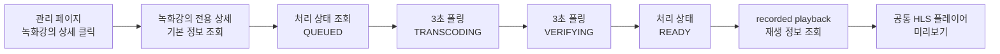

# ADR-0009: 녹화강의 상세는 처리 상태를 3초 폴링하고 READY부터 공통 HLS 플레이어를 연다

> 관련 결정: [ADR-0008 녹화강의 업로드·HLS 변환](0008-recorded-lesson-upload-and-hls-transcoding.md) ·
> [ADR-0007 라이브 녹화 READY 처리 화면 폴링](0007-recording-ready-auto-publish-and-processing-polling.md) ·
> [ADR-0032 학생 HLS 단일 재생](../songjeongki/0032-media-playback-hls-only.md) ·
> [ADR-0015 프론트 서비스 어댑터 경계](../yoongwanghyeok/0015-feature-service-adapter-routing.md) ·
> [공유 계약](../../CONTRACT.md)

- **상태**: 채택 — 코드 구현·자동화 검증 완료, 실제 `media-worker` 운영 E2E 미수행
- **일자**: 2026-08-03
- **적용 범위**: 강사 커리큘럼 관리의 녹화강의 상세 진입, MP4→HLS 처리 상태 표시,
  상태 폴링, 실패 재시도, READY 녹화강의 미리보기
- **선행 조건**: ADR-0008의 녹화강의 생성·업로드·처리·재생 API와 `media-worker`가 동작해야 한다.
- **유지**:
  - 업로드 성공 뒤 커리큘럼 관리 페이지로 돌아가는 현재 흐름
  - 라이브 강의 상세·라이브 다시보기의 기존 URL, DTO와 화면 동작
  - 녹화강의와 라이브 다시보기의 백엔드 API·상태기계 분리
  - HLS manifest 인증과 segment presign은 Spring의 기존 recorded playback API가 담당

## 한 줄 결정

커리큘럼 관리 목록에서 `deliveryType=RECORDED`인 강의의 상세 링크는 새
`RecordedLessonDetailPage`로 이동한다. 상세 페이지는 강사 전용 processing API를 3초마다 폴링하고,
`QUEUED`, `TRANSCODING`, `VERIFYING`을 단계형 UI로 표시한다. 상태가 `READY`가 된 시점부터
recorded playback API를 활성화해 공통 HLS 플레이어로 영상을 재생한다. `FAILED`에서는 폴링을 멈추고
안정된 실패 사유와 재시도 버튼을 제공한다.

상태 알림에는 SSE를 새로 만들지 않는다. 현재 화면은 한 강사가 한 작업만 짧게 관찰하고 이미 DB
snapshot 조회 API가 있으므로, 3초 폴링이 구현 복잡도와 체감 반응 시간 사이의 적절한 선택이다.

## 맥락

현재 업로드 화면은 다음 요청을 모두 성공한 뒤에만 커리큘럼 관리 페이지로 이동한다.

```text
녹화강의 생성(AWAITING_UPLOAD)
  → presigned URL 발급
  → 브라우저가 MP4 PUT
  → 업로드 완료 API가 변환 작업 접수(QUEUED)
  → 커리큘럼 관리 페이지 이동
```

따라서 이번 정상 사용자 흐름에서 관리 페이지의 상세 버튼을 누를 때 시작 상태는 최소 `QUEUED`다.
업로드 도중 새로고침·이탈하거나 `AWAITING_UPLOAD` 레슨을 복구하는 흐름은 이번 결정에서 다루지 않는다.

백엔드에는 필요한 API가 이미 구현되어 있다.

| 용도 | API |
|---|---|
| 강사 레슨 기본 정보 | `GET /api/instructor/lessons/{lessonId}` |
| 녹화 영상 처리 상태 | `GET /api/instructor/recorded-lessons/{lessonId}/processing` |
| 실패 작업 재시도 | `POST /api/instructor/recorded-lessons/{lessonId}/processing/retry` |
| 녹화강의 재생 정보 | `GET /api/lessons/{lessonId}/recorded-playback` |
| 인증된 HLS manifest | `GET /api/lessons/{lessonId}/recorded-playback/manifest` |

그러나 프론트에는 다음 연결이 없다.

1. 관리 목록은 녹화강의 배지를 표시하지만 상세 링크는 라이브 강의와 같은
   `LessonDetailPage`로 이동한다.
2. `LessonDetailPage`는 `liveSession` 중심이라 녹화강의에 “연결된 라이브 일정이 없습니다”를 표시한다.
3. recorded processing·retry·playback API를 호출하는 프론트 서비스와 Query 훅이 없다.
4. 기존 `ReplayLessonPage`는 `sessionId`, 라이브 자막·채팅·노트, `ReplayStatus`에 결합되어 있어
   업로드 녹화강의 화면으로 그대로 재사용할 수 없다.
5. 기존 `PlaybackPlayer`의 내부 HLS 재생 기능은 재사용할 수 있지만 props가 라이브 playback DTO에
   결합되어 있다.

## 목표와 비목표

### 목표

- 관리 목록의 녹화강의 상세 버튼을 올바른 전용 화면으로 연결한다.
- 상세 진입 시 이미 `READY`면 불필요한 대기 화면 없이 즉시 재생 정보를 조회한다.
- 처리 중이면 서버의 실제 상태를 3초 간격으로 갱신하고 현재 단계를 설명한다.
- `READY` 전에는 playback API와 HLS 플레이어를 열지 않는다.
- `FAILED`이면 실패 원인과 재시도 동작을 제공한다.
- 라이브·다시보기와 녹화강의가 저수준 HLS 플레이어 구현을 공유한다.
- 화면 새로고침 뒤에도 로컬 상태가 아니라 DB snapshot으로 동일한 화면을 복구한다.

### 비목표

- 업로드 도중 이탈한 `AWAITING_UPLOAD` 강의의 이어 올리기
- 업로드 원본 교체와 녹화강의 버전 관리
- 녹화강의 제목·설명 수정 화면 재설계
- 수강생용 녹화강의 상세·학습 화면
- 녹화강의 자막·채팅·AI·퀴즈·챕터 생성
- 변환 퍼센트 또는 예상 완료 시간 제공
- 여러 녹화강의를 동시에 감시하는 처리 대시보드
- SSE endpoint와 서버 push 이벤트 추가

## 정상 상세·재생 흐름

아래 다이어그램은 성공적인 처리 흐름만 나타낸다. 폴링은 DB snapshot을 읽으므로 처리 속도가 빠르면
프론트가 중간 상태 하나를 관찰하지 못하고 다음 상태를 바로 볼 수 있다.



## 프론트 라우팅과 페이지 책임

### 1. 전용 강사 라우트

녹화강의 상세는 라이브 강의 상세와 URL부터 분리한다.

```text
/instructor/curriculums/{curriculumId}/sections/{sectionId}/recorded-lessons/{lessonId}
```

라우터 helper를 추가한다.

```ts
instructorPaths.recordedLesson(curriculumId, sectionId, lessonId)
```

`CurriculumManagePage`의 상세 링크는 목록에 이미 있는 `deliveryType`으로 분기한다.

```ts
const detailPath = lesson.deliveryType === 'RECORDED'
  ? instructorPaths.recordedLesson(curriculumId, section.sectionId, lesson.lessonId)
  : instructorPaths.lesson(curriculumId, section.sectionId, lesson.lessonId)
```

서버가 강사 레슨 응답에 이미 주는 `deliveryType`을 프론트 `LessonDetailView`와 HTTP 매핑에도 추가한다.
전용 라우트로 직접 진입했는데 조회 결과가 `LIVE`라면 녹화강의 화면을 렌더링하지 않고 잘못된 경로로
처리한다. URL만으로 전달 방식을 신뢰하지 않는다.

### 2. `RecordedLessonDetailPage` 책임

페이지는 다음 세 가지 서버 상태를 조합한다.

| Query key | 데이터 | 활성 조건 |
|---|---|---|
| `['recorded-lesson', lessonId]` | 제목·설명·섹션·커리큘럼·자료·`deliveryType` | 유효한 `lessonId` |
| `['recorded-processing', lessonId]` | `status`, `failureCode`, `durationMs`, `sizeBytes`, `readyAt` | 레슨이 `RECORDED` |
| `['recorded-playback', lessonId]` | HLS `source`, `durationMs`, `recordedVideoId` | processing 상태가 `READY` |

페이지는 별도의 상태기계를 `useState`로 복제하지 않는다. 화면은 processing Query의 최신 서버 상태에서
직접 파생한다. 새로고침·뒤로 가기·다른 탭 진입에서도 같은 원칙을 유지한다.

## 프론트 서비스 경계

프로젝트의 서비스 어댑터 규칙에 맞춰 녹화강의 상세 기능을 별도 feature로 둔다.

```text
features/recorded-lesson/
  recordedLessonService.interface.ts
  mockRecordedLessonService.ts
  httpRecordedLessonService.ts
  recordedLessonService.ts
  useRecordedLessonQueries.ts
  useRecordedLessonMutations.ts
  recordedLessonProcessing.ts
```

서비스 인터페이스는 최소 다음 기능을 제공한다.

```ts
interface RecordedLessonService {
  getProcessing(lessonId: string): Promise<RecordedProcessingView>
  retryProcessing(lessonId: string): Promise<RecordedProcessingView>
  getPlayback(lessonId: string): Promise<RecordedPlaybackView>
}
```

일반 페이지는 `apiClient`, HTTP 구현체나 mock 구현체를 직접 import하지 않고 Query·Mutation 훅만
사용한다. HTTP와 mock은 동일한 상태 전이와 Interface를 만족해야 한다.

## 3초 polling 결정

### 폴링 대상 상태

```text
QUEUED | TRANSCODING | VERIFYING
```

위 상태에서는 `GET /api/instructor/recorded-lessons/{lessonId}/processing`을 3초마다 다시 호출한다.
`READY`와 `FAILED`는 terminal 상태이므로 즉시 폴링을 중단한다. 브라우저 탭이 백그라운드에 있으면
폴링하지 않고, 다시 포커스를 얻을 때 즉시 refetch한다.

정책은 화면 안의 조건문으로 흩어 놓지 않고 순수 함수로 고정한다.

```ts
const ACTIVE_PROCESSING_STATUSES = new Set<RecordedProcessingStatus>([
  'QUEUED', 'TRANSCODING', 'VERIFYING',
])

export function recordedProcessingPollInterval(status?: RecordedProcessingStatus) {
  return status && ACTIVE_PROCESSING_STATUSES.has(status) ? 3_000 : false
}
```

TanStack Query는 다음 정책을 사용한다.

```ts
useQuery({
  queryKey: ['recorded-processing', lessonId],
  queryFn: () => getProcessing(lessonId),
  refetchInterval: (query) =>
    recordedProcessingPollInterval(query.state.data?.status),
  refetchIntervalInBackground: false,
  refetchOnWindowFocus: true,
})
```

첫 처리 상태 조회가 실패하면 페이지 전체를 라이브 상세로 되돌리지 않는다. 녹화강의 정보는 유지하고
처리 패널 안에 조회 실패와 수동 재시도 버튼을 표시한다. 이미 받은 active snapshot 이후 일시적인
polling 요청이 실패해도 이를 미디어 변환의 `FAILED`로 해석하지 않는다. `FAILED`는 서버 응답의 도메인
상태로만 확정한다.

### SSE를 사용하지 않는 이유

- 이미 작은 DB snapshot 조회 API가 구현되어 있다.
- 상세 화면은 한 사용자에게 한 작업 상태만 보여 준다.
- 3초 지연은 강사 미리보기 준비 UX에 충분하다.
- SSE를 추가하면 worker callback 이후 이벤트 발행, 인증된 stream endpoint, 연결 복구, 이벤트 누락 시
  snapshot 보완 계약을 새로 만들어야 한다.

향후 여러 작업을 동시에 보는 변환 대시보드나 세밀한 진행률이 필요하면 SSE를 다시 검토한다. 그 경우도
최초·재연결 시 snapshot 조회는 유지한다.

## 단계형 처리 상태 UI

처리 중에는 실제 퍼센트를 추정하지 않는다. 백엔드가 진행률을 제공하지 않으므로 임의의 30%·70% 같은
수치는 잘못된 완료 기대를 만든다. 현재 단계와 완료된 단계만 표시한다.

| 서버 상태 | 현재 단계 | 사용자 문구 |
|---|---|---|
| `QUEUED` | 1. 변환 대기 | “영상을 재생용 형식으로 변환할 준비를 하고 있습니다.” |
| `TRANSCODING` | 2. HLS 변환 | “MP4 영상을 재생용 HLS로 변환하고 있습니다.” |
| `VERIFYING` | 3. 재생 검증 | “변환된 영상과 재생 목록을 확인하고 있습니다.” |
| `READY` | 4. 재생 준비 완료 | 처리 UI를 완료 상태로 바꾸고 플레이어를 연다. |

처리 중 화면은 최소한 다음 정보를 제공한다.

- 강의 제목과 설명
- `녹화강의` 배지
- 현재 단계와 이전 단계의 완료 표시
- “완료되면 이 화면에서 자동으로 영상을 표시합니다” 안내
- 커리큘럼 관리로 돌아가기

`durationMs`나 `sizeBytes`가 아직 없으면 빈 값이나 가짜 값으로 채우지 않는다. `READY` 이후 실제 값이
있을 때만 영상 길이·처리된 용량·준비 완료 시각을 표시한다.

## READY부터 recorded playback 활성화

playback Query는 processing Query가 `READY`일 때만 활성화한다.

```ts
useQuery({
  queryKey: ['recorded-playback', lessonId],
  queryFn: () => getPlayback(lessonId),
  enabled: processing.status === 'READY',
  retry: false,
})
```

`READY`는 같은 DB 트랜잭션에서 manifest key·길이·크기·segment 수가 검증되어 저장된 상태이므로,
프론트가 별도 지연 타이머를 두지 않는다. 다음 렌더에서 즉시 playback Query가 활성화된다.

재생 오류는 처리 실패와 분리한다.

| 오류 | UI 처리 |
|---|---|
| `RECORDED_VIDEO_NOT_READY` | processing을 즉시 refetch하고 처리 패널로 돌아간다. |
| `PLAYBACK_STORAGE_UNAVAILABLE` | 플레이어 영역에 일시 장애와 재시도 버튼을 표시한다. |
| `ENROLLMENT_REQUIRED` | 강사 소유권이 맞지 않는 접근으로 보고 권한 오류 화면을 표시한다. |
| 404 | 녹화강의를 찾을 수 없음 화면을 표시한다. |
| HLS segment URL 만료·플레이어 오류 | playback metadata와 manifest를 다시 받아 플레이어를 재시작한다. |

## 공통 HLS 플레이어 재사용

`ReplayLessonPage` 전체는 재사용하지 않는다. 이 페이지는 라이브 `sessionId`, 라이브 당시 자막·채팅·노트,
`ReplayStatus`와 세션 상대 시간축을 필요로 한다. 업로드 녹화강의에 가짜 세션 값을 만들어 넣지 않는다.

대신 현재 `PlaybackPlayer`에서 vidstack·hls.js를 제어하는 저수준 재생부를 중립 컴포넌트로 추출한다.

```text
features/media/HlsMediaPlayer.tsx
```

예상 props는 다음 책임만 가진다.

```ts
interface HlsMediaPlayerProps {
  sourceUrl: string
  title: string
  streamType: 'live:dvr' | 'on-demand'
  durationMs: number | null
  reloadToken: number
  onTimeChange?: (mediaTimeMs: number) => void
  onPlaybackError: () => void
}
```

- 기존 라이브 `PlaybackPlayer`는 공통 플레이어 주변에 LIVE 배지, 참가 인원, 세션 시간 변환,
  라이브 엣지 설정을 유지한다.
- 녹화강의 상세는 `streamType='on-demand'`, 미디어 시작점 0으로 공통 플레이어를 사용한다.
- 녹화강의 화면에는 참가 인원, LIVE 배지, 라이브 채팅·자막을 표시하지 않는다.
- 공통 플레이어 key는 `sourceUrl + reloadToken`처럼 실제 재생 대상이나 명시적 재시도가 바뀔 때만
  변경한다. processing 폴링 렌더마다 플레이어를 재마운트하지 않는다.

이 구조는 HLS 라이브러리·오류 복구를 공유하면서 라이브와 녹화강의의 DTO·화면 의미는 섞지 않는다.

## FAILED 표시와 재시도

`FAILED`는 terminal 상태라 자동 폴링을 멈춘다. 화면은 일반 오류 문구만 보여 주지 않고 서버의
`failureCode`를 안정된 사용자 메시지로 매핑한다.

| failureCode | 사용자 메시지 |
|---|---|
| `SOURCE_DOWNLOAD_FAILED` | 원본 영상을 불러오지 못했습니다. |
| `SOURCE_INVALID`·`FFPROBE_FAILED` | 재생할 수 있는 MP4 영상인지 확인하지 못했습니다. |
| `SOURCE_TOO_LARGE` | 허용된 영상 크기를 초과했습니다. |
| `DURATION_LIMIT_EXCEEDED` | 허용된 영상 길이를 초과했습니다. |
| `FFMPEG_FAILED` | 영상을 HLS로 변환하지 못했습니다. |
| `OUTPUT_UPLOAD_FAILED` | 변환된 영상을 저장하지 못했습니다. |
| `MANIFEST_MISSING`·`MANIFEST_INVALID` | 변환 결과의 재생 목록을 확인하지 못했습니다. |
| `DISPATCH_FAILED`·`SOURCE_NOT_READY`·`WORKER_INTERNAL_ERROR` | 영상 처리 중 일시적인 문제가 발생했습니다. |
| 알 수 없는 코드 | 영상 처리에 실패했습니다. 잠시 후 다시 시도해 주세요. |

사용자 메시지 아래에는 고객 지원과 로그 상관관계를 위해 원본 `failureCode`를 작은 보조 텍스트로
표시할 수 있다. 서버 내부 예외 메시지나 stack trace는 노출하지 않는다.

`다시 처리` 버튼은 다음 API를 호출한다.

```http
POST /api/instructor/recorded-lessons/{lessonId}/processing/retry
```

버튼 동작은 다음과 같다.

1. 요청 중 버튼을 비활성화하고 중복 클릭을 막는다.
2. 성공 응답의 `QUEUED` snapshot으로 processing Query cache를 갱신한다.
3. 3초 폴링이 자동으로 다시 시작된다.
4. 실패하면 기존 `FAILED` 화면을 유지하고 재시도 요청 실패를 별도로 알린다.

재시도는 원본 MP4를 다시 업로드하지 않는다. 백엔드가 보관한 기존 source asset으로 새 attempt를 만든다.

## 권한과 공개 정책

- 상세 기본 정보와 processing·retry는 소유 강사만 접근할 수 있다.
- recorded playback은 기존 `LessonPlaybackAccess`를 사용해 소유 강사의 게시 전 미리보기를 허용한다.
- 프론트 라우트 가드는 UX 경계이고 최종 소유권 검증은 백엔드가 담당한다.
- `READY`는 미디어 준비 상태다. 레슨 공개 여부는 기존 커리큘럼 `lifecycleStatus` 정책을 유지한다.
- 강사 상세에서 재생하는 행위가 별도의 영상 게시·공개 상태를 변경하지 않는다.

## 백엔드·DB 변경 여부

이번 설계의 정상 범위에는 새 백엔드 API와 DB migration이 필요하지 않다. ADR-0008에서 구현한
processing·retry·recorded playback API와 `recorded_video` 상태를 그대로 사용한다.

프론트 구현 중 실제 응답이 `CONTRACT.md`와 다르다면 프론트 변환으로 숨기지 않고 백엔드 DTO,
`CONTRACT.md`, 계약 테스트를 같은 변경에서 수정한다. 현재 계약과 일치한다면 `CONTRACT.md`의 endpoint
추가는 필요 없고, 이 ADR만 UI·polling 결정을 기록한다.

## 테스트와 완료 게이트

### 프론트 단위·계약 테스트

- processing HTTP adapter가 URL과 camelCase 응답을 올바르게 매핑한다.
- retry가 올바른 POST URL을 호출하고 `QUEUED` 응답을 cache에 반영한다.
- recorded playback adapter가 live `/playback`이 아니라 `/recorded-playback`을 호출한다.
- active 상태만 3초를 반환하고 `READY`·`FAILED`에서 폴링을 중단한다.
- failureCode가 안정된 사용자 메시지로 매핑된다.

### 프론트 통합 테스트

- 관리 목록의 `RECORDED` 상세 링크가 전용 라우트로 이동한다.
- `QUEUED → TRANSCODING → VERIFYING` snapshot에 맞춰 단계 표시가 바뀐다.
- `READY` 전에는 playback API와 플레이어가 활성화되지 않는다.
- `READY` snapshot을 받으면 playback API를 호출하고 HLS 플레이어를 표시한다.
- 새로고침 시 최초 snapshot이 이미 `READY`면 즉시 플레이어를 표시한다.
- `FAILED`에서 폴링이 멈추고 재시도 성공 뒤 `QUEUED`로 돌아간다.
- 라이브 상세·라이브 다시보기의 기존 라우트와 플레이어 테스트가 회귀하지 않는다.

### 백엔드 계약 검증

기존 `RecordedLessonUploadContractTest`가 다음 경계를 이미 검증한다.

- processing 조회와 소유권
- signed worker callback의 `TRANSCODING → READY`
- 소유 강사의 recorded playback metadata·manifest 접근

기존 테스트에는 `POST .../processing/retry`의 HTTP 계약과 `FAILED → QUEUED` 전이가 없다. 이번 UI가
해당 API를 실제 사용자 복구 경로로 열기 때문에, 구현할 때 다음 백엔드 계약 테스트를 추가한다.

- `FAILED` 작업 재시도는 202와 새 `jobId`, `status=QUEUED`를 반환한다.
- `READY` 또는 처리 중 작업의 재시도는 409 `RECORDED_VIDEO_RETRY_CONFLICT`다.
- 비소유 강사의 재시도는 403이다.

실제 완료 보고에는 프론트 HTTP 계약·통합 테스트와 위 백엔드 재시도 계약 테스트 결과를 첨부한다.
`media-worker`를 포함한 실제 MP4→HLS→브라우저 재생 E2E는 별도 운영 검증으로 남기고, 수행하지
않았다면 완료 보고에서 명시한다.

## 구현 순서

1. 레슨 화면 모델과 HTTP 매핑에 `deliveryType`을 반영한다.
2. recorded-lesson Interface·Mock·HTTP·facade와 Query/Mutation 훅을 만든다.
3. 처리 상태·실패 코드 순수 정책과 테스트를 작성한다.
4. 공통 `HlsMediaPlayer`를 추출하고 기존 라이브 플레이어 회귀 테스트를 통과시킨다.
5. `RecordedLessonDetailPage`에서 기본 정보·processing·playback Query를 조립한다.
6. 강사 전용 라우트와 관리 목록 상세 링크 분기를 연결한다.
7. 단계형 UI, READY 자동 재생, FAILED 재시도 통합 테스트를 추가한다.
8. 로컬 `media-worker`를 포함해 실제 MP4 한 건의 `QUEUED → READY → HLS 재생`을 스모크 검증한다.

## 결과와 트레이드오프

### 이점

- 강사는 상세 페이지를 새로고침하거나 다시 방문해도 실제 처리 상태를 확인할 수 있다.
- READY가 되는 즉시 같은 화면에서 미리보기가 열려 별도 수동 이동이 필요 없다.
- 기존 API만 사용하므로 백엔드·DB 회귀 범위가 작다.
- 공통 HLS 재생부를 공유하되 라이브 세션과 녹화강의 의미를 섞지 않는다.
- 실패와 일시적인 조회 장애를 구분해 잘못된 재처리를 줄인다.

### 비용과 제한

- 처리 중 상세 페이지 하나당 3초마다 작은 HTTP 요청이 발생한다.
- 실제 변환 퍼센트는 알 수 없고 단계만 보여 준다.
- `AWAITING_UPLOAD` 복구를 제외하므로 업로드 중 이탈한 강의는 이번 화면에서 복구할 수 없다.
- 플레이어 공통화 과정에서 라이브 DVR 동작을 건드릴 수 있어 기존 라이브 회귀 테스트가 필수다.

## 완료 조건

다음 조건을 모두 만족하면 이 결정을 구현 완료로 전환한다.

1. `RECORDED` 상세 링크가 전용 상세 페이지로 이동한다.
2. `QUEUED`, `TRANSCODING`, `VERIFYING`에서 3초 폴링과 단계형 UI가 동작한다.
3. `READY` 전에는 recorded playback API를 호출하지 않는다.
4. `READY`가 관찰되면 폴링을 멈추고 공통 HLS 플레이어로 영상을 재생한다.
5. `FAILED`에서 원인과 재시도 버튼을 표시하고, 재시도 성공 뒤 폴링을 재개한다.
6. 라이브 상세·다시보기의 기존 재생 동작이 회귀하지 않는다.
7. 관련 프론트 HTTP 계약·통합 테스트가 통과한다.
8. 실제 워커 E2E를 수행하지 못했다면 이를 운영 검증 블로커로 명시한다.

## 구현 및 검증 결과 (2026-08-03)

- `RECORDED` 상세 라우트·목록 분기와 전용 상세 페이지를 연결했다.
- processing·retry·recorded playback 프론트 어댑터와 Query/Mutation 훅을 추가했다.
- active 상태 3초 폴링, 단계형 UI, `READY` 재생, `FAILED` 원인·재시도를 구현했다.
- 라이브 다시보기에서 vidstack·hls.js 재생부를 `HlsMediaPlayer`로 분리해 녹화강의와 공유했다.
- 프론트 전체 Vitest **87개 파일·731개 테스트**, TypeScript 타입 검사, ESLint, Vite 프로덕션 빌드가 통과했다.
- `RecordedLessonUploadContractTest`에 재시도 202·상태 충돌 409·비소유자 403 계약을 추가하고 통과했다.
- 실제 MinIO·FFmpeg·`media-worker`를 포함한 `MP4 → HLS → 브라우저 재생` E2E는 이 작업에서 수행하지 않았다. 운영 통합 검증으로 남긴다.
