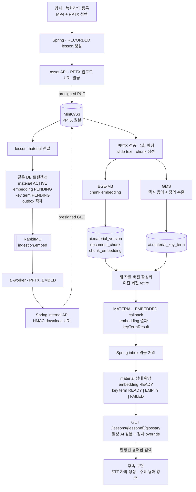

# ADR-0010: 녹화강의 PPTX는 공통 자료 파이프라인으로 임베딩하고 핵심 용어 상태를 별도로 관리한다

> 관련 결정: [ADR-0008 녹화강의 업로드·HLS 변환](0008-recorded-lesson-upload-and-hls-transcoding.md) ·
> [ADR-0009 녹화강의 상세·처리 상태·재생](0009-recorded-lesson-detail-polling-and-playback.md) ·
> [ADR-0035 자료 업로드·레슨 연결](../songjeongki/0035-lesson-material-attach.md) ·
> [ADR-0036 PPTX 자료 임베딩](../songjeongki/0036-material-embedding-pipeline.md) ·
> [ADR-0003 PPTX 핵심 용어 추출](../jinwoo/0003-pptx-key-term-extraction-approach.md) ·
> [ADR-0004 용어 callback 전달 시점](../jinwoo/0004-key-term-callback-delivery-timing.md) ·
> [ADR-0005 자료 버전별 용어 저장](../jinwoo/0005-key-term-storage-schema.md) ·
> [ADR-0064 레슨 용어집 두 겹 모델](../songjeongki/0064-lesson-glossary-two-layers.md) ·
> [공유 계약](../../CONTRACT.md)

- **상태**: 채택 — FE·Spring·ai-worker 코드 구현 완료, 기능 플래그 활성화와 staging E2E는 배포 단계
- **일자**: 2026-08-03
- **적용 범위**: 녹화강의 생성 시 첨부한 PPTX의 업로드·레슨 연결, 비동기 임베딩,
  핵심 용어·정의 추출, 자료 버전 활성화, 완료 상태 반영과 용어집 조회 준비
- **후속 범위**: 녹화 영상 STT, 자막 생성·검수·게시, 자막의 주요 용어 강조는 별도 결정과 구현으로 남긴다.
- **유지**:
  - `RECORDED`도 기존 `lesson`이므로 자료 연결 API와 `material_asset`을 그대로 사용한다.
  - 자료 바이트는 Spring을 통과하지 않고 presigned URL로 오브젝트 스토리지와 직접 주고받는다.
  - AI 원본 용어는 `ai.material_key_term`, 강사 수정본은 `core.lesson_glossary_override`가 소유한다.
  - 핵심 용어 추출 실패가 BGE-M3 임베딩 성공을 실패로 되돌리지는 않는다.

## 한 줄 결정

녹화강의용 PPTX 파이프라인을 새로 만들지 않는다. 녹화강의를 만든 뒤 PPTX를 일반 레슨 자료로
연결하고, 기존 outbox와 `ingestion.embed` 큐를 통해 `PPTX_EMBED` 작업을 실행한다. ai-worker는 PPTX를
한 번 파싱한 결과로 **chunk 임베딩과 핵심 용어·정의 추출을 병렬 수행**하고, 결과는 자료 버전에
종속해 `ai` 스키마에 저장한다.

다만 `embeddingStatus=READY`는 “검색용 chunk와 vector가 준비됨”만 뜻한다. 핵심 용어 추출은 선택적
외부 모델 호출이고 기존 구현은 실패와 정상 빈 결과를 모두 빈 목록으로 축약하므로, 추후 자막 강조의
준비 여부를 판단할 수 없다. 따라서 `keyTermStatus`를 별도 상태로 추가하고 terminal callback에는
용어 원문 복사본이 아니라 **추출·저장 결과 상태와 개수**를 싣는다.

## 구현 결과

- 녹화강의 등록 화면이 다중 PPTX를 범용 `MATERIAL` asset으로 업로드하고 생성된 `lessonId`에 연결한다.
- Spring은 레슨 자료에 `keyTermStatus`를 저장하고 v2 `PPTX_EMBED` 작업을 outbox로 발행한다.
- ai-worker는 단일 파싱 결과로 임베딩·용어 추출을 병렬 실행하고, 용어 terminal 결과를 material
  version에 영속한 뒤 v2 callback으로 전달한다.
- Spring callback inbox는 임베딩과 용어 상태를 독립 반영하며, 이미 확정된 용어 terminal 상태는
  지연된 다른 결과로 되돌리지 않는다.
- `docs/CONTRACT.md`, FE/BE 계약 테스트와 worker 계약·재시도 테스트를 함께 갱신했다.
- Spring `material.embedding.enabled`와 worker ingestion/key-term 관련 플래그는 기본값이 꺼져 있다.
  실제 RabbitMQ·PostgreSQL·GMS를 연결한 staging E2E와 운영 활성화는 배포 단계에서 수행한다.

## 맥락과 구현 전 차이

라이브 강의 자료와 녹화강의 자료는 모두 `lessonId`에 연결되는 PPTX다. AI 입장에서는
`deliveryType=LIVE|RECORDED`가 파싱·임베딩·용어 추출 방식에 영향을 주지 않는다. 따라서 녹화강의
전용 큐, 전용 테이블, 전용 worker를 추가하면 같은 자료 형식에 두 개의 생명주기가 생긴다.

구현 전 코드에도 재사용할 기반은 이미 있었다.

| 구간 | 현재 기반 | 이번 결정에서의 사용 |
|---|---|---|
| 파일 업로드 | 범용 asset의 presigned PUT | PPTX를 `MATERIAL` 용도로 업로드 |
| 자료 연결 | `POST /api/instructor/lessons/{lessonId}/materials` | 생성된 녹화강의의 `lessonId`에 연결 |
| 발행 신뢰성 | `core.outbox_events` | 자료 연결과 `MATERIAL_EMBED_REQUESTED`를 같은 트랜잭션에 기록 |
| 작업 큐 | RabbitMQ `ingestion.embed` | 기존 `PPTX_EMBED` envelope 발행 |
| 파일 읽기 | HMAC `POST /api/internal/ai/materials/download-url` | worker가 처리 직전에 짧은 TTL의 GET URL 발급 |
| 임베딩 저장 | `ai.material_version`, `document_chunk`, `chunk_embedding` | 자료 버전별 stage·activate |
| 용어 저장 | `ai.material_key_term` | 같은 자료 버전의 용어·정의를 저장 |
| callback | HMAC + `external_event_inbox` | 중복 callback을 멱등 처리하고 자료 상태 확정 |
| 조회 | `GET /api/lessons/{lessonId}/glossary` | 활성 자료 버전과 강사 수정본을 합친 용어집 제공 |

이번 구현에서 보강한 핵심 문제는 다음 세 가지다.

1. `embeddingStatus=READY`만으로는 용어가 아직 처리 중인지, 0건인지, 실패했는지 알 수 없다.
2. ai-worker의 `_safe_extract_key_terms`와 `_safe_store_key_terms`는 실패를 삼키고 빈 tuple로 바꾼다.
   이 때문에 정상 0건과 장애를 구분할 수 없다.
3. callback의 optional `keyTerms`는 worker 재시작 뒤 멱등 단축 경로에서 사라질 수 있다. 이미
   `ai.material_key_term`이 원본 저장소이므로 callback payload를 용어 원본의 전달·보관 수단으로
   사용해서는 안 된다.

## 목표와 비목표

### 목표

- 강사가 녹화강의를 만들 때 MP4와 함께 PPTX 자료를 첨부할 수 있다.
- 녹화강의 PPTX도 라이브 강의와 같은 자료 연결·임베딩 파이프라인을 사용한다.
- 자료 연결 HTTP 요청과 AI 작업 발행 사이의 유실을 outbox로 막는다.
- PPTX를 한 번 파싱하고, 같은 파싱 결과를 임베딩과 핵심 용어 추출에 재사용한다.
- 핵심 용어와 정의를 활성 자료 버전에 종속해 저장하여 재업로드·삭제 시 오래된 결과를 배제한다.
- 임베딩 성공과 용어 추출 성공을 독립적으로 관찰하고 재처리할 수 있다.
- 중복 큐 배달, callback 재전송, worker 재시작에도 최종 결과가 멱등하게 수렴한다.
- 후속 STT 구현이 레슨 용어집을 안정된 입력으로 사용할 수 있는 지점까지 준비한다.

### 비목표

- 녹화 영상에서 음성을 추출하거나 STT를 실행하지 않는다.
- 자막 segment 생성·시간축 정렬·검수·게시를 구현하지 않는다.
- 자막 문자열에서 용어를 찾아 강조하거나 정의 팝오버를 표시하지 않는다.
- 추출된 용어로 퀴즈를 만들거나 RAG 답변 품질을 평가하지 않는다.
- PDF, HWP, DOCX 등 PPTX 이외 형식의 파서를 추가하지 않는다.
- GMS가 생성한 정의를 무조건 정답으로 간주하지 않는다. 강사 수정은 기존 override 계층을 사용한다.

## 전체 처리 흐름



핵심 용어는 vector 검색으로 찾아내는 값이 아니다. **임베딩과 용어 추출은 동일한 PPTX 파싱 결과를
공유하는 두 개의 병렬 분기**다. 임베딩은 chunk마다 BGE-M3 vector를 만들고, 용어 추출은 슬라이드
순서가 보존된 전체 텍스트를 구조화 출력 모델에 전달한다.

## 상세 설계

### 1. 녹화강의 생성과 PPTX 연결

프론트는 하나의 거대한 multipart 요청을 만들지 않고 다음 순서로 처리한다.

1. `POST /api/instructor/sections/{sectionId}/recorded-lessons`로 `lessonId`를 만든다.
2. 각 PPTX에 대해 범용 asset 업로드 티켓을 발급받고 브라우저가 presigned URL로 직접 PUT 한다.
3. 업로드가 끝난 asset을 `POST /api/instructor/lessons/{lessonId}/materials`로 연결한다.
4. MP4는 ADR-0008의 녹화 영상 업로드·변환 흐름을 독립적으로 진행한다.

PPTX 자료 처리 실패와 MP4 변환 실패는 서로의 상태를 덮어쓰지 않는다. 예를 들어 영상은 `READY`지만
자료 임베딩은 `FAILED`일 수 있고, 강사는 영상을 다시 올리지 않고 자료 처리만 재시도할 수 있어야 한다.

자료 연결 트랜잭션은 다음을 원자적으로 커밋한다.

- `core.material_asset`: `status=ACTIVE`
- `embeddingStatus=PENDING`
- `keyTermStatus=PENDING` — 이번 작업이 용어 추출을 요청한 경우
- `core.outbox_events`: `eventType=MATERIAL_EMBED_REQUESTED`

구형 자료나 용어 추출을 요청하지 않은 자료는 `keyTermStatus=NOT_REQUESTED`로 구분한다. 설정이 꺼졌는데
무기한 `PENDING`이 되는 일을 막기 위해, Spring이 용어 추출을 요청했는지는 job envelope에 명시한다.

### 2. 작업 계약과 파일 획득

기존 `PPTX_EMBED` envelope를 additive하게 확장한다.

```json
{
  "taskType": "PPTX_EMBED",
  "materialId": "2fca475f-530c-4f68-9eb8-661f658df91c",
  "assetId": "4a58ac1e-af9d-4b94-986f-f00b90b9a130",
  "lessonId": "10000000-0000-4000-8000-000000000001",
  "curriculumId": "20000000-0000-4000-8000-000000000001",
  "fileName": "spring-security.pptx",
  "policy": {
    "embedModel": "bge-m3",
    "extractKeyTerms": true
  },
  "contractVersion": 2
}
```

- `extractKeyTerms`가 없는 v1 메시지는 현재 동작대로 worker의
  `AI_WORKER_KEY_TERM_EXTRACTION_ENABLED` 값을 따른다. v2부터는 요청 의도를 `true|false`로 명시한다.
- 녹화강의라는 별도 `taskType`이나 `deliveryType`은 싣지 않는다. worker의 결과는 레슨 자료라는
  사실에만 의존한다.
- bucket, object key, presigned URL은 큐에 넣지 않는다. worker는 처리 직전에 `assetId`로
  `POST /api/internal/ai/materials/download-url`을 호출한다.
- job의 안정된 멱등키는 material과 계약 버전·처리 정책으로 결정한다. 같은 메시지 재배달은 같은
  자료 버전을 재사용하고, 다른 파일이나 정책으로 재처리하면 새 버전을 만든다.
- v2가 `extractKeyTerms=true`를 요구했는데 worker에 extractor나 GMS key가 없으면 설정 불일치다.
  임베딩은 계속하되 용어 결과를 `FAILED`와 안정된 `failureCode`로 보고한다.

### 3. PPTX 검증과 단일 파싱

worker는 다운로드한 바이트를 바로 모델에 보내지 않는다.

1. ZIP/PPTX signature, 전체 크기, 압축 해제 크기, entry 개수 등 기존 제한을 검증한다.
2. 슬라이드 번호와 텍스트 블록 순서를 보존한 `ParsedPresentation`을 한 번 만든다.
3. 임베딩 분기에는 페이지 메타데이터가 포함된 chunk 목록을 제공한다.
4. 용어 분기에는 `[슬라이드N]` 경계가 포함된 전체 텍스트를 제공한다.

빈 PPTX나 지원되는 텍스트가 없는 PPTX는 임베딩 자체가 불가능하므로 `MATERIAL_EMBED_FAILED`로 끝낸다.
이 경우 `embeddingStatus=FAILED`, `keyTermStatus=FAILED`다. 비밀번호가 걸렸거나 파손된 PPTX도 같은
영구 오류로 처리하고 원문이나 압축 entry 내용을 로그에 남기지 않는다.

### 4. 임베딩 분기

- 슬라이드 텍스트를 결정적 규칙으로 chunking한다. 동일 입력·동일 chunk 정책은 같은 순서와
  `contentHash`를 만든다.
- 각 chunk를 BGE-M3로 임베딩하고 개수·차원 계약을 검증한다.
- 새 `ai.material_version`을 stage하고 `document_chunk`, `chunk_embedding`을 저장한다.
- 모든 필수 row가 저장된 뒤 새 버전을 activate하고 같은 material의 이전 활성 버전을 retire한다.
- 중간 실패에서는 새 버전을 활성화하지 않으므로 기존 활성 인덱스가 계속 조회된다.

이 분기의 성공 여부만 `embeddingStatus`를 결정한다. 용어 추출이 실패해도 vector 저장과 버전 활성화가
정상이라면 `embeddingStatus=READY`다.

### 5. 핵심 용어·정의 추출 분기

용어 추출은 chunk embedding과 `asyncio.gather`로 병렬 실행하되, 별도 timeout을 둔다. 입력은 chunk별
vector가 아니라 단일 파싱 결과에서 만든 슬라이드 순서 텍스트다.

GMS 요청은 다음 규칙을 지킨다.

- PPTX 텍스트는 신뢰하지 않는 데이터라고 system prompt에 명시하고 자료 안의 지시를 따르지 않는다.
- 설정된 최대 글자 수를 넘으면 명시된 절단 정책을 적용하고 `truncated=true`를 관측 지표에 남긴다.
- 응답은 `terms[{term, definition}]` JSON Schema로 강제한다.
- `term`과 `definition`을 trim하고 빈 값은 버린다. 같은 자료 버전에서 동일한 term은 정규화 후
  한 건으로 합친다.
- 모델명, 입력 글자 수, 처리 시간, 추출 건수, 실패 유형은 기록하되 PPTX 원문·GMS 응답 원문·API key는
  로그에 남기지 않는다.

추출과 저장의 결과를 빈 tuple 하나로 축약하지 않고 다음 값 객체로 반환한다.

```text
KeyTermExtractionResult
  status: READY | EMPTY | FAILED
  terms: tuple[KeyTerm, ...]
  failureCode: optional stable code
  truncated: boolean
```

- `READY`: 한 건 이상 추출했고 `ai.material_key_term` 저장까지 성공
- `EMPTY`: 모델 호출과 응답 검증은 성공했으나 유효한 용어가 0건
- `FAILED`: timeout, GMS 오류, 응답 계약 위반 또는 DB 저장 실패

용어 추출·저장 실패는 기록하고 `FAILED`로 반환하되 임베딩 분기에 예외를 전파하지 않는다. 반대로
임베딩이 실패하면 새 자료 버전을 활성화하지 않으므로, 해당 실행에서 얻은 용어도 조회 대상으로
활성화하지 않는다.

### 6. 버전 저장과 활성화

용어는 `materialId`에 직접 붙이지 않고 결과를 만든 `ai.material_version.id`에 붙인다.

```text
ai.material_version (1)
  ├─ document_chunk (N)
  │    └─ chunk_embedding (1)
  └─ material_key_term (N)
```

worker 재시작 뒤에도 terminal callback을 동일하게 복구하려면 용어 row만으로는 부족하다. 0건은
`EMPTY`일 수도 있고 `FAILED`일 수도 있기 때문이다. 따라서 AI 소유 스키마의 material version 또는
별도 processing-result 테이블에 다음 결과 메타데이터도 영속화한다.

```text
key_term_status: NOT_REQUESTED | PENDING | READY | EMPTY | FAILED
key_term_count: integer
key_term_truncated: boolean
key_term_failure_code: nullable stable code
```

`ai` 쪽 값은 worker가 callback을 재구성하는 producer 결과이고, `core.material_asset.keyTermStatus`는
Spring API가 노출하는 projection이다. 양쪽에 용어 원문을 중복 저장하는 것이 아니며, callback이
성공할 때 projection이 producer 결과로 수렴한다.

권장 저장 순서는 다음과 같다.

1. 새 material version과 임베딩 chunk를 `STAGED` 상태로 저장한다.
2. 용어 분기가 `READY`면 같은 version에 용어를 upsert한다.
3. 용어가 `EMPTY` 또는 `FAILED`여도 임베딩이 정상이면 새 version을 activate한다.
4. 새 version 활성화와 이전 version retire를 원자적으로 전환한다.
5. terminal callback은 활성화 이후에만 보낸다.

이 순서로 재업로드 도중에는 이전 용어집이 유지되고, 새 임베딩 버전이 활성화되는 순간부터 새 버전의
용어만 조회된다. `FAILED`인 용어 분기는 빈 원본을 노출할 수 있지만, 상태를 별도로 제공하므로 운영자와
강사는 “정상 0건”으로 오해하지 않는다.

### 7. callback과 두 상태축

AI 원본 용어는 `ai.material_key_term`이 SSOT다. callback의 `keyTerms` 목록을 `core`에 복사하지 않는다.
대신 terminal callback을 다음처럼 additive하게 확장한다.

```json
{
  "eventId": "52cf818e-152d-5bf4-9661-3d12a70317b4",
  "eventType": "MATERIAL_EMBEDDED",
  "jobId": "stable-worker-job-id",
  "materialId": "2fca475f-530c-4f68-9eb8-661f658df91c",
  "lessonId": "10000000-0000-4000-8000-000000000001",
  "status": "READY",
  "outputs": {
    "materialVersionId": 321,
    "chunkCount": 42,
    "keyTermResult": {
      "status": "READY",
      "count": 18,
      "truncated": false
    }
  }
}
```

- `eventId`는 동일 terminal 결과에 대해 결정적이어야 한다.
- Spring은 `(source, eventId)`를 `external_event_inbox`에 먼저 기록하고 중복이면 성공 응답만 반환한다.
- `outputs`가 없는 기존 callback은 기존과 같이 `embeddingStatus`만 갱신한다.
- `keyTerms` 목록은 과도기 호환을 위해 받을 수 있으나 저장 원본으로 사용하지 않는다.
- callback은 DB 저장·버전 활성화가 끝난 뒤 전송하며, 성공 응답을 받기 전에는 RabbitMQ 메시지를 ACK하지
  않는다.

자료 상태는 다음 두 축으로 관리한다.

| 축 | 상태 | 의미 |
|---|---|---|
| `embeddingStatus` | `PENDING` | 임베딩 작업이 아직 terminal 결과를 받지 않음 |
|  | `PROCESSING` | worker가 작업을 시작함. 초기 구현에서 생략하고 `PENDING`을 유지해도 됨 |
|  | `READY` | 활성 material version과 chunk embedding이 조회 가능 |
|  | `FAILED` | PPTX 검증·파싱·임베딩·필수 저장 실패 |
| `keyTermStatus` | `NOT_REQUESTED` | 구형 자료이거나 용어 추출 정책이 적용되지 않음 |
|  | `PENDING` | 용어 추출이 요청됐지만 terminal 결과가 없음 |
|  | `PROCESSING` | 추출 작업 시작. 초기 구현에서 생략 가능 |
|  | `READY` | 한 건 이상의 용어·정의가 활성 version에 저장됨 |
|  | `EMPTY` | 정상 처리됐지만 유효한 용어가 0건 |
|  | `FAILED` | 추출 또는 용어 저장 실패. 임베딩은 `READY`일 수 있음 |

`core.material_asset`과 자료 응답 DTO에 `keyTermStatus`를 추가하고, 실제 wire 변경과 함께
`docs/CONTRACT.md`와 FE/BE 계약 테스트를 갱신한다.

### 8. 용어집 조회 경계

후속 기능이 소비할 준비 완료 지점은 `GET /api/lessons/{lessonId}/glossary`다.

- `ai.material_key_term`은 `activated_at IS NOT NULL AND retired_at IS NULL`인 자료 버전만 읽는다.
- 같은 레슨에 여러 PPTX가 있으면 활성 버전들의 용어를 합친다.
- 동일 term이 여러 자료에 있으면 정규화된 term 기준으로 결정적으로 dedupe한다. 정의 선택 규칙은
  material 정렬 순서와 version id 등 안정된 우선순위를 계약으로 고정한다.
- 같은 term의 `core.lesson_glossary_override`가 있으면 강사 수정본이 항상 이긴다.
- 자료 삭제·재업로드로 retire된 version의 용어는 반환하지 않는다.

STT·자막 강조 구현은 이 API 결과를 입력으로 받을 수 있지만, 이번 결정에서는 호출 시점이나 문자열
매칭 알고리즘을 정하지 않는다.

### 9. 삭제와 재처리

#### 자료 삭제

자료 연결을 삭제하면 Spring은 연결 상태 변경과 `EMBED_DELETE` outbox를 같은 트랜잭션에 기록한다.
worker는 해당 material의 활성·staged version, chunk, embedding, `material_key_term`을 정리한다.
외래키 cascade를 사용하더라도 삭제 대상 material과 lesson scope를 검증해야 한다. 삭제 callback 역시
inbox로 멱등 처리한다.

#### 임베딩 전체 재처리

PPTX 파일이나 chunk/model 정책이 바뀌면 새 material version을 만든다. 기존 활성 version을 먼저
지우지 않고 새 version의 stage가 모두 끝난 뒤 교체한다.

#### 용어만 재처리

`embeddingStatus=READY`, `keyTermStatus=FAILED`이면 BGE-M3를 다시 호출하지 않는다. 후속 구현에서
`PPTX_KEY_TERM_EXTRACT` 작업을 추가해 현재 활성 version과 원본 asset을 대상으로 용어 분기만 재실행한다.
성공 시 해당 version의 `material_key_term`을 교체하고 `keyTermStatus`를 `READY|EMPTY`로 바꾼다.
재처리 job도 outbox, 결정적 job id, terminal callback 계약을 사용한다.

## 실패·재시도 정책

| 실패 지점 | 임베딩 상태 | 용어 상태 | 처리 |
|---|---|---|---|
| PPTX 업로드/연결 실패 | 생성 전 또는 `PENDING` 없음 | 생성 전 또는 `PENDING` 없음 | FE 재시도, outbox 미생성 |
| download URL/스토리지 일시 오류 | `PENDING` | `PENDING` | RabbitMQ 유한 재시도 |
| 손상·암호화·빈 PPTX | `FAILED` | `FAILED` | 영구 실패 callback, 파일 교체 안내 |
| BGE API/DB 일시 오류 | `PENDING` 후 실패 가능 | 결과 미확정 | 유한 재시도 후 `MATERIAL_EMBED_FAILED` |
| GMS timeout/계약 위반 | `READY` 가능 | `FAILED` | 임베딩 계속, 용어만 재처리 가능 |
| 용어 DB 저장 실패 | `READY` 가능 | `FAILED` | callback에 실패 명시, 용어만 재처리 |
| callback 응답 유실 | 저장된 결과 유지 | 저장된 결과 유지 | 같은 eventId로 재전송, inbox 중복 성공 |
| worker 재시작 후 중복 메시지 | 기존 version 재사용 | DB 결과로 복구 | in-memory cache에 의존하지 않음 |

일시 오류 재시도는 지수 backoff와 상한을 두고, 소진 후 DLQ로 이동한다. 로그와 metric의 키는
`jobId`, `materialId`, `lessonId`, `materialVersionId`, 각 상태와 안정된 `failureCode`로 제한한다.

## 기능 플래그와 배포 순서

현재 관련 플래그는 기본적으로 꺼져 있으므로 코드 반영만으로 운영 처리가 시작되지는 않는다.

- Spring: `MATERIAL_EMBEDDING_ENABLED=true`
- ai-worker: `AI_WORKER_MATERIAL_INGESTION_ENABLED=true`
- ai-worker: `AI_WORKER_KEY_TERM_EXTRACTION_ENABLED=true`
- secret: `AI_WORKER_GMS_API_KEY`

권장 배포 순서는 다음과 같다.

1. AI DB migration과 읽기 권한을 먼저 적용한다.
2. worker에 결과 상태 모델·영속 저장·새 callback payload를 배포한다. 구형 Spring은 `outputs`를 무시한다.
3. Spring에 callback DTO, `keyTermStatus`, 응답 DTO를 배포한다.
4. FE에 녹화강의 PPTX 첨부와 두 상태 배지를 배포한다.
5. staging에서 실제 PPTX로 업로드→임베딩→용어집 조회 E2E를 검증한다.
6. material ingestion을 켠 뒤 key-term extraction을 별도로 켜고 오류율·지연·비용을 관찰한다.

플래그를 켜기 전에 Spring과 worker의 `contractVersion=2` 호환 여부, HMAC secret, GMS key,
RabbitMQ DLQ, `ai` migration 적용 여부를 readiness check로 확인한다.

## 구현 단위

### Frontend

- 녹화강의 등록 폼에서 `.pptx` 다중 선택·삭제·크기/확장자 검증을 제공한다.
- 녹화강의 생성 후 기존 asset 업로드와 lesson material attach API를 순서대로 호출한다.
- MP4 처리 상태와 자료 처리 상태를 분리해 표시한다.
- 자료별 `embeddingStatus`와 `keyTermStatus`를 폴링하거나 상세 재조회한다.
- 일부 PPTX 실패 때문에 성공한 다른 PPTX나 MP4 결과를 숨기지 않는다.

### Spring Backend

- 녹화강의도 일반 lesson material attach 경로를 통과하도록 유지한다.
- attach+상태 초기화+outbox를 한 트랜잭션으로 보장한다.
- v2 job policy와 callback `outputs.keyTermResult`를 계약 DTO에 추가한다.
- `material_asset.key_term_status` migration과 상태 전이 검증을 추가한다.
- inbox 중복 callback이 상태를 되돌리지 않도록 terminal 전이를 멱등 처리한다.
- 자료 목록·상세 응답에 `keyTermStatus`를 추가하고 CONTRACT를 갱신한다.
- 용어집 조회의 중복 term 정의 선택 순서를 결정적으로 만든다.

### ai-worker

- `MaterialIndexResult`가 terms뿐 아니라 추출·저장 결과 상태를 반환하도록 변경한다.
- `_safe_extract_key_terms`가 `EMPTY`와 `FAILED`를 구분한다.
- `_safe_store_key_terms`가 저장 성공 여부를 호출자에게 반환한다.
- 재배달 단축 경로가 in-memory cache가 아니라 `ai` DB에서 용어 결과를 복구하도록 한다.
- material version에 용어 결과 상태·개수·절단 여부·실패 코드를 영속화하는 migration을 추가한다.
- stage→term store→activate→callback 순서를 보장하고 각각의 실패 metric을 남긴다.
- v1/v2 envelope와 구형 callback consumer 호환 테스트를 유지한다.

### 운영

- `PPTX_EMBED` 처리 시간, chunk 수, 용어 수, GMS 지연·실패율, 상태별 material 수를 관측한다.
- `embeddingStatus=READY AND keyTermStatus=FAILED` 자료를 별도 경보·재처리 대상으로 조회한다.
- GMS 비용과 지연이 임베딩 처리량을 침범하지 않도록 동시성·timeout·rate limit을 분리한다.

## 검증 기준

### 계약 테스트

- 녹화강의의 `lessonId`에 PPTX를 연결하면 자료 응답이 `embeddingStatus=PENDING`,
  `keyTermStatus=PENDING`이다.
- v1 callback은 기존처럼 embedding 상태만 갱신하고 오류 없이 204를 반환한다.
- v2 `MATERIAL_EMBEDDED` callback은 embedding을 `READY`, 용어를 `READY|EMPTY|FAILED`로 독립 갱신한다.
- 같은 `eventId` callback을 두 번 보내도 inbox와 상태가 한 번만 반영된다.
- 용어 추출 실패 callback이 embedding 상태를 `FAILED`로 바꾸지 않는다.
- 자료 삭제 후 glossary에서 해당 자료 버전의 용어가 사라진다.

### worker 테스트

- PPTX 파서는 한 번만 실행되고 embedding·용어 추출 두 분기가 같은 parsed presentation을 사용한다.
- GMS 정상 다건, 정상 0건, timeout, JSON Schema 위반을 각각 `READY`, `EMPTY`, `FAILED`로 구분한다.
- GMS 또는 용어 저장 실패에도 정상 embedding version은 활성화된다.
- embedding 실패 시 staged version과 용어가 활성 조회에 노출되지 않는다.
- 중복 배달과 worker 재시작 뒤에도 version·chunk·term이 중복 생성되지 않는다.
- callback 응답 유실 뒤 재전송 payload의 `keyTermResult`가 DB 결과와 같다.

### 통합 E2E

1. 강사가 녹화강의와 실제 PPTX를 등록한다.
2. 오브젝트 저장과 lesson material 연결을 확인한다.
3. outbox→RabbitMQ→worker 소비를 확인한다.
4. 활성 material version, chunk embedding, key term row를 확인한다.
5. material 응답의 두 상태와 glossary 응답의 용어·정의를 확인한다.
6. 같은 메시지와 callback을 재전송해 row 수와 최종 응답이 변하지 않는지 확인한다.
7. GMS를 의도적으로 실패시켜 영상·임베딩은 정상이고 용어 상태만 실패하는지 확인한다.

## 검토한 대안

### 1. 녹화강의 전용 PPTX 파이프라인을 만든다

기각한다. 자료의 처리 방식은 lesson delivery type과 무관하다. 전용 큐·테이블·worker는 라이브와
녹화강의의 재시도·삭제·상태 계약을 불필요하게 갈라놓는다.

### 2. 자료 연결 HTTP 요청에서 동기 임베딩·용어 추출을 수행한다

기각한다. 대용량 PPTX, 외부 임베딩/GMS 지연과 장애를 HTTP transaction에 묶고 재시도·멱등성을
약화한다. 파일 업로드 성공과 AI 처리 접수는 분리해야 한다.

### 3. embedding vector에서 핵심 용어를 역으로 고른다

기각한다. vector는 검색 유사도를 위한 표현이며 용어·정의의 구조화 원본이 아니다. PPTX 파싱 텍스트를
공유하되 임베딩과 용어 추출을 독립 분기로 유지한다.

### 4. callback의 `keyTerms`를 `core` 테이블에 복사한다

기각한다. `ai.material_key_term`과 두 벌의 원본이 생기고, 재업로드·callback 재시도 시 어느 쪽이
최신인지 불명확해진다. callback은 상태·개수만 알리고 Spring은 활성 AI version을 읽는다.

### 5. 용어 추출 실패를 전체 임베딩 실패로 처리한다

기각한다. GMS 장애 때문에 RAG 검색용 인덱스까지 폐기할 이유가 없다. 두 결과는 같은 파싱을 공유하지만
가용성은 분리한다.

### 6. 임베딩 성공이면 용어도 성공한 것으로 간주한다

기각한다. 현재처럼 실패와 0건을 구분하지 못해 추후 자막 강조가 조용히 비어 보인다. 운영 재처리와
사용자 안내를 위해 별도 상태축이 필요하다.

## 결과와 한계

이 결정으로 라이브·녹화강의는 하나의 PPTX 자료 생명주기를 공유하며, 영상 변환과 자료 AI 처리는
독립적으로 실패·복구할 수 있다. 임베딩과 핵심 용어 추출의 상태를 분리하므로 후속 STT 기능은
“용어집이 정상적으로 준비되었는가”를 확인하고 처리할 수 있다.

반면 GMS가 뽑은 용어와 정의의 교육적 정확성은 자동으로 보장되지 않는다. 강사 검수·수정은 기존
`lesson_glossary_override`를 사용하고, 정확도 지표와 prompt/model 변경은 별도 실험으로 관리한다.
또한 이번 결정은 자막 생성이나 강조 알고리즘을 확정하지 않는다. 후속 ADR은 이 문서의 최종 경계인
`GET /api/lessons/{lessonId}/glossary`와 두 자료 상태를 입력 계약으로 삼아 STT 이후 흐름을 설계한다.
