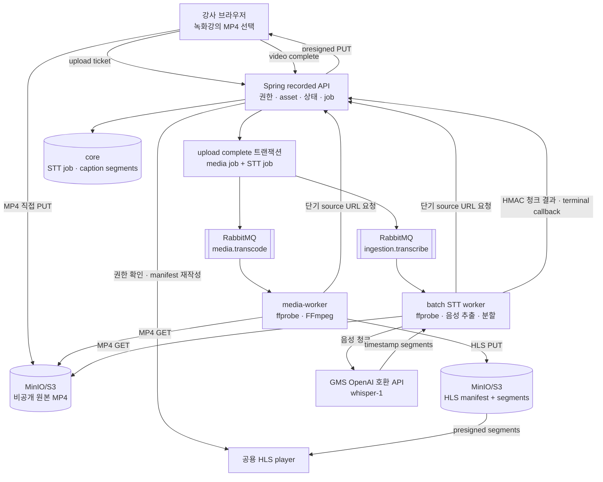
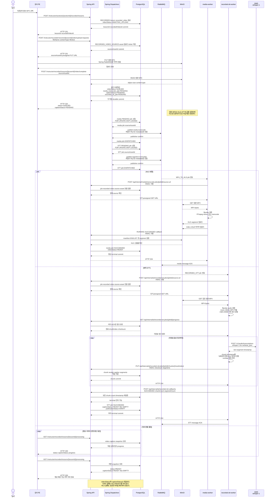

# ADR-0011: 녹화강의 자막은 원본 MP4에서 음성을 추출해 GMS Whisper 배치 작업으로 생성한다

> 관련 결정: [ADR-0008 녹화강의 업로드·HLS 변환](0008-recorded-lesson-upload-and-hls-transcoding.md) ·
> [ADR-0009 녹화강의 상세·처리 상태·재생](0009-recorded-lesson-detail-polling-and-playback.md) ·
> [ADR-0010 녹화강의 PPTX 임베딩·핵심 용어](0010-recorded-lesson-pptx-embedding-and-key-term-extraction.md) ·
> [ADR-0012 RabbitMQ durable 배치](../songjeongki/0012-hybrid-queue.md) ·
> [ADR-0013 실시간 스트리밍 STT](../songjeongki/0013-unified-streaming-stt.md) ·
> [ADR-0017 core/ai 스키마 소유권](../songjeongki/0017-schema-ownership-core-ai.md) ·
> [ADR-0032 학생 HLS 단일 재생](../songjeongki/0032-media-playback-hls-only.md) ·
> [공유 계약](../../CONTRACT.md) · [AI 통신 계약](../../ai/CONTRACT.md)

- **상태**: 채택 — 설계 확정, 구현 전
- **일자**: 2026-08-03
- **적용 범위**: 강사가 업로드한 `RECORDED` 레슨의 원본 MP4 보존, 녹화강의 업로드 완료 뒤
  배치 STT 작업 생성·발행, 음성 추출·분할, GMS `whisper-1` 호출, 시간 구간 자막 저장, 처리 상태와 재시도
- **비적용 범위**: 라이브 중 realtime-agent 스트리밍 STT, LiveKit Egress로 만든 라이브 다시보기의
  2-pass 교정, 강사 자막 편집 UI, 번역 자막, 화자 분리, 자막 기반 챕터·퀴즈 생성
- **유지**:
  - 학생 재생 형식은 라이브·라이브 다시보기·업로드 녹화강의 모두 HLS다.
  - 업로드 원본 MP4와 HLS 산출물은 서로 대체하지 않고 MinIO/S3의 분리된 비공개 key 공간에 둔다.
  - 미디어 바이트는 Spring과 RabbitMQ를 통과하지 않는다.
  - 영상 처리와 자막 처리는 독립 상태축이며 어느 한쪽 실패가 다른 쪽 성공을 되돌리지 않는다.
  - 자막 원본·후보·게시본의 write-owner는 Spring과 `core` 스키마다.

## 한 줄 결정

강사가 녹화강의 MP4를 presigned PUT으로 MinIO/S3에 올리고 업로드 완료를 접수하면, Spring은 기존
`media.transcode` 작업과 별도의 durable `ingestion.transcribe` 작업을 독립적으로 발행한다. 두 worker는
RabbitMQ에서 파일 바이트가 아니라 `sourceAssetId`와 `jobId`만 받고, 작업 직전에 Spring이 발급한 단기
presigned GET URL로 같은 비공개 원본 MP4를 읽는다.

`media-worker`는 원본을 HLS 재생 산출물로 만들고, 별도 batch STT worker는 원본 MP4에서 mono 음성을
추출해 25MB 미만 청크로 나눈 뒤 GMS OpenAI 호환 `/v1/audio/transcriptions`의 `whisper-1`으로 전사한다.
HLS 세그먼트는 STT 입력으로 다시 조립하지 않는다. worker는 청크별 시간값을 녹화강의 0ms 기준으로
합쳐 Spring internal API에 멱등 전달하고, Spring만 `core` 자막 테이블을 쓰고 최종 상태를 확정한다.

## 맥락과 확인된 전제

업로드 녹화강의는 이미 다음 생명주기를 가진다.

1. Spring이 `RECORDED_VIDEO_SOURCE` asset과 presigned PUT URL을 발급한다.
2. 브라우저가 Spring을 거치지 않고 원본 MP4를 MinIO/S3에 직접 PUT한다.
3. 브라우저가 `video/complete`를 호출하면 Spring이 HEAD로 객체 존재·크기·content type을 확인한다.
4. Spring이 `media_transcode_job`을 만들고 `media.transcode`에 발행한다.
5. `media-worker`가 원본을 내려받아 HLS VOD를 만들고 별도 output prefix에 저장한다.
6. Spring이 manifest와 첫 segment를 검증한 뒤 영상만 `READY`로 확정한다.

[ADR-0008](0008-recorded-lesson-upload-and-hls-transcoding.md)은 원본 MP4를 HLS 변환 재시도와 후속 batch
STT 입력을 위해 즉시 삭제하지 않도록 이미 결정했다. 이번 결정은 그 후속 STT 경계를 구체화한다.

### GMS 기술 검증 결과

2026-08-03에 프로젝트에 설정된 GMS key를 노출하지 않고 짧은 MP3 fixture로 실제 gateway를
검증했다.

| 요청 | 결과 |
|---|---|
| `POST https://api.openai.com/v1/audio/transcriptions` | 정상 응답 |
| `model=whisper-1`, `language=ko`, `response_format=verbose_json` | `language`, `duration`, `text`, `segments`, `usage.seconds` 반환 |
| `model=gpt-transcribe` | GMS 400 `Model ... is not available` |
| `model=gpt-4o-transcribe` | GMS 400 `Model ... is not available` |
| `model=gpt-4o-mini-transcribe` | GMS 400 `Model ... is not available` |
| `GET .../v1/models` | gateway가 model 없는 요청으로 거부하여 목록 조회 불가 |

따라서 현재 프로젝트 key와 GMS allowlist에서 검증된 파일 전사 모델은 `whisper-1`이다. 모델 허용 목록은
외부 운영 상태이므로 코드 곳곳에 문자열을 복제하지 않고 환경변수 기본값으로만 둔다. 다른 모델로
바꾸기 전에는 staging smoke test로 endpoint, response format, timestamp와 quota를 다시 확인한다.

OpenAI 파일 전사 API는 현재 파일당 25MB 제한을 두며, `whisper-1`의 `verbose_json`은 segment/word
timestamp를 제공한다. 상세한 외부 제약은
[OpenAI 파일 전사 가이드](https://developers.openai.com/api/docs/guides/speech-to-text/)를 따른다.
GMS가 OpenAI의 body size, timeout, rate limit과 비용을 그대로 적용한다고 가정하지 않고 운영에서 별도
측정한다.

## 결정 원칙과 불변식

1. **원본과 배포본을 구분한다.** MP4는 재처리 가능한 비공개 원본이고 HLS는 학생 재생용 파생본이다.
2. **대용량 파일과 작업 신호를 구분한다.** 파일은 object storage, 작업 ID는 RabbitMQ, 상태와 권한은
   PostgreSQL/Spring이 소유한다.
3. **업로드 완료가 단일 분기점이다.** HEAD 검증과 DB job commit 전에는 어떤 worker도 source를 읽지
   않는다.
4. **영상과 자막은 병렬·독립 처리한다.** HLS가 준비돼야 STT를 시작하거나 STT가 끝나야 영상을
   공개하는 의존성을 만들지 않는다.
5. **STT는 원본 MP4를 읽는다.** HLS manifest와 segment를 다시 다운로드·재조립하지 않는다.
6. **worker는 source URL을 메시지로 받지 않는다.** 만료된 URL의 장기 체류를 막기 위해 작업 직전에
   Spring internal API에서 발급받는다.
7. **외부 AI 결과는 후보이다.** worker가 `core` DB를 직접 쓰지 않고 Spring이 검증·영속한다.
8. **at-least-once를 전제로 한다.** queue 중복 배달, 청크 결과 재전송, terminal callback 재시도는
   모두 같은 결과로 수렴해야 한다.
9. **미디어 가용성을 AI와 격리한다.** `captionStatus=FAILED`여도 `videoStatus=READY`면 학생은 영상을
   재생할 수 있다.

## 전체 구조



## 목표 MVP 시퀀스



## MP4와 HLS를 함께 저장하는 이유

### 서로 다른 역할

HLS는 MP4 파일을 같은 key에 덮어써 만드는 형식이 아니다. 하나의 manifest와 여러 media segment로
이뤄진 별도 패키지다.

```text
recorded_video_source/{sourceAssetId}               # 비공개 원본 MP4
recorded/{recordedVideoId}/index.m3u8               # 학생 재생용 VOD manifest
recorded/{recordedVideoId}/segment-000000.ts        # 학생 재생용 segment
recorded/{recordedVideoId}/segment-000001.ts
...
```

| 객체 | 역할 | 접근 주체 | 보존 이유 |
|---|---|---|---|
| 원본 MP4 | 재처리 가능한 source of truth | media/STT worker | HLS 실패 재시도, STT 재처리, 향후 ABR·썸네일 재생성 |
| HLS manifest·segment | 학생 배포·재생본 | 권한 확인된 플레이어 | 라이브·다시보기·녹화강의 공용 HLS UI와 seek 계약 |
| 임시 음성 청크 | GMS 전송 단위 | STT worker만 | 25MB 제한을 만족하고 timestamp를 병합하기 위한 작업 파일 |
| 자막 segment | 교육 기능 데이터 | Spring·권한 확인된 사용자 | 검색·검수·동기화 가능한 구조화 결과 |

원본과 HLS를 함께 저장하면 저장량은 늘지만 다음을 얻는다.

- 변환 실패·코덱 정책 변경 뒤 HLS를 다시 만들 수 있다.
- STT 모델·prompt·용어집이 바뀌어도 원본에서 자막을 다시 만들 수 있다.
- HLS single rendition을 추후 ABR ladder로 바꿀 때 강사에게 재업로드를 요구하지 않는다.
- 학생 UI는 라이브 엣지, 라이브 다시보기, 업로드 녹화강의에 같은 HLS player를 사용한다.
- 원본은 학생에게 노출하지 않고 HLS manifest와 segment만 기존 권한·presign 경계로 제공한다.

원본 보존은 STT만을 위한 결정이 아니다. HLS 자체가 파생 산출물이므로 재생본을 다시 만들 수 있는
원본을 보존하는 것이 우선이고, batch STT는 그 원본을 추가로 재사용한다.

### 보존 정책

1차 구현은 기존 ADR과 같이 원본 MP4를 레슨 삭제 또는 명시적 보존 정책 적용 전까지 유지한다. 임시
음성 청크는 영속 저장하지 않고 job별 임시 디렉터리에서 만들며, 각 청크 결과가 Spring에 ACK된 뒤 또는
작업 실패·종료 시 삭제한다.

저장량이 실제 운영 비용 문제가 되면 다음 조건을 모두 만족한 source만 별도 lifecycle 정책으로
archive/delete할 수 있다.

- HLS `READY`
- 자막 `READY|EMPTY` 또는 운영자가 자막 생성을 명시적으로 포기
- 변환·STT 재시도 보존 기간 경과
- 향후 ABR·썸네일 재생성 요구가 없음

source를 삭제하면 HLS 재생성·모델 교체 재전사·정밀 재동기화가 불가능하므로 1차 구현에서 자동 삭제를
넣지 않는다.

## 업로드 완료와 병렬 작업 접수

### 1. 클라이언트 업로드

강사 브라우저는 기존 API에서 받은 presigned PUT URL로 MP4를 object storage에 직접 업로드한다. Spring은
파일 바이트를 받지 않는다. 업로드 성공 뒤 기존 endpoint를 호출한다.

```http
POST /api/instructor/recorded-lessons/{lessonId}/video/complete
Content-Type: application/json
```

```json
{
  "assetId": "60000000-0000-4000-8000-000000000001"
}
```

Spring은 기존과 동일하게 소유권, asset kind, source 연결, content type, 실제 object 크기를 확인한다.
STT 기능이 켜져 있으면 같은 DB transaction에서 다음을 함께 commit한다.

- `recorded_video.status=QUEUED`
- 새 `media_transcode_job.status=PENDING`
- 새 `recorded_caption_track.status=PENDING`
- 새 `recorded_stt_job.status=PENDING`

RabbitMQ publish 자체는 HTTP transaction에서 하지 않는다. 두 dispatcher가 commit된 job row를 각각
선점해 publish하고 confirm을 받은 뒤 `DISPATCHED`로 바꾼다. 한 queue 발행 실패가 다른 job row를
취소하지 않으며 각 dispatcher가 독립 재시도한다.

STT 기능 플래그가 꺼져 있으면 media job만 만들고 `captionStatus=NOT_REQUESTED`를 반환한다. GMS key가
없는 상태에서 기능 플래그를 켠 worker는 시작 단계에서 fail-fast해야 하며 요청마다 늦게 실패해서는
안 된다.

### 2. 외부 처리 상태

기존 영상 상태 `status`의 의미를 바꾸지 않고 자막 상태를 additive 필드로 제공한다.

```json
{
  "lessonId": "10000000-0000-4000-8000-000000000001",
  "recordedVideoId": "50000000-0000-4000-8000-000000000001",
  "status": "TRANSCODING",
  "failureCode": null,
  "durationMs": null,
  "sizeBytes": null,
  "readyAt": null,
  "captionStatus": "PROCESSING",
  "captionFailureCode": null,
  "captionProcessedChunks": 3,
  "captionTotalChunks": 7,
  "captionReadyAt": null
}
```

`status`는 기존 HLS 영상 처리 상태이고 `captionStatus`는 다음 별도 상태다.

```text
NOT_REQUESTED

PENDING ── dispatch ──▶ PROCESSING ── speech segments ──▶ READY
                              └──── valid audio, no speech ──▶ EMPTY
                              └──── terminal error ──────────▶ FAILED

FAILED ── instructor retry + valid source ──▶ PENDING
```

불변식:

- `status=READY`는 `captionStatus`와 무관하게 학생 HLS playback을 연다.
- `captionStatus=READY`는 영상이 아직 변환 중이어도 유지한다.
- `captionStatus=EMPTY`는 유효한 audio track을 전사했지만 발화 segment가 0건인 정상 terminal이다.
- audio stream 자체가 없으면 처리할 입력이 없으므로 `FAILED(SOURCE_AUDIO_MISSING)`로 구분한다.
- GMS 2xx 빈 segment와 source audio 부재를 같은 상태로 축약하지 않는다.
- 영상 retry endpoint와 자막 retry endpoint를 공유하지 않는다.

자막만 다시 처리하는 endpoint는 별도로 둔다.

```http
POST /api/instructor/recorded-lessons/{lessonId}/captions/retry
```

`captionStatus=FAILED|EMPTY`이고 source asset이 `UPLOADED`일 때 새 STT attempt를 만들며 202를 반환한다.
모델·prompt 변경으로 `READY` 자막을 재생성하는 관리 기능과 자막 게시·철회는 후속 범위다.

## RabbitMQ 작업 계약

queue는 durable `ingestion.transcribe`, DLQ는 `ingestion.transcribe.dlq`로 둔다. 기존
`media.transcode`, PPTX용 `ingestion.embed`, 라이브 caption Redis Stream과 queue·consumer·retry
정책을 공유하지 않는다.

```json
{
  "taskType": "RECORDED_STT",
  "jobId": "80000000-0000-4000-8000-000000000001",
  "recordedVideoId": "50000000-0000-4000-8000-000000000001",
  "lessonId": "10000000-0000-4000-8000-000000000001",
  "sourceAssetId": "60000000-0000-4000-8000-000000000001",
  "language": "ko",
  "contractVersion": 1
}
```

- URL, GMS key, object key, 강사 파일명, MP4 bytes는 message에 넣지 않는다.
- `jobId`는 attempt별 UUID이며 worker idempotency key다.
- `sourceAssetId`는 Spring이 job·recorded video·asset 연결을 다시 검증하는 논리 참조다.
- publish는 persistent message와 publisher confirm을 사용한다.
- worker prefetch는 1로 시작하고 실제 전사 시간·GMS quota를 측정한 뒤 조정한다.
- original message는 terminal callback에 대한 Spring 204를 받은 뒤 ACK한다.
- transient 실패는 bounded retry 후 DLQ, 계약 위반·지원하지 않는 모델 같은 permanent 실패는 바로
  terminal callback 후 DLQ에 원인을 보존한다.

## batch STT worker 경계

### 배치 위치

batch STT 구현은 `media-worker`나 `realtime-agent`에 넣지 않는다. `ai-worker`의 GMS client, HMAC,
RabbitMQ 운영 패턴은 재사용할 수 있지만, 실행 프로세스와 queue는 분리한다. 권장 배치는 같은 AI
codebase/image에서 `recorded-stt` profile로 실행하는 별도 `recorded-stt-worker` container다.

이 분리는 긴 전사 요청이 PPTX 임베딩 consumer의 prefetch 슬롯이나 HLS 변환 슬롯을 점유하지 않게 한다.
STT 프로세스에만 FFmpeg와 GMS key를 주입하고, media worker에는 GMS 권한을 주지 않는다.

### 1. 원본 URL 획득

worker는 message를 받은 직후 다음 internal API를 HMAC 서명해 호출한다.

```http
POST /api/internal/ai/recorded-stt-jobs/{jobId}/source-url
X-Signature: <base64 HMAC-SHA256>
```

Spring은 다음을 확인한 뒤 짧은 TTL의 GET URL을 반환한다.

- job이 message의 `recordedVideoId`, `lessonId`, `sourceAssetId`와 일치한다.
- recorded lesson과 source asset이 삭제되지 않았다.
- asset kind가 `RECORDED_VIDEO_SOURCE`이고 object 상태가 `UPLOADED`다.
- job이 현재 실행 가능한 `DISPATCHED|RUNNING` attempt다.

오래된 presigned URL을 queue message에 넣지 않기 때문에 장기 대기·retry 뒤에도 worker가 새 URL을 받을
수 있다. 원본 object key는 worker API 응답에도 불필요하게 노출하지 않고 presigned URL 안에서만
해석된다.

### 2. MP4 검증과 음성 추출

worker는 job별 임시 디렉터리에 MP4를 streaming download하고 설정된 최대 바이트를 넘으면 즉시
중단한다. `ffprobe`로 실제 container, duration, audio stream을 검증하며 확장자와 MIME만 신뢰하지
않는다.

대표 음성 추출 형식은 다음과 같다.

```bash
ffmpeg -i source.mp4 -map 0:a:0 -vn -ac 1 -ar 16000 \
  -c:a libmp3lame -b:a 64k audio.mp3
```

- mono 16kHz, 64kbps MP3를 기본값으로 시작하되 정확도·크기 bake-off 뒤 설정으로 바꿀 수 있다.
- decoded source의 첫 audio sample을 0ms로 정규화한다. 업로드 녹화강의 HLS playback도
  `availableFromMs=0`이므로 자막과 player가 같은 미디어 상대 시간축을 사용한다.
- 6시간 source 제한은 기존 media 정책과 맞춘다.
- audio stream이 없으면 `SOURCE_AUDIO_MISSING`, decode 실패는 `AUDIO_EXTRACTION_FAILED`다.

### 3. 25MB 이하 청크 분할

원본 MP4를 그대로 GMS에 보내지 않는다. MP4는 최대 5GiB지만 외부 file transcription은 25MB
제한이 있으므로 음성만 추출하고 청크를 만든다.

- 기본 청크 길이: 15분
- 기본 overlap: 1초
- hard limit: 실제 파일 크기 24MiB 이하
- 64kbps 15분 MP3는 약 7.2MB이므로 기본값에 여유가 있다.
- silence boundary를 찾을 수 있으면 15분 근처 무음 구간에서 자르고, 찾지 못하면 고정 길이와
  overlap을 사용한다.
- 각 청크는 `chunkIndex`, `sourceStartMs`, `sourceEndMs`, SHA-256을 가진다.

청크 경계를 문장 중간에서 자르면 앞뒤 문맥이 손실될 수 있다. overlap과 이전 청크의 마지막 확정 문장,
PPTX에서 준비된 핵심 용어 일부를 다음 요청 prompt로 넘겨 완화한다. `whisper-1` prompt에는 외부 API
제한이 있으므로 전체 PPTX나 전체 용어집을 넣지 않고 강의 제목·상위 중요 용어·이전 문장 tail을 bounded
선택한다.

### 4. GMS Whisper 호출

```http
POST https://api.openai.com/v1/audio/transcriptions
Authorization: Bearer <GMS key>
Content-Type: multipart/form-data
```

```text
file=<chunk mp3>
model=whisper-1
language=ko
response_format=verbose_json
timestamp_granularities[]=segment
prompt=<강의 제목 + bounded 핵심 용어 + 이전 청크 tail>
```

설정은 다음처럼 STT worker 전용 namespace로 둔다. 실제 이름은 구현 시 기존 설정 체계에 맞춰 확정하되
media worker나 Frontend 환경변수로 복제하지 않는다.

```text
RECORDED_STT_ENABLED=false
RECORDED_STT_GMS_BASE_URL=https://api.openai.com/v1
RECORDED_STT_GMS_API_KEY=<secret>
RECORDED_STT_MODEL=whisper-1
RECORDED_STT_LANGUAGE=ko
RECORDED_STT_CHUNK_SECONDS=900
RECORDED_STT_CHUNK_OVERLAP_MS=1000
RECORDED_STT_REQUEST_TIMEOUT_SECONDS=<staging 실측값>
```

GMS key와 원문 음성·전사 응답을 로그에 남기지 않는다. 로그에는 job/recorded video ID, 모델, 입력
duration, chunk index, 요청 지연, retry 횟수, HTTP status class와 안정 error code만 남긴다.

### 5. 전역 시간축 병합

GMS segment timestamp는 각 청크 시작을 0초로 본다. worker는 다음 식으로 녹화강의 전체 0ms 축으로
변환한다.

```text
globalStartMs = chunk.sourceStartMs + round(segment.startSeconds * 1000)
globalEndMs   = chunk.sourceStartMs + round(segment.endSeconds * 1000)
```

병합 불변식:

- `0 <= startMs < endMs <= sourceDurationMs + tolerance`
- 최종 segment는 `(startMs, endMs, chunkIndex, localSegmentIndex)` 안정 순서로 정렬한다.
- overlap 구간에서 정규화한 텍스트가 같거나 높은 유사도로 겹치면 하나만 남긴다.
- 중복 후보 중 더 긴 문맥을 가진 segment를 우선하되 원본 응답은 진단 metadata로 추적 가능해야 한다.
- 청크 사이 공백은 허용하지만 시간이 역행하거나 두 자막이 비정상적으로 장시간 겹치면 계약 위반으로
  해당 청크를 재처리한다.
- player currentTime과 자막 `startMs`는 모두 업로드 source 0ms 기준이다. HLS segment 번호나 wall clock을
  자막 좌표로 사용하지 않는다.

## 청크 결과와 terminal callback

6시간 강의의 모든 segment를 마지막 한 번의 거대한 callback transaction으로 보내지 않는다. GMS 청크
하나가 끝날 때마다 Spring에 멱등 전달하고, terminal callback은 이미 저장된 청크를 활성화하는 신호로만
사용한다.

### 1. 진행 상태 조회

worker는 재시작·중복 배달 시 이미 저장된 청크를 다시 GMS에 보내 과금·quota를 중복 소비하지 않도록
Spring에서 progress를 조회한다.

```http
GET /api/internal/ai/recorded-stt-jobs/{jobId}/progress
```

응답은 완료된 `chunkIndex`와 checksum, source duration, 현재 terminal 여부를 제공한다. worker는 같은
checksum으로 ACK된 청크를 건너뛴다.

### 2. 청크 결과 전달

```http
PUT /api/internal/ai/recorded-stt-jobs/{jobId}/chunks/{chunkIndex}
X-Signature: <base64 HMAC-SHA256>
Content-Type: application/json
```

```json
{
  "eventId": "stt-chunk-01J...",
  "sourceStartMs": 899000,
  "sourceEndMs": 1800000,
  "sourceSha256": "hex-sha256",
  "model": "whisper-1",
  "language": "ko",
  "segments": [
    {
      "localSegmentIndex": 0,
      "startMs": 901250,
      "endMs": 905880,
      "text": "스프링 시큐리티의 필터 체인을 살펴보겠습니다."
    }
  ]
}
```

- API segment의 `startMs/endMs`는 이미 전체 녹화강의 0ms 기준이다.
- Spring은 job의 예상 chunk 범위와 timestamp, text 크기, model, checksum을 검증한다.
- `(jobId, chunkIndex)`는 unique이며 같은 checksum·body 재전송은 204 멱등 성공이다.
- 같은 index에 다른 checksum이나 결과가 오면 409 `RECORDED_STT_CHUNK_CONFLICT`다.
- event inbox는 `(source=recorded-stt-worker,eventId)`로 callback 재전송을 접는다.
- segment text는 제품 데이터로 저장하되 application log에는 쓰지 않는다.

### 3. terminal callback

```http
POST /api/internal/ai/recorded-stt-callbacks
X-Signature: <base64 HMAC-SHA256>
```

```json
{
  "eventId": "stt-terminal-01J...",
  "jobId": "80000000-0000-4000-8000-000000000001",
  "recordedVideoId": "50000000-0000-4000-8000-000000000001",
  "status": "SUCCEEDED",
  "output": {
    "model": "whisper-1",
    "language": "ko",
    "durationMs": 3612000,
    "chunkCount": 5,
    "segmentCount": 428
  },
  "failureCode": null
}
```

Spring은 모든 chunk receipt와 segment count를 재계산하고 일치할 때만 같은 transaction에서 job
`SUCCEEDED`, track `READY|EMPTY`, active attempt와 `readyAt`을 확정한다. worker가 보낸 count만 신뢰하지
않는다. 누락 청크는 409로 callback을 거부해 worker가 복구한 뒤 같은 terminal event를 재시도하게 한다.

FAILED callback은 안정 `failureCode`만 외부 처리 상태에 투영하고 provider 원문 오류를 그대로 노출하지
않는다. 이미 성공한 attempt는 늦은 FAILED callback으로 되돌리지 않는 terminal first-wins 규칙을
적용한다.

## 데이터 모델과 소유권

자막은 재생·검수·학습 진도와 결합되는 제품 데이터이므로 `core`가 소유한다. Python worker는 직접
`core` schema에 접속하지 않고 internal API만 호출한다. `ai` schema에는 필요하면 provider latency,
model run과 평가 metadata만 기록할 수 있으며 자막 SSOT를 복제하지 않는다.

구현 시 다음 additive 테이블을 기본안으로 한다.

### `core.recorded_caption_track`

- `id uuid PK`
- `recorded_video_id uuid UNIQUE FK`
- `status NOT_REQUESTED|PENDING|PROCESSING|READY|EMPTY|FAILED`
- `publication_status NOT_AVAILABLE|DRAFT|PUBLISHED`
- `active_job_id uuid NULL`
- `model`, `language`, `duration_ms`, `segment_count`
- `failure_code`, `started_at`, `ready_at`, `published_at`
- 낙관적 잠금용 `version`

생성 결과는 우선 `DRAFT`다. 강사 검수·편집·게시 API를 구현하기 전에는 학생 공개 정책을 별도 기능
플래그로 닫는다. 자동 게시를 선택하려면 AI 결과는 후보라는 기존 원칙에 대한 후속 ADR이 필요하다.

### `core.recorded_stt_job`

- `id uuid PK`, `recorded_video_id FK`, `source_asset_id FK`
- `attempt_no`, `status PENDING|DISPATCHED|RUNNING|SUCCEEDED|FAILED`
- `idempotency_key UNIQUE`
- `publish_attempt_count`, `next_publish_at`, `published_at`
- `total_chunk_count`, `processed_chunk_count`
- `model`, `language`, `failure_code`
- `started_at`, `finished_at`, `created_at`, `updated_at`
- `(recorded_video_id, attempt_no) UNIQUE`
- 진행 중 attempt 하나만 허용하는 partial unique index

### `core.recorded_stt_chunk`

- `job_id FK`, `chunk_index`, `source_start_ms`, `source_end_ms`
- `source_sha256`, `segment_count`, `received_at`
- `(job_id, chunk_index) UNIQUE`

### `core.recorded_caption_segment`

- append에 적합한 `bigint PK`
- `track_id FK`, `job_id FK`, `chunk_index`, `local_segment_index`
- `start_ms`, `end_ms`, `text`
- `(job_id, chunk_index, local_segment_index) UNIQUE`
- 활성·게시된 job의 시간 조회를 위한 `(track_id, start_ms)` index

새 attempt 결과는 기존 게시 segment를 처리 중에 덮어쓰지 않는다. terminal 검증에 성공한 job만
`active_job_id` 후보가 되며, 게시 기능은 활성 draft를 별도 `PUBLISHED`로 전환한다.

## 왜 다른 방식을 선택하지 않았는가

### 1. 클라이언트에서 MP4를 HLS로 변환하고 STT까지 실행한다

기각한다. 브라우저 FFmpeg/WASM은 수 GB 파일을 CPU·메모리·배터리로 처리해야 하며 탭 종료, 절전,
브라우저별 codec 차이에서 durable retry가 불가능하다. HLS는 수백 개 segment와 manifest-last 업로드를
원자적으로 관리해야 하므로 클라이언트에 넓은 output prefix 쓰기 권한도 줘야 한다. GMS key를
클라이언트에 배포하면 즉시 유출되어 권한·quota·비용 통제가 불가능하다.

클라이언트의 책임은 사용자가 선택한 원본 MP4를 presigned URL로 직접 업로드하고 완료를 알리는 데서
끝낸다.

### 2. MP4 바이트를 RabbitMQ message에 넣는다

기각한다. RabbitMQ는 blob storage가 아니라 작은 durable 작업 신호를 전달하는 broker다. 최대 5GiB
MP4를 message로 넣으면 broker memory/disk, replication, retry, DLQ와 backup이 미디어 크기에 종속된다.
consumer가 ACK하기 전 큰 payload가 유지되고 실패할 때마다 다시 전달되어 다른 자료·AI 작업도
막는다.

RabbitMQ에는 `jobId`와 `sourceAssetId`만 넣고 바이트는 대용량 object storage에서 worker가 직접 읽는다.

### 3. Spring multipart 요청에서 MP4를 받고 동기 변환·STT한다

기각한다. 대용량 바이트가 Spring connection·임시 디스크를 오래 점유하고 HTTP timeout, 배포·재시작,
GMS 장애가 사용자 요청과 DB transaction에 결합된다. 현재의 presigned direct upload 원칙과 durable
재시도 경계를 모두 잃는다.

Spring은 권한·상태·단기 URL·callback 검증만 소유하고 미디어 바이트를 proxy하지 않는다.

### 4. HLS가 READY된 뒤 segment에서 음성을 다시 추출한다

기각한다. manifest 파싱, 모든 `.ts` segment 다운로드, 순서·누락·discontinuity 검증, 재결합이 새 실패
지점이 된다. HLS transcode가 끝날 때까지 STT도 시작할 수 없어 전체 지연이 직렬 합산된다. HLS는 이미
원본 MP4에서 만든 손실 압축 파생본이며 STT 품질과 재처리 입력으로 원본보다 낫지 않다.

원본 MP4가 보존돼 있으므로 STT worker가 그 source에서 audio stream을 한 번 직접 decode한다.

### 5. `media-worker`가 HLS 변환과 GMS STT를 모두 수행한다

기각한다. 같은 MP4를 한 번만 다운로드한다는 장점은 있지만 GMS timeout·429·quota가 HLS 변환 slot과
video `READY`를 막는다. media worker에 AI key와 외부 전송 권한까지 주어 책임과 침해 범위가 커진다.
STT 재시도 때문에 성공한 HLS를 다시 처리하거나 복잡한 부분 재개 상태를 media job에 넣게 된다.

두 worker가 원본을 각각 다운로드하는 네트워크 비용을 영상 가용성·보안 권한·재시도 격리와 맞바꾼다.
중복 다운로드가 실제 병목으로 확인되기 전에는 media worker가 private audio artifact를 생성하는 최적화를
도입하지 않는다.

### 6. 라이브용 realtime-agent에 MP4를 재생해 스트리밍 STT한다

기각한다. 완료된 녹화 파일을 실시간 길이로 재생해야 하고 가짜 LiveKit room·participant·dispatch와 GPU
slot을 점유한다. partial/delta와 낮은 지연은 업로드 VOD에 가치가 없고 durable 청크 재시도·정밀 timestamp
병합이 더 중요하다.

라이브는 realtime-agent, 업로드 녹화강의는 file transcription이라는 입력 특성에 맞는 서로 다른 STT
adapter를 사용한다.

### 7. 업로드 녹화강의를 MP4로 직접 재생하고 HLS를 만들지 않는다

가능한 대안이지만 이번 범위에서는 기각한다. MP4 progressive download도 Range·CORS·H.264/AAC·faststart를
보장하면 재생 가능하다. 그러나 현재 제품은 학생 라이브 엣지, 라이브 다시보기, 업로드 녹화강의의
seek·버퍼링·오류 복구·자막 시계를 공용 HLS player로 통일했다. MP4 직접 재생은 provider·URL 만료·Range
처리 분기를 다시 만든다.

현재 HLS는 single rendition이라 ABR 이점은 아직 없다는 한계가 있다. 그럼에도 이미 구현된 HLS
manifest 검증·segment presign·공용 UI를 유지하고, 향후 ABR 확장 가능성을 보존하는 편이 현재 변경
비용과 제품 일관성에 맞는다.

### 8. HLS 변환 성공 후에만 STT를 순차 시작한다

기각한다. source HEAD 검증 뒤 두 작업은 같은 원본을 독립적으로 검증할 수 있다. 직렬화하면 영상 변환
시간과 STT 시간이 합산되고 HLS 실패가 자막 생성까지 불필요하게 막는다. 두 job을 함께 commit하되
상태·queue·retry를 분리한다.

## 실패·재시도 정책

| 실패 지점 | 자막 상태 | 처리 |
|---|---|---|
| STT job publish 일시 실패 | `PENDING` | dispatcher 지수 backoff |
| source URL 발급 5xx | `PROCESSING` | bounded retry |
| source가 삭제·교체됨 | `FAILED(SOURCE_NOT_READY)` | 새 업로드 또는 운영 복구 |
| audio stream 없음 | `FAILED(SOURCE_AUDIO_MISSING)` | 영상은 계속 처리·재생 가능 |
| FFmpeg decode 실패 | `FAILED(AUDIO_EXTRACTION_FAILED)` | source 검수 후 retry |
| 청크가 24MiB 초과 | 내부 재분할 | 최소 단위도 초과하면 `AUDIO_CHUNK_TOO_LARGE` |
| GMS timeout·429·5xx | `PROCESSING` | 청크 단위 bounded retry, 소진 시 FAILED |
| GMS 400 model unavailable | `FAILED(STT_MODEL_UNAVAILABLE)` | 설정·allowlist 수정 전 retry 금지 |
| GMS 정상 응답, segment 0건 | `EMPTY` | 정상 terminal |
| 응답 schema·timestamp 위반 | `FAILED(STT_RESPONSE_INVALID)` | raw 응답 로그 없이 진단 metadata 기록 |
| 청크 callback 유실 | `PROCESSING` | 같은 event/body 재전송 |
| terminal callback 전 worker 재시작 | `PROCESSING` | progress 조회 후 미완료 청크부터 재개 |
| Rabbit 중복 배달 | 상태 불변 | job terminal/progress 확인 후 결과 callback 재구성 |

영상 상태와 자막 상태의 terminal first-wins는 각각 적용한다. 예를 들어 video `READY` 뒤 STT `FAILED`가
와도 video를 바꾸지 않고, caption `READY` 뒤 늦은 같은 attempt의 FAILED가 와도 caption을 되돌리지
않는다.

## 보안과 개인정보 경계

- GMS key는 STT worker secret으로만 주입하고 Frontend, Spring 응답, RabbitMQ, 로그에 넣지 않는다.
- media worker에는 GMS key를 주지 않는다.
- 원본 MP4와 임시 음성은 사용자 교육 콘텐츠이며 GMS를 거쳐 외부 provider로 전송된다는 점을 운영
  정책·이용 고지에서 확인한다. GMS의 보존·학습 사용·quota 정책을 추측하지 않는다.
- source presigned URL은 job과 source 연결 검증 뒤 짧은 TTL로 발급하고 로그에서 query string을
  redaction한다.
- source URL 발급, chunk 결과, terminal callback은 용도별 HMAC secret과 timestamp/replay window를
  적용한다. media callback secret과 공유하지 않는다.
- worker가 받은 object key, URL, 파일명은 shell 문자열로 조립하지 않고 고정 인자 배열과 job별 임시
  디렉터리를 사용한다.
- callback의 text·timestamp 개수와 body size를 제한하고 JSON extra field를 거부한다.
- 자막 조회는 소유 강사와 활성 수강생 권한을 기존 lesson playback access와 동일하게 검사한다.
- 레슨 삭제는 DB commit 뒤 source MP4, HLS prefix, STT job/segment와 임시 artifact cleanup을 멱등
  수행한다.

## 관측성·용량·비용

다음 지표를 job·model·환경 기준으로 수집한다.

- queue depth와 oldest pending age
- source duration/bytes, extracted audio bytes, chunk count
- chunk별 GMS latency, HTTP status class, retry 횟수
- audio minute 대비 처리 시간(real-time factor)
- segment count, EMPTY/FAILED 비율, timestamp contract failure
- video READY와 caption READY 사이 시간
- source/HLS 저장량과 원본 보존 비용
- GMS usage duration과 project quota 소진율

공개 OpenAI 가격을 GMS 실제 과금으로 간주하지 않는다. 운영 가능 여부는 GMS dashboard의 quota와
대표 한국어 기술 강의 bake-off로 확정한다. 최소 평가 세트에는 조용한 강의, 배경 소음, 한영 혼용,
PPTX 전문 용어, 1시간 이상 영상을 포함하고 CER/WER, 핵심 용어 recall, 자막 시간 오차, 처리 시간을
기록한다.

## 기능 플래그와 배포 순서

1. `core` additive migration으로 track/job/chunk/segment를 추가한다.
2. Spring source URL·progress·chunk·terminal callback과 HMAC 검증을 구현한다.
3. `ingestion.transcribe` dispatcher와 DLQ를 추가하되 `recorded.stt.enabled=false`로 둔다.
4. batch STT worker의 download, ffprobe, FFmpeg, chunking, GMS adapter와 resume을 구현한다.
5. processing 응답에 additive caption 필드를 추가하고 FE 상태 UI를 연결한다.
6. fixture 기반 local integration에서 MP4 upload→HLS와 STT 두 branch를 검증한다.
7. staging에서 실제 GMS key로 5분·1시간 한국어 강의를 smoke/bake-off한다.
8. GMS quota, timeout, callback body limit, MinIO bandwidth를 확인한 뒤 기능 플래그를 켠다.
9. 자막 검수·게시 정책이 확정되기 전에는 생성 결과를 강사 draft로만 노출한다.

롤백은 STT 기능 플래그를 꺼 새 job 생성을 중단하는 것으로 시작한다. 기존 media job, HLS playback,
라이브 realtime-agent는 변경 없이 계속 동작한다. 이미 처리 중인 STT job은 drain하거나 운영자가
명시적으로 FAILED 처리하며 DB 테이블을 즉시 제거하지 않는다.

## 검증 게이트

### 계약 테스트 — 필수

이 기능은 Spring↔worker RabbitMQ JSON, Spring internal HTTP, FE↔Spring 처리 상태라는 세 공유 경계를
추가하므로 [POLICY](../../harness/POLICY.md)에 따라 계약 테스트가 필수다.

- `RECORDED_STT` message camelCase 필드, UUID, `contractVersion=1`, extra field 정책
- source URL HMAC 서명, job/source 불일치, 만료·replay, 401/404/409/503
- chunk callback의 timestamp·checksum·멱등 204와 conflict 409
- terminal callback의 누락 청크 거부, READY/EMPTY/FAILED 전이, first-wins
- processing 응답의 `captionStatus`, progress, stable failure code
- 영상 READY와 caption FAILED, 영상 FAILED와 caption READY 조합이 서로 상태를 덮지 않음
- LIVE lesson에는 recorded STT job을 만들 수 없음

실제 필드와 endpoint를 구현하는 변경에서 `docs/CONTRACT.md`, FE 타입, Spring DTO, Python schema fixture를
같이 갱신한다. 이 ADR의 예시는 구현 전 목표 계약이며 현재 구현 완료를 뜻하지 않는다.

### worker 테스트

- MP4 audio stream 검증과 `SOURCE_AUDIO_MISSING`
- mono 16kHz 추출, duration과 source 0ms 정규화
- 25MB hard limit, 기본 15분·overlap 청크 경계
- GMS `verbose_json` 정상·빈 결과·timeout·429·5xx·400·schema 위반
- 청크 전역 timestamp 변환, overlap dedupe, 역행·범위 초과 거부
- progress 조회 뒤 완료 청크 skip과 미완료 resume
- queue 중복 배달·callback 재전송·DLQ 전 terminal 보존
- 로그에 key, presigned query, 음성·자막 원문이 남지 않음

### 통합 E2E

- 한 MP4 업로드 완료가 media/STT job을 모두 durable commit한다.
- 두 worker를 동시에 실행해 HLS와 자막이 독립 terminal에 도달한다.
- HLS failure가 STT 결과를 지우지 않고 GMS failure가 HLS playback을 막지 않는다.
- 실제 player `currentTime`과 자막 segment가 시작·중간·끝에서 허용 오차 안에 맞는다.
- Spring·worker 재시작, Rabbit 중복, callback 유실 뒤 추가 GMS 과금 없이 resume한다.
- 레슨 삭제 뒤 원본, HLS, caption 데이터와 실패 cleanup이 최종 수렴한다.

## 결과와 한계

이 결정으로 녹화강의 업로드는 하나의 비공개 MP4 원본에서 HLS 재생본과 Whisper 자막이라는 두 파생
산출물을 병렬 생성한다. object storage, queue, DB의 역할이 분리되고 외부 AI 장애가 학생 영상 재생을
막지 않는다. HLS 공용 player를 유지하면서도 STT는 손실 파생 HLS가 아니라 재처리 가능한 원본을
사용한다.

대가로 media worker와 STT worker가 같은 MP4를 각각 내려받고 원본 MP4와 HLS를 함께 저장한다. 이는
현재 단계에서 장애·권한·재시도 격리를 위한 의도적 비용이다. 실제 MinIO bandwidth와 저장 비용이
병목으로 확인되면 media worker가 검증된 private audio artifact를 한 번 생성하고 STT worker가 읽는
방식을 후속 ADR로 검토할 수 있지만, 그 전에는 두 파이프라인을 결합하지 않는다.

`whisper-1`의 한국어 전문 용어 정확도와 GMS quota는 설계만으로 보장되지 않는다. PPTX 핵심 용어를
bounded prompt로 활용하고 대표 강의 bake-off를 통과해야 운영 플래그를 켠다. 자막 생성 이후의 강사
편집·게시, 학생 player 표시, 용어 강조와 RAG chunking은 이번 결정의 안정된 segment/time contract를
입력으로 받는 후속 구현이다.
