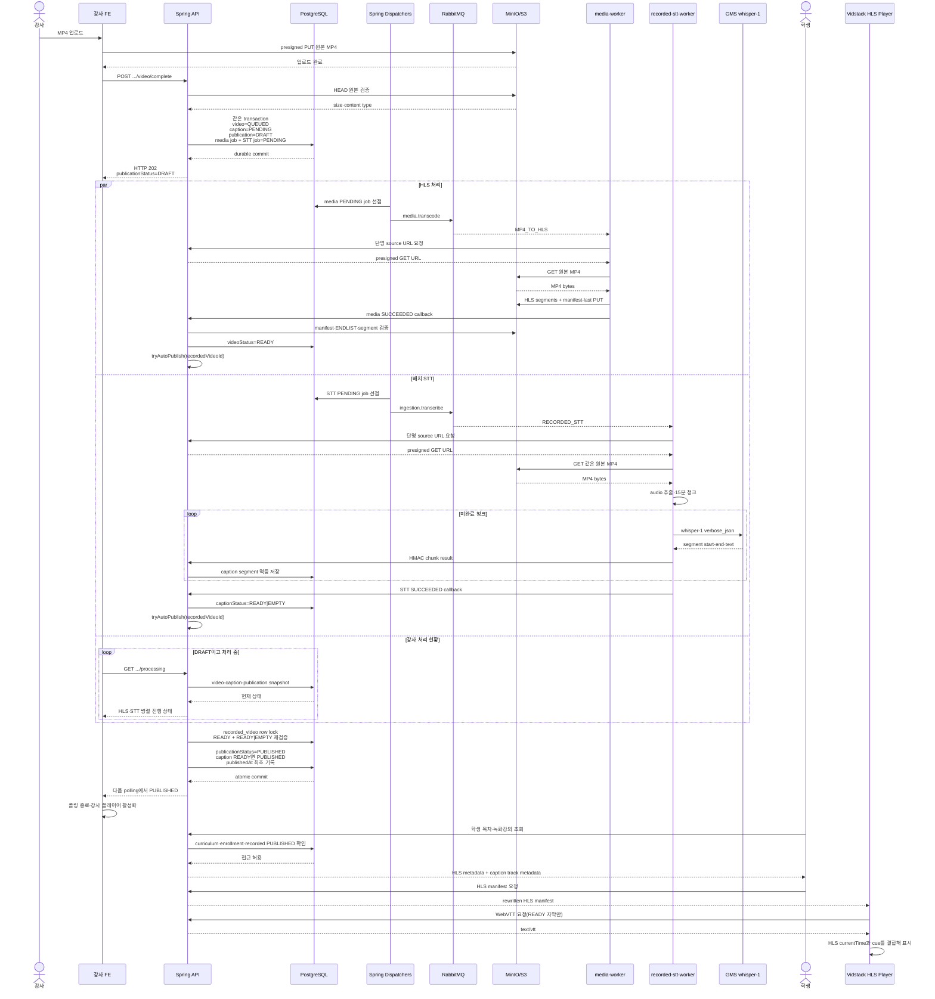

# ADR-0012: 업로드 녹화강의는 HLS와 배치 STT가 모두 끝난 뒤 재생 패키지로 자동 게시한다

> 관련 결정: [ADR-0008 녹화강의 업로드·HLS 변환](0008-recorded-lesson-upload-and-hls-transcoding.md) ·
> [ADR-0009 녹화강의 처리 상태·HLS 재생](0009-recorded-lesson-detail-polling-and-playback.md) ·
> [ADR-0011 GMS Whisper 배치 STT](0011-recorded-lesson-batch-stt-with-gms-whisper.md) ·
> [ADR-0005 레슨에는 초안 상태가 없다](../seominkyeong/0005-lesson-has-no-draft-state.md) ·
> [ADR-0032 학생 HLS 단일 재생](../songjeongki/0032-media-playback-hls-only.md) ·
> [ADR-0017 core/ai 스키마 소유권](../songjeongki/0017-schema-ownership-core-ai.md) ·
> [공유 계약](../../CONTRACT.md)

- **상태**: 채택 — 구현 완료
- **일자**: 2026-08-04
- **적용 범위**: 강사가 업로드한 `RECORDED` 레슨의 HLS·배치 STT 병렬 처리, 녹화강의 전용 게시
  게이트, 자동 게시, 강사 처리 화면, 학생 목차·상세·HLS+WebVTT 재생
- **비적용 범위**: 강사 자막 검수·편집, 자막 수동 게시·철회, 번역·화자 분리, 라이브 스트리밍
  자막 UI 변경, 라이브 Egress 다시보기 공개 정책, 영상에 자막을 구워 넣는 burn-in
- **부분 대체**:
  - ADR-0009의 업로드 녹화강의를 `videoStatus=READY`만으로 재생 가능하게 하는 게이트
  - ADR-0011의 `captionStatus=FAILED`여도 새 업로드 영상을 학생에게 먼저 공개한다는 초기 공개 정책
  - ADR-0011의 새 STT 성공 결과를 강사 검수 전까지 항상 `DRAFT`로만 둔다는 MVP 정책
- **유지**:
  - MP4→HLS와 MP4→STT는 서로 기다리지 않고 독립 queue·worker에서 병렬 처리한다.
  - 영상과 자막은 독립 상태축과 독립 재시도를 유지한다.
  - 원본 MP4와 HLS 파생본을 함께 보존하고, 미디어 bytes는 Spring·RabbitMQ를 통과하지 않는다.
  - `lesson.status=PUBLISHED` 단일 상태와 `curriculum.lifecycleStatus` 중심의 기존 작성·카탈로그 모델은
    바꾸지 않는다.

## 한 줄 결정

강사가 MP4 업로드 완료를 접수하면 Spring은 기존처럼 HLS 변환과 GMS `whisper-1` 배치 STT 작업을
동시에 시작한다. 새 업로드 녹화강의는 `publicationStatus=DRAFT`로 두고, Spring이 검증한
`videoStatus=READY`와 `captionStatus=READY|EMPTY`가 모두 관찰된 시점에만 녹화강의 재생 패키지를
`PUBLISHED`로 원자적으로 전환한다.

`PUBLISHED` 전에는 강사 관리 화면에서 처리 현황과 재시도만 제공하고 강사·학생 playback은 열지 않는다.
`PUBLISHED` 뒤에는 HLS manifest와, 자막이 존재하면 Spring이 `core.recorded_caption_segment`에서 만든
WebVTT track을 같은 playback 응답으로 제공한다. 학생 브라우저는 HLS와 WebVTT를 Vidstack에서
런타임에 결합해 표시하며 영상을 다시 인코딩하지 않는다.

## 왜 이 결정을 추가하는가

ADR-0011 구현은 영상과 자막의 가용성을 완전히 분리했다. 따라서 HLS가 먼저 `READY`가 되면 학생이
영상을 보고, STT가 나중에 끝나면 자막을 추가하는 흐름이었다. 이는 영상 가용성을 우선하지만 업로드
녹화강의를 처음 공개할 때 다음 중간 상태가 학생에게 노출된다.

```text
videoStatus=READY
captionStatus=PENDING|PROCESSING|FAILED
```

업로드 녹화강의에는 라이브와 같은 즉시성이 없다. 강사가 업로드한 뒤 몇 분 더 기다려도 되므로 학생에게
미완성 상태를 노출하기보다 영상과 자막이 함께 준비된 하나의 재생 패키지로 공개하는 편이 제품 기대에
맞는다.

이 결정은 두 처리 작업을 직렬화하지 않는다. HLS 뒤에 STT를 시작하면 전체 준비 시간이 두 작업 시간의
합이 되지만, 병렬 처리 뒤 게시만 기다리면 전체 준비 시간은 대체로 더 오래 걸린 한 작업의 시간이 된다.

```text
직렬 처리: HLS 시간 + STT 시간
병렬 처리와 합류 게이트: max(HLS 시간, STT 시간)
```

## 기존 게시 모델과의 경계

현재 `core.lesson.status`는 `PUBLISHED` 하나뿐이다. 이 값은 레슨이 커리큘럼에 등록된 작성 모델을 뜻하며,
학생 카탈로그 공개 여부는 `core.curriculum.lifecycle_status`가 결정한다. 업로드 녹화강의 하나를 준비하는
동안 `lesson.status`를 `DRAFT→PROCESSING→PUBLISHED`로 되돌리면 라이브 레슨, 목차, 집계 trigger와 기존
API 계약까지 함께 바뀐다.

따라서 새 게이트는 레슨 게시 상태가 아니라 **업로드 녹화강의 재생 패키지 게시 상태**다.

```text
core.lesson.status
  PUBLISHED                         # 기존 계약 유지

core.curriculum.lifecycle_status
  DRAFT | PUBLISHED | ARCHIVED      # 커리큘럼 전체 공개 여부

core.recorded_video.publication_status
  DRAFT | PUBLISHED                 # HLS+자막 패키지의 재생 공개 여부
```

각 상태의 질문은 서로 다르다.

| 상태 | 답하는 질문 |
|---|---|
| `lesson.status` | 이 레슨이 커리큘럼 작성 모델에 포함됐는가? |
| `curriculum.lifecycleStatus` | 커리큘럼이 카탈로그·수강 대상인가? |
| `recordedVideo.status` | HLS 기술 처리가 어디까지 진행됐는가? |
| `captionStatus` | STT 기술 처리가 어디까지 진행됐는가? |
| `recordedVideo.publicationStatus` | 완성된 녹화강의 재생 패키지를 강사·학생에게 열었는가? |

`publicationStatus`라는 이름은 이 문서에서 recorded video 이하의 delivery 공개 상태를 뜻한다. 구현 시
API와 로그에서는 가능하면 `recordedPublicationStatus`처럼 범위를 드러내 기존 curriculum publication과
혼동하지 않게 한다.

## 상태 모델과 불변식

### 1. 업로드 접수

```text
videoStatus                    = QUEUED
captionStatus                  = PENDING
recordedPublicationStatus      = DRAFT
captionPublicationStatus       = NOT_AVAILABLE
```

업로드 완료 트랜잭션은 media job과 STT job을 함께 durable commit하지만 RabbitMQ publish 자체는 각
dispatcher가 담당한다.

### 2. HLS만 먼저 완료

```text
videoStatus                    = READY
captionStatus                  = PENDING|PROCESSING
recordedPublicationStatus      = DRAFT
```

HLS manifest와 segment가 존재해도 강사·학생 playback을 열지 않는다. 강사는 processing API에서 HLS 완료와
STT 진행 상황을 확인한다.

### 3. STT만 먼저 완료

```text
videoStatus                    = QUEUED|TRANSCODING|VERIFYING
captionStatus                  = READY|EMPTY
recordedPublicationStatus      = DRAFT
```

자막 segment는 DB에 보존하지만 HLS가 검증되지 않았으므로 재생 패키지를 공개하지 않는다.

### 4. 자막이 있는 정상 자동 게시

```text
videoStatus                    = READY
captionStatus                  = READY
recordedPublicationStatus      = PUBLISHED
captionPublicationStatus       = PUBLISHED
```

영상·자막 상태 재검증, recorded publication 전이, caption publication 전이와 `publishedAt` 기록은 하나의
DB 트랜잭션에서 수행한다. 학생이 `PUBLISHED`를 관찰했는데 WebVTT가 아직 비공개인 중간 상태를 만들지 않는다.

### 5. 정상 무발화 영상

```text
videoStatus                    = READY
captionStatus                  = EMPTY
recordedPublicationStatus      = PUBLISHED
captionPublicationStatus       = NOT_AVAILABLE
```

`EMPTY`는 audio stream은 유효하지만 GMS가 발화 segment를 만들지 않은 정상 terminal이다. 무음 실습,
화면 시연, 음악만 있는 영상이 영구적으로 게시되지 않는 것을 막기 위해 공개 조건에 포함한다. 학생 playback은
HLS만 제공하고 caption track은 빈 배열이다.

audio stream 자체가 없거나 decode·provider 호출이 실패한 `FAILED`는 `EMPTY`가 아니며 공개를 막는다.

### 6. 처리 실패

```text
videoStatus=FAILED
OR captionStatus=FAILED

recordedPublicationStatus=DRAFT
```

성공한 다른 작업 결과는 되돌리거나 삭제하지 않는다. 강사는 실패한 축만 기존 endpoint로 재시도하고,
재시도 성공 뒤 같은 자동 게시 게이트를 다시 평가한다.

### 7. terminal first-wins

한 번 `PUBLISHED`가 된 녹화강의는 같은 attempt의 늦은 FAILED callback, queue 중복 배달 또는 dispatcher
재처리로 `DRAFT`로 돌아가지 않는다. 게시 철회와 게시 뒤 자막 재생성은 버전·기존 게시본 보존 정책이
필요하므로 후속 범위다.

## 목표 MVP 시퀀스



## 백엔드 설계

### 1. 데이터 모델

`core.recorded_video`에 다음 additive 필드를 둔다.

```text
publication_status varchar(20) NOT NULL DEFAULT 'DRAFT'
  CHECK (publication_status IN ('DRAFT', 'PUBLISHED'))

published_at timestamptz NULL
```

별도 `FAILED` publication 상태를 추가하지 않는다. 무엇이 실패했는지는 이미 `recorded_video.status`,
`recorded_caption_track.status`와 각 `failureCode`가 정확히 표현한다. 게시 상태에 처리 실패를 복제하면
상태 조합이 불필요하게 늘어난다.

`core.recorded_caption_track.publication_status`는 기존 컬럼을 사용한다.

```text
caption READY  + recorded auto publish → PUBLISHED
caption EMPTY  + recorded auto publish → NOT_AVAILABLE
caption FAILED                           → NOT_AVAILABLE
```

### 2. 공통 자동 게시 서비스

media callback과 STT terminal callback이 상태를 성공으로 확정한 뒤 같은 도메인 서비스의 다음 동작을
호출한다.

```text
tryAutoPublish(recordedVideoId)
```

서비스는 다음 순서로 동작한다.

1. `recorded_video`를 `FOR UPDATE`로 잠근다.
2. 이미 `PUBLISHED`이면 최초 `publishedAt`을 보존하고 멱등 성공한다.
3. 현재 HLS 상태가 `READY`인지 확인한다.
4. 연결된 caption track이 `READY|EMPTY`인지 확인한다.
5. `READY` 자막이면 `activeJobId`, segment count와 terminal job 일치를 재검증한다.
6. recorded publication과 caption publication을 같은 트랜잭션에서 확정한다.

두 callback이 동시에 처리될 수 있으므로 둘 모두 동일한 recorded video row를 잠그는 규칙을 지킨다.
한 transaction이 다른 쪽의 아직 commit되지 않은 상태를 보고 게시를 건너뛰는 경우에 대비해 다음도 둔다.

- 각 성공 transaction commit 뒤 다시 `tryAutoPublish`하는 짧은 event handler
- `READY + READY|EMPTY + DRAFT` 조합을 찾는 저빈도 reconciler

reconciler는 새로운 정책을 결정하지 않고 이미 성립한 게시 조건을 복구하는 안전망이다.

### 3. STT 기능은 새 업로드의 필수 선행 조건

이 정책에서는 `RECORDED_STT_ENABLED=false`인 환경에서 새 녹화강의를 접수하면 영원히 `DRAFT`에 남는다.
따라서 새 업로드 ticket을 발급하기 전에 STT 기능 설정을 확인하고 비활성 환경에서는 대용량 업로드를
시작하기 전에 명확하게 거부한다.

```http
HTTP 503
{
  "code": "RECORDED_STT_REQUIRED",
  "message": "녹화강의 자막 생성 기능을 사용할 수 없습니다."
}
```

worker 순간 장애나 GMS 장애는 upload API에서 동기 health check하지 않는다. durable job과 재시도 상태로
처리하고, 최종 실패하면 강사 processing 화면에서 복구한다.

### 4. 재시도

게시 전 실패는 기존 원본 MP4를 사용해 실패한 축만 재시도한다.

```http
POST /api/instructor/recorded-lessons/{lessonId}/processing/retry
POST /api/instructor/recorded-lessons/{lessonId}/captions/retry
```

- HLS 실패 재시도는 성공한 STT segment를 지우지 않는다.
- STT 실패 재시도는 성공한 HLS를 다시 변환하지 않는다.
- 새 attempt가 성공하면 자동 게시 게이트를 다시 평가한다.
- `EMPTY`는 이 결정에서 정상 게시 terminal이므로 게시 뒤 기존 `/captions/retry`로 즉시 active 자막을
  바꾸지 않는다. 게시 뒤 재전사는 기존 게시본을 유지하는 versioned replacement 설계 이후 허용한다.

### 5. playback 접근 게이트

기존 recorded playback의 `videoStatus=READY` 조건을 다음으로 강화한다.

```text
소유 강사 또는 활성 수강생
AND videoStatus=READY
AND recordedPublicationStatus=PUBLISHED
AND captionStatus IN (READY, EMPTY)
```

강사도 이 문서의 요구에 따라 `PUBLISHED` 전에는 실제 playback을 열지 않는다. 단, 강사 전용 processing,
상세 metadata와 재시도 endpoint는 항상 접근할 수 있어야 한다.

학생용 목차·레슨 상세에서도 `deliveryType=RECORDED`는 recorded publication을 확인한다. 이 결정의 기본
UX는 준비 중인 녹화강의를 학생 목차에서 숨기는 것이다. 이전 응답이나 직접 URL로 게시 전 lessonId에
접근해도 playback과 WebVTT를 반환하지 않는다.

### 6. WebVTT 응답

자막을 영상 pixels에 burn-in하거나 HLS `.ts` segment에 다시 mux하지 않는다. Spring은 게시된 active
caption segment를 WebVTT로 직렬화한다.

```http
GET /api/lessons/{lessonId}/recorded-playback/captions/{trackId}.vtt
Content-Type: text/vtt; charset=UTF-8
```

```vtt
WEBVTT

segment-1
00:00:01.250 --> 00:00:05.880
오늘은 스프링 시큐리티를 살펴보겠습니다.

segment-2
00:00:06.100 --> 00:00:10.420
먼저 필터 체인의 구조부터 보겠습니다.
```

endpoint는 recorded playback과 동일한 curriculum·enrollment·publication gate를 다시 검사한다. URL을
추측해도 `DRAFT` track, 과거 inactive job 또는 다른 레슨의 track을 읽을 수 없어야 한다. 자막 version을
ETag 또는 URL query에 반영해 게시본 교체 시 오래된 브라우저 cache와 구분한다.

## 외부 API 계약안

### 1. 강사 processing

기존 응답에 recorded publication을 additive로 제공한다.

```json
{
  "lessonId": "10000000-0000-4000-8000-000000000001",
  "recordedVideoId": "50000000-0000-4000-8000-000000000001",
  "status": "READY",
  "captionStatus": "PROCESSING",
  "captionProcessedChunks": 3,
  "captionTotalChunks": 5,
  "recordedPublicationStatus": "DRAFT",
  "publishedAt": null
}
```

강사 FE의 polling active 조건은 영상 상태 하나가 아니라 다음 합류 조건이다.

```text
recordedPublicationStatus == DRAFT
AND videoStatus 또는 captionStatus가 non-terminal
```

`PUBLISHED`면 폴링을 멈추고 플레이어를 연다. 어느 한쪽이 `FAILED`면 자동 폴링을 멈추고 실패 축에 맞는
재시도 버튼을 제공한다.

### 2. 강사·학생 playback

```http
GET /api/lessons/{lessonId}/recorded-playback
```

`PUBLISHED`에서만 다음 완성 패키지를 반환한다.

```json
{
  "lessonId": "10000000-0000-4000-8000-000000000001",
  "recordedVideoId": "50000000-0000-4000-8000-000000000001",
  "durationMs": 3612000,
  "recordedPublicationStatus": "PUBLISHED",
  "source": {
    "url": "/api/lessons/10000000-0000-4000-8000-000000000001/recorded-playback/manifest",
    "availableFromMs": 0,
    "availableToMs": 3612000
  },
  "captions": {
    "status": "AVAILABLE",
    "tracks": [
      {
        "trackId": "70000000-0000-4000-8000-000000000001",
        "language": "ko",
        "label": "한국어",
        "kind": "subtitles",
        "format": "WEBVTT",
        "url": "/api/lessons/10000000-0000-4000-8000-000000000001/recorded-playback/captions/70000000-0000-4000-8000-000000000001.vtt",
        "version": 1,
        "default": true
      }
    ]
  }
}
```

`captionStatus=EMPTY`로 게시된 경우는 다음과 같다.

```json
{
  "captions": {
    "status": "EMPTY",
    "tracks": []
  }
}
```

학생은 미완성 상태를 polling하지 않는다. 목차에 나타난 녹화강의는 이미 `PUBLISHED`이므로 playback을 한
번 조회해 HLS와 자막을 함께 받는다.

## 프론트 설계

### 1. 강사 처리 화면

현재 녹화강의 상세는 `videoStatus=READY`부터 플레이어를 연지만, 새 흐름에서는 다음 세 단계를 병렬로
보여준다.

```text
원본 업로드          완료
HLS 재생본 생성      진행 중 / 완료 / 실패
AI 자막 생성         대기 / 진행 중 / 완료 / 발화 없음 / 실패
자동 게시            준비 중 / 게시 완료
```

HLS만 먼저 끝난 `READY + PROCESSING + DRAFT`에서도 플레이어를 열지 않는다. 실패 시 강사는 관리 화면에
남아 해당 재시도를 수행한다. 다음 polling에서 `PUBLISHED`를 확인한 뒤에만 recorded playback Query와
공용 HLS player를 활성화한다.

### 2. 학생 화면

학생 목차에는 `recordedPublicationStatus=PUBLISHED`인 업로드 녹화강의만 포함한다. 따라서 학생 화면에
“영상은 되지만 자막 생성 중”이라는 중간 UI와 caption polling을 추가하지 않는다.

학생이 playback에 진입하면 HLS와 WebVTT metadata가 이미 함께 준비돼 있다. WebVTT fetch가 일시 실패해도
HLS 재생까지 중단하지 않고 caption track 오류만 표시하거나 재요청한다.

### 3. Vidstack 연결

공용 `HlsMediaPlayer`는 caption track 목록을 optional prop으로 받는다.

```tsx
<MediaPlayer src={{ src: sourceUrl, type: 'application/vnd.apple.mpegurl' }}>
  <MediaProvider>
    {captionTracks.map((track) => (
      <Track
        key={`${track.trackId}-${track.version}`}
        src={track.url}
        kind="subtitles"
        label={track.label}
        lang={track.language}
        default={track.default}
      />
    ))}
  </MediaProvider>
  <DefaultVideoLayout icons={defaultLayoutIcons} />
</MediaPlayer>
```

HLS와 WebVTT는 서로 다른 HTTP resource지만 플레이어 `currentTime`을 공유한다. STT worker가 이미 원본
MP4 0ms 기준으로 저장한 `startMs/endMs`와 업로드 VOD의 `availableFromMs=0`이 일치하므로 라이브 자막의
세션 offset이나 STT 방출 지연 보정을 적용하지 않는다.

## 라이브 HLS 자막과의 차이

이번 결정은 녹화강의 UI를 라이브와 같게 만들지 않는다.

| 구분 | 라이브 강의 현재 구현 | 업로드 녹화강의 |
|---|---|---|
| STT 입력 | 실시간 audio stream | 완료된 원본 MP4 |
| 전달 | WS `caption.delta`·`segment.final` | 게시된 WebVTT REST |
| 시간축 | session-ms, HLS `availableFromMs` 보정 | 원본 영상 0ms |
| STT 지연 | 방출 시각 기반 약 1.5초 보정 | 완료 segment timestamp, 보정 없음 |
| 렌더링 | 플레이어 아래 React `CaptionDock` | Vidstack `Track` 플레이어 overlay |
| 복구 | REST snapshot + WS 재구독 | WebVTT 재요청 |
| 학생 진입 | 라이브 도중 계속 변함 | 완성 패키지 게시 뒤 진입 |

라이브의 델타 누적기와 CaptionDock을 녹화강의에 재사용하지 않는다. batch STT 결과는 이미 완결된 구간이므로
표준 WebVTT와 player text track이 더 단순하고 정확하다.

## 실패·재시도 정책

| 조합 | recorded publication | 강사 화면 | 학생 노출 |
|---|---|---|---|
| HLS 처리 중 + STT 처리 중 | `DRAFT` | 두 작업 진행 표시 | 숨김 |
| HLS `READY` + STT 처리 중 | `DRAFT` | 자막 대기 | 숨김 |
| HLS 처리 중 + 자막 `READY` | `DRAFT` | HLS 대기 | 숨김 |
| HLS `READY` + 자막 `READY` | `PUBLISHED` | 플레이어 활성화 | HLS+WebVTT |
| HLS `READY` + 자막 `EMPTY` | `PUBLISHED` | 플레이어 활성화·발화 없음 | HLS만 |
| HLS `FAILED` + 자막 성공 | `DRAFT` | HLS 재시도 | 숨김 |
| HLS 성공 + 자막 `FAILED` | `DRAFT` | STT 재시도 | 숨김 |

GMS 장기 장애는 새 녹화강의의 학생 공개를 지연시킨다. 이는 이 결정이 의도적으로 선택한 품질 게이트다.
운영에서 게시 지연이 허용 범위를 넘으면 “자막 없이 예외 게시”를 후속 ADR로 추가할 수 있지만 MVP에는
조용한 fail-open을 넣지 않는다.

## 동시성·멱등성과 관측성

### 동시성·멱등성

- media와 STT 성공 callback은 어느 순서로 와도 같은 `PUBLISHED` 상태로 수렴한다.
- 같은 callback의 중복 전달은 `publishedAt`, active caption job과 track version을 바꾸지 않는다.
- 한 축의 늦은 실패는 이미 성공한 축이나 이미 게시된 delivery를 되돌리지 않는다.
- `PUBLISHED` 전이 transaction 실패는 callback 재전송 또는 reconciler가 복구한다.
- WebVTT는 `captionTrack.activeJobId`에 속한 segment만 시간순으로 직렬화한다.

### 운영 지표

최소 다음을 기록한다.

```text
recorded_delivery_publish_wait_seconds
recorded_delivery_auto_publish_total
recorded_delivery_publish_blocked_total{reason=video|caption}
recorded_delivery_stuck_draft_total
recorded_caption_vtt_request_total{result=success|forbidden|not_found|error}
```

로그에는 lesson·recordedVideo·job·track ID와 안정 failure code만 남기고 원문 자막과 GMS key를 남기지 않는다.

## 기존 데이터와 배포

새 정책은 migration 이후 접수되는 업로드 녹화강의에 적용한다. 이미 학생이 재생 중인 기존
`recorded_video.status=READY`를 일괄 `DRAFT`로 내려 서비스에서 사라지게 하지 않는다.

초기 migration은 기존 `READY` row를 `PUBLISHED`로 backfill하고 `publishedAt`은 기존 `readyAt`을
사용한다. 이 legacy row는 자막이 없을 수 있는 호환 예외다. 새 row는 기본 `DRAFT`이며 HLS+STT 합류
게이트 외의 경로로 `PUBLISHED`에 도달하지 않는다.

엄격한 자막 정책을 기존 row에도 적용하려면 별도 backfill STT job으로 자막을 먼저 만든 뒤 전환해야 하며,
이 ADR의 자동 migration 범위에는 포함하지 않는다.

배포 순서는 다음과 같다.

1. additive DB migration과 backward-compatible 응답 필드 배포
2. 자동 게시 서비스·reconciler와 playback gate 배포
3. WebVTT endpoint와 FE `Track` 지원 배포
4. 학생 목차 recorded publication 필터 배포
5. `RECORDED_STT_ENABLED=true`와 worker 준비 확인
6. 새 업로드 자동 게시 정책 활성화

FE가 caption 필드를 모르는 동안에도 기존 필드를 그대로 읽을 수 있어야 하고, 학생 목차 필터와 playback
gate는 같은 배포 단위에서 켜 공개됐지만 진입할 수 없는 불일치를 피한다.

## 고려했지만 선택하지 않은 방식

### 1. HLS가 READY면 먼저 공개하고 자막은 나중에 붙인다

영상 가용성은 높지만 학생이 같은 레슨을 열었을 때 시점에 따라 자막 유무가 달라진다. 업로드 녹화강의는
즉시성이 없고 완성본 공개가 우선이라는 제품 결정과 맞지 않아 기각한다.

### 2. HLS가 끝난 뒤 STT를 시작한다

공개 조건은 같지만 처리 시간이 직렬 합산되고 HLS 실패가 STT까지 막는다. 같은 검증된 원본 MP4를
독립적으로 읽을 수 있으므로 병렬 처리 뒤 합류한다.

### 3. `lesson.status`에 DRAFT·PROCESSING을 다시 추가한다

현재 레슨은 상태가 `PUBLISHED` 하나이고 커리큘럼이 카탈로그 공개를 소유한다. 업로드 media readiness를
위해 모든 라이브·녹화 레슨 작성 계약과 DB trigger를 되돌리는 변경은 범위가 지나치게 크므로 기각한다.

### 4. 자막을 영상에 burn-in해 새 HLS를 만든다

자막 수정·다국어·끄기·접근성 선택을 잃고 STT 결과마다 HLS를 다시 인코딩해야 한다. WebVTT text track은
같은 UI 합성을 더 낮은 비용으로 제공하므로 기각한다.

### 5. 라이브 CaptionDock과 WebSocket 계약을 녹화강의에도 사용한다

완성된 batch segment를 delta처럼 재생할 이유가 없고 재연결·누적 상태가 불필요하다. 녹화강의는
WebVTT track으로 표시하며 라이브 UI를 그대로 맞추지 않는다.

## 구현 완료 조건

다음이 모두 충족돼야 이 ADR 구현을 완료로 선언한다.

1. 새 업로드가 `DRAFT`로 시작하고 HLS+STT가 병렬 실행된다.
2. `READY + READY|EMPTY`에서만 recorded delivery가 원자적으로 `PUBLISHED`가 된다.
3. HLS 또는 STT 실패 시 학생 목차·상세·playback에 노출되지 않고 강사는 실패와 재시도를 본다.
4. 게시 전 강사·학생 playback과 WebVTT 직접 접근이 거부된다.
5. 게시된 `READY` 자막은 HLS playback 응답의 WebVTT track으로 표시된다.
6. `EMPTY`는 HLS만 게시하고 `FAILED`와 구분된다.
7. callback 중복·동시 완료·게시 transaction 재시도를 포함한 계약 테스트가 통과한다.
8. FE HTTP·Mock이 같은 camelCase 계약을 만족하고, PUBLISHED 전에는 플레이어를 열지 않는다.
9. 영상 재생은 자막 track fetch 일시 장애로 중단되지 않는다.
10. 기존 READY 녹화강의의 접근성이 migration으로 갑자기 사라지지 않는다.

필수 테스트 행렬은 최소 다음을 포함한다.

```text
HLS first / STT first / simultaneous completion
READY+READY / READY+EMPTY / video FAILED / caption FAILED
duplicate media callback / duplicate STT terminal / publish transaction retry
owner instructor / enrolled student / unenrolled student
pre-publish playback / pre-publish VTT / published HLS+VTT
student outline hide-before-publish / reveal-after-publish
```
