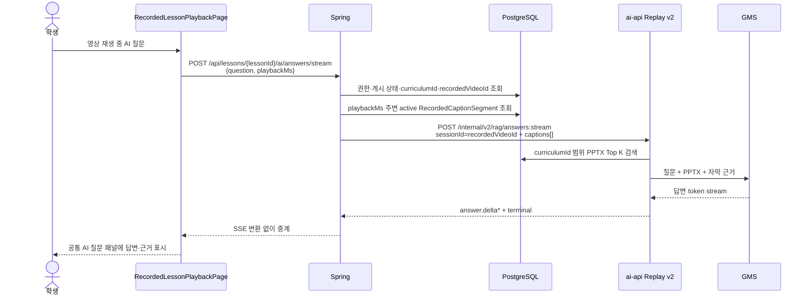

# ADR-0015: 녹화강의 AI 질문은 Replay v2의 `sessionId` 슬롯에 `recordedVideoId`를 사용한다

- 상태: 승인
- 작성일: 2026-08-04
- 관련 결정: [0010](0010-recorded-lesson-pptx-embedding-and-key-term-extraction.md), [0011](0011-recorded-lesson-batch-stt-with-gms-whisper.md), [0012](0012-recorded-lesson-hls-caption-auto-publication.md), [Replay v2 계약](../canola/0042-replay-ai-caption-context-contract.md)

## 배경

업로드 녹화강의는 다음 준비를 마쳤다.

- 레슨 PPTX는 라이브 레슨과 같은 `PPTX_EMBED` 파이프라인으로 pgvector에 저장된다.
- Whisper STT 결과는 `core.recorded_caption_segment`에 원본 영상 0ms 상대 시간으로 저장된다.
- HLS와 자막이 모두 terminal이면 `recorded_video.publication_status=PUBLISHED`로 자동 게시된다.
- ai-api에는 Spring이 전달한 과거 자막과 기존 PPTX 검색을 합쳐 답하는
  `POST /internal/v2/rag/answers:stream`이 이미 구현되어 있다.

남은 연결 문제는 Replay v2가 `sessionId`를 필수 UUID로 받지만 업로드 녹화강의에는
`live_session`이 없고 `recordedVideoId`가 있다는 점이다. ai-api v2는 이 값으로 Spring DB의
라이브 세션을 조회하지 않는다. PPTX는 `curriculumId`로 검색하고, 자막은 요청의 `captions[]`를
사용하며, `sessionId`는 자막 source의 요청 범위 식별값으로만 사용한다.

## 결정

업로드 녹화강의가 Replay v2를 호출할 때 기존 wire를 변경하지 않고 다음과 같이 매핑한다.

```text
Replay v2 request.sessionId = recordedVideo.id
Replay v2 context.mode      = "REPLAY"
questionSessionMs           = 녹화 영상의 playbackMs
captions[]                  = active recorded_caption_segment를 변환한 값
```

`sessionId`라는 JSON 필드명은 유지하지만, 녹화강의 요청 안에서는 **ai-api가 신뢰하는 VOD 자막
범위 ID 슬롯**으로 사용한다. 이 결정은 내부 Spring→ai-api 경계에만 적용한다. `recordedVideoId`를
실제 `LiveSessionRepository`, 라이브 접근 게이트, 라이브 채팅·노트 또는 `live_ai_answer`의 FK로
사용하지 않는다.

브라우저 공개 요청은 내부 ID를 받지 않는다.

```http
POST /api/lessons/{lessonId}/ai/answers/stream
Accept: text/event-stream
Content-Type: application/json

{"question":"여기서 설명한 consumer group이 뭐야?","playbackMs":735000}
```

Spring은 인증 사용자와 path의 `lessonId`로 다음 값을 직접 확정한다.

- 소유 강사 또는 활성 수강생인지
- `videoStatus=READY AND recordedPublicationStatus=PUBLISHED`인지
- 실제 `recordedVideoId`와 `curriculumId`
- 게시된 active caption track/job
- 질문 시점을 포함하는 발화와 그 이전 최대 30초의 자막

자막은 질문 뒤에 시작한 발화를 제외하고 가까운 순서 기준 최대 20개, `text` 합계 최대 6,000자로
제한한다. 자막이 없어도 빈 `captions[]`로 PPTX 검색을 계속한다.

## 목표 흐름



## 화면 결정

학생 녹화강의는 전용 route/page를 유지하되 라이브·다시보기에서 검증된 다음 컴포넌트를 조합한다.

- 공통 `HlsMediaPlayer`
- 공통 `CaptionDock`
- 공통 `LearningSidebar`
- 공통 `PersonalAiQuestionPanel`
- 공통 용어집 매핑

업로드 녹화강의에는 라이브 당시 채팅과 실시간 강의 노트가 없으므로 초기 화면은 `AI 질문`과
`핵심 용어` 탭만 노출한다. 자막은 WebVTT track과 구조화된 caption dock을 함께 제공하며, AI가 반환한
CAPTION source의 `startSessionMs`는 녹화 영상의 `startPlaybackMs`와 같은 축으로 해석할 수 있다.
기본 표시는 라이브와 같은 caption dock으로 하고 native WebVTT overlay는 기본 off로 두되 플레이어
설정에서 선택할 수 있게 유지한다. 두 자막이 동시에 기본 표시되는 것을 막기 위함이다.

## 대안 검토

### AI 질문용 빈 `live_session` 생성

채택하지 않는다. 라이브 일정·상태·채팅·노트·통계·다시보기 선택에 가짜 세션이 섞이고,
`RECORDED` 레슨에 라이브 상태 전이 불변식을 우회하게 된다.

### 모든 `sessionId`를 `lessonId`로 교체

채택하지 않는다. 정상 동작 중인 Live v1, Redis 자막 scope, 라이브 질문 이력과 FE 경로까지 바뀐다.
또한 `lessonId`는 특정 영상/자막 버전을 식별하지 못한다.

### Replay v2에 `RECORDED + recordedVideoId` 신규 wire 추가

의미는 가장 명확하지만 현재 ai-api v2의 요청·검증·source·테스트와 Spring 양쪽 계약을 바꿔야 한다.
현재 v2가 `sessionId`를 외부 조회 키로 사용하지 않으므로 MVP 변경량에 비해 이점이 작다. 향후 Live replay와
업로드 VOD를 하나의 정식 계약으로 승격할 때 `mediaType + mediaId`로 교체한다.

## 결과와 제약

- ai-api의 PPTX 검색, GMS 호출, SSE event와 Replay v2 테스트 자산을 그대로 재사용한다.
- Spring에는 Replay v2 HTTP client, 녹화 자막 변환/선별, 공개 SSE 프록시가 추가된다.
- 질문 이력은 이번 결정 범위에서 서버에 저장하지 않는다. 화면 생명주기 동안 기존 AI 패널 메모리에 유지한다.
- `answer.done.sources[].sessionId`는 녹화강의 응답에서 실제로 `recordedVideoId`다. FE는 이를 라이브 세션
  조회에 사용하지 않고, `startSessionMs/endSessionMs`만 녹화 HLS 시간축으로 사용한다.
- wire 필드의 의미 재사용은 내부 호환 전략이다. 외부 API와 DB에서 녹화 영상을 `live_session`으로 가장하지 않는다.

## 검증

공유 경계를 넘는 JSON·SSE이므로 다음 계약 테스트를 둔다.

- Spring 공개 요청 `{question,playbackMs}`와 인가·게시 게이트
- Spring→ai-api v2 정확한 필드 집합, HMAC 원시 body 서명, `sessionId=recordedVideoId`
- `RecordedCaptionSegment → captions[]` 시간·개수·문자 예산
- ai-api SSE의 브라우저 무변환 릴레이
- FE POST 경로·body·SSE event 및 자막 source 시간 정규화
