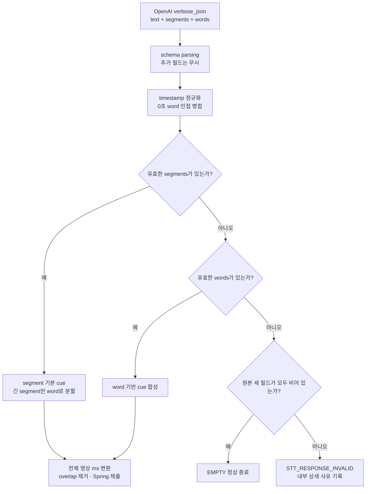

# ADR-0017: 녹화강의 자막은 segment 우선·word 보정으로 합성한다

> 정본 규칙: [AGENTS.md](../../../AGENTS.md) · 공유 계약: [CONTRACT.md](../../CONTRACT.md) ·
> 판단 정책: [POLICY.md](../../harness/POLICY.md) · 관련 결정:
> [ADR-0011 녹화강의 batch STT](0011-recorded-lesson-batch-stt-with-gms-whisper.md) ·
> [ADR-0012 녹화강의 자동 게시](0012-recorded-lesson-hls-caption-auto-publication.md)

- **상태**: 채택
- **일자**: 2026-08-05
- **적용 범위**: `recorded-stt-worker`의 OpenAI 전사 응답 해석, 타임스탬프 정규화,
  발화 cue 합성, 상세 실패 진단
- **비적용 범위**: OpenAI provider·`whisper-1` 교체, 15분 청크와 1초 overlap 정책 변경,
  Spring callback JSON·DB 스키마·학생 자막 API 변경, 강사 자막 편집, 화자 분리

## 맥락 (Context)

[ADR-0011](0011-recorded-lesson-batch-stt-with-gms-whisper.md)은 공식 OpenAI
`/v1/audio/transcriptions`에 `whisper-1`, `verbose_json`, word timestamp를 요청하고, 반환된 단어의
`start/end`를 묶어 녹화강의 자막 cue를 만드는 구조를 채택했다. 이 구조는 전체 문자열만 반환하던
경로와 달리 자막을 발화 시간에 맞춰 표시할 수 있다.

실제 녹화강의 처리에서는 OpenAI가 HTTP 200과 정상 전사문을 반환했는데도 작업이
`STT_RESPONSE_INVALID`로 끝났다. 실패 작업은 Spring에 청크 결과를 하나도 제출하지 못했고
`processedChunkCount=0`이었다.

동일한 13.664초 입력 청크를 같은 옵션으로 다시 요청해 다음 응답을 확인했다.

```json
{
  "task": "transcribe",
  "language": "korean",
  "duration": 13.649999618530273,
  "text": "안녕하세요. 이 영상은 테스트 영상입니다. 자막이 잘 생성되는지 확인하기 위한 테스트용 영상입니다. 감사합니다.",
  "words": [
    {"word": "안녕하세요", "start": 0.0, "end": 2.0199999809265137},
    {"word": "이", "start": 2.9600000381469727, "end": 2.9600000381469727},
    {"word": "영상은", "start": 2.9600000381469727, "end": 3.5999999046325684}
  ]
}
```

두 번째 word `이`는 비어 있지 않은 정상 전사 토큰이지만 `start == end`라 길이가 0초다. 기존
worker는 provider 응답 검증과 전체 영상 millisecond 변환에서 모두 `end <= start`를 치명적 오류로
판단한다. 따라서 복구 가능한 word 하나 때문에 정상 `text`와 나머지 12개 word를 포함한 응답 전체를
폐기했다.

이 응답에서 다음 특성도 확인했다.

- `text`에는 전체 전사문과 문장부호가 있지만 각 문장의 시간이 없다.
- `words`에는 정밀한 시간이 있지만 문장부호가 빠질 수 있다.
- word timestamp에는 `start == end` 같은 경계값이 포함될 수 있다.
- 현재 요청은 `timestamp_granularities[]=word`만 보내므로 정상 응답에도 `segments`가 없다.

OpenAI Audio Transcriptions API는 `verbose_json`에서 `word`와 `segment` timestamp를 각각 또는 함께
요청할 수 있다. segment timestamp에는 추가 지연이 없고 word timestamp에는 추가 지연이 있다는
제약은 [공식 API 참조](https://developers.openai.com/api/reference/resources/audio/subresources/transcriptions/methods/create)를
따른다. 현재 경로는 이미 word timestamp 비용을 지불하므로 segment를 함께 받는 것은 응답 데이터가
증가하는 변경이지 word timestamp 지연을 새로 추가하는 변경이 아니다.

## 문제 정의

현재 구현은 서로 다른 목적의 provider 필드를 하나의 엄격한 word 계약으로 축약한다.

| provider 필드 | 실제 의미 | 현재 사용의 한계 |
|---|---|---|
| `text` | 전체 전사문 | 시간이 없어 단독으로 동기화 자막을 만들 수 없음 |
| `segments[]` | 시작·종료 시간이 있는 provider 발화 묶음 | 현재 요청·응답 모델에서 받지 않음 |
| `words[]` | 단어별 정밀 시작·종료 시간 | 0초 word 하나도 전체 실패시키고 문장부호가 빠질 수 있음 |

해결해야 할 문제는 모델을 바꾸는 것이 아니라 다음 세 가지다.

1. 정상 segment가 있으면 일부 word 경계값 때문에 전체 작업을 실패시키지 않는다.
2. segment가 너무 길 때에만 word를 사용해 화면에 적합한 cue로 더 나눈다.
3. 실제로 타임스탬프를 신뢰할 수 없는 응답과 음성이 없는 정상 응답을 구분한다.

## 결정 (Decision)

### 1. text·segments·words의 역할을 분리한다

녹화강의 STT는 세 필드를 다음 역할로 사용한다.

- `text`: 청크 전체 전사 유무 확인과 다음 청크 prompt tail의 원본이다. 시간 자막의 직접 source로
  사용하지 않는다.
- `segments`: 화면에 표시할 기본 자막 문장과 provider 시간 경계다.
- `words`: 긴 segment의 안전한 분할, pause 탐지, 청크 overlap 소유권과 정밀 시간 경계에 사용한다.

`text`만으로 자막 시간을 길이 비율이나 글자 수에 따라 추정하지 않는다. 그 추정은 실제 발화와 무음
구간을 알 수 없어 전체 문장을 잘못된 시간에 표시한다.

### 2. word와 segment timestamp를 함께 요청한다

worker의 multipart 요청은 timestamp 배열 값을 두 번 보낸다.

```text
POST /v1/audio/transcriptions
model=whisper-1
language=ko
response_format=verbose_json
timestamp_granularities[]=segment
timestamp_granularities[]=word
```

응답 모델은 provider가 반환하는 추가 필드를 계속 무시하되 다음 필드를 명시적으로 수용한다.

```text
WhisperResult
  duration: float
  text: string
  segments: WhisperSegment[] = []
  words: WhisperWord[] = []

WhisperSegment
  start: float
  end: float
  text: string

WhisperWord
  start: float
  end: float
  word: string
```

`segments`와 `words`는 요청했더라도 fallback 판단을 위해 선택 배열로 파싱한다. 필드 부재 자체를
Pydantic schema 오류로 즉시 바꾸지 않고, 파싱 뒤 사용할 수 있는 타임스탬프가 있는지 판단한다.

### 3. segment를 기본 자막으로 사용한다

유효한 segment는 다음 불변식을 만족한다.

```text
start와 end가 finite number다.
0 <= start < end다.
text.strip()이 비어 있지 않다.
청크 duration과 기존 2초 경계 허용 범위를 심하게 벗어나지 않는다.
```

유효한 segment가 최대 6초·42자 이내면 `segment.text`와 시간을 그대로 cue로 사용한다. 이 경로는
provider의 문장부호와 띄어쓰기를 보존한다.

segment가 6초 또는 42자를 넘고 그 범위에 유효한 words가 있으면 words의 순서·pause·시간을 사용해
더 작은 cue로 나눈다. 분할 경계는 다음 우선순위를 따른다.

1. provider segment 경계
2. 문장 종결 부호
3. 인접 word 사이 500ms 이상 pause
4. cue 최대 6초
5. cue 목표 최대 42자

word는 분할 지점과 시간만 결정하고 화면 문자열의 source of truth는 `segment.text`다. segment text와
word를 순서대로 정렬해 word 사이의 문장부호를 앞 cue에 포함한다. 정렬에 실패하면 전사문을 잃거나
임의의 시간을 만들지 않고 원래 segment 하나를 유지한다. 긴 자막 한 개가 자막 전체 실패보다 낫다.

### 4. 0초 word는 인접 word에 병합한다

`start == end`인 비어 있지 않은 word는 치명적 응답 오류가 아니라 시간 anchor가 부족한 전사 토큰으로
분류한다.

정규화는 provider 순서를 바꾸지 않고 다음 순서로 수행한다.

1. 다음 유효 word가 같은 시점에 시작하면 현재 text를 다음 word의 prefix로 병합한다.
2. 그렇지 않고 이전 유효 word의 끝과 같은 시점이면 이전 word의 suffix로 병합한다.
3. 정상 segment가 있으면 해당 word를 시간 anchor에서만 제외하고 `segment.text`로 화면 text를
   보존한다.
4. segment가 없는 word-only fallback에서는 가장 가까운 유효 이웃에 병합한다.
5. 병합할 이웃도 없으면 이 word만 사용할 수 없는 것으로 표시한다. 전체 응답의 성공 여부는 남은
   유효 segment/word로 판단한다.

이번 실제 응답은 다음과 같이 정규화한다.

```text
입력
  이       2.960 ~ 2.960
  영상은   2.960 ~ 3.600

정규화
  이 영상은 2.960 ~ 3.600
```

`end < start`, non-finite timestamp, 큰 음수, 청크 범위를 심하게 벗어난 timestamp는 같은 방식으로
억지 보정하지 않고 해당 segment/word를 사용할 수 없는 것으로 분류한다.

### 5. fallback은 네 분기로 제한한다

모든 provider 조합을 별도 상태 머신으로 만들지 않고 다음 순서로 한 번만 판단한다.

```text
1. 사용할 수 있는 segments가 있는가?
   -> segments로 cue를 만든다.
   -> words가 충분하면 긴 segment만 더 나눈다.

2. segments는 없지만 사용할 수 있는 words가 있는가?
   -> words를 정규화하고 기존 cue 정책으로 묶는다.

3. 원본 text, segments, words가 모두 비어 있는가?
   -> 음성 없음으로 EMPTY 성공한다.

4. text가 있거나 timestamp 배열이 왔지만 사용할 수 있는 timestamp가 없는가?
   -> STT_RESPONSE_INVALID로 실패한다.
```

의사 코드는 다음과 같다.

```python
segments = normalize_segments(response.segments, response.duration)
words = normalize_words(response.words, segments, response.duration)

if segments:
    return build_from_segments(segments, words)
if words:
    return build_from_words(words, response.text)
if not response.text.strip() and not response.segments and not response.words:
    return EMPTY
reason = "TIMESTAMPS_MISSING" if response.text.strip() else "TIMESTAMPS_INVALID"
raise SttResponseInvalid(reason=reason)
```

외부 Spring callback의 안정된 `failureCode`는 기존 `STT_RESPONSE_INVALID`를 유지한다.
`TIMESTAMPS_MISSING`, `TIMESTAMPS_INVALID` 같은 세부 사유는 worker
내부 진단값이며 공유 API enum을 늘리지 않는다.

### 6. 최종 cue 불변식을 한 곳에서 검증한다

provider 응답이 어떤 fallback을 탔든 Spring으로 보내기 전에 모든 cue가 다음을 만족해야 한다.

```text
text.strip()은 비어 있지 않다.
0 <= startMs < endMs다.
cue 순서는 startMs 기준 단조 증가한다.
청크 overlap 소유권을 적용한 뒤 같은 발화를 중복 제출하지 않는다.
sourceEndMs 밖의 미세한 끝값은 sourceEndMs로 제한한다.
localSegmentIndex는 0부터 빈틈없이 증가한다.
```

최종 cue 자체가 0ms가 되거나 역전되면 해당 cue를 저장하지 않는다. 정상 cue가 남아 있으면 청크를
성공 처리하고, 전사 text는 있는데 정상 cue가 하나도 없으면 `STT_RESPONSE_INVALID`로 실패한다.

## 목표 처리 흐름



## 이번 재현 입력의 목표 결과

현재 정책과 실제 응답을 적용하면 다음 네 cue가 생성돼야 한다.

```json
[
  {"startMs": 0, "endMs": 2020, "text": "안녕하세요."},
  {"startMs": 2960, "endMs": 4860, "text": "이 영상은 테스트 영상입니다."},
  {
    "startMs": 5740,
    "endMs": 9400,
    "text": "자막이 잘 생성되는지 확인하기 위한 테스트용 영상입니다."
  },
  {"startMs": 11240, "endMs": 11560, "text": "감사합니다."}
]
```

두 번째 cue의 `이`는 0초 word였지만 인접 `영상은`과 같은 시작점을 사용하므로 내용과 시간이 모두
보존된다.

## 관측 가능성과 개인정보 경계

응답 원문과 강의 음성, API key는 로그에 남기지 않는다. 성공 정규화 로그는 다음 집계만 포함한다.

```json
{
  "event": "stt_response_normalized",
  "wordCount": 13,
  "segmentCount": 4,
  "zeroDurationWordCount": 1,
  "mergedWordCount": 1,
  "discardedWordCount": 0,
  "fallbackMode": "SEGMENT_PRIMARY"
}
```

실패 로그는 전사 text 대신 stage·reason·index·숫자 timestamp만 남긴다.

```json
{
  "event": "stt_response_rejected",
  "stage": "TIMESTAMP_NORMALIZATION",
  "reason": "TIMESTAMPS_MISSING",
  "wordCount": 0,
  "segmentCount": 0
}
```

이 진단 정보는 Spring callback wire에 추가하지 않는다. worker log/metric으로만 사용한다.

## 대안 (Alternatives)

| 대안 | 판단 |
|---|---|
| `text`만 사용 | 기각. 문장별 시간이 없어 전체 자막이 한꺼번에 표시되는 원래 문제를 재발시킨다. |
| word-only 엄격 검증 유지 | 기각. 실제로 확인된 0초 word 하나가 정상 응답 전체를 폐기한다. |
| `end == start` 조건만 무조건 허용 | 기각. 고립된 0초 word가 최종 0ms cue가 될 수 있어 인접 병합과 최종 불변식이 필요하다. |
| segment만 사용 | 기각. provider가 연속 발화를 긴 segment 하나로 반환하면 화면용 cue 길이를 제어할 수 없다. |
| segment 우선 + word 보정(채택) | 문장부호·기본 시간은 segment로 보존하고 긴 구간만 word로 정밀 분할한다. |
| 다른 STT 모델로 즉시 교체 | 기각. 이번 장애는 정상 provider 경계값을 worker가 과도하게 거부한 후처리 문제다. |

## 영향·후속 (Consequences)

- Spring callback의 `segments[]`, FE 자막 응답, DB schema는 바뀌지 않는다.
- OpenAI 응답 모델에는 `segments[]`가 추가되고 multipart 배열 encoding을 계약 테스트로 고정한다.
- word 하나의 결함이 전체 녹화강의 실패로 확대되는 빈도가 줄어든다.
- 정상 segment가 있으면 문장부호와 띄어쓰기를 보존한다.
- segment text와 word를 정렬하는 코드와 fallback 테스트가 추가돼 worker 내부 복잡도는 늘어난다.
- 긴 segment의 word 정렬이 실패하면 분할 품질은 낮아질 수 있지만 timed segment 자체는 보존한다.
- OpenAI 응답 크기가 증가한다. word timestamp 지연은 기존 경로에 이미 존재하고 segment timestamp에는
  공식 문서상 추가 지연이 없다.
- 기존에 `STT_RESPONSE_INVALID`로 실패한 게시 전 녹화강의는 worker 배포 후 기존 자막 재처리 API로
  다시 발행한다. DLQ 메시지를 수동 삭제해 성공으로 가장하지 않는다.

## 구현 경계

구현은 다음 책임으로 나눈다.

```text
openai_whisper.py
  - word + segment 요청
  - provider JSON schema parsing
  - HTTP/retry/failure code 경계

transcription_normalizer.py
  - segment/word timestamp 유효성 분류
  - 0초 word 인접 병합
  - fallback 입력 생성과 상세 진단 집계

caption_cues.py
  - segment 기본 cue
  - 긴 segment의 word 기반 분할
  - 최종 cue 불변식

handler.py
  - 청크 상대 시간을 녹화강의 전체 ms로 변환
  - overlap 소유권과 Spring 청크 제출
```

provider raw response, API key와 전사 원문을 파일·DB·RabbitMQ에 새로 저장하지 않는다.

## 검증 (Verification)

이번 변경은 OpenAI 외부 응답과 worker 내부 처리 경계에 걸리므로 단위·adapter 계약 테스트를 둔다.
Spring callback wire는 바꾸지 않으므로 FE/BE 공유 계약 테스트 추가는 필요하지 않다.

필수 fixture와 기대 결과는 다음과 같다.

| fixture | 기대 결과 |
|---|---|
| 실제 재현: `이 2.96~2.96`, 다음 `영상은 2.96~3.60` | `이 영상은 2.96~3.60`으로 병합, 전체 성공 |
| 정상 segments + 일부 잘못된 words | segments로 성공, 잘못된 word 집계 |
| segments 없음 + 정상 words | word 기반 cue로 성공 |
| text·segments·words 모두 빈 응답 | `EMPTY` 정상 종료 |
| text는 있지만 usable timestamp 없음 | `STT_RESPONSE_INVALID`, 내부 `TIMESTAMPS_MISSING` |
| text는 비었지만 timestamp 배열이 모두 unusable | `STT_RESPONSE_INVALID`, 내부 `TIMESTAMPS_INVALID` |
| 6초 또는 42자 초과 segment + 정상 words | pause·길이 정책으로 다중 cue 생성 |
| 긴 segment + word/text 정렬 실패 | 원래 timed segment를 보존해 성공 |
| non-finite·역전·큰 범위 초과 timestamp만 존재 | 실패하고 상세 reason만 로그 |
| 15분 청크의 1초 overlap 중복 word | 이전 청크 소유권 유지, 중복 cue 없음 |
| 모든 생성 경로 | `0 <= startMs < endMs`, 정렬·연속 local index 만족 |

변경한 `ai-worker`에서는 다음 완료 게이트를 실행한다.

```bash
cd ai/ai-worker
uv run --frozen pytest -q -p no:cacheprovider
uv run --frozen ruff check app tests
```

문서 링크와 ADR 번호 충돌 검사는 루트에서 실행한다.

```bash
node docs/harness/templates/check-links.mjs
bash scripts/check-version-collisions.sh
```

테스트 채택 근거는 실제 provider의 정상 HTTP 200 응답이 worker의 내부 해석 때문에 전체 실패한 회귀가
이미 발생했고, 녹화강의 자막 전달은 CP 핵심 경로이기 때문이다.
