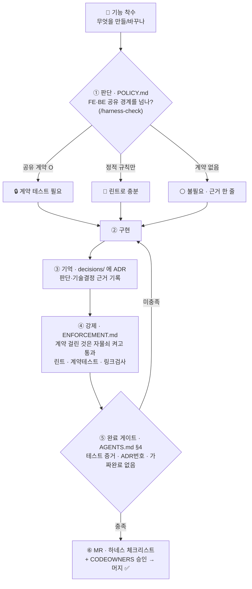

# 팀 AI 하네스 — 시작 가이드 (진입점)

> **이 문서 하나로** 하네스가 뭔지, 어디에 뭐가 있는지, 내 AI 도구를 어떻게 연결하는지 파악할 수 있습니다.

## 1분 개요 — 하네스가 뭐고 왜 있나

팀원마다 다른 AI 도구(Claude Code / Cursor / Codex / Gemini)를 써도 **같은 규칙·같은 계약·같은 완료 기준**으로 코드가 수렴하도록, 프로젝트 규칙을 레포에 커밋해 둔 것이 "하네스"입니다. 4개 레이어로 구성됩니다.

| 레이어 | 역할 | 어디에 |
|---|---|---|
| **말(지시)** | 프로젝트 규칙·컨벤션 | [AGENTS.md](../../AGENTS.md)(정본), [backend/](../../backend/AGENTS.md)·[frontend/](../../frontend/AGENTS.md) |
| **계약** | FE/BE 공유 불변식(필드명·상태코드) | [CONTRACT.md](../CONTRACT.md) |
| **판단** | 언제 테스트/린트를 채우나 | [POLICY.md](POLICY.md) |
| **기억(근거)** | 기술 결정·판단의 이유 | [decisions/](../decisions/) (ADR) |
| **강제(자물쇠)** | 규칙을 기계가 검증 | [ENFORCEMENT.md](ENFORCEMENT.md) (git 훅·린트·테스트) |

핵심 원칙: **강제는 특정 AI 도구가 아니라 git 훅·스크립트·MR에 둔다.** 그래야 누가 무슨 도구로 짰든 안전망이 유지됩니다.

## 파일 지도 (무엇이 어디에)

| 알고 싶은 것 | 파일 |
|---|---|
| 프로젝트 규칙 전체 (정본) | [AGENTS.md](../../AGENTS.md) |
| FE/BE 필드명·상태코드 계약 | [CONTRACT.md](../CONTRACT.md) |
| 이 기능에 테스트가 필요한가? | [POLICY.md](POLICY.md) |
| 왜 이렇게 결정했나? | [decisions/](../decisions/) |
| 린트/훅/테스트 켜는 법 | [ENFORCEMENT.md](ENFORCEMENT.md) |
| 스택별 규칙(빌드/실행) | [backend/AGENTS.md](../../backend/AGENTS.md) · [frontend/AGENTS.md](../../frontend/AGENTS.md) |
| 기능 계약 / 구현 로드맵 | [CONTRACT.md](../CONTRACT.md) · [CP-ROADMAP.md](../CP-ROADMAP.md) |

## 작업 흐름 (프로세스)

기능 하나를 착수해서 머지까지 가는 과정입니다. **①판단 → ②구현 → ③기억 → ④강제 → ⑤완료게이트 → ⑥MR**. (아래 다이어그램은 GitLab에서 그림으로 렌더링됩니다.)



<details>
<summary>텍스트 버전 (렌더링 안 되는 뷰어용)</summary>

```
        🚀 기능 착수
             │
             ▼
   ┌──────────────────────────────┐
   │ ① 판단  POLICY.md            │   ← /harness-check (Claude·Cursor·Gemini)
   │   FE·BE 공유 경계를 넘나?     │
   └───┬──────────┬──────────┬────┘
   공유계약O    정적규칙만    계약없음
       │          │          │
       ▼          ▼          ▼
  [계약테스트]  [린트로충분] [불필요·근거]
       └──────────┼──────────┘
                  ▼
            ② 구현
                  ▼
   ③ 기억  decisions/ 에 ADR (근거 기록)
                  ▼
   ④ 강제  ENFORCEMENT (린트·계약테스트·링크검사)
                  ▼
   ⑤ 완료 게이트  AGENTS.md §4 ──미충족──▶ ② 구현으로
                  │ 충족
                  ▼
   ⑥ MR  체크리스트 + CODEOWNERS 승인 → 머지 ✅
```
</details>

> 각 단계의 정본: ① [POLICY.md](POLICY.md) · ③ [decisions/](../decisions/) · ④ [ENFORCEMENT.md](ENFORCEMENT.md) · ⑤ [AGENTS.md §4](../../AGENTS.md#4-완료-게이트-기능-완료-선언-전-필수) · ⑥ [MR 템플릿](../../.gitlab/merge_request_templates/merge_request_template.md)

## 내 도구 연결하기

**정본은 [AGENTS.md](../../AGENTS.md) 하나**입니다. 각 도구는 자기가 읽는 파일에서 AGENTS.md를 가리키게만 하면 됩니다(내용 복제 금지 → 표류 방지).

각 도구의 어댑터가 **이미 설치돼 있습니다.** 자기 도구를 쓰면 바로 적용됩니다. 어댑터는 얇은 포인터/명령이고 알맹이(규칙·판단)는 공통 문서에 있습니다.

| 도구 | 자동으로 읽는 파일 | 포인터(규칙) | 명령 어댑터 |
|---|---|---|---|
| **Claude Code** | `CLAUDE.md`(+하위 폴더), `AGENTS.md` | [CLAUDE.md](../../CLAUDE.md) | `/harness-check`·`/run`·`/review`, `harness-judge` |
| **Codex CLI** | `AGENTS.md`(루트+하위) 네이티브 | (정본 그대로) | 문서 기반(별도 명령 없음) |
| **Cursor** | `.cursor/rules/*.mdc`, `.cursor/commands/` | `.cursor/rules/harness.mdc` | `/harness-check` |
| **Gemini CLI** | `GEMINI.md`, `.gemini/commands/` | `GEMINI.md` | `/harness-check` |
| **기타(Windsurf 등)** | 각자 rules 파일 | 동일 패턴으로 추가 | — |

> `backend/`·`frontend/` 하위 `AGENTS.md`는 Claude Code·Codex가 작업 폴더 기준으로 자동 로드합니다.
> ⚠️ **어댑터에 규칙을 복제하지 마세요.** 판단 로직이 바뀌면 어댑터가 아니라 [POLICY.md](POLICY.md)를 고칩니다. 주의사항 전체: [ENFORCEMENT §F](ENFORCEMENT.md#f-도구별-어댑터-설치-완료--추가-작업-없음).

## 완료 게이트 (요약)

기능 "완료" 전 반드시: ① 계약 테스트 통과 증거(또는 불필요 근거) ② 결정 ADR 번호 ③ 가짜 완료(TODO/skip/@Disabled) 없음. 정본: [AGENTS.md §4](../../AGENTS.md#4-완료-게이트-기능-완료-선언-전-필수).
